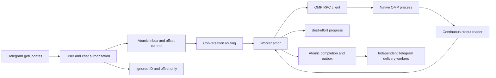

# Architecture and development

English | [中文](architecture.zh.md) | [User guide](../README.md)

This is a reference for the current implementation: ownership, state transitions, persistence, failure handling, and recovery. Installation, configuration examples, and command usage belong in the [README](../README.md). Source links identify the implementation boundary; test links identify regression coverage, not evidence of live Telegram validation.

**Contents**

- [Ownership and system boundaries](#ownership-and-system-boundaries)
- [Components and data flow](#components-and-data-flow)
- [Bootstrap, configuration, and process policy](#bootstrap-configuration-and-process-policy)
- [Execution workers and RPC](#execution-workers-and-rpc)
- [Native commands and Telegram menus](#native-commands-and-telegram-menus)
- [Progress, status and final replies](#progress-status-and-final-replies)
- [Interruption and conservative recovery](#interruption-and-conservative-recovery)
- [Managed autoresearch](#managed-autoresearch)
- [Session lifecycle](#session-lifecycle)
- [Session discovery and management](#session-discovery-and-management)
- [Runtime settings and diagnostics](#runtime-settings-and-diagnostics)
- [Persistence and recovery](#persistence-and-recovery)
- [Telegram delivery and progress cleanup](#telegram-delivery-and-progress-cleanup)
- [Attachments and host-tool file boundaries](#attachments-and-host-tool-file-boundaries)
- [Logging contract](#logging-contract)
- [Development, verification, and release](#development-verification-and-release)

## Ownership and system boundaries

The daemon bridges Telegram conversations to native OMP sessions. It owns authorization, routing, process lifecycle, RPC transport, task bookkeeping, and Telegram delivery. OMP owns model execution, tools, credentials, configuration, and native session history. The bridge neither emulates a terminal nor maintains a second model transcript.

One database belongs to one bot. Each supported conversation has one worker and one session binding: ordinary private chats use thread ID `0`; private-chat topics and group topics use their Telegram thread IDs. A group topic shares its session among authorized users. Group messages outside a topic are not routed to an inferred session. Independent sessions do not isolate filesystems or credentials.

Core invariants:

- Authorize both the user and chat for every input and callback, before retaining content or downloading attachments.
- Keep RPC stdout consumption independent of Telegram HTTP delivery. Acceptance is not completion.
- Fence asynchronous work by its original worker, client, generation, request, and task/session scope. A stale result cannot mutate a replacement runtime.
- Persist native session-file identities, not PIDs. Do not automatically replay work whose execution status is uncertain.
- Commit task settlement and final output atomically. A later `/new` or `/close` does not cancel already committed replies.
- Start native programs with argument arrays, without a shell. Model selection changes only through configured arguments, requested commands, or the documented saved-model default fallback; tools, configuration files and approval policy are not implicitly changed.

## Components and data flow

| Implementation | Responsibility |
| --- | --- |
| [`cmd/omp-telegram`](../cmd/omp-telegram/main.go) | CLI, signal handling, process-wide data-directory lock |
| [`internal/config`](../internal/config/config.go), [`config.go`](../config.go) | Strict TOML loading, executable-relative paths, embedded [`config.toml`](../config.toml), argv/environment policy |
| [`bridge.go`](../internal/bridge/bridge.go), [`steer.go`](../internal/bridge/steer.go), [`recovery.go`](../internal/bridge/recovery.go) | Routing, worker actors, task ownership, queueing, completion, startup/shutdown recovery |
| [`native_commands.go`](../internal/bridge/native_commands.go), [`command_menu.go`](../internal/bridge/command_menu.go) | Command-source validation, native submission, Telegram discovery menus |
| [`autoresearch.go`](../internal/bridge/autoresearch.go), `research_*.go` | Native research admission, controls, round settlement, disable recovery |
| [`session.go`](../internal/bridge/session.go), [`resume_picker.go`](../internal/bridge/resume_picker.go), [`binding_list.go`](../internal/bridge/binding_list.go), [`session_delete.go`](../internal/bridge/session_delete.go), [`export.go`](../internal/bridge/export.go) | Session transitions, listings, reservations, favorites, deletion, export |
| [`args.go`](../internal/bridge/args.go), [`model_picker.go`](../internal/bridge/model_picker.go), [`doctor.go`](../internal/bridge/doctor.go) | Startup presets, runtime settings, session-preserving diagnostics |
| [`progress_status.go`](../internal/bridge/progress_status.go), [`reply_status.go`](../internal/bridge/reply_status.go), [`reply_metrics.go`](../internal/bridge/reply_metrics.go), [`watchdog.go`](../internal/bridge/watchdog.go) | Best-effort live state, bounded final headers, conservative missing-completion recovery |
| [`internal/i18n`](../internal/i18n/i18n.go), [`language.go`](../internal/bridge/language.go) | English/Chinese Bridge templates and global language selection |
| [`internal/omp`](../internal/omp/client.go) | RPC v2 framing and correlation, process supervision, native metadata, ACP session listing, export/render/delete delegation |
| [`internal/store`](../internal/store/store.go) | SQLite schema, inbox/outbox, bindings, startup intents, atomic transitions and retention |
| [`internal/telegram`](../internal/telegram/client.go) | Bot API, Markdown-to-HTML rendering, reply fallback, transport/delivery classification |
| [`internal/media`](../internal/media/media.go), [`bridge/media.go`](../internal/bridge/media.go) | Authorized downloads, workspace-confined file access, snapshots and attachment lifecycle |
| [`internal/logging`](../internal/logging/logging.go) | Fixed component loggers, synchronized text/JSON output |



Polling persists updates before worker routing. Unauthorized or senderless updates keep only their ID and ignored state while advancing the offset; they cannot start OMP or download files. Authorized typed updates retain the content needed by routing. Routing rechecks authorization for inputs and callbacks. Replies, progress, and exports are visible to anyone with access to the destination conversation, not just the submitting user.

Polling failures use cancellable exponential backoff from one to 30 seconds. A positive Telegram `retry_after` can extend the actual delay beyond that ceiling; a successful poll resets backoff. Durable offset reads or update writes fail the daemon rather than acknowledging uncommitted inputs.

### Identity and stale work

| Identity | Representation and scope |
| --- | --- |
| Bot | Numeric `getMe` ID, checked against database ownership; not token or username |
| Conversation | `(bot, chat, thread)`; the daemon's worker map can use `(chat, thread)` because the bot is fixed |
| Binding | Workspace, native session-file path and validated session ID, persisted generation, running/interrupted state |
| Runtime | Current `omp.Client` and process-local monotonic client ID; never a durable PID |
| Root task | Inbox ID, worker generation, turn, and owning prompt request |
| Asynchronous operation or picker | Captured request/token plus the relevant client, generation, session, catalog/preset revision, and message/owner scope |
| Telegram input/output | Bot-database update ID / bridge outbox ID, distinct from Telegram message IDs |

The exact fence depends on the operation; no single generation check replaces all task, session, and menu checks. Session claims and export/delete reservations are synchronized under `sessionMu` and apply only within this daemon. They do not lock a workspace or prevent another program from opening native history. Recovery cannot infer Telegram chat type from a binding: zero-thread restoration requires a positive private-chat ID and the current chat allowlist.

`daemon.lock` prevents two daemons from opening the same data directory. Database bot ownership prevents another bot from reusing it. Neither prevents another poller from using the same bot token with a different directory or webhook; deployment must enforce a single consumer.

## Bootstrap, configuration, and process policy

### Startup and shutdown boundaries

[`main.go`](../cmd/omp-telegram/main.go) handles `--version`/`-v` before configuration. `--check` loads and validates configuration, resolves the OMP executable, and creates configured data/workspace directories; it does not open SQLite, start OMP, or contact Telegram.

Normal startup performs:

1. Configuration loading and logger creation, then restrictive umask and exclusive `daemon.lock` acquisition.
2. SQLite initialization/migration and runtime-state reconciliation.
3. Telegram `getMe`, database bot-ownership check, and persisted argument-preset and global interface-language initialization.
4. Best-effort default command registration for the default and `zh` language scopes.
5. Progress-cleanup reconciliation, restoration of eligible session claims/workers, and retention cleanup.
6. Polling, actor routing, four delivery workers, command-menu updates, progress cleanup, and the optional daily retention janitor.

Command-menu registration failure does not prevent polling. Durable-state failures are not hidden by best-effort UI paths. SIGINT/SIGTERM cancel the shared context; workers settle/cancel outstanding work conservatively, close owned processes, and complete background work before the store closes. Session-specific shutdown and unfinished-start recovery are described with the session lifecycle below.

The fatal boundary treats only errors matching an already-ended daemon context as normal shutdown. Cancellation while the daemon remains live and other submitted errors still propagate. An in-flight assistant append cancelled by shutdown retains its uncommitted text for conservative teardown settlement, not replay.

### Configuration and path contracts

[`config.Load`](../internal/config/config.go) resolves symlinks on the bridge executable and uses its real directory for defaults. The implicit `config.toml` lives there; only an absent implicit file falls back to the embedded root configuration. An explicit missing file, unreadable file, invalid TOML or invalid known setting is an error. Unknown keys/tables are ignored; the typed decoder's missing-field diagnostics become line/column-only startup ERROR logs, including during `--check`. Known-field type/value validation still applies even when unknown items are present. Explicit relative `--config`/`-c` paths remain caller-relative.

| Path or setting | Resolution |
| --- | --- |
| Relative `storage.data_dir` and `storage.workspace_root` | Real bridge executable directory, even when the config file lives elsewhere |
| Empty optional workspace root | `workspace/` beside the executable |
| Default OMP binary | `omp` resolved through the daemon's `PATH`, then made absolute |
| Lock, database, attachment spools | Under `storage.data_dir` |
| Native OMP configuration, credentials and session storage | OMP defaults or explicitly configured native arguments; not relocated by the bridge |

The supported tables are `[telegram]`, `[telegram.status_bar]`, `[omp]`, `[omp.environment]`, `[sub2api]`, `[storage]`, `[worker]`, `[logging]`, and `[logging.component_levels]`. Unknown and misplaced fields are ignored without automatic migration or environment expansion. Unknown component names are treated like other unknown keys; malformed values for the six known logging components are still rejected. Both allowlists must be nonempty; user IDs must be positive and chat IDs nonzero. `max_workers` is bounded to `1..64`, `queue_capacity` to `1..1024`, and retention days must be nonnegative. A positive Go duration enables idle release; empty, `0`, or `disabled` disables it.

String references expand once after TOML parsing: `$VAR`, `${VAR}`, and `$$` for a literal dollar. Inserted environment contents are not expanded again and cannot inject TOML. Numeric and allowlist fields accept their documented environment-reference strings. The default `OMP_TELEGRAM_ARGS` and workspace-root references may be unset; invalid/unset progress mode falls back to `summary`. Other required references fail when unset. Environment-policy mode/names, display-only `omp.args_labels`, `telegram.status_bar` fields and `telegram.final_actions` labels/commands remain literal. `.env` files are not loaded.

`omp.args` accepts an ordered array of preset strings or a scalar normalized to one preset. Each string is tokenized with quoting support, not executed by a shell; all presets are validated before startup. Bridge-owned mode/cwd/session options, their protected short forms, `--`, and NUL bytes are rejected. Only the normalized preset fingerprint and chosen index are persisted, not raw arguments. Selection semantics and per-runtime snapshots are described under runtime settings.

`[sub2api]` is disabled only when `base_url`, `api_key` and `providers` are all empty. These strings, including each provider element, use the same one-pass environment expansion. Partial configuration, unsafe HTTP(S) base URLs (credentials, query, fragment, invalid port or dot-path segments), invalid/duplicate provider IDs and an enabled source without explicit `sub2api.extension = true` fail validation without echoing input or environment-reference names. Providers match exact, case-sensitive OMP IDs, not model selectors or URL aliases. The observer may also be explicitly enabled without configuring a quota source.

The root [`config.go`](../config.go) embeds `Sub2apiExtension`. Explicit observer opt-in reuses the migration Extension's private, content-addressed, atomic preparation under `<storage.data_dir>/.bridge-extensions/`, rejects cache symlinks and appends only an absolute `-e` path to every OMP argv preset. Neither startup nor `--check` changes global OMP configuration. Sub2api model/provider URLs, context settings and credentials remain OMP-owned; the admin key is used only by the bridge HTTP client and is never added to OMP argv or injected into child environments. Existing environment policy is unchanged: environment-backed admin keys should be denied explicitly or omitted from an allowlist.

### Child environment and containment limits

[`omp.Environment`](../internal/omp/env.go) filters parent variables for native RPC, ACP, model-query, render/export, deletion, and diagnostic child processes. `denylist` mode inherits everything except explicitly denied names. The bundled configuration denies `OMP_TELEGRAM_BOT_TOKEN`; the loader adds no implicit secret-name filtering. A custom token variable is inherited unless explicitly denied. `allowlist` mode requires an explicit `allow` list, possibly empty, and passes only listed names that exist. Each mode rejects the other list even if empty. Bridge-side TOML expansion is independent of this child policy.

Passing provider credentials is intentional when configured. This is not a sandbox: withholding `HOME` or a token variable does not prevent same-user filesystem/process access, tool access to other copies of credentials, or outbound networking. Use trusted OMP code and deployment-level isolation where required. The bridge does not enable automatic tool approval.

On Linux, native RPC, ACP, model-query, render/export and deletion paths using [`startProcess`](../internal/omp/process_linux.go) receive a dedicated process group and parent-death SIGTERM. The creating OS thread stays locked until `Wait` returns because Linux associates that signal with the creating thread. Their normal shutdown can escalate to killing the owned process group; parent death itself supplies no later SIGKILL escalation. The `/doctor` version probe instead uses direct `exec.CommandContext` and has neither of these process-group/parent-death guarantees. Ignored signals, surviving descendants, escaped groups, and programs clearing parent-death settings require external containment. RPC/ACP stderr is discarded; render path resolution inspects bounded native diagnostics internally. Raw diagnostics are not forwarded to logs or Telegram.

## Execution workers and RPC

### Actor ownership and input lanes

[`worker`](../internal/bridge/bridge.go) owns one conversation's logical binding, active root, deferred FIFO queue, control state, progress and callbacks. Connected processes are a separate resource: runtime state is `released`, `starting`, or `connected`. `worker.max_workers` limits connected OMP processes, not logical sessions. Idle release can return a process slot without discarding the validated binding or native session claim.

| Lane | Admission and ownership |
| --- | --- |
| Root | Ordinary text with no active root starts an independent submission. Its inbox owns the final reply and Telegram reply target. |
| Steer | Ordinary text during an active agent root uses native `prompt` with `streamingBehavior:"steer"`. It has a submitted inbox and correlated request, but no independent final reply or progress message. |
| Deferred root | `/followup`, attachments, bridge `/review`, and recognized native commands retain FIFO positions and become independent submissions. Attachment preparation is asynchronous; an unprepared head cannot be overtaken. |
| Control | Bridge controls and callbacks do not enter the prompt FIFO. Slow mutation/control RPCs run through one asynchronous operation lane; actor event handling remains separate. Startup and some bounded Telegram/RPC calls can still occupy the actor. |

`worker.queue_capacity` bounds queued roots plus unresolved steers. Queue inspection reads this worker's runtime queue/active/busy state; pending cancellation settles selected inboxes and releases prepared resources. Shutdown cancels waiting inputs. Neither queued inputs nor uncertain submissions are automatically replayed after restart.

A native-command owner remains native while acceptance omits `agentInvoked`; new ordinary text stays queued. Only `agentInvoked:true` or `agent_start` proves agent execution and enables ordinary root steering under the original reply owner. Ordinary text arriving while `controlAbort` is pending becomes a new queued root; slash invocations still require strict Bridge/native classification and unknown commands never become model prompts. Managed research has a special long-lived owner; its terminal/settlement policy is not the ordinary-root policy.

### Transport and completion boundaries

[`Client`](../internal/omp/client.go) owns an OMP process group, a continuous stdout reader, serialized stdin writes, pending request IDs and an asynchronous event forwarder. Startup validates `ready` transport limits and negotiates public RPC v2. `Call` registers correlation before writing and waits for the command acknowledgment, not agent completion. Response IDs and command names must match; uncorrelated/malformed responses fail closed, while late responses for abandoned IDs are discarded rather than reinterpreted as events. Text steering additionally requires request-correlated `prompt_result` and settlement support.

Processes stay in bridge-owned `--mode rpc-ui`. After `ready`, startup attempts `set_ask_dialog enabled:true` before ordinary v2 negotiation. Only a request-correlated `success:false` with the exact string error `Unknown command: set_ask_dialog` permits continuing in the same process with native `select`/`editor` instead of combined dialogs. Other rejections, malformed success, timeout, disconnect, uncorrelated or mismatched responses close the process; none proves an older version or permits switching to ordinary `rpc`. Public RPC v2 negotiation remains mandatory. The native dialog paths have been exercised with OMP 18.18.1.

Startup remains synchronous: the worker takes ownership of UI events only after `Start` completes negotiation. Dialogs that block `session_start` before this handoff are not supported; negotiation times out, startup fails, and no actionable Telegram dialog is shown. The bridge never automatically answers them. After connection, rootless UI is not rejected merely because no task is active.

Before this handoff, the reader observes unanswered `ask`/`confirm`/`select`/`input`/`editor` requests without consuming or answering events. A startup-only tracker retains at most 128 SHA-256 ID keys and allowlisted method names; `cancel.targetId` removes only its matching request. Failure freezes evidence before sampling the terminal error and shutting down the process; a protocol/transport error published during freezing takes precedence over the deadline, while cancellation from parent-deadline teardown preserves the original timeout. Successful startup discards the tracker. Only a timeout with pending evidence receives `startup_timeout_pending_confirm` (confirmation takes precedence) or `startup_timeout_pending_ui`; rejection, protocol failure, disconnect and normal cancellation do not borrow this diagnosis. Pending UI is evidence, not proof of the timeout's sole cause.

`rpc_startup_failed` logs `client_id`, `stage` (`ready`, `set_ask_dialog`, `negotiate_protocol`), safe `reason`, `pending_ui_count` and allowlisted `pending_ui_methods`. Bridge `runtime_start_failed` adds conversation/generation correlation and selects localized recovery guidance from the error kind. Neither diagnostic includes raw UI IDs, titles, questions, options, defaults, entered values or RPC frames; normal context cancellation does not emit these failure records. Startup deadlines, protocol fallback rules and startup-intent recovery remain unchanged.

Startup failure resolution receives the lifecycle parent separately from the startup request context. After sampling the terminal error it checks the parent directly, so parent-deadline teardown cannot overwrite an already determined handshake rejection, protocol failure or timeout, even before the deadline reaches the child. Genuine parent cancellation is normalized to `context.Canceled` without failure diagnostics. Pre-ready saved-model recognition still uses the startup request context; timeout/UI-evidence and protocol/transport precedence are unchanged.

Except for normal cancellation, every stage returns and logs the resolved failure classification. Only a pre-ready `process_exit` may be recognized as `model_restore` from fully reaped stderr, retaining the existing startup-context and protocol guards; other ready failures do not reload the original client error.

Ask admission and response completion check the reader-authoritative catalog session ID as well as its epoch, so an old queued event cannot adopt a replacement native session.

The root inbox is durably `submitted` before the request is sent. Steers first validate frame size, reserve an ID, persist submission, and register `(request, root, client, generation, turn, admission)` before sending. Asynchronous operation results carry client/generation/root/turn fences. Runtime release drops waiting old-client operations but does not free an already-running RPC lane until its result returns. If the process exits during that call, exit policy waits for its result; an old exit fence cannot block a replacement runtime.

| Evidence | Ordinary-root outcome |
| --- | --- |
| Successful prompt acknowledgment | Accepted only; continue waiting unless explicit local completion applies. |
| `agent_end` with `isTerminal:false` | Await continuation; do not dispatch another root. |
| `agent_end` not explicitly `isTerminal:false`, with confirmed assistant text | `done`, subject to steer settlement and assistant error/cancellation metadata below. |
| Assistant `stopReason:"aborted"` | `cancelled`; retain available partial text. |
| Assistant error stop reason, nonempty `errorMessage`/`errorClassificationMessage`, or nonzero `errorStatus` | `uncertain`; retain available partial text and a safe notice. |
| Terminal event without confirmed text | `uncertain`, except confirmed local native-command completion. |

Terminal metadata takes precedence over cached `message_end` metadata for the current agent run. Completed bodies already belong to durable outbox and are never replaced by terminal snapshots. RPC v2 may omit an unchanged leading prefix, so the worker tracks all-role positions and the original `messageCount`, retaining only current uncommitted text and the latest terminal metadata. A continuation `agent_start` opens a new run without discarding earlier queued output or task-wide resource counters. Task settlement and teardown clear transient delivery state. A late/unsolicited `agent_start` without an active bridge owner cannot restart typing or wedge the queue. Managed research retains its separate per-round delivery lifecycle.

[`steerFence`](../internal/bridge/steer.go) requires a terminal root event, terminal results for every steer, and current-session settlement before finalization. Steer statuses map `completed` to `done`, `aborted` to `cancelled`, and `error` to `failed`; unknown status is uncertain. Explicit rejection fails that steer without claiming its instruction was applied; unconfirmed transport outcomes retire the runtime. A local-only `agentInvoked:false` acknowledgment can finish that steer but still requires quiescence evidence for its root.

Any later correlated `sessionSettled:false` invalidates earlier true evidence regardless of admission order. Only the latest admission's true result can establish settlement directly. Unkeyed `session_settled` requests a bounded `get_state.isSettled` probe, never releases the fence itself. Probe results are fenced by client/generation/root/turn/revision and yield to queued events or buffered RPC output. A new `agent_start` discards a deferred old terminal.

### Resource and privacy boundaries

| Resource | Bound and failure behavior |
| --- | --- |
| Physical RPC frame | At most 1 MiB, reduced to the negotiated limit. Oversized outgoing requests are rejected before writing. |
| Reassembled logical frame | At most 64 MiB, with validated chunk framing/order/length. |
| Buffered RPC resources | Shared 64 MiB credits for physical/reassembly capacity and queued event bytes; event credit returns when the worker receives it. Queue-slot or byte overflow fails the client. |
| Pre-terminal assistant text | 4 MiB logical finalized-plus-pending output and a separate 4 MiB retained stream cap. Finalized messages replace their streamed contribution to logical accounting. Overflow before completion is uncertain, not successful display truncation. |
| Confirmed final display | At most 1 MiB and 32 Telegram messages, including header/notices; explicit truncation does not turn a confirmed task into failure. |

Logical-frame capacity and buffered-resource policy are independent: a valid near-limit frame can still exhaust credits while a physical chunk or queued events remain retained. The RPC reader never performs Telegram delivery.

[`reply_context.go`](../internal/bridge/reply_context.go) adds only Telegram's supplied immediate reply context to ordinary prompts, steers, followups and current attachment prompts. An explicit selected quote wins over full replied text. Otherwise it uses text, photo/document labels, a document filename and caption, or an unsupported-message marker. It does not fetch older messages, recurse through replies, download replied-to media, or reveal sender names/IDs; the sender label is only `bot` or `user`.

The quoted envelope is capped at 3000 UTF-16 units, including delimiters and `...[truncated]`; the current user message is not truncated by this helper. Reserved delimiter strings inside quoted content are escaped. This is quoted input, not trusted instructions or an authorization boundary. Bridge controls and generic recognized native commands receive no reply-context wrapper. Bridge `/review` keeps its slash command first and appends the context. Queue previews use current-message text rather than the quoted envelope. Telegram payload persistence and eventual model input still contain the supplied quoted text; this is minimization, not secret redaction.

## Native commands and Telegram menus

### Native command recognition and submission

[`catalog.go`](../internal/omp/catalog.go) publishes immutable per-client catalogs with distinct `CatalogUnknown`, `CatalogReady` (including empty), and `CatalogUnsupported` states. Discovery is asynchronous and single-flight. Only the explicit native unknown-command response proves discovery unsupported; rejection, timeout, malformed catalogs and transport failure are not interchangeable fallback states.

Bridge commands and hidden `/start` take precedence. A valid `@bot` suffix is recognized only for a single-segment command with 1-32 ASCII letters/digits/underscores and a 5-32-character username-shaped target; foreign-bot commands are ignored. Paths such as `/opt/user@host/file` remain ordinary text. Invocation parsing follows OMP whitespace, including BOM but excluding NEL, and `:`. Native lookup first tries the whole name before the first literal space, preserving names such as `plugin:command`; only advertised builtins enable the additional separator syntax. Refused advertised sources also match those separators so they cannot fall back to model input.

| Catalog/source | Routing contract |
| --- | --- |
| Unknown | Slash input waits for classification in FIFO. Ordinary non-slash roots need not wait for discovery when their other admission evidence is available. |
| Ready, executable | `builtin`, `skill`, `custom`, `mcp_prompt`, and `file` commands/aliases enter the native deferred queue without steering or reply-context wrapping. |
| Ready, unrecognized slash input | Preserve text and ordinary prompt/steer routing, including absolute paths. |
| Unsupported discovery | Cancel non-bridge slash-headed input, including followup/attachment/steer paths; ordinary non-slash input and bridge controls remain usable. Explicit bridge `/review` provenance retains its exception. |
| Extension or unknown source | Recognize and refuse generically, without echoing catalog names, arguments or raw source. Only exact canonical extension `autoresearch` has a specialized owner; its aliases and other extensions do not inherit that permission. |

Names and aliases are opaque, unnormalized strings. Empty names, leading `/`, and invalid name/alias types invalidate the catalog; unusual whitespace/control/Unicode names alone do not. Missing/null/non-string/unknown sources stay recognizable but non-executable. Catalog validity does not imply that the current invocation parser can call every retained name.

The stdout reader publishes unsolicited catalog updates before later response waiters. Queries record their actual epoch and reader-update revision; a changed session or newer update wins over an older query response. Identical discovery preserves snapshot/revision, while even identical unsolicited updates advance revision. Worker catalog events are wakeups, not snapshots to reapply. Lazy restoration refreshes discovery.

A discovery waiter timeout/cancellation/rejection preserves a reader-published usable catalog. If discovery remains unknown, the worker pauses discovery for that client/epoch and leaves slash inputs pending; `/queue` cancellation of the waiting item can release later FIFO work. Scope changes or reader updates restore classification. Actual transport/protocol/process failure retains normal runtime-failure policy.

[`native_commands.go`](../internal/bridge/native_commands.go) revalidates the queue head immediately before submission, including after asynchronous admission work. It checks current source/name and native session identity; a removed command or changed native session cancels the entry, never downgrades it to model text. Same-session revision changes do not cancel a still-valid command; a replacement client restoring the same session is allowed. Raw slash-headed followups and prepared attachments cannot bypass source/lifecycle checks.

Lifecycle-mutating `/move`, `/wt`, `/worktree`, and `/session delete` are refused both at routing and dispatch, even without discovery. Session refusal matches only case-insensitive `delete` with no further arguments. `/session info` and `/session pin` keep native routing. Bridge session lifecycle APIs own the saved binding; arbitrary extension lifecycle mutations are not reconciled. Snapshot validation is not atomic upstream check-and-execute, and untagged old-session unsolicited updates cannot be reliably identified by bridge fences.

An explicit native local acknowledgment `agentInvoked:false`, or request-correlated local `prompt_result(status:"completed", agentInvoked:false)`, completes the submission without requiring assistant text. This does not prove background operations finished. Local `error` is uncertain, `aborted` cancelled, and missing/unknown status uncertain; generic notices commit with those states without exposing raw RPC errors, retiring a healthy runtime, or replaying the command. Recognition alone does not implement native `/plan` or `/plan-review` RPC support.

After the RPC client consumes private metadata and `/usage` query replies, `command_output.text` from the connected runtime is delivered through the outbox as a standalone conversation notice with no inbox association. The event has no request ID: it does not change a task's preview or completion, and delayed output cannot become the next root's final reply. Blank output is ignored; each event uses the existing final-reply byte, message-count, and UTF-16 display budgets with truncation. Only the text is displayed, not the RPC frame, and the payload is not logged.

### Command menu publication

[`command_menu.go`](../internal/bridge/command_menu.go) keeps the default bridge menu and publishes chat-scoped unions of bridge commands plus executable native names/aliases. Telegram has no topic command scope: topics in one chat share the union, while chats remain separate. Menu visibility never grants execution permission. Names must already match `[a-z0-9_]{1,32}`; bridge entries/descriptions take precedence, hidden `/start` and refused lifecycle names are excluded, and sorted/deduplicated native entries fill the remaining space up to 100. Omitted executable names remain manually callable.

Before worker restoration and polling, startup runs one bounded `omp --mode rpc-ui --no-session` discovery in `storage.workspace_root`, using the selected startup arguments and configured environment without overriding OMP settings. [`DiscoverCommands`](../internal/omp/catalog.go) drains and discards events, requests the official catalog, then closes and joins the process and event drainer before returning. Discovery has a 20-second deadline, sends no prompt, writes no native session history or bridge binding/start intent, and finishes before normal runtime slots are used. Only permitted builtin names and aliases seed the in-memory fallback; workspace-specific sources wait for real sessions. Failure logs a generic classification and leaves bridge-only menus and later per-worker discovery available.

Each chat uses the startup fallback until an active topic publishes an authoritative catalog. Real topic catalogs then replace the fallback, including empty or unsupported catalogs. An unknown catalog clears that topic's stale contribution without turning the fallback into an authoritative empty list. Removing or invalidating the last known contribution restores the fallback. The probe still performs normal OMP configuration and extension initialization; `--no-session` is not an isolation or no-side-effects guarantee.

Executable native commands and aliases use OMP-provided descriptions, normalized to a single line of at most 256 UTF-16 code units. Missing, null, non-string, or whitespace-only descriptions do not invalidate the catalog and use the generic menu label. Refused commands do not retain descriptions. Catalog equality includes normalized descriptions, so description-only changes advance the revision and refresh menus. When topics advertise the same name, prefer a nonempty description and choose the lexicographically smallest nonempty description to keep the chat union deterministic.

Session/catalog invalidation clears old contributions. Logical close/replacement/failure/shutdown removes only that worker's contribution; idle process release retains it. Pointer ownership and inactive tombstones prevent late updates/removals from retired workers. Startup publishes the discovered builtin fallback without first replacing chat menus with a bridge-only list, and preserves early authoritative catalogs.

One background publisher coalesces dirty chats and writes both default-language and `zh` scopes with 20-second deadlines outside actors/readers. It caches acknowledged lists per chat/language and skips unchanged successful scopes. Publication failures do not fail tasks. Uncertain publication invalidates the prior successful cache because Telegram may have applied the update; definite rejection retains it. Menu state is not persisted locally, and published native names and descriptions are visible to chat members even if they cannot operate the bot. Raw catalogs, descriptions and arguments do not enter menu diagnostics.

Network uncertainty, request timeouts, HTTP 5xx errors and rate limits requeue the failed chat through the existing dirty/pending/wake mechanism. Per-chat exponential backoff starts at one second and caps at one minute; a longer Telegram `retry_after` is respected. These intervals are not delivery deadlines. The publisher reuses one cancellable timer, rotates deferred chats behind ready work, and recomputes the latest language and catalog when eligible. Repeated updates coalesce without bypassing backoff. Only the first failed pass for a chat emits warnings until a full pass succeeds. Definite non-429 HTTP 4xx rejections do not schedule automatic retries, but later contributions/language updates can trigger a new attempt subject to the same backoff. Tests use `testing/synctest` to cover persisted-language recovery, partial scope success, latest-state selection, retry bounds, log suppression, cancellation, and permanent rejection.

### Interface language

[`internal/i18n`](../internal/i18n/i18n.go) localizes only Bridge-owned templates, with English as the default and Chinese selected by `/lang zh`. `/lang en` switches back, and `/lang` reports the current setting. The setting is global across all chats and topics, not inferred from Telegram user locale and not attached to an OMP session or binding. Any otherwise authorized caller may change it. The command remains available during tasks and unresolved migrations without submitting OMP work or clearing a migration lock.

[`language.go`](../internal/bridge/language.go) loads the singleton preference before workers and recovery notices start. A mutex orders database writes and atomic in-memory publication, so concurrent changes cannot leave persisted and live settings reversed. Workers read the shared atomic preference rather than retaining independent copies. Failed persistence leaves the active language unchanged. Session close, replacement, and binding removal do not reset it. Both default and `zh` Telegram menu scopes use the selected global language; changes dirty the global menu and all known/configured chat menus for the existing background publisher.

[`Message`](../internal/i18n/i18n.go) is a struct with private English/Chinese fields. The static [`Msg` catalog](../internal/i18n/messages.go) gives each bilingual object a stable semantic name. Small `Task`, `Session`, `Queue`, and `Language` groups hold related entries, for example `i18n.Msg.Task.SubmissionUncertain` and `i18n.Msg.Queue.Full`; other entries remain flat until needed. Names do not depend on English wording, and removed flat names have no aliases. English text is no longer a lookup key. `Text` and both Bridge `tr` helpers accept only `Message`, so raw strings, nonexistent catalog names, and missing constructor arguments fail compilation. Changing English wording requires editing the same entry as its Chinese text, not updating a separate lookup key. Typed Bridge errors and stable media/store sentinels select explicit messages; opaque errors are not classified by their English wording. Call sites select the language before formatting user/native values, rather than translating assembled output or intercepting generic delivery. Native OMP text and dialog content, model replies, tool arguments/results, paths, session titles, and user captions remain untranslated. Existing rendering limits and sanitization remain in force. Queued media keeps captions separate from Bridge fallback labels so newly rendered queues follow the latest language. Already rendered outbox text and delivered messages are not rewritten.

Telegram scope updates are separate requests, not an atomic multi-scope operation. An older in-flight publication may briefly remain visible before the queued language refresh converges. Regression tests block publication during a language change and verify every default/chat scope eventually reaches Chinese, then English after rapid switches. A task does not retain its startup language: newly generated Bridge receipts use the current global setting while previously rendered outbox text and OMP reply bodies remain unchanged.

`progress.NativeStatus` caches rendered Bridge status text. Switching languages does not eagerly rebuild it: the next accepted native-status result uses the global language at completion, including a switch while its RPC query was pending. Sampling normally runs every five seconds and still depends on a successful RPC response and identity fencing; this is not a five-second refresh guarantee. Existing progress messages are edited on the next normal update, without a new cache epoch or task-local language field. Native OMP extension text is outside this guarantee.

The message constructor rejects empty language text. Test-only reflection recursively traverses flat entries and nested groups in `Msg`, checking both languages and the ordered formatting directives, including argument count, verb, width, and precision; no separate runtime registry is maintained. A nested-message regression covers missing translations and mismatched format arguments. The checker understands sequential `%s`, `%d`, and `%f` directives and ignores escaped `%%`; unsupported syntax fails rather than being silently skipped. New formatting syntax must extend the checker before use. `formatDirectives` stays in `_test.go`. This guards the typed translation path, not arbitrary raw text deliberately sent outside it.

### Native dialogs and session operations

[`worker.ui`](../internal/bridge/bridge.go) maps native `confirm` to Confirm/Cancel buttons and `select` to a ten-option paged picker with cancellation. Empty selects are cancelled. [`ask.go`](../internal/bridge/ask.go) handles combined `ask` and non-secret `input`/`editor` text replies; widgets and generic native output are not terminal UI emulation. Tokens are owner/generation/client scoped and single-use; selections are also tied to their menu message. Unlike bridge-owned menus, native dialogs have no bridge expiry, including after pagination: OMP owns native deadlines and cancel signals. Pending dialogs block normal idle release.

An active Ask/text dialog also excludes stuck-task recovery before and after display confirmation, even when native reports idle with no active tool. Once the dialog ends, the existing watchdog policy resumes; deferred guidance alone is not a user wait.

Native cancellation invalidates matching tokens. Teardown removes obsolete tokens before bounded keyboard cleanup. A menu receipt records the user's choice, not operation success; failed confirmation/select writes retire the runtime conservatively.

Sequential native `select` dialogs reuse the preceding completed menu only within the same active root, turn, client, and generation, with no intervening model run/message or session transition. Prior choices remain visible within the menu text limit while a later selection is pending, paginated, cancelled or invalidated. If the reused Telegram message no longer exists, a fresh usable menu is sent; other edit failures do not resend an ambiguously delivered menu. Pending menus retain their creation scope, including zero root/turn values; completion cannot adopt a later root. Concurrent requests are cancelled without modifying the current menu or prior receipt. Cancellation, task settlement, and runtime teardown clear the reusable receipt cache, not the displayed prior choices; existing single-use tokens, message binding, and native-response handling remain unchanged.

Combined Ask retains one immutable client/generation/session/catalog-epoch/root/turn/request identity and one mutable question/interaction epoch. It edits one main message sequentially, pages options without changing their labels, and submits all answers in question order only after the final question. Single selections advance; multi selections toggle and require confirmation, including explicitly empty selections. Custom multi-choice text supplements selected options. Entering/leaving text entry or changing the question revokes previous tokens and prompt identities. Each text-entry attempt sends a separate selectively targeted ForceReply message with an opaque bot-authored `[ask:...]` marker. Both its returned message ID and current token/owner/conversation must match. One early reply may wait for the display result to establish the exact ID; cancellation settles that pending inbox without replay. Markers recognize stale/restarted prompts without persisting another conversation copy. Ordinary text and queued followups do not cancel Ask or enter its answer route.

[`steer.go`](../internal/bridge/steer.go) holds would-be steering input FIFO while an Ask/text dialog, its response write, or the native `ask` tool is active. Held inbox rows remain pending and share capacity with ordinary queued work and in-flight steers. Each entry retains the original root/client/generation/turn and bound native session/catalog epoch; it never becomes an independent followup. Dispatch revalidates identity, waits for both UI settlement and `tool_execution_end`, and requires an empty RPC lane and no buffered native output. `BufferedOutput` includes the reader's unframed `bufio` read-ahead as well as frame/event byte credit, so a published old tool end cannot hide already-prefetched next-dialog frames. Normal steer submission then owns acceptance and completion. Stop, runtime/session replacement and root completion cancel unsent guidance; final reply sampling cancels it before asynchronous metadata reads. No OMP interrupt policy is overridden, no uncertain input is replayed, and control commands retain their existing paths.

Initial steering admission and deferred dispatch share the same `steeringBlocked` gate. Already-buffered native Ask or terminal events cannot be bypassed merely because the actor selects Telegram input first. An unblocked first steer still submits directly without allocating a temporary deferred queue.

Read-ahead presence and frame/event byte credit share one atomic occupancy word. `BufferedOutput` reads it once: frame credit is reserved before the old prefetch flag is cleared, and new prefetch is published before its corresponding frame credit can be released. The flag is excluded from the allocation budget and byte diagnostics.

The private stdout reader publishes this flag immediately after a nonempty underlying `Read`, before `bufio` can wait for the rest of a physical line. An idle blocking read does not publish occupancy. Completed lines retain the flag until frame credit is reserved; EOF and fatal decode paths clear it without altering outstanding event credit.

Recognized Bridge commands, the native `/autoresearch off` control, and foreign-bot commands are classified before Ask's early-reply wait and stale-answer rejection. Research shutdown uses the existing exact `autoresearchArguments` parser; other native slash input is unchanged. After checking the bot-authored reply and conversation, their Ask quote is stripped and the existing command route applies normal authorization/lifecycle or foreign-command ignoring; neither becomes an answer. Question text in a dedicated prompt is clipped to 1000 UTF-16 units and encoded with the existing non-conflicting fenced literal encoder, independently of the owner mention and marker. This bounds Markdown rendering without table expansion or extra mentions and keeps selective ForceReply targeting intact.

The `ui` entry shares admission across native `ask`/`select`/`confirm`/`input`/`editor`: an active Ask/text request or pending native UI confirmation excludes new requests. A different concurrent ID is cancelled once through the existing response sender; the current menu is untouched. If only response-write completion is pending, one next UI event is retained in the existing `askRequest`, occupying the same single-request slot without displaying or cancelling it. Once writes settle, the actor revalidates its client/generation/session/catalog-epoch/root/turn and live runtime before `applyUI` displays it without readmission. Stop, native cancellation, task/runtime teardown and failed current-runtime writes revoke the deferred event; late results cannot reopen it. The same ID is ignored both while pending and after completion or rejection. Per-runtime request receipts are shared and bounded at 4096; exhaustion retires that runtime conservatively rather than reopening old requests. Native cancellation only clears local state. Stop immediately revokes input while preserving the existing ordinary/research/steer stop path. Root settlement, session replacement and runtime teardown invalidate the interaction. Ask/text presentation runs outside the actor with a ten-second deadline; stale completions only clean their old keyboard. Failed presentation cancels the request. Submission first consumes local state, then attempts one five-second `extension_ui_response` write independently of the RPC operation lane. No business ACK or retry exists; an uncertain write retires only its original current runtime/session. Idle release and new root dispatch wait for outstanding response writes. OMP alone applies timeout/default-answer semantics; enabling UI never changes approval policy.

Stop records a task-scoped UI admission fence even when no current `askRequest` exists and only the previous response-write result is pending. New UI IDs are cancelled while this fence is set, and deferred display checks it too. A new task or runtime replacement/teardown resets it. Successful Stop completion also clears it, including confirmed-idle Stop or confirmed autoresearch mode-off that retains the connected runtime; the fence remains set until Stop settles. After Stop has revoked a pending Ask, even an explicit native abort rejection retires that runtime and settles an active root as uncertain; it cannot leave an unanswerable dialog blocking the worker. Abort rejection without a pending Ask clears the fence and retains the existing reusable-runtime policy.

Current-session export rejects startup while the existing runtime-interaction busy predicate reports active/deferred dialogs or outstanding response writes. While export is active, shared UI admission records each new valid-scope request ID but rejects it before question validation, presentation or automatic cancellation, without sending any native response. Rejected IDs are not replayed after export. Stale display results retain cleanup-only fencing. Exports of other sessions do not fence the current UI.

Manual `/compact` requires an idle logical session, not an already-connected process, and starts without confirmation after restoring a released runtime. It attempts a button-free `Compacting...` message with a five-second timeout, then runs native `compact` in the operation lane with a 180-second deadline. A post-success `get_state` query has at most three seconds within that remaining deadline. Missing/invalid usage or failed sampling displays `n/a` without changing confirmed compaction into failure. A different nonempty native session ID additionally retires the runtime while preserving the original binding/claim. Completion replaces the status message; absent status or failed edit falls back to durable outbox.

`/handoff` requires idle session controls and an empty queue, passes optional `customInstructions` to native RPC, and holds subsequent queue dispatch until its result. Its operation deadline is 180 seconds. Explicit compact/handoff rejection retains a reusable runtime; errors, timeouts, cancellation and unconfirmed results release it for lazy resume. Neither operation creates a model root or borrows its progress/Stop keyboard. Session/model/argument selection and native export/path resolution are separate lifecycle interfaces; [`render.go`](../internal/omp/render.go) resolves native history paths through `omp render`, not Telegram final-answer formatting.

## Progress, status and final replies

### Completion shortcuts and follow-up input (#99 contract)

`telegram.final_actions` is an ordered literal list of at most six `{label, command}` entries; omitted or empty disables completion buttons. Labels are nonempty, single-line, at most 64 UTF-16 units. Commands are one slash invocation, with no controls, variable expansion or shell interpretation. Load-time validation does not invent a native command catalog: availability, source policy, binding and session are checked again at click time. Custom labels and commands are never logged.

Completion buttons belong only to successful root settlement and the last real assistant body part, not headers, truncation/error notices or native command output. Tail message IDs are tracked separately from the first-part header target, including when headers are disabled. Pending output carries its keyboard; already sent output receives a reply-markup-only edit. Markup failure or uncertainty never resends the body, and header/quota edits preserve its current markup. Existing outbox ordering, claims and uncertain-delivery policy remain authoritative. Each button has its own durable one-shot token. Admission first reserves it without removing markup (`consumed=0, consumed_by>0`); original command handlers retain eligibility checks, and a deterministic local refusal releases the reservation atomically with settling that callback inbox. Accepted queue input, target RPC submission or local execution consumes it before side effects. Execution confirmations carry the reservation until acceptance, cancellation or expiry; menus that successfully open are already executed commands. Duplicate update delivery cannot reopen a settled attempt. Old binding/generation/configuration actions reject. Startup conservatively consumes interrupted reservations, cancels their pending callback inboxes and never replays them. Reserved source bodies remain protected from retention until the reservation settles.

Header and markup edits for one delivered outbox row share an exclusive `actions_pending=2` claim through the remote call and acknowledgment. Button changes preserve an in-flight claim and remain pending if they differ from its snapshot. Other rows can still be edited concurrently. A cancelled, unattempted markup claim returns to pending; an attempted or uncertain edit never resends the body.

Progress displays `Stop | Follow-up` in one row, and `off` emits neither. Stop keeps its task-fenced token and action index `0`; Follow-up uses `followup` on that same token without consuming Stop. Clicking Follow-up only opens asynchronous, topic-scoped ForceReply input; it neither pauses nor submits the running task. A new request supersedes this user's previous request in the conversation. The request is persisted before sending, carries an opaque random marker, expires after ten minutes, and accepts only the intended user's reply to a positively delivered prompt ID. Send-uncertain prompts, wrong identities, stale/expired/cancelled/consumed requests and unfinished requests from another bridge instance are rejected, never ordinary prompts or attachments. Minimal durable metadata supports rejection after restart without duplicating prompt/model text.

Natural completion keeps issued input valid while the binding/session is stable; submission is not fenced to the old active turn. Stop/Close cancel requests, and new/resume binding changes make them stale. Empty/nontext input and a full existing worker queue do not consume the request or claim success. Acceptance atomically associates the request with the original inbox ID before appending to that queue; interrupted accepted input follows existing uncertain/cancelled inbox recovery rather than replaying as ordinary input. Only valid requests allow known Bridge slash replies to retain ordinary command handling, stripping only the bridge ForceReply context. Stale or missing-record prompts identified by this bot's valid marker reject even control commands. Other accepted text queues independently, without steering or quoting the ForceReply prompt. Shortcut callbacks likewise retain their original inbox ID and real clicking identity; strict bridge/native dispatch never turns an unknown slash command into prompt/steer input.

Stop/Close also cancel outstanding Follow-up requests when intercepted during migration preflight, even before a durable migration record exists.

Follow-up history shares `storage.database_retention_days` with message cleanup. Batches delete at most 1000 requests whose expiration precedes the retention cutoff and is no later than now, including expired unread pending/delivered prompts, but preserve correlations with pending/submitted inbox work. The expiry index is also installed for existing schema 24 databases. After deletion a valid marker from this bot still rejects late input; without either a retained prompt identity or a recognizable marker, a reply cannot be distinguished from an ordinary quote.

Marker fallback accepts only a complete terminal `[followup:token]` line after a nonempty body, with no extra prefix or suffix on that line. It does not search arbitrary body substrings or match translated prompt wording. Known prompt IDs still identify replies independently of this text fallback.

Telegram send options permit either an inline keyboard or selective ForceReply, never both. `EditKeyboard` uses `editMessageReplyMarkup`; existing reply fallback, authorization and not-modified handling continue to apply.

The ForceReply prompt explicitly mentions its target user with a `tg://user?id=...` link. Selective targeting must not depend on the original reply target: a favorite can start a task from a bot message, and reply fallback can remove that target.

### Best-effort progress

[`worker.renderProgress`](../internal/bridge/bridge.go) uses an editable, in-memory tool/status preview with the current assistant text's bounded tail. The 1.5-second worker tick evaluates creation after a three-second initial delay. `off` suppresses progress Send/Edit and typing, not completed assistant messages. `summary` shows state, active tools and the text preview; `verbose` adds bounded raw arguments, latest partial/final results and up to `telegram.progress_recent_tools` recent tool outcomes (default 5, range 1..100), with an omitted-earlier count. Rendering drops oldest rows when needed to preserve the newest visible suffix within the preview budget. Retry/compaction states are explicit. Only matching `tool_execution_end` completes a tool; host callbacks may correct its name/arguments but do not invent completion. Reasoning and whole frames are never appended to this bubble.

The assistant preview retains at most 2200 UTF-16 units of the current text tail without changing its formal body. At most six active tools are displayed, with 64-unit names, 100-unit payload fields and a 1600-unit aggregate detail budget within a 3500-unit total preview budget. The bounded JSON payload decoder scans the event but copies only limited prefixes. Verbose payloads are not redacted and can expose credentials or private files to everyone who can read the conversation; truncation is not a privacy filter.

A root's Stop button is fenced by owner, generation, active inbox and turn. Valid use consumes the token before requesting interruption; stale buttons cannot abort later work. Accepted Steer and durable body append rotate the preview epoch through `retirePreview`. Steer can retire an unprotected live preview immediately; a completed body records its first outbox ID and part count, and deletion waits for the entire replacement range to be successfully delivered. Each preview keeps its first retirement boundary, so later Steer or body append cannot overwrite delivery protection. A shared, synchronized retirement receipt carries that boundary into late initial Send acknowledgments, including shutdown handling. Rotation cancels obsolete Edits but lets initial Sends return their message identity for cleanup. New previews wait until the conversation has no pending/sending outbox rows, so they cannot overtake formal replies; this UI gate does not delay RPC consumption or task execution. A Steer preview replies to that user message without changing root ownership or restarting OMP. Initial Send failure suppresses further progress for that epoch to avoid duplicates; Edit failure remains retryable. Only the first formal text part quotes the original root request. Reply rejection can fall back to a plain message without changing execution state. Typing runs at most every five seconds with a four-second timeout and is cancelled on completion, turn change, runtime release and shutdown.

Completed assistant bodies are independent durable messages, never temporary Progress. Every preview identity is persisted in `progress_messages`, including late successful Sends from an older epoch. Terminal cleanup checks all associations even if every body was delivered before inbox completion and there is no new final row. Late Progress results are fenced by their original task/generation/turn/epoch; they cannot rebind the current preview, rewrite an assistant question, or make a replacement task own the old message.

Stop callback acknowledgments and keyboard cleanup run outside the actor in bounded, worker-cancelled UI lanes, each request with a five-second deadline. Owner, expiry, generation, active inbox and turn checks remain actor-owned, as does token consumption before interruption. Only UI targets and receipt text cross these lanes; late results cannot change task ownership or settle/replay work. Backpressure may drop UI operations, never the stop request. Other callback types retain their existing behavior.

### Native status projection

[`status.go`](../internal/bridge/status.go) decodes only display-safe fields, never raw model configuration. Detailed `/status` reports workspace, session/name, provider/model, configured thinking, fast setting/activity, native context usage, streaming/compaction, bridge queue count, native speed, runtime connectivity and idle age. Missing or invalid data is `n/a`, not a guessed value. Its `Running` flag is native streaming, not the bridge's active-root predicate. Inspecting a released running binding may temporarily restore and then release a durably idle runtime; new input, pending work/UI or buffered output prevents premature release.

[`progress_status.go`](../internal/bridge/progress_status.go) samples connected running roots independently of the mutation lane: one in-flight `get_state`, at most every five seconds after initial progress delay, with a three-second deadline. It runs only when an enabled Progress header or intermediate header selects native-backed fields. It never starts a process or changes idle-watchdog evidence. Results require matching request/client/generation/root/turn/catalog epoch and bound/native session. Current-scope completions immediately trigger preview refresh, subject to the delivery gate. Same-session title/metadata updates preserve pending and completed samples; real scope changes invalidate them. Failed reads clear stale display values without placeholders; they do not settle or replay the task. Sampling remains independent of pending formal delivery.

The sampler can serve intermediate headers while Progress is off or suppressed. Completed intermediate messages combine their confirmed output-inclusive usage with a same-scope/model/provider positive window, even if the sampled root is streaming or compacting. This does not assert idle state; final context still requires explicit idle evidence. Unread, unavailable and failed fields are always omitted, without delaying body delivery or adding a query. Final metadata may update the latest formal message's header, never its body.

When `status` is selected, formal assistant messages start with **💬** and confirmed root success changes only the latest first-part header to **✅**. A completed `message_end` is not terminal evidence for the root. Cancelled or uncertain tasks and ongoing research rounds never gain a success marker. Research rounds retain only the latest status outbox ID and bounded metrics across resets, not transcript copies. Headers have a reserved 512 UTF-16-unit budget whenever either intermediate or final fields are selected, including initially headerless messages, so a later header can fit without rewriting or resending the immutable body.

[`assistant_delivery.go`](../internal/bridge/assistant_delivery.go) immediately queues every completed assistant `message_end`, including model-stop bodies, through `AppendAssistantReplies` while the root remains submitted. The outbox stores the first-part header separately from immutable text and preserves bot-message order. Only the inbox's first durable text reply quotes the original request; subsequent messages and split parts use no reply target. Delivery never waits for final metadata. Only terminal-only text without `message_end` may remain staged for final sampling. Memory retains current uncommitted text, at most one staged body and positional/resource counters, not a duplicate completed transcript. `message_end` does not finish the root or dispatch the next prompt. No question detector or automatic approval is used.

Position deduplication distinguishes staged text from immutable queued history. An `agent_end` snapshot, including `isTerminal:false`, may correct only the uncommitted body; repeated positions can update terminal metadata but cannot rewrite committed text or count metrics again. Metadata-only snapshots retain uncommitted text. Nonterminal corrections remain subject to the task's remaining input budget before being queued. Only interactive `ask`, `confirm`, `select`, `input` and `editor` UI requests imply continuation. Passive UI metadata neither flushes staged text nor interrupts pending final-state sampling.

Native `agent_end` can repeat streamed messages or contain only a compacted suffix. Reconciliation tracks all-role positions, including user and tool-result messages, and uses the original `messageCount` when present; identical assistant bodies at different positions remain distinct. Missing final `message_end` and native continuation/interruption boundaries preserve their uncommitted text without resending earlier bodies. Existing per-root or per-research-round byte/message budgets apply across all body messages, reserving terminal status and a single explicit truncation notice. Ordinary input, steer, ownership, session fencing and uncertain-delivery/no-replay policies are unchanged.

[`markdown_inline.go`](../internal/telegram/markdown_inline.go) tokenizes source before HTML escaping, pairs delimiter runs within ordinary paragraphs across soft newlines, and keeps code and link destinations opaque to delimiter matching without source-forgeable placeholders. ASCII punctuation escapes retain raw source for preview reconstruction while decoding visible text; code bodies and URL destinations keep literal backslashes. Link candidates, including overlapping labels, are indexed in one linear scan with bounded suffix states for destinations and titles; consuming an escaped opener or a code span never restarts a suffix search. Delimiter searches cache lower bounds by marker and closer-rule class; unusable strikethrough remnants leave the matching stack. Missing delimiter neighbors are identified by source offsets, not a NUL rune sentinel, so original NUL glyphs do not masquerade as message edges. Code closes active emphasis/link entities and normal text resumes them as needed, including in headings. Inline-code padding permits safe delimiters around literal backticks. List blank lines remain block-level paragraph separators. Telegram entity-parse rejection retries original text when it fits; otherwise, the client strips only its generated HTML tags and decodes escapes to retry the same bounded visible text without truncation. These rendering changes do not establish the cause of every Telegram iOS presentation report.

Final splitting measures complete table headers and rows after conversion, including compact-table labels. Ordinary tables retain repeated headers; an oversized header or single row degrades the whole table to unescaped labelled text, then literal fenced chunks, with escaping only at final conversion. Code and literal-table chunks preserve payload characters and newline order, keep fitting lines whole, and choose a non-colliding fence after hard cuts. Oversized ordinary paragraphs reuse matched inline tokens to split visible payload and rebuild independently convertible Markdown. A constant set of delimiter encodings is checked against the original spans, actual rendered UTF-16 length and block interpretation. Generated delimiter events identify necessary entity-boundary splits when no encoding is legal in that context; unresolved single-glyph entities have a structurally valid terminal encoding, never a source-dependent panic or lost payload. Fitting lines remain together where their entity context is representable; oversized lines are hard-cut, and an unrepresentable entity boundary may require another message. Visible paragraph text and non-whitespace glyph formatting remain intact. Edge whitespace can sit outside emphasis, and whitespace-only payload is protected as literal code. Existing blank-line normalization outside blocks and aggregate byte/message truncation budgets are unchanged.

`compactFields` and `renderCompactFields` in [`compact_status.go`](../internal/bridge/compact_status.go) project safe values and select them in configured order. Model, configured thinking, fast activity, context, speed, quota and Git are independent fields; unknown values remain empty, with no placeholder or leftover separator. Nil metrics select native samples; confirmed reply metrics select whole-task speed and output-inclusive context while fencing model-specific settings. Thinking comes from the runtime-scoped configured-selector cache populated by the local `/effort` metadata query and `thinking_level_changed`, not effective `get_state.thinkingLevel`. Unknown/model-default/non-adjustable selectors are omitted; detailed `/status` can still show `n/a`. Runtime stop clears the cache. Optional selector-read failures do not undo an already verified setting mutation; a stopping client still cannot be reused. Tokens/s are never estimated from text deltas.

### Confirmed final rendering and metrics

[`reply_metrics.go`](../internal/bridge/reply_metrics.go) keeps observed model/provider and safe numeric usage/duration independently of progress mode. Intermediate headers use confirmed data. Final completion atomically records settlement and the latest formal first-part header, or queues a terminal-only body with that header. The existing delivery loop sends pending bodies with their latest header; already delivered bodies receive a best-effort Edit using their saved Telegram message ID and unchanged body. Header completion is snapshot-fenced so a newer pending header is not lost. An edit failure does not resend the answer or create an orphan status bubble. Header bytes and splits count toward the aggregate output budget. Main-agent assistant `message_end` frames contribute metrics once; repeated terminal summaries are not counted again. Average generation speed is `sum(output tokens) * 1000 / sum(duration_ms)`, excluding queue/tool time and requiring positive output and at least 100 ms total duration. Missing/invalid contributing calls suppress the aggregate. Counters reset per root or successful managed-research round.

Progress and intermediate/final reply headers share model/thinking/fast formatting, compact context (`46% (500k)`), speed units (`3.8 t/s`) and field separators. Live values remain native samples; final values remain output-inclusive context and whole-task average speed. Optional provider quota uses the same last-good cache in all three header types, without triggering a query from rendering. Detailed `/status` rendering is unchanged. Telegram clients determine wrapping; a logical header line does not guarantee one visual line.

First-field inline literals with long backtick delimiters are enclosed in emphasis solely to disambiguate paragraph-level fences. This adds no visible glyphs, preserves body Markdown entities, and counts toward the header's 512 UTF-16-unit budget. Research root settlement reapplies the actor-confirmed thinking selector after its existing fences; native `get_state` cannot populate that actor-owned projection.

The splitter's truncation flag and part count distinguish actual assistant bodies from generated notice-only output. No path classifies text by equality with the localized truncation message. A real body with that exact content remains the editable final target, including terminal-only completion and later quota edits; a generated notice never replaces the previous actual-body target.

`[telegram.status_bar]` has ordered `progress`, `intermediate` and `final` arrays. Missing arrays default to `status, thinking, model, fast, context, speed`; explicit `[]` hides that header including its icon, but leaves Progress body and Stop/Follow-up controls intact. Unknown/duplicate field values and `git` outside final are rejected. The old `telegram.provider_usage` key is ignored with an ERROR log; selecting `quota` replaces its opt-in. Unselected fields do not enable display-only native/account/quota/Git sampling; task-safety and explicit command queries are unaffected.

Schema 23 adds `outbox.header_editable` independently of header content, backfilling existing assistant headers. Only an assistant body's first part is editable. Its Telegram ID is saved even with an empty header; pending edits can add or remove headers and use snapshot-CAS acknowledgement. Equal headers do not queue redundant edits. Ordinary outputs remain noneditable. Both intermediate-off/final-on and intermediate-on/final-off work before, during and after body delivery.

Ordinary final sampling uses a shared cancellable parent, independent 1-second contexts for each native state/account RPC, and Git's configured budget. Research settlement gives each state/account RPC its own 5-second context and derives Git's configured deadline from the operation parent, not an RPC context. Only `research_settlement` loses the generic 30-second operation cap, because its finite RPCs and Git probe each remain individually bounded. Operation/control cancellation and all ownership/session fences remain in force.

Final context uses the last call's output-inclusive usage: prefer explicit `contextTokens`, otherwise positive `totalTokens` or a complete input/output/cache sum, subtract orchestration input/output/cache-read usage, and clamp at zero. Missing, negative or overflowing data is not estimated. This differs from `get_state.contextUsage.tokens`, which can still be the final input anchor.

After confirmed text completion, [`reply_status.go`](../internal/bridge/reply_status.go) makes an independent one-second `get_state` query only when the selected header needs native fields. Context is added only for matching model/provider/native session with explicit non-streaming/non-compacting state; percentage is recomputed from output-inclusive usage and the sampled window. Thinking/fast fields also require matching model identity. The query cannot free the mutation lane. Client/generation/root/turn/catalog epoch/session fences reject late results; new input, native activity, retirement or query failure commits the confirmed answer with already-known model/average fields. Harmless metadata/completion trailers may drain without replacing it.

#### Git status sampling

[`reply_git.go`](../internal/bridge/reply_git.go) takes a completion-time snapshot from the current native-confirmed binding workspace. Its safety preflight and status commands share the configured Git deadline (default 450 ms) and cumulative 64 KiB stdout budget. [`reply_git_probe.go`](../internal/bridge/reply_git_probe.go) inspects configuration, tracked-file attributes and initialized submodules without hashing worktree contents. Relevant content filters make the field unavailable; unused global driver definitions do not. Known drivers receive empty clean/process commands and `required=true` guards, and attributes are checked again after status. Parent status uses `--ignore-submodules=dirty`; independently guarded child status supplies submodule worktree/untracked dirtiness without implicit recursive helpers. Every command disables optional locks and fsmonitor; child environment explicitly disables all three Trace2 targets, prompting and lazy fetch, without bypassing ownership checks. This is not an atomic snapshot against concurrent addition of both unknown filter drivers and attributes. Staged, unstaged and nonignored untracked entries append a literal `*`; ahead/behind do not. Detached HEAD uses `HEAD`; failed, unsafe, over-budget or incomplete results are omitted. No filenames or diagnostics are published. Ordinary final sampling runs Git alongside needed native reads; research settlement reuses its authoritative idle/off read and existing fences, never samples Git for intermediate rounds. Later quota edits retain the captured Git field.

[`reply_git_command.go`](../internal/bridge/reply_git_command.go) dispatches both ordinary and research-root final sampling. Omitted or empty `telegram.status_bar.git_command` calls the safe `readReplyGit` with all built-in protections intact. Nonempty argv uses `exec.CommandContext` directly with `Dir` set to the current binding workspace and the existing OMP child-environment policy, without a shell, expansion, added Git flags, Git-specific environment sanitization or safety preflight. Users own custom-command safety and side effects. The custom path uses the configured Git deadline and retains the 64 KiB stdout cap and bounded pipe cleanup; it discards stderr, removes trailing CR/LF, rejects embedded line breaks/control characters and invalid UTF-8, and clips a single raw label to 64 UTF-8 bytes without Git-format parsing. Rendering uses the same literal-field encoding and header budget as the built-in result. Failures and empty output omit the field, never fall back to Git. Only selected final Git fields run commands; intermediate research rounds do not. Existing research fences may require another settlement probe, so custom commands must not assume exactly-once execution. Later quota edits reuse the captured label.

`telegram.status_bar.git_timeout` is a positive literal Go duration string, defaulting to `"450ms"` for both built-in and custom sampling; large repositories can use e.g. `"2s"`. Configuration rejects explicit empty, zero, negative, invalid, overflowing and non-string values without including their contents in errors, and does not expand environment references. `config.DefaultGitTimeout` supplies the shared default; a nonpositive programmatic `StatusBar.GitTimeout` falls back to it at both bridge readers. The built-in preflight and status commands consume one shared deadline, not a fresh timeout per subprocess. No retries or timeout-disabling value are added. Increasing the budget changes neither built-in protections nor the 64 KiB output and 64-byte label limits; large repositories can still lose the field to the output cap.

#### sub2api quota

Selecting `quota` in a visible status-bar array enables display, but upstream sampling also requires complete `[sub2api]` configuration and explicit observer opt-in. The embedded [`observer`](../extensions/omp-telegram-sub2api.ts) handles `after_provider_response` and emits only `ctx.ui.notify` with marker `omp-telegram.sub2api.v1 ` and compact `{sessionId,provider,clientRequestId}` JSON. The request ID is the server `x-client-request-id` UUID, not a locally generated guess. No session entry, history content or whole header map is emitted. The bridge consumes recognized markers before generic UI handling, including malformed marker payloads, so private metadata cannot become a Telegram notice.

Attribution supports HTTP/SSE response headers. `after_provider_response` observes headers before the response stream and asynchronous usage-ledger write necessarily finish, so a valid request ID does not imply its usage row is already queryable. The observer strictly accepts successful `2xx` responses and does not accept a WebSocket `101` upgrade. WebSocket per-turn attribution is unsupported: a handshake ID is not proof of the account serving later turns or their usage rows. The bridge respects OMP's transport configuration without switching transports or changing provider/model credentials.

The observer requires RPC extension notifications: enabled sub2api rejects any argument preset containing `--no-ui`. Headless extension UI drops `notify`; the bridge does not override that explicit user setting. `--no-extensions` only disables discovery and remains compatible with the explicit observer path.

Bridge-side bounded HTTP work runs outside the RPC operation lane. Each attribution/quota batch has a separate 10-second total budget covering all sequential request-ID lookups and account-quota reads; native RPC `/usage` retains its three-second budget. Task-scope or runtime cancellation can end HTTP work earlier. GET requests use `x-api-key`, refuse redirects and do not expose raw HTTP/RPC responses or secrets. Exact `client:<UUID>` usage lookup must yield a unique matching account across validated pagination; there is no latest-row, provider-only or native-credential fallback for configured providers. The actual account's `/api/v1/admin/openai/accounts/:id/quota` response contributes only finite 0..100 used percentages for the 18000/604800-second windows. Missing IDs, unsupported hooks/headers, ambiguous/missing mappings, HTTP/permission failures and absent windows omit unavailable values. They neither delay task settlement nor replay model work.

Before each account-quota cache claim, the batch checks its context and stops HTTP work if already cancelled or expired. Accounts not reached by the batch do not acquire a refresh cooldown; previously claimed slots retain their normal cooldown, without rollback of shared cache state. The next quota refresh uses the earliest shared claim deadline across all confirmed accounts, including unvisited accounts; a batch error does not impose a worker-wide cooldown.

Response-header notifications only collect the task's full set of request IDs; they never start HTTP work during execution. After final task completion, the shared idle gate permits a batch to resolve every retained ID and deduplicate the actual accounts before quota reads. `ErrNotReady` usage lookups retry with a one-second minimum interval within a 10-second window while that scope remains valid and idle; the worker's 1.5-second tick determines actual scheduling, and invalidation can cancel them sooner. While the batch context remains valid, a failed lookup does not stop other IDs. Any not-ready result preserves the bounded short retry despite independent lookup failures; without a not-ready result, lookup errors retain their five-minute attribution backoff, separate from account-quota scheduling. Not-ready accounting does not claim the five-minute account-quota refresh slot. These retries neither hold task completion nor replay provider requests; a successful late result can update only the latest corresponding final-header target under the existing fences.

Exhausting that window stops only unresolved request-ID lookups; already confirmed accounts continue through the ordinary quota-refresh gate. Quota-only sampling neither extends nor restarts the exhausted attribution window. All task IDs are collected before idle sampling begins, rather than retaining only the latest response ID or probing a changing request set during execution.

[`client.go`](../internal/sub2api/client.go) retains each window's `reset_at` Unix seconds, or derives an approximate reset from positive `reset_after_seconds` plus `fetched_at` (local receipt time when absent). Absolute timestamps take precedence, including elapsed resets. Missing, invalid or overflowing reset metadata does not invalidate otherwise usable percentages. Window duration identifies 5h/7d only; it never supplies a reset estimate.

Request identity is task-local and fenced by runtime generation, native session and turn. A new task cannot display the previous task's account quota before its own actual account is confirmed; neither a model name nor cached quota proves that identity. Multiple actual accounts used in one task remain separate after deduplication. Late results cannot update a newer task or unrelated final header. Only selected, formatted plan/account labels, percentages and countdowns are persisted in Telegram headers; correlation IDs, keys and raw responses are not persisted. Other providers obtain samples from the native source described below; model/context accounting and detailed `/status` do not change.

An ordinary `agent_start` continuation preserves the same task's confirmed accounts and unresolved IDs. Actual task/scope replacement resets them, while research `agent_start` opens a separately attributed round; it does not reuse the preceding round's request set. All configured provider IDs share one Sub2api backend and contribute to the same request set, with accounts deduplicated across provider IDs. The state's provider binds the actual body's header, assigned at final completion or research body-round commit rather than from the first response. `get_state` model projections update native display/cache scope without deleting those response identities.

Both sources use the same `providerUsageCache` lifecycle in [`reply_usage.go`](../internal/bridge/reply_usage.go): `claim` advances the five-minute same-account refresh gate without deleting the sample, `save` commits only usable samples, and `load` returns the retained last-good sample independently of that gate. Refreshing, failures and empty results never erase a successful sample. There is no display TTL for either source. The cache is in-memory, shared across messages and confirmed same-account scopes, and cleared on daemon restart; it adds no quota database table. Source-specific code only establishes account scope and obtains normalized quota samples; caching, rendering and idle scheduling are shared.

`providerUsageRefreshReady()` is the shared scheduling gate for native and sub2api refresh, including periodic attempts. Quota must be enabled, with no active task, session control, awaiting continuation, steer, enabled/disabling/restoring research, runtime resume, active or queued RPC operation, queued work or pending input. Neither source samples during execution or research rounds. Queue and control work take priority; no process starts solely for quota, and refresh does not reset runtime idle activity. Cached data can still render while busy if the current scope has already been confirmed.

New input cancels pending sampling without clearing confirmed scope or cached values; ordinary read-only controls retain identity. Actual task/scope or generation replacement discards the old attribution. Already claimed refresh slots keep their cooldown. Research preserves the actual-body round's full deferred attribution state, including request IDs and final-header target, rather than only a pre-fetched quota snapshot. Committing a body-bearing round transfers ownership of that state and resets the live round; an empty round does not replace it. Only after the final completion transaction succeeds is the body round's state restored with a fresh epoch and current result channel, bound to the actual final target. Once task state is cleared and the shared idle gate opens, attribution and quota can backfill that header. Queue dispatch, a new scope or runtime retirement may preempt this work; there is no guarantee of historical backfill, and no research-execution HTTP probe.

The HTTP API boundary requires global `usage.read`, which exposes all-site usage logs, and resource `openai.quota.read` on the target OpenAI OAuth groups. Optional resource `accounts.identity.read` adds plan labels; otherwise confirmed account IDs label quota. The client uses read-only endpoints without enumerating accounts or requesting generic account-usage reports.

#### Native provider quota

Providers not configured for sub2api use the native path below.

Selected `quota` fields read the shared last-good cache independently of refresh and progress mode. Native quota displays recognized 5h/7d **used** percentages only after a same-scope account read establishes a usable cached value. Unread, unknown or ambiguous scope remains absent; failed, skipped, unsupported or empty refresh results retain any last-good sample for the confirmed account, without an age limit.

[`reply_quota.go`](../internal/bridge/reply_quota.go) renders structured window samples rather than cached text: `used` directly, fixed 5h/7d order without labels when both exist, and a spaced label for a singleton. This matches the context field's used-percentage direction. Each render subtracts its current time from the stored reset timestamp; it neither queries quota nor schedules periodic edits of old messages. Native `resets in Nd/Nh/Nm/Ns` is associated only with the current account row, anchored at observation time and marked approximate. Its original unit precision is retained rather than inventing finer detail. Missing/invalid/duplicate reset lines omit only the countdown. Exact sub-hour durations show `<1h`; elapsed resets omit the countdown without restoring quota or rolling the window forward. Sub2api uses the same structured samples and renderer, including retained research-body state.

When a short task finishes without confirming its native scope and final does not select quota, idle-only scope discovery performs a bounded read without holding task settlement. Unknown-scope discovery is spaced by at least five seconds; confirmed account refresh attempts use the shared five-minute cache gate. No quota field on a visible header means no account/quota display queries. Header budgeting omits complete fields rather than truncating literal fences or dirty markers.

Cache keys include the provider, the startup argv namespace and a conservative account scope established by the unique active OAuth credential from the read-only `get_logout_accounts` RPC. There is no provider-only fallback. Unknown or ambiguous scope hides other accounts' cached values without deleting them. Metadata sampling uses only the read-only account RPC to establish scope; it does not invoke `/usage` or an account mutation. Refresh reads account scope before and after the quota query and accepts the result only when both scopes match. Client/generation/native-session and operation ownership fences also reject stale completions; header edits additionally require the latest corresponding final-header target. The limitations of this upstream interface are recorded under [known upstream limitations and dependencies](#known-upstream-limitations-and-dependencies).

Native quota refresh uses the shared idle-only scheduler, separately from task settlement, final metadata and the five-second Progress sampler. Its RPC work has a three-second deadline and remains exclusive in the existing operation lane; sub2api's bounded HTTP batch runs outside that lane but obeys the same idle gate and account cooldown. Successful refresh may update the latest matching final header only if final selects `quota`, never its immutable body. Failed refresh does not delay settlement, resend an answer or create a status bubble.

Terminal-only final bodies and their first-part headers are stored separately in the same completion transaction. The committed outbox ID becomes the quota-refresh target, even when an earlier intermediate message already exists; that intermediate header is not changed. Failed completion rolls back both the final output and the owner's state.

Refresh uses only the existing native builtin `prompt("/usage")` for `anthropic` or `openai-codex`, not a direct provider request. The private `Client.Usage` path requires an advertised builtin `/usage` and explicit `agentInvoked:false`, captures bounded output in the RPC reader, and excludes competing native prompts and mutations for the capture's lifetime. The parser accepts only the selected provider's recognized 5h/7d used percentages for the account explicitly marked current in the native report. Missing/unrecognized data and the token/cost-only fallback report do not replace the cache. Raw reports, account identities, emails and credential IDs are not published as ordinary events, sent to Telegram, or written to logs or the database. This adds no independent CLI, authentication-database access or upstream modification.

Decorative bracketed bar lines are ignored as opaque text; control characters in semantic fields still invalidate the report. Queue safety uses the synchronous `Client.Stopping()` signal, not the later `Done()` cleanup notification: retire the failed runtime before dispatching pending work, preserving the confirmed answer and queue for same-session resume.

Private `/usage` retains the session ID and catalog epoch that authorized it. After acquiring the RPC write gate, it revalidates that scope and builtin command identity before arming capture. Revocation before this send boundary returns an error without sending or retrying the prompt, marking execution uncertain, or retiring an otherwise healthy client. A catalog revision alone does not invalidate authorization when the same scoped builtin remains available.

New input or control work cancels idle quota refresh before subsequent submission. Sub2api HTTP work is cancelled through its context. For native private `/usage`, cancellation checks and the private send hook are serialized under the client's mutex: an unsent cancellation keeps the runtime, while submitted or uncertain private work still retires it without replay or recursive release from `runtimeStopped`. The existing RPC operation lane serializes subsequent submissions without changing queued root ownership. Cancellation does not clear confirmed scope or last-good cache, roll back claimed cooldowns, or hold final settlement open.

#### Settlement and failure handling

Entering final status rendering cancels any remaining steer-settlement probe; its late results cannot retire the runtime while final metadata is pending. Runtime teardown only commits a pending confirmed answer: the outer release owns client shutdown and returns its process slot exactly once.

When a native event flushes a pending final reply, the event is consumed if that flush retires or replaces its client. It cannot update compaction, progress or tool state after teardown. If the same client is retained, the event continues through its normal handler, including native compaction start/end transitions.

Accepted final metadata and task settlement enter the same durable inbox-completion/outbox transaction; formal `message_end` bodies were already committed independently. Failure before settlement retains uncertain/no-replay recovery. Header space, Markdown-aware splitting/fence repair and explicit truncation share the 1 MiB/32-message display budget. Error/cancellation notices and local command receipts do not gain a success header. Attachment/output transport remains the responsibility of the media and durable-delivery interfaces.

Terminal errors expose fixed RPC failure classes through [`ClassifyError`](../internal/omp/errors.go), not raw rejections. Assistant failures can include a bounded 512-unit `errorMessage` summary after credential, request/trace/correlation ID, URL and filesystem-path filtering; ambiguous unkeyed secret markers suppress that detail. HTTP 429 or recognized rate-limit classification produces a generic provider-rate-limit notice. `errorClassificationMessage`/`errorStatus` classify failures but are never copied as raw detail. This filtering does not redact ordinary assistant answers or verbose tool payloads.

## Interruption and conservative recovery

### Stop and runtime retirement

Without a steer fence, Progress Stop preserves deferred bridge tasks while `/stop` cancels tasks already waiting when it is requested. Plain native `abort` uses the connected process without lazy restore. A successful abort acknowledgment cannot fence native asynchronous continuation, so the bridge immediately terminates the old process group without draining stdin before releasing following work. A still-active root becomes `cancelled`; a root already durably settled is not rewritten. The original binding, generation and session claim remain, and later work lazily resumes the same native session on a replacement process. New text received during abort remains a separate queued root.

With a steer fence, both Stop controls terminate first and settle the root and unresolved steers as `uncertain`, since native queued input cannot be safely withdrawn by plain abort. Progress Stop preserves followups; `/stop` clears them. Research has its own owner/off-confirmation policy. Termination cannot undo tool effects or guarantee that an unsaved/corrupted native session is resumable. Native queue-removal APIs are not used as authoritative per-prompt cancellation or as a stale-event barrier.

When no bridge root is active, Stop first probes native state asynchronously with a five-second deadline. It keeps the runtime only with explicit idle/settled evidence, no reported async/queued native work, no bridge session operation, UI/host request or buffered output. History-file existence is not evidence of activity; a confirmed idle unsaved session can remain connected. Otherwise normal abort/retirement applies. Explicit abort rejection retains the client; unconfirmed abort retires it and makes a still-active root uncertain before preserved work continues on a fresh runtime.

Ordinary root submission failure/unconfirmed acceptance, unexpected process exit, pre-terminal assistant overflow, and failed native UI response writes retire the runtime and cancel ordinary waiting work. Root acceptance still has a 30-second deadline, even if a native `/review` picker is waiting for a user choice; this is not a timeout on accepted model execution. Pre-write oversize rejection reports that no task was sent. Steered/research retirement has its own queue-preservation policy. Retirement clears session/control/compaction state, durably settles interrupted owners, and preserves the logical binding for explicit reuse. An absent native history file remains a restore failure, never permission to invent a replacement session.

### Missing completion watchdog

[`watchdog.go`](../internal/bridge/watchdog.go) is a conservative uncertainty path, not a success detector. An active busy ordinary root is eligible only after 30 seconds without activity and without compaction/session work, retry, running tools, host requests or native UI waits. A background `get_state` probe has a five-second timeout. Idle requires explicit `isStreaming:false` and `isCompacting:false`; absent/null/malformed fields or errors do not prove idle. Two confirmations at least 30 seconds apart are required before settling missing completion uncertain and retiring the old runtime before queue dispatch. The logical session and queued roots are preserved for lazy resume, never replay of the uncertain root.

Every event, including unknown/malformed input, and ordinary RPC activity invalidates idle evidence. Results carry client/generation/turn/active-inbox/activity-revision fences and yield to queued events and buffered output. Explicit nonterminal `agent_end` records `awaitingContinuation` and suppresses ordinary watchdog recovery until a new `agent_start`, settlement, dispatch or teardown; a legitimately silent native async continuation has no invented ordinary-root deadline. Managed research is excluded from this watchdog.

The steer fence is the exception to nonterminal suppression. Streaming, compaction, tools, retry and UI still prevent recovery. Repeated explicit idle snapshots with reported native async/queued work receive five minutes from the first continuous idle-pending confirmation; they do not continually reset the timer. Activity, non-idle/ineligible evidence or disappearance of pending work resets it. A current idle-pending confirmation at/after the limit terminates the process and marks the root/unresolved steers uncertain while preserving bridge followups. This bounds a stuck native queue but can interrupt legitimate work that stays wholly silent and pending for five minutes.

## Managed autoresearch

### Capability and ownership

The bridge manages research operation ownership, not experiments. The native extension owns experiment setup, Git operations, artifacts, and autonomous continuation. Startup adds no bridge approval override. The implementation is split between [research routing and round ownership](../internal/bridge/autoresearch.go), [admission](../internal/bridge/research_admission.go), [controls](../internal/bridge/research_control.go), and [settlement](../internal/bridge/research_settlement.go).

The command catalog grants a narrow exception to the canonical `autoresearch` command advertised with source `extension`. Extension aliases, another extension aliased as `autoresearch`, and unknown sources do not gain that permission. Managed research additionally requires the command to remain executable in the current catalog; queued commands are revalidated against their session and source. See [catalog classification](../internal/omp/catalog.go) and [native routing](../internal/bridge/native_commands.go).

| Input | Meaning |
| --- | --- |
| `/autoresearch <goal>` | Submit the goal to the native handler. |
| Empty `/autoresearch`, mode off | Enable through the native handler. It can complete locally without a model call; the next ordinary prompt supplies the research task. |
| Empty `/autoresearch`, mode on | Disable through the managed control path, rather than waiting behind the autonomous root. |
| `/autoresearch off` | Explicitly request confirmed disable, including recovery from unconfirmed mode. |
| `/autoresearch clear ...` | Request destructive native clear, subject to idle checks and confirmation. |

Thus enabling mode and starting an agent task are distinct steps. A confirmed local startup refusal or local native command completes without retaining a fictitious research root.

### Recorded mode and dispatch admission

[Client.AutoresearchMode](../internal/omp/autoresearch.go) reads recorded control intent on the current native branch. It does not reconstruct experiment state or prove effective Git-branch-dependent tool activation. Recorded-on mode can therefore retain a managed owner even when the native extension cannot continue; notifications and tool availability are not substitutes for authoritative mode evidence.

The reader:

1. Obtains the native session ID and absolute history path with `get_state`.
2. Reads only ancestry/control metadata from the JSONL file, then calls `get_entries` with `since` set to the last valid disk entry. RPC supplies the canonical suffix and current `leafId`.
3. Rechecks the session ID/path and walks the leaf's complete parent chain. The nearest `autoresearch-control` selects `on`, `off`, or `clear`; other branches do not select mode.

This avoids transferring an entire saved transcript through the 64 MiB logical RPC limit. Model/tool payloads are not retained in metadata. A new session without a persisted file uses RPC alone. A JSON syntax error stops disk reading at the valid prefix; RPC must supply the canonical remainder, including records after malformed middle entries. Legacy headers with `version < 2`, including omitted versions, use native in-memory migration through an initial RPC snapshot instead of disk ancestry. The bridge never repairs or rewrites history.

A valid empty branch or branch without a control entry means off. Missing required RPC fields, invalid controls, duplicate IDs, broken/cyclic ancestry, mismatched session headers, unreadable/nonregular history, and failed or inconsistent queries do not mean off. Admission cancels the attempted queue head and pauses waiting work when mode cannot be confirmed.

[Admission evidence](../internal/bridge/research_admission.go) belongs to one queue head, scoped by client, binding generation, turn, inbox ID, catalog epoch/revision, and native session. Catalog revision changes require fresh evidence; session/epoch changes reject the original admission. Cancellation, off, retirement, and submission invalidate it, so the next root cannot reuse it. Lookups run outside the actor in the cancellable operation lane; Stop and close remain actionable.

Pending slash inputs are classified before dispatch. Confirmed off permits ordinary roots while discovery is pending; confirmed on waits for the canonical extension. Once discovery is settled without that extension, managed-research admission is not applied. Discovery converts queued research inputs in place, preserving FIFO position; a control removes only its own entry when handled immediately.

### Root ownership and agent rounds

[The worker event dispatcher](../internal/bridge/bridge.go) distinguishes a submitted root from its agent rounds. Enabled mode makes the next agent task a research owner. Its inbox, request ownership, turn, and progress association survive successive `agent_start`/`agent_end` pairs. An end event, terminal-looking root `prompt_result`, temporary idleness, or a settled notification alone cannot finish it. The bridge neither replays the goal nor synthesizes continuation prompts.

Each successful round appends bounded replies to durable outbox while the root remains `submitted`, then clears round buffers. An end event without another start does not append the round again. Ordinary text can steer the same owner once native-command admission has crossed into agent execution, including between rounds. Before that boundary it remains queued. Native commands, attachments, and followups stay deferred. [Generic steering completion](../internal/bridge/steer.go), watchdogs, and idle release cannot conclude research between rounds.

A queued goal or enabling toggle does not start a competing routing lookup while a native-command root still owns local completion. If that root starts agent execution, deferred empty toggles return to the immediate control path with fresh session/catalog checks. Off takeover cancels queued empty toggles, including unclassified ones, so they cannot later re-enable research; ordinary work and nonempty goals remain queued.

Natural completion uses a separate [settlement probe](../internal/bridge/research_settlement.go). After the round closes and steers resolve, recorded mode must be off and `get_state` must explicitly report all of:

| Field | Required value |
| --- | --- |
| `isStreaming`, `isCompacting` | `false` |
| `isSettled` | `true` |
| `hasPendingAsyncWork` | `false` |
| `queuedMessageCount` | `0` |

Mode-on or pending work retains ownership. Missing fields or query errors retire the root as `uncertain` and pause the queue. Results are fenced by client, generation, root/request, turn, catalog/session, settlement revision, and steer admission. Before accepting off, the actor processes queued native events and checks buffered reader output; a new round or steer invalidates older evidence. Confirmed completion marks the root `done` without copying already committed replies.

Deferred guidance is ownership-bearing pending work even before native admission, so it blocks new settlement probes and acceptance of older off/idle results. If dispatch cancels it for a changed native session/epoch while its Bridge owner still matches the research root, that owner is retired as `uncertain`: a replacement session cannot confirm the old root, and no steer callback will arrive to wake settlement. Stale guidance from another owner never retires the current root.

### Stop, explicit off, and uncertain disable

[Research controls](../internal/bridge/research_control.go) are actor-owned phases: lookup, identity/catalog validation, final idle check, submission, acceptance, correlated local completion, and post-control mode confirmation. RPC closures return results without mutating worker state or consuming native events. Local research completion requires both acceptance and a matching `prompt_result` with `status=completed`, `agentInvoked=false`, and `sessionSettled=true`; off/clear additionally require recorded-off evidence afterward. A notification is never completion evidence. Display notices are sanitized, bounded, and limited to eight per round/local control.

| Action | Waiting work |
| --- | --- |
| Progress Stop | Preserve deferred work; active research must be disabled before dispatch resumes. |
| `/autoresearch off` | Preserve deferred work; confirm disable rather than steer or abort an ordinary owner. |
| `/stop` | Cancel the queue, then stop/disable the owner. |

Explicit off is read-only when a scoped off proof already exists or a fresh lookup proves an ordinary owner is mode-off: it preserves the ordinary task, runtime, binding, and replies without submitting native off. A failed lookup marks the control uncertain and pauses future dispatch, but leaves that ordinary task running. Repeated read-only off or replacement of an unsubmitted route lookup does not retire the ordinary runtime; confirmed off clears the pause.

An active research process cannot be fenced by ordinary abort alone. Stop/off retires its process group, marks the interrupted root and unresolved steers uncertain, and resumes the exact original session to disable it. An idle enabled runtime can instead complete off locally. Before native off, identity, file/workspace, session claim, catalog source, and idle/settled/no-pending state are checked. Acceptance, correlated completion, and post-off mode confirmation gate preserved work. Failures retain `disablePending`, close a mutated/uncertain runtime, and never replay the control. Interrupting an already loading control likewise retires uncertain work; cancellation itself does not prove mode-off.

Cold disable requires the original saved file and working directory, available session ownership, and runtime capacity. A connected session may confirm off before its history file exists. Recovery never invents a replacement session. Stop during a blocked admission lookup retires that runtime before attempting disable, rather than queueing another lookup behind it. Termination cannot undo tool effects or guarantee resumability.

### Destructive clear and crash recovery

Clear requires an idle instance, empty queue, no unresolved steers, and an owner-authorized confirmation tied to chat, topic, message, generation, and catalog epoch. Arguments are preserved. Busy clear is rejected, not saved for later; raw followup/attachment text cannot bypass confirmation. Confirmation rechecks availability, mode, scope, and native idle state before submission. Off and clear revalidate scope after the final idle query; a revoked source or changed session prevents submission. This is not an atomic upstream check-and-execute transaction.

The [native clear handler](https://github.com/can1357/oh-my-pi/blob/main/packages/coding-agent/src/autoresearch/index.ts) may hard-reset tracked files and delete untracked files. `--keep-tree` suppresses that worktree reset/clean, not artifact cleanup: native research artifacts can still be deleted, so the flag does not make clear nondestructive. The bridge warns about destructive behavior and cannot undo it; native code, not the bridge, owns artifact/worktree cleanup. An unconfirmed clear is not retried automatically.

[Startup recovery](../internal/bridge/recovery.go) restores session identity, not autonomous operation. Interrupted submitted work becomes uncertain and waiting work is cancelled; neither goals nor in-flight controls replay after shutdown/crash. Native recorded mode may survive: the next explicit prompt obtains fresh admission evidence, or explicit off restores the original owner and confirms disable first. Closing a runtime is not proof that its saved mode is off.

## Session lifecycle

### Logical session and runtime

A conversation binding identifies the selected workspace, native session ID and session-file path, plus its generation. It is not a PID. The binding's `running` flag means that the logical session is eligible for on-demand restoration; it does not mean an OMP process is connected. Native history and session titles remain OMP-owned.

| State or transition | Contract |
| --- | --- |
| Unbound | No committed workspace/session; `/new` or explicit `/resume ID` selects one. |
| Open, connected | A validated runtime holds a process slot and the conversation's native session claim. |
| Open, released | The binding and logical claim remain, but no runtime or process slot is held. Work requiring OMP restores the exact saved session first. |
| Pending start | A durable startup intent exists, but the requested transition has not published its validated binding. This is not permission to retry automatically. |
| Closed | `/close` cancels a pending intent, persists `running=false`, and tears down runtime/task state and the claim. Workspace, native history and the saved binding are retained. |
| Unexpected runtime exit | The active task is uncertain, queued work is cancelled, and the runtime is retired. The logical binding remains open; no task is replayed. |

[`worker.ensureRuntime`, `closeLogicalSession`, `failed` and runtime transitions](../internal/bridge/bridge.go) separate these states. Explicit successful `/new` and `/resume` transitions advance the binding generation; lazy restoration does not.

### Workspace selection and native ownership

`/new <name>` places a single-component name below `storage.workspace_root`. Absolute paths and `~/path` select a project directory. The resolver rejects control characters, relative multi-component paths and named workspaces that are symlinks, while resolving existing project-path components through symlinks. Missing directories for a new session are created with mode `0700`, subject to the process umask. With no argument, `/new` reuses the saved conversation workspace; with none saved, it uses the workspace root itself, not a generated conversation subdirectory. A binding read failure does not silently fall back.

There is no workspace lease or admission lock. Different native sessions and workers may share a directory and modify the same files or Git state. Session claims prevent reuse of the same native conversation within this daemon, not concurrent access to the same filesystem. See [`resolveWorkspace`](../internal/bridge/workspace.go) and [`worker.newWorkspace`](../internal/bridge/bridge.go).

`/resume ID` delegates session lookup to OMP and may restore the session's original directory; it does not recreate a missing original directory. The bridge accepts hex/hyphen IDs or prefixes of 8-64 characters, rejects leading/trailing hyphens, and verifies the returned full native identity. Picker resumes additionally require the listed canonical workspace.

### Start intent, validation and commit

A user-requested start follows two durable publication boundaries:

1. Reserve a runtime slot, unless replacing an already-connected runtime, and prepare the directory for `/new`.
2. `PrepareStart` saves the target, kind and next generation in `startup_intents`. Its transaction checks the expected prior binding or genuinely unbound target and makes any prior running binding ineligible for lazy restore. Replacement tears down the old runtime only after this preparation succeeds.
3. Start OMP using a frozen argv snapshot. Obtain `get_state` identity and local `/session info` metadata before submitting user work. Validate the native session ID, absolute session-file path and available CWD. Resume checks the requested ID prefix; lazy restore checks the original file identity and full ID; an expected workspace must match canonically.
4. Acquire the validated native session claim, query optional configured thinking, and register mandatory Telegram host tools.
5. `CommitStart` publishes the validated binding with `running=true` and removes the intent. Only then is the new logical session ready. Lazy restore instead retains the existing committed binding and generation.

[`startInternalWithArgs`](../internal/bridge/bridge.go) owns this sequence; [`Client.SessionInfo`](../internal/omp/session.go) obtains identity without an agent turn. A fresh native session may already have an ID and absolute file path without having written its history file; identity discovery does not create it.

Ordinary topic startup and saved autoresearch-control restoration opt into a single saved-model fallback in `omp.Start`; discovery, migration recovery and destructive session deletion do not. The first launch retains normal saved-model restoration. Only a pre-ready process failure with the native `SessionModelRestoreError: Could not restore model ...` diagnostic permits a second launch of the same session with a private argv copy whose existing `--model <value>` and `--model=<value>` options are replaced by one `--model @default` pair. Built-in string option/value pairs remain intact even when values resemble model flags; other arguments keep their order, and the original preset is unchanged. The failed process is fully reaped first. A bounded in-memory stderr classifier discards raw diagnostics rather than logging or persisting them; unrelated exit, cancellation, timeout, protocol, byte-budget and post-ready errors do not trigger fallback, including reassembly-budget failure after process exit wins the race. Native default resolution, model-history recording and session loading remain OMP-owned. Ordinary startup reports successful fallback only after its identity, file, CWD, claim, host-tool and binding-commit checks. Research-control restoration reports it after fenced identity, file, CWD and claim validation. Both paths report at most once per client, including later controls that reuse the runtime. A failed retry preserves existing startup-intent and no-replay behavior.

The retry places `--model @default` before the retained preset arguments, not after them. This preserves native handling of trailing valueless options such as `--system-prompt` and `--append-system-prompt`, which must not consume the model override or turn `@default` into an `@file` input.

A read that ends with residual physical-frame or chunk data cannot trigger model fallback, whether it terminates with EOF or another I/O error, including supervisor-forced stdout closure. The exclusion is recorded before an already-stopped process can short-circuit the reader. Read termination without residual data retains its existing error behavior.

The transactions do not make subprocess startup exactly once. A launch failure can leave an unresolved intent because the native outcome is uncertain. A failed post-launch validation closes the failed runtime; lazy-restore failures preserve the saved binding and submit no prompt. Recovery retains unresolved, unexpired intents, reports uncertainty, and requires `/close` followed by an explicit `/new` or `/resume`. Intent retention can remove an old bridge intent, but cannot prove that OMP created no session or undo its effects.

### Transactional context migration

[`migration.go`](../internal/bridge/migration.go), [`migration_claims.go`](../internal/bridge/migration_claims.go), [`Store` migration transactions](../internal/store/migration.go), and the bundled [`Extension Command`](../extensions/omp-telegram-migrate.ts) implement `/migrate`. The command is `omp_telegram_migrate_v1`, not a Hook command: only `ExtensionCommandContext` supplies the required `reload`. No OMP-core changes, approval changes, or initialization model turn are used. The Extension is loaded by the bridge only when `omp.migration_extension = true`; the default is `false`.

[`config.go`](../config.go) embeds the Extension. When enabled, [`prepareMigrationExtension`](../internal/config/migration_extension.go) atomically materializes it as a content-addressed `.ts` file in `<storage.data_dir>/.bridge-extensions/`, using private directory/file modes and rejecting cache symlinks. Paths are absolute, independent of the worker workspace, and versioned by content so another binary or `--check` cannot replace code used by an existing runtime. The loader appends `-e` and that path as separate argv elements to every parsed preset before computing the argument fingerprint. Ordinary startup, lazy/explicit resume, migration recovery, and native discovery reuse those effective presets. User arguments and OMP configuration files are not rewritten. Cached files are bridge-owned generated assets, not workspace or session history; standalone binary installation is sufficient.

Native migration compatibility is verified with OMP 18.18.1; other versions are not implied compatible by RPC v2 support alone. The opt-in [`TestRealOMPMigrationCompatibility`](../internal/config/migration_integration_test.go) exercises the actual embedded Extension, budget cleanup after a rejected handoff, strict journal/live-context validation, non-default model persistence across process restart, configured thinking `auto`, and Fast `false`. A new or changed initialization record must fail closed until its semantics have been verified; do not broaden the metadata whitelist merely to make an upgrade pass. This test does not cover Fast-enabled providers or production-provider behavior.

The worker first checks the exact source identity, settled native state, empty bridge queue and absence of competing controls. It freezes provider/model, configured thinking and fast-mode setting. `PrepareMigration` CAS-checks the source and excludes pending starts/migrations, but does not change its binding or `running` flag. Durable phases are `prepared`, `handoff`, `initialize`, and `verify`; unresolved failures retain their phase and a bounded error kind. The phase is persisted before each side-effecting step. Handoff has a 180-second deadline; other migration RPC stages are bounded separately.

Migration preflight requires both `omp_telegram_migrate_v1` and `omp_telegram_migrate_handoff_v1` in the Extension command catalog. Before the native handoff RPC, the latter validates the migration/source/workspace identities and temporarily overrides `compaction.keepRecentTokens` to `0` in the current process only, so the normal recent-history budget cannot reject a short conversation. It preserves the previous effective value and whether a runtime override existed. The native `session_compact` event restores the budget after the handoff commit; shutdown also restores it. The bridge additionally submits an owner-checked restore command on both success and failure, with a separate five-second cleanup deadline even when the handoff context is cancelled. Restoration clears the temporary override when none existed before, rather than persisting the previous value. No configuration file is written, and fresh-session initialization rejects an active budget lease. Unconfirmed restoration stops the runtime and retains the migration lock; a stopped process discards its in-memory override. Ordinary `/handoff` is unchanged. Native handoff still requires conversation messages; an empty session has no context to migrate.

Handoff capture reads the source header and a 4 KiB EOF fence, then at most 2 MiB of newly appended JSONL, with a 128 KiB summary limit. Replacement, truncation, changed fences, malformed records and ambiguous handoff entries fail closed. It never scans the old history for a summary. OMP itself may still load old history. Handoff mutates the source context in place; retaining the source does not promise byte-for-byte rollback.

The JSON request carries protocol version, random migration ID, source session/generation, workspace, exact summary and SHA-256. Full encoded RPC size is checked before submission. The Extension captures the current model before switching and writes its explicit `provider/model` selector with `appendModelChange` in `newSession.setup` before the user summary. This persists the model for native resume, rather than relying on the current runtime alone. It flushes, reloads, then appends and flushes a `custom` entry named `omp-telegram.migration.complete`. The marker records version, migration/source/target identities, workspace, summary entry ID/hash and `reloadCompleted=true`. This metadata is not sent to the model. It proves only successful Extension initialization, not Bridge publication or independently inspected live messages. SHA-256 checks consistency, not Extension authenticity; explicitly loaded Extensions are trusted local code.

Bridge verification independently compares native identity/CWD, the bounded fresh journal, RPC entries and active leaf, exact seed text/hash, live `get_messages`, and frozen settings. The active initialization chain must contain exactly the summary seed before the completion marker; only `model_change`, `thinking_level_change` and `service_tier_change` metadata may surround them. The final persisted model selector on that chain must match the frozen provider/model, and live messages must contain only the exact summary. Offline inspection does not claim a selected native leaf, but also rejects unexpected entries descending from the marker. Duplicate/conflicting markers, orphan or cyclic parents, markers outside the active chain, rewritten seed boundaries, extra messages and unknown chain entries all prevent publication. A matching string elsewhere in the file is not proof. Generic RPC success, `prompt_result`, notifications and session-switch events cannot commit a migration.

Both source and candidate remain reserved under `sessionMu`. Candidate observation checks conflicts before persisting the immutable identity and installing both reservations; it never calls the replacing `claimSession`. Observed identities are persisted before a cancellable result handoff, including during shutdown. Each asynchronous attempt has a separate token in addition to migration ID and client lease. Ordinary messages/media, callbacks, starts/resumes, binding replacement/forgetting, exports/deletion, idle release and ordinary restart restoration cannot bypass an active migration. Stop/close cancel runtime work without releasing the durable lock or either identity. Retention also preserves the originating inbox needed for resolution.

`CommitMigration` CAS-checks the source and migration, archives the source binding, publishes the validated target with generation + 1, removes the active migration and settles its inbox with a linked outbox notice in one transaction. Claims promote to the target only after commit. Notification failure cannot roll back the binding or rerun initialization. Active migration records are loaded before ordinary running-binding claims at startup, including when the source is closed; they never expire or automatically resume work.

Recovery is explicit. `old` selects the saved source; a full candidate ID uses native path resolution, or the user can specify an absolute file for custom stores. Candidates are boundedly inspected, exclusively reserved and persisted before starting their runtime. Recovery never calls handoff/newSession. Unknown candidates are not inferred from directory order. The 45-second recovery-start phase forwards cancellation to the actual process startup context; successful startup detaches this short-lived phase before runtime adoption. Canceled startup retains its own cancel/reap ownership and blocks another recovery until reaped; successful adoption transfers that cancel to runtime lifetime so committing the migration cannot kill the published process. All unresolved or ambiguous outcomes remain locked. Flush and process-crash recovery provide software-level persistence evidence, not a verified power-loss guarantee.

Operationally, `/status` reports the migration ID, persisted phase, source ID and a candidate's full ID only when that identity is durable. A crash after native initialization but before candidate observation can therefore leave a complete native session without any candidate identity in the bridge database or pre-crash logs. Logs are not a candidate index. In that window, restoring the source requires no candidate discovery; candidate recovery requires an independently supplied exact ID/path and the same strict evidence checks. Neither restart nor recovery scans for the newest file or generates another handoff/session. A known candidate remains identifiable through `/status` after restart even though ordinary logs need not expose its ID.


### Restart restoration and idle release

Before polling, [`restoreWorkers`](../internal/bridge/recovery.go) rebuilds logical claims for authorized, supported running bindings. It launches no saved-session OMP processes and consumes no runtime slots; the separate ephemeral menu-discovery process has already exited. Saved session files must be regular files at absolute paths and saved workspaces must be available absolute directories. An unavailable file or directory closes that binding's restoration eligibility and reports the skip; it never creates a replacement session. Conflicting or unavailable saved claim identities fail restoration rather than sharing a session.

An interrupted binding receives a warning and its interruption marker is cleared, without changing its generation. Submitted work is not replayed; pending prompt-like inputs are cancelled under the input-recovery policy. An unfinished start intent is reported, not resumed as another startup attempt. `/close` remains the explicit cancellation path.

Idle release is a runtime optimization. After the configured inactive interval, it requires no active task, deferred queue or preparation, session/control operation, unfinished preview, host request, listing/export/delete job, pending startup intent or runtime-bound confirmation. The saved session path must already be an existing regular file: an unsaved fresh session stays connected rather than losing its only in-memory state. Independent resume menus may survive release. Successful RPC activity refreshes the idle clock; failed calls invalidate watchdog evidence without extending that clock.

Release detaches the old client before closing it and returns its process slot, while preserving the binding and claim. Consequently an intentional close notification cannot be mistaken for an unexpected exit. The next prompt, attachment or state-requiring native control restores and validates the saved session before submission. Capacity or restore failures submit nothing. `/help`, `/stop` and `/close` do not wake a released runtime. Stop/abort and compaction execution semantics belong to the execution subsystem, not a second session lifecycle.

### Session claims and destructive-operation fences

[`session.go`](../internal/bridge/session.go) keeps claims under `sessionMu`. Ordinary claiming replaces a worker's previous native file/ID claim; migration reservations instead retain both source and candidate until durable resolution. Claims survive idle release and are reconstructed from committed bindings and active migrations at restart. Prefix-aware, case-insensitive checks prevent an abbreviated requested ID from bypassing another owner's claim. These are daemon-local claims, not cross-process locks on OMP history.

Export and delete have separate per-session reservations. Export excludes other logical owners and conflicting operations. Deletion distinguishes logical ownership from runtime activity: a released claim alone does not block deletion, but a connected or starting runtime, export or another deletion does. Pending resume intents also block matching deletion; legacy running bindings without a known ID conservatively block deletion in their own workspace only.

Lazy restore holds `sessionMu` while rechecking the persisted binding generation, file, ID, workspace and running flag, checking reservations, and marking its claim as starting. A delete reservation won first prevents `omp.Start`; a restore won first blocks deletion during startup. Picker resume carries its mutation epoch into the locked `PrepareStart` boundary, closing the race between UI validation and deletion. Binding forgetting similarly uses a generation-fenced closed-binding transaction that refuses an outstanding startup intent.

## Session discovery and management

### Native discovery, favorites and menus

[`ListSessions`](../internal/omp/list.go) launches a short-lived `omp acp --cwd ...` child and negotiates ACP `initialize` and `session/list`. OMP supplies the list; bridge `history` is not a browser, and the bridge does not scan directories to synthesize one. The client validates protocol responses, follows bounded pagination, rejects repeated cursors and oversized/malformed results, deduplicates IDs, and filters to the canonical requested workspace. Listing has a 4 MiB frame limit and a 10,000-entry safety bound. Cancellation drains and reaps the child process group.

[`resume_picker.go`](../internal/bridge/resume_picker.go) runs directory listing asynchronously with a deadline and a shared two-job listing/export limit. `/resume` requires a committed usable workspace and an idle conversation. Its ten-entry pages show native titles, full IDs, optional update times, current selection and in-use-elsewhere markers. Per-conversation, per-workspace favorites store identities only in `session_favorites`; pinned entries come first while preserving native ordering within each group. A pin absent from native listing remains hidden, not a synthetic result.

Re-selecting the current open session does not replace its binding or start a released runtime. The picker identifies a released current session as already selected in this conversation, not in use elsewhere, and explains that the next message restores its runtime normally. Connected current sessions retain their existing already-active notice; claims belonging to another conversation still block selection.

Bridge selection tokens are random, owner-bound and generation-fenced, normally expire after two minutes, and are lost on restart. Session pickers and delete confirmations also bind the source message and bridge-wide mutation epoch. Selection rechecks persisted generation and canonical workspace; consumed tokens cannot replay a mutation. A resume picker retains its listing preset index/fingerprint, rejects a changed global selection, and launches with the verified argv snapshot. Later global changes cannot alter that already-admitted launch.

A selection or `Confirmed` receipt records the user's decision, not restore/export/delete success. Settings menus show `Applying...` until a confirmed result; interruption is not presented as success. Decision edits and keyboard removal are bounded, best-effort UI; failing to edit does not reauthorize a consumed token or block the requested action.

Model, thinking and argument-preset completion uses `finishMenuOrSay`: replace the original menu with the actual result, including the selected role and any optional-query warning, or enqueue one result notification when the menu is absent or cannot be edited. Success and failure do not publish the same result through both paths. Selection/confirmation receipts for restore, export and deletion remain distinct from their execution results.

### Binding list and forgetting

[`binding_list.go`](../internal/bridge/binding_list.go) implements `/bindings [old]` over committed bindings and unfinished startup intents for the current bot/chat, merged by conversation. An intent takes precedence for the displayed workspace and pending state. Native titles are best-effort transient ACP metadata; fallback titles use the workspace basename, with no shadow title in SQLite.

The normal ten-entry view puts the current conversation first, pending starts next, then remaining entries by most recent known `last_used_at`. The `old` cleanup ordering is specified below. Zero/future times are unknown; thread ID breaks ties. Asynchronous name updates do not reorder the snapshot. Each entry is one full-width button combining its name, topic, logical session icon, age and home-abbreviated workspace. `📖` means logically Open and `📕` means Closed, based on the persisted binding flag rather than OMP process connectivity; unfinished starts or resumes use `⏳`. Labels are bounded and may also be clipped by the Telegram client. Current and pending entries are disabled. Selecting an eligible entry opens a separate destructive confirmation with its full resolved name, textual Open/Closed status, unabbreviated workspace and session ID; long confirmations send all preceding chunks before the final chunk with Binding/Binding+Session/Cancel buttons. There is no separate `Del` button or read-only detail row.

Deletion-confirmation names normalize whitespace and control characters without additional truncation; list labels retain their UTF-16 limits.

Ages use one language-independent unit, rounded down: `m`, `h`, `d`, `w`, `mo` (30 days), or `y` (365 days). Under one minute is `now`; missing, nonpositive or future timestamps display `-`. The current time is captured once for each page render.

`Binding` removes bridge binding/history/favorite metadata only, preserving local session history without creating directories. An Open binding is routed to its owning worker, which checks the target generation and rejects active tasks, queued or incoming work, startup intents and session operations. An idle target fences new input, persists closure and releases the runtime/claim. `Binding` then removes the closed binding. When the native session file exists and identity checks pass, `Binding+Session` retains the binding until confirmed native deletion, with the same session reservations and reference cleanup as `/resume` Delete. A confirmed missing file instead takes the reference-only path described below, without starting OMP. Native failure, uncertainty or temporary-directory cleanup failure retains the binding, possibly Closed; native deletion followed by database failure is reported as partial success. Neither case is automatically retried. Success refreshes the requesting viewer with its ordering and page retained; it creates no target-conversation notification and does not cancel already-committed outbox deliveries. Workspace files and Telegram topics remain intact. `Cancel` changes neither binding nor native session.

`Binding+Session` clears all bindings referencing the deleted session under this bot, including other topics with Closed bindings or released runtimes. Deletion depends on actual session use, not binding count or the persisted logical `Running`/Open state. In particular, an Open binding with a released runtime permits deletion. `sessionDeleteStatusLocked` checks runtime-active and runtime-starting flags, migration claims and other operation reservations; `sessionDeleteAvailable` also checks durable migrations, pending starts and uncertain identities. No preliminary binding-only deletion is required. `Binding` remains target-only and preserves other topics' bindings and the native session.

`DeleteBoundSession` distinguishes a file already absent at its initial check from other access errors and uncertain native deletion. Only that missing-file outcome permits reference cleanup without native deletion. `DeleteMissingSessionReferences` checks every same-ID binding under this bot for the exact missing path in the same database transaction as cleanup; a different or empty path rejects the entire cleanup without modifying bindings, history or pins. Confirmed native deletion still uses `DeleteSessionReferences` without this missing-file restriction. The bridge reports either outcome explicitly and refreshes the requesting bindings list with its ordering/page retained. Other failures keep their existing conservative handling; workspace files and remaining native artifacts are not removed by this path.

Before missing-file cleanup, the worker rechecks the path while holding the Bridge session mutex. If the file is present again or absence cannot be verified, it preserves references and returns to the list. Missing-file metadata failures have a separate notice that does not claim native deletion. This recheck rejects stale missing-file results; it cannot make external filesystem writes atomic with a SQLite transaction.

Worker teardown invalidates the pending binding-forget confirmation without freeing its pending reply slot; the old reply is drained before a new request can use that slot. A late target-close reply must still match the requesting generation before it can start native deletion. A delete operation retains its context until result settlement: cancelled or expired missing-file results preserve references and release the reservation without reopening old menus. Confirmed native deletion still settles references after cancellation; cancellation cannot undo native mutation. On Linux, directory identities are pinned with `O_PATH|O_DIRECTORY|O_NOFOLLOW|O_CLOEXEC`, so search-only ancestors are accepted while inode checks and empty-owned-directory cleanup remain unchanged. Other platforms retain their previous directory-open behavior.

For missing-file cleanup, the operation context covers database-connection acquisition and every query/delete through `BeginTx`, `QueryRowContext` and `ExecContext`. A cancelled transaction leaves references unchanged; it is not reported as a persistence failure and does not reopen the picker.

Each delete task retains its single result in the buffered `deleteResults` channel even after worker cancellation. On graceful shutdown, `worker.run` joins the background jobs and drains results through `sessionDeleteFinished` before the database closes. Confirmed native success still settles references; missing, failed and unconfirmed results preserve references and release deletion state/reservations without replay. Exiting workers send no deletion notices or picker refreshes; metadata failures are logged. This does not close the native-deletion/SQLite crash window.

Reference cleanup deletes only this bot's same-ID bindings, this bot's Bridge history rows whose paths match those currently recorded by the targeted bindings, and this bot's same-ID pins. It is not a database-wide orphan-history sweep and does not remove other bots' references or all history for a project. A missing-file outcome does not search for or remove native artifacts.

`last_used_at` records explicit starts, accepted task submissions and confirmed native session-changing controls. Restore itself and read-only status/list/help operations do not refresh it. A failed timestamp update is a metadata failure, not a reversal of an accepted operation.

#### `/bindings old` cleanup ordering

`old` is a cleanup view for finding long-unused projects and forgetting their bindings, not a session-health diagnostic. It uses existing binding metadata only; default `/bindings` ordering remains unchanged.

| Priority | Group | Classification |
| --- | --- | --- |
| 1 | Closed (`📕`) | A committed binding with `Running=false` and no startup intent. |
| 2 | Open (`📖`) | A committed binding with `Running=true` and no startup intent, including an idle-released runtime. |
| 3 | Pending (`⏳`) | Any unfinished startup or resume intent, regardless of the previous binding's flag. |

Apply these rules in order:

1. Classify an entry with an intent as Pending before examining its committed binding. Runtime connectivity, process existence and task activity do not determine the group; releasing an OMP process does not close its logical session.
2. Order groups Closed, Open, then Pending. An Open or Pending entry never precedes a Closed entry merely because it is older.
3. Within Closed and Open, sort valid `last_used_at` timestamps ascending: least recently used first. Missing, nonpositive or future timestamps are unknown and follow all known times in that same group. Closed entries with unknown time still precede every Open or Pending entry. No separate inactivity threshold is used for Open.
4. Break equal or unknown-time ties by ascending Topic/thread ID. Compare raw timestamps, not the rounded age labels. Pending is always last and sorted by Topic/thread ID, not age. Its displayed age can still use a previous binding's `last_used_at` when available, otherwise unknown; do not substitute the intent's creation time.
5. Do not pin the current Topic to the front in `old`. Its `*` marker and deletion restriction remain. The current-first and pending-next behavior of default `/bindings` remains unchanged.
6. Preserve snapshot ordering during navigation and asynchronous name updates. A fresh list or a successful deletion refresh applies the new ordering; deletion refresh still retains the selected mode and clamps the page as needed. Existing authorization, confirmation and generation/epoch checks remain unchanged.

The age remains time since last use, not time since closure or release. This ordering needs no new persistent field, database migration, worker-liveness check, runtime query or OMP process launch. A long last-use age is only a cleanup hint; existing active-work checks and deletion confirmation still apply.

Acceptance examples:

- A Closed binding last used 3 days ago precedes an Open binding last used a year ago, even when the latter has no connected process.
- A Closed binding with unknown time follows Closed bindings with known time but still precedes Open bindings.
- An unfinished resume intent over an old Closed binding belongs to Pending and remains after all Open bindings.
- Within Closed and Open, older timestamps precede newer ones; ties and unknown times use deterministic Topic ID ordering. Pending entries use Topic ID ordering regardless of saved age. Default `/bindings` ordering and deletion/page-refresh behavior are preserved.

### Rename and export

`/name <title>` calls native `set_session_name` through the control lane, including during an active task, without creating another agent turn, replacing identity, changing workspace or interrupting queued work. OMP persists the title; `/status` reads it back. It does not rename Telegram topics. Only the first successful `/new` in an unbound topic schedules a best-effort topic-title update to the workspace basename; failure does not undo the start.

Topic auto-naming atomically reserves a title before its asynchronous API call. The plain basename is preferred; an exact collision in the same bot/chat adds ` [thread ID]` only to the new topic. If that candidate is also occupied, a numeric suffix is advanced. UTF-16 truncation preserves the complete suffix. `topic_names` stores known titles separately from per-request `topic_name_reservations`; collision checks include both. Reservations survive restarts and serialize concurrent workers. Authorized `forum_topic_created` and nonempty `forum_topic_edited.name` events update known titles without becoming model input or releasing active requests' claims. Icon-only edits do not clear names. Records are independent of session bindings and are not deleted with session history. No workspace-derived backfill or complete Telegram topic inventory is claimed; missing external edit/delete events can leave stale records.

Each HTTP request settles its own reservation before notifying the actor, so graceful worker shutdown waits for durable settlement even when the notification is discarded. Explicit rejection releases only that request's claim; uncertainty retains it without replay. Success commits the reserved title only when no newer title observation or reservation intervened. If a conflicting observation makes ordering ambiguous, both possible names remain occupied until a later title observation. Shutdown and old generations send no rename notices. HTTP effects and SQLite settlement are not atomic across crashes or forced termination.

| Export entry point | Behavior |
| --- | --- |
| `/export` | Native session picker, JSONL snapshot by default. |
| `/export html` | Same native picker, OMP-rendered HTML. |
| `/export ID`, `/export html ID` | Direct selection, without listing. |

Export uses the committed binding's workspace and identity without `ensureRuntime`, prompt submission, a startup intent, a normal runtime slot, generation changes or last-use updates. Listing may run while a task is busy; exporting the current session requires its task/queue/maintenance/finalization to be idle. Another unclaimed inactive session can be exported concurrently. An export reservation protects the selected native session until completion.

For an exact committed session ID, export reads the committed session path even after idle release or `/close`. Other IDs are resolved by native `omp <args...> render ID -q -t`; [`ResolveSessionPath`](../internal/omp/render.go) validates the first native path diagnostic, a non-symlink regular file, and its native session header against the ID and canonical workspace. It does not implement OMP's store layout. Non-exact/inactive resolution is refused when permitted environment or argv selects a custom session directory, because native render cannot resolve that store safely.

[`export.go`](../internal/bridge/export.go) copies JSONL read-only into a private, size-bounded, synced outbox snapshot. HTML first snapshots the main JSONL, then delegates to [`omp --export`](../internal/omp/export.go), without replaying RPC/cwd/resume/startup arguments into the exporter. The outbox never references the original history file. Completion rechecks request, generation, mutation epoch and committed binding identity; stale or failed jobs remove their private files instead of publishing them. Successful enqueue hands snapshot ownership to durable attachment delivery.

Exports contain conversation/tool data and may contain secrets or local paths. They are not project archives: the bridge does not separately collect source files, Git state, configuration, credential files, or environment variables, but any such content already recorded in native history remains exportable. Source history is never deleted by export.

### Native deletion

The `/resume` Delete action and `/bindings` `Binding+Session` both delete native history, unlike `Binding` alone. [`session_delete.go`](../internal/bridge/session_delete.go) validates the exact identity, checks runtime claims, pending resumes and reservations, and starts a deadline-bounded isolated RPC child after destructive confirmation. The binding path rechecks its persisted generation, workspace, full session ID and file; its launch arguments are captured by the confirmation.

[`DeleteSession`](../internal/omp/delete.go) resumes that exact ID, verifies its full identity, canonical workspace and existing regular file, and arms destructive shutdown before writing local `/session delete`. Success requires all of: explicit `agentInvoked=false`, native deletion output for that exact file, immediate process-group termination, and verified file absence afterwards. This local command has no `prompt_result`. Graceful EOF after deletion can recreate history, so every path after the destructive boundary hard-stops the child, including rejection, missing output, cancellation and protocol failure. The bridge never unlinks OMP history or computes native artifact paths itself, and never retries an uncertain deletion.

[`DeleteBoundSession`](../internal/omp/delete.go) additionally verifies the persisted native file and can temporarily recreate missing original workspace components. Creation and cleanup use no-follow directory descriptors and recorded identities. After the child stops, only unchanged empty directories created by this operation are removed; existing directories, replacements and newly written files are preserved. Incomplete cleanup returns a safe error and retains the binding, even if the native session has already been deleted.

After confirmed native deletion, `DeleteSessionReferences` atomically removes this bot's exact case-insensitive matching bindings, their bound-path history snapshots and matching pins across conversations/workspaces. Released claims are removed only after this transaction commits; active/starting claims are retained. The bridge advances its menu epoch even if reference cleanup fails, reports that failure separately from native success, and refreshes only a still-current picker. Native deletion cannot be rolled back by SQLite. Workspace files and Telegram topics are untouched.

If an unconfirmed deletion leaves the verified file absent after hard stop, it still reports failure and retains references/pins, but advances the epoch before releasing its reservation. Old menus cannot resume the missing session. If the file remains, no epoch advance is inferred. Pin updates serialize with cleanup, and stale lazy restores recheck the database rather than trusting a worker snapshot removed by another conversation's deletion. Closing such a stale binding treats `ErrStaleBinding` as already closed.

## Runtime settings and diagnostics

### Global argument selection and runtime snapshots

[`args.go`](../internal/bridge/args.go) owns a bot-global startup-preset selection. `/args [number]` requires the requesting conversation to be idle with an empty queue; menu selections recheck this at click time. A connected runtime is checked through the asynchronous RPC lane for explicit idle, settled, and no pending native work. New input, runtime events, Stop, close, or a changed client/session scope invalidate a pending check; failed or unconfirmed checks neither change selection nor stop the process. A one-based index and configuration fingerprint are committed to `omp_args_selection` before publishing the in-memory choice. Failed persistence leaves the previous choice active. Service restart restores a matching, in-range selection; a changed fingerprint or invalid selection resets to preset 1. Raw argv is not stored in that table or shown in the picker. Valid configured labels are public menu text, not a place for secrets; absent/blank/mismatched labels fall back to `Preset N`.

The selected argv is captured before the idle query. After saving the selection, the current open session is immediately restored with that snapshot, retiring its connected process unless its launch argv already matches. The saved session must be available before retirement; binding, generation, and claim are preserved, and no task is replayed. An open released session is restored immediately; a closed or absent session only saves the selection. Restore failure retains the original binding and newly saved selection and reports failure, without rolling back another conversation's selection. Other connected runtimes remain unchanged; their later starts and lazy restores take the then-current global preset. Connected model-role configuration queries use their runtime's own launch snapshot. Listing/export/name lookups freeze their own starting arguments. Resume picker admission additionally checks that its selection still matches the listing preset. `/args` does not rewrite OMP configuration.

Only an `/args`-initiated restore calls the existing `SetModelRole("default")` native selection path after session identity validation and before reporting success. The new runtime resolves its own default role; the bridge neither parses model selectors nor changes persisted OMP configuration. Default selection must pass the existing local-execution, native-output, and resulting-model checks. Failure retires the replacement runtime while preserving the binding and saved preset. Ordinary resumes and other connected conversations keep their existing model behavior.

### Model, thinking and fast controls

[`model_picker.go`](../internal/bridge/model_picker.go) serializes model/thinking operations through the asynchronous RPC lane, fencing callbacks by generation/client/task context. Mutations require an idle native runtime and an empty bridge queue; `get_state` also rejects native streaming or compaction. State-requiring controls can lazily restore an open released session.

| Control | Native boundary |
| --- | --- |
| `/model` | Read `cycleOrder` and `modelRoles` through native read-only configuration queries; select a native `/model @role`. |
| `/model provider/model` | Call `set_model` and use the returned native identity. |
| `/thinking` | Call `set_thinking_level`, then verify `get_state.thinkingLevel`; report OMP's actual adjustment. |
| `/fast [on\|ultra\|off\|status]` | Submit the native `/fast` command through RPC `prompt`; require explicit `agentInvoked=false`. Bare `/fast` toggles without a picker. |

[`native_control.go`](../internal/bridge/native_control.go) owns the dedicated fast submission independently of the running root. It accepts controls while a task or queued work exists, without adding a prompt/steer or changing root identity, turn, owner, or final reply. Other active controls and bridge-owned compaction/handoff still exclude it. The shared asynchronous RPC lane serializes acknowledgments, not task completion; the next queued root waits for control settlement. Discovery waiting and the prompt RPC each have a 15-second deadline. Submission requires current builtin advertisement; catalog epoch/session, client and binding generation fence submission and acknowledgment. A reader-published catalog update can satisfy discovery without waiting for an older query response; unavailable or non-builtin commands are cancelled, never forwarded as model text.

Native `command_output` lacks request IDs and remains standalone output, not a captured fast receipt or part of the running answer. OMP owns argument validation, service tiers and user-facing text. Explicit RPC rejection preserves the running root. Missing, malformed, or agent-invoking acknowledgments and uncertain submissions mark the control uncertain and retire the current runtime without replay; an interrupted root remains uncertain. `/stop`, the task Stop button, `/close`, and runtime replacement cancel pending control ownership; stop does not wait behind its acknowledgment and preserves the existing research mode-off and steered-owner shutdown boundaries. Already-submitted controls remain uncertain, and late results cannot affect the replacement client or generation.

[`CycleRoles`](../internal/omp/model.go) retains native role ordering and default-role fallback. It applies the runtime's ordered `--config` overlays through native `PI_CONFIG_FILES` handling, honoring the child environment policy; explicit overlays still apply when inherited overlays are filtered out. It does not enumerate roles by switching models, duplicate selector resolution or modify configuration. A selected role is confirmed only after local-only acknowledgment, matching native success output and a matching `get_state` model. An unconfirmed role mutation retires the runtime. Explicit direct-setting RPC rejection is distinguished from an uncertain submission; uncertain mutations retire the process without changing the logical binding or replaying the mutation.

Provider capabilities, role defaults, effective thinking adjustments and fast service-tier support belong to OMP. Pickers and receipts never turn an unsupported or failed request into success. Manual compact/handoff execution and its recovery boundaries are described with task execution rather than duplicated here.

### Configured thinking and metadata failure classes

Display thinking is not the effective level in `get_state`. After identity validation, a three-second local `/effort` query obtains the configured selector, preserving `auto`; model-default or non-adjustable results leave it unknown. The runtime-scoped cache drives detailed status and compact progress/final headers. It is cleared on runtime stop and reread on restore, not persisted. `thinking_level_changed` uses `configured` when present, otherwise `thinkingLevel`; confirmed model/role/thinking mutations resynchronize before queued work continues. Missing configured data displays `n/a` or omits the compact indicator, never substitutes the effective value. `/thinking` mutation receipts still report the verified effective level.

[`SessionInfo`](../internal/omp/session.go), [`SetModelRole`](../internal/omp/model.go) and [`ConfiguredThinking`](../internal/omp/thinking.go) share an exclusive metadata lane because native `command_output` has no request correlation ID. Required output precedes acknowledgment; these methods do not wait for later unrelated output as a substitute. Intercepted metadata is not an ordinary Telegram reply. The failure boundaries deliberately differ:

| Query/outcome | Policy |
| --- | --- |
| `/session info` incomplete after submission | Metadata becomes unavailable; startup identity validation fails and the bridge closes the failed runtime. |
| `/model @role` unconfirmed at any mutation/verification step | Metadata becomes unavailable and the client stops; no switch success is claimed. |
| `/effort` explicitly rejected | Safe query failure; metadata lane and usable client remain available. |
| `/effort` acknowledged local, but output missing, malformed or over 4096 bytes | Safe bounded query failure; release the metadata lane without poisoning later session/role queries. |
| `/effort` submission or local acknowledgment uncertain, including timeout | Disable metadata and stop the client; late output cannot authorize another query. |

At startup, optional `/effort` failure leaves the cache empty and permits host-tool registration/binding commit only while the client remains usable. A stopping client aborts startup at this stage rather than misreporting an attachment-registration failure.

After a confirmed model switch or mandatory effective-thinking verification, optional `/effort` failure cannot reverse that success. The receipt keeps the actual mutation result, adds `Thinking: n/a` and a safe follow-up-query notice, and clears the old cache. If the synchronous stopping signal is set, the actor retires the runtime before dispatching more work and reports that distinction; the binding/claim and queued work remain. Safe output failures keep the same client. There is no automatic metadata retry, mutation replay or invented configured value.

### Status restoration and diagnostics

The status field projection is described with progress and final replies above. Detailed `/status` uses native context percentage when available, otherwise valid token/window arithmetic; named sessions show the full native ID on a separate line and home-relative workspaces use `~`. Telegram controls message width and wrapping. A conflicting logical session owner is reported before any runtime start, even if that owner is idle-released.

`/status` on an open released binding uses normal lazy restoration and capacity/identity checks. Its temporary client is released only with a surviving client-specific fence, durable history, quiescent local lifecycle and drained native output. A successful snapshot must explicitly be idle/settled without pending work. A failed query may also release the temporary client if local/event checks permit it; incoming work, dialogs, unknown settlement or a consumed native start retain it. The fence is armed before event handling and cannot be recreated by an older result. Already-connected clients are not released by status, and closed sessions are not opened. Observed settlement does not prove completion of unreported extension callbacks; process release terminates those callbacks.

[`doctor.go`](../internal/bridge/doctor.go) is an asynchronous, ten-second control-plane diagnostic, not a prompt or lazy runtime start. It checks runtime configuration, Telegram `getMe`, SQLite `quick_check`, data-directory create/write/sync/delete access, `omp --version`, committed workspace/history availability, runtime state, uncertain inbox/outbox counts and available disk space. Telegram and binary probes each have five-second deadlines. It does not mutate the binding or repair uncertain work; its temporary storage probe is removed. Reports use fixed safe summaries rather than raw errors, credentials, prompts, RPC state or full paths.

The existing Outbox check shows the current chat/thread's pending/sending counts, oldest pending age, head state, and uncertain count. The head is the smallest outbox ID in that conversation with state `pending` or `sending`, matching delivery ordering. Only a pending head's own `next_attempt_at` distinguishes `Waiting for retry` from `Ready to send`; a sending head shows elapsed time since its `updated_at`, never a later row's retry time. Idle, ready, sending, queue age, and ordinary retry waits do not introduce warnings. Existing uncertain warnings remain. Global outbox data contains only pending/sending/uncertain counts, never another topic's IDs, content, filenames, paths, or timestamps.

Delivery diagnostics use one context-aware read-only SQLite statement on the existing store, without claiming work, changing retry fields, opening/reconciling another store, or altering the schema. The query runs last under the doctor deadline; its timeout or database error makes only Outbox unavailable/`WARN`, preserving earlier checks including Inbox. A completed diagnostic adds at most six topic-scoped metadata fields to the existing `doctor` log event: `pending_count`, `sending_count`, `uncertain_count`, `head_state`, `head_wait_seconds`, and `retry_in_seconds`. Pending head wait uses `created_at`, sending head wait uses `updated_at`, and retry seconds apply only to pending. An unavailable query logs only `head_state=unavailable`, not invented zero counts. This is an on-demand summary, not a new monitoring service; existing polling/delivery logs remain the fallback when Telegram cannot receive the diagnostic request or deliver its queued report.

Only one doctor request runs per worker. Request identity plus a committed-binding/runtime/client snapshot fence rejects obsolete results; timeout or state change requests a fresh diagnostic rather than reporting a stale success. Missing history on a connected/starting open session is `WARN` because it may not yet be persisted; missing history on an open released session is `FAIL`, and on a closed binding is `WARN`. Disk availability is `WARN` below 1 GiB and `FAIL` below 128 MiB; unavailable platform probes report `WARN`. Linux uses available filesystem blocks in [`doctor_disk_linux.go`](../internal/bridge/doctor_disk_linux.go).

## Persistence and recovery

[`internal/store/store.go`](../internal/store/store.go) stores bridge metadata and Telegram input/output, not a second OMP transcript or model context. `storage.data_dir/omp-telegram.db` uses WAL, a 5-second busy timeout, and one open connection. The data directory must not be group- or world-writable; the database must be a regular file and is protected with mode `0600`.

### Schema and migration boundary

`PRAGMA user_version` is currently **24**, independently of the application version. A fresh empty database creates the schema, indexes, and version transactionally. Versions 1-23 follow the built-in migration chain; version 19 adds durable context migrations, version 20 adds the global interface-language singleton, version 21 adds topic-title records for conditional auto-name suffixes, version 22 adds independent progress/header delivery, version 23 adds header editability, and version 24 adds durable completion shortcuts and follow-up request metadata. A populated unversioned database, negative version, or future version is rejected. Schema migration, session-ID backfill, and in-flight-state reconciliation commit together.

| Table | Identity and retained data | Responsibility |
| --- | --- | --- |
| `meta` | `key`, integer `value` | Owning bot ID and next polling offset |
| `bindings` | `(bot,chat,thread)`; workspace, native session path/ID, generation, last-use time, running/interrupted flags | Last validated logical session binding; `running` is restoration eligibility, not a live PID |
| `startup_intents` | `(bot,chat,thread)`; new/resume kind, workspace, session target, next generation, creation time | Uncommitted startup transition; publishing a binding, archiving its predecessor, and deleting the matching intent are one transaction |
| `migrations` | `(bot,chat,thread)` and unique operation ID; immutable source/configuration, phase/error, source summary entry/hash, optional candidate identity, originating inbox | Durable migration lock and explicit recovery evidence; no summary copy, PID or automatic expiry |
| `history` | Bot/conversation, workspace, session path, generation | Previous binding snapshots, not a native session index or conversation transcript |
| `session_favorites` | `(bot,chat,thread,workspace,session_id)` | Conversation-local pinned native session identities |
| `omp_args_selection` | Singleton preset index and argument fingerprint | Global startup-preset selection; no raw arguments |
| `interface_language` | Singleton `id=1`, language `en` or `zh` | Global Bridge interface language; absent row means English |
| `topic_names` | `(bot,chat,thread)`; known title and monotonic revision | Persistent observed titles and reservation-token allocation; empty-title tombstones prevent revision reuse |
| `topic_name_reservations` | `(bot,chat,thread,revision)`; reserved title and active/retained state | Per-request title claims; observations preserve active requests, and matching outcomes settle only their own claims |
| `inbox` | Update ID; typed-update JSON, state, reply target, creation/update times | Deduplication and durable input settlement |
| `progress_messages` | `(inbox_id,message_id)`, chat, retirement flag and replacement outbox range | Preview identities and durable deletion eligibility, including running-task retries |
| `outbox` | Increasing ID; optional inbox ID, chat/thread/reply target, immutable text or attachment kind/path/name, separate header, Telegram message ID, pending-header marker, state, retry counters/times | Ordered durable body delivery and best-effort status updates; attachment bytes remain in the private filesystem spool |

The migration scope is deliberately bridge-local. Earlier versions add startup metadata, input/output timestamps and reply/progress associations, native session IDs, last-use metadata, favorites, and retry scheduling. Legacy `last_used_at` remains zero; the separate server-rejection counter starts at zero rather than guessing from total delivery attempts. Versions 11/12 pass through removal of `activity_messages`; it is absent from the current schema. Legacy intents acquire their creation time at migration. Versions 14/15 advance without rebuilding obsolete workspace tables; version 17 adds the preset singleton, and version 18 drops `workspace_users` and `workspace_leases` if present. Native session files, selected workspace paths, and committed bindings are not migrated into a new storage model.

Schema version 22 migrates the former single inbox progress association into `progress_messages` and adds separate outbox header/delivery fields. Existing text, delivery state and native sessions are preserved; historical body text is not reparsed to invent editable headers.

Schema version 24 preserves per-button one-shot claims and tail reply-markup state separately from first-part header editing. Minimal follow-up request/tombstone metadata records prompt delivery certainty, owner and session/binding identity, expiry, bridge instance and accepted inbox association; it does not maintain another model transcript or queue. Pending requests from a previous bridge instance reject after restart, and consumed/uncertain work is never re-executed as ordinary input.

Schema version 25 adds preview retirement and replacement-range fields. Existing preview identities and outbox bodies are preserved without inventing replacement boundaries. Unmapped previews of terminal tasks require associated text and successful delivery of every associated output before cleanup; failed, uncertain or missing formal delivery retains the preview.

### Input acceptance and settlement

Authorization precedes payload persistence. `Accept` inserts a `pending` inbox row and advances the offset to at least `update_id + 1` in one transaction. `AcceptIgnored` instead stores an empty payload and `ignored` state for an unauthorized update. Both forms deduplicate by update ID without replacing the first durable decision; a failed insert or offset write rolls back both. Routing rechecks authorization, and changing an existing pending row to `ignored` clears its payload.

| Input path | Durable contract |
| --- | --- |
| Ordinary root, attachment, review, or supported native submission | `Submit` records `submitted` and the originating Telegram message ID before RPC submission. `message_end` bodies are appended independently while the inbox remains `submitted`. Final settlement atomically records `done`, `uncertain`, or `cancelled` and any remaining text; successful completion also updates the captured final header. Only the first durable text reply quotes the recorded source. A failed append or settlement rolls back that transaction and stops the worker, without undoing earlier committed bodies. |
| Tracked steer | Uses the same pre-write `Submit`; `FinishSubmitted` settles exactly one submitted row as `done`, `cancelled`, `failed`, or `uncertain`. It creates no independent final-reply outbox; the root owns the reply. |
| Managed research round | `AppendAssistantReplies` appends completed round bodies with separately stored headers while the owner remains `submitted`. Round-end metadata may update the captured header, but only whole-root settlement completes the owner. Already committed output survives owner interruption. |
| Bridge controls and callbacks | Use their own inbox marking and notification path. A control inbox reaching `done` is not a universal receipt for completion of an asynchronous native operation; correlated operation handling remains authoritative. `say()` enqueues notifications separately and is not the root completion transaction. |
| Host-tool attachment or export | Enqueues a separate attachment outbox row after snapshot creation. It is not retroactively part of the root's final-text transaction and carries no root progress association. |

| Inbox source | Allowed settlement |
| --- | --- |
| `pending` | `submitted`, or direct `done`, `cancelled`, `failed`, `ignored` |
| `submitted` | Root completion: `done`, `uncertain`, `cancelled`; tracked submission settlement additionally supports `failed` |
| Terminal state | No normal transition back to pending or automatic replay |

On opening the database, `submitted` inputs become `uncertain` and `sending` outputs become `uncertain`. These conversions acknowledge missing evidence, not execution failure. Bridge startup/shutdown separately cancels deferred pending prompts, including attachments, review/followup, and native slash submissions; it does not reconstruct the runtime queue or albums. Remaining pending controls go through normal authorization/routing, and lost in-memory callback tokens are not restored. Durable input is therefore **not** permission to replay uncertain work. Pending outbox work, including durable retry deadlines, remains deliverable.

### Retention

`storage.database_retention_days` defaults to 90; `0` disables automatic message/attachment retention cleanup. The best-effort janitor runs at startup and every 24 hours, uses the latest state-transition time (`updated_at`), deletes in committed batches of 1000, and never automatically runs `VACUUM`.

Only terminal inbox states (`done`, `cancelled`, `ignored`, `failed`, `uncertain`) and terminal outbox states (`done`, `failed`, `uncertain`, `cancelled`, legacy `sent`) expire. Pending/submitted inputs and pending/sending outputs do not. A retained progress association protects its inbox and related outbox records even after the cutoff. Retention neither removes `progress_messages` associations nor calls Telegram Delete; the protected records become eligible only after progress cleanup clears those associations and the other retention conditions are met. It does not remove bindings, binding history, favorites, workspaces, or native session data. Startup intents use their own `created_at` and generation-fenced retirement; their lifecycle and recovery rules belong to session management.

A pending header protects a terminal body from retention only when it is actionable: `done` with a known Telegram message ID and nonempty header. Failed, uncertain and other undeliverable terminal bodies expire normally, even if their header marker remains set; retention never replays them.

Attachment cleanup follows separate filesystem ownership checks below. Failure of periodic cleanup is logged and retried later, not treated as task failure.

## Telegram delivery and progress cleanup

[`internal/bridge/bridge.go`](../internal/bridge/bridge.go) runs four delivery workers independently of RPC event consumption. `ClaimNextOutput` transactionally selects a due row and marks it `sending`, incrementing total `attempt_count`. At most one output per `(chat,thread)` is sending; an older pending row blocks later rows in that conversation even while waiting for a retry deadline. Other conversations can proceed. This is conversation ordering, not a global delivery barrier.

### Delivery states and failure certainty

[`internal/telegram/client.go`](../internal/telegram/client.go) and [`internal/telegram/media.go`](../internal/telegram/media.go) classify certainty at the HTTP boundary. A trustworthy rejection requires a complete explicit Telegram failure envelope with an error code and nonblank description; HTTP status alone does not establish non-delivery. Network interruption, truncated/malformed responses, invalid success results, and contradictory responses remain uncertain. Local failures before sending are definite. Earlier uncertainty is never erased by a later failure.

| Outbox transition | Condition and policy |
| --- | --- |
| `pending -> sending -> done` | Telegram send succeeds and the terminal state is persisted |
| `sending -> pending` | Definite 429: persist Telegram's `retry_after`, or one second when absent/invalid; no retry-count cap |
| `sending -> pending` or `failed` | Definite 500/502/503/504 rejection: exponential delay from one second, capped at five minutes; the 12th server rejection atomically marks `failed` |
| `sending -> failed` | Other definite failures, including permanent API rejection or local upload failure |
| `sending -> uncertain` | Delivery may already have happened; no automatic resend |
| `sending -> uncertain` on database reopen | The last network side effect cannot be reconstructed safely |
| `sending -> cancelled` or legacy `sent` | Recognized store terminal states; normal delivery emits `done`, `failed`, or `uncertain` |

`server_retry_count` counts only the listed definite server rejections; 429 and total claim count do not consume that budget. Retry scheduling survives restart and preserves conversation ordering. The client does not independently retry an ambiguous send or file upload. SQLite cannot atomically commit a Telegram side effect, so neither durable delivery nor completion transactions promise exactly-once network delivery. Persistence failures in claim, retry, or terminal state handling are fatal rather than silently losing state.

The stored target is `(chat,thread,reply_to)`: only the first durable text reply for an inbox quotes the root's originating Telegram message, not the most recent steer. Later messages and split parts use zero, while inbox/root ownership stays unchanged. A definite unavailable-reply-target rejection permits one attempt without reply binding for text or attachments. A missing topic is not permission to send into another thread. This fallback changes presentation, not ownership or settlement.

### Message rendering and progress association

[`internal/telegram/markdown.go`](../internal/telegram/markdown.go) converts escaped Markdown into Telegram's HTML subset. Splitting measures rendered UTF-16 units against the 4096-unit message limit, retains block structure where possible, repeats oversized table headers, and splits oversized fences into valid fences. Wide tables degrade to labelled lines. HTML entity rejection falls back to plain text; a conversion whose rendered length exceeds the limit is sent plain rather than knowingly exceeding the limit.

A successful initial progress send appends its Telegram message ID to the root's `progress_messages` associations; later edits cannot recreate a cleared association. Generation/turn/epoch fences prevent old results from rebinding current previews, while a late successful initial send can still be recorded for cleanup. Progress remains a best-effort UI lane rather than replayable outbox work. Its live rendering, Stop controls, and privacy limits are described with execution and status above.

### Progress deletion

A retired preview becomes deletable once every outbox part in its recorded replacement range is `done` or legacy `sent`. An explicit Steer-only retirement has no delivery range and is immediately eligible; it never replaces an earlier protected boundary. This includes running tasks, so transient deletion failures can be retried without waiting for task completion. Unretired terminal previews require associated text and successful delivery of all associated outputs. Failed, uncertain, cancelled or missing deliveries do not authorize deletion. Cleanup runs after delivery, on preview retirement or late acknowledgment, at startup, and every minute. Each delete has a five-second timeout.

Confirmed local-command completion is another explicit no-range retirement: `finishLocalCommandSubmission` selects `finishResult(true)`, which retires status-only previews only after the durable completion transaction succeeds and only if no assistant body was observed. This also covers delayed `prompt_result` completion and late initial preview acknowledgments without inventing an assistant reply. Commit failure leaves the preview protected. Existing assistant-body boundaries remain intact, and missing outbox rows alone never authorize deletion of historical or uncertain task previews.

Success clears the matching local association. A confirmed permanent 4xx other than 429 abandons deletion and also clears it. A 429, 5xx, transport failure, or uncertain response retains it for another cleanup attempt. Cleanup never changes task or outbox results and never targets formal replies. Retained preview associations protect their inbox and outbox records from retention; unsuccessful formal delivery therefore keeps the frozen visible preview and its stored body rather than silently deleting their last visible copy. This does not replay uncertain delivery or model work, and best-effort deletion cannot guarantee that every obsolete preview disappears remotely.

## Attachments and host-tool file boundaries

[`internal/bridge/media.go`](../internal/bridge/media.go), [`internal/media/media.go`](../internal/media/media.go), and [`internal/media/incoming.go`](../internal/media/incoming.go) separate incoming originals, optional inline previews, and outgoing immutable snapshots. Files are not stored as database BLOBs. Preparation and snapshot work share two bounded media slots; preparation reserves its prompt queue position while running.

### Incoming originals and albums

Only authorized messages can trigger downloads. Originals are saved under private `storage.data_dir/attachments/inbox/incoming-*` directories with sanitized bounded filenames and exclusive `0600` files. If the data directory lies within a workspace, so do these attachments; this layout is not filesystem isolation. Telegram file paths must be relative ASCII path segments, redirects are refused, and both advertised and streamed size are bounded to 20,000,000 bytes. Partial downloads and failed preparations are removed. Prompt text explicitly labels filenames and contents as untrusted data.

Decodable JPEG/PNG/GIF/WebP images are inspected within a 16-million-pixel limit. Inline image payloads are bounded to 512 KiB; larger originals may receive a JPEG preview with a longest side of 1280 pixels. Unsupported, invalid, or over-budget inline images keep their originals and a textual path. Submission includes only the leading inline images fitting the negotiated RPC frame, never discards originals to make a frame fit, and fails an oversized text-only pending prompt without submitting it.

Albums are worker-local collections keyed by media group and sender. The first member reserves one queue slot and owns the input; consumed continuations become `done`. Collection seals after a 500 ms quiet period, no later than two seconds from the first member, with at most ten items. Members are ordered by Telegram message ID and prepared all-or-nothing into one directory with indexed filenames. One prompt uses the first nonempty caption and first available reply context; its final reply targets the first ordered message. Failure removes the directory and owner queue entry, marks the owner failed, and emits one album notice. Fenced timers and temporary suppression reject stale/late continuations; restart does not reconstruct an album.

### Outgoing snapshots and target authority

`telegram_send` is an essential host tool available only during an active Telegram request. Its arguments contain a workspace path, optional `photo`/`document` kind, and caption, never a Telegram destination. The bridge fixes the destination to the current conversation, defaults to `document`, rejects unknown fields/kinds, deduplicates outstanding request IDs, and bounds pending host requests to 16. Results are fenced by originating client and generation.

| Boundary | Enforced contract |
| --- | --- |
| Source access | Absolute or relative paths must resolve inside the current workspace through `os.Root`; escaping symlinks, traversal, directories, FIFOs, and other nonregular files are rejected. Symlinks staying inside the workspace may be used. Nonblocking open plus post-open stat protects against file-type substitution. |
| Snapshot | Copy into a random `attachment-*` spool file, enforce the byte limit while copying, and reject detected source size/mtime changes. Protect with `0400`, sync the file and containing directory, then enqueue. Later source edits cannot change the queued snapshot. |
| Limits | Documents: 50,000,000 bytes. Photos: 10,000,000 bytes, fully decodable JPEG/PNG, at most 16 million pixels, dimension sum at most 10000 and aspect ratio at most 20. Caption: 1024 UTF-16 units. |
| Upload | Stream multipart data instead of loading the whole file; reopen with no-follow/nonblocking semantics and verify regular-file identity and limits. |
| Acknowledgment | Host-tool success means durably queued, not delivered. Failure to return the host result retires the affected runtime conservatively; the task is not replayed to manufacture an acknowledgment. |

Confinement is a path-access boundary, not secret detection or a sandbox for OMP's other tools. Attachment metadata and tool definitions describe transport facts and enforced limits, without adding content policy or task instructions. Captionless uploads still submit OMP work; they are not save-only uploads.

`/export` hands its completed private document snapshot to the same attachment outbox. Failed, canceled, or stale export results remove their temporary files; after enqueue, delivery owns cleanup. Export session resolution and native rendering remain session-management responsibilities.

### Ownership and cleanup ordering

Before incoming preparation, a durable `.preparing` marker identifies bridge-owned interrupted downloads. Successful preparation writes `.owner.json` with native session ID and workspace, then removes the marker. These names are reserved; a user document with either name receives an `attachment-` prefix. Metadata is bounded and validated on both write and read.

Queued/active paths are retained in memory. Pre-submission cancellation and preparation failure remove them; task settlement refreshes directory mtime before releasing in-use protection. Retention considers only old, unused direct `incoming-*` directories. A valid owner requires successful native session listing across configured argument presets: the session must be absent or its last update older than the cutoff. Current session/export/delete claims, pending resume intents, failed listing, or invalid timestamps retain the directory. Final claim/intent checks and removal share the session mutex, so a concurrent resume cannot pass between the last ownership check and deletion. The whole incoming cleanup pass has a 30-second timeout.

An old interrupted preparation with the exact bridge marker but no valid owner can be removed without session lookup. Unmarked directories with absent/invalid owners, symlink entries, unrelated paths, and legacy workspace `.telegram/incoming/` directories are preserved. Native history may retain a path after retention removes the file.

For outgoing files, terminal outbox state is committed **before** best-effort snapshot removal, regardless of delivery success. A persistence failure therefore retains the snapshot; observing `done` alone is not proof that file removal has finished. A terminal attachment failure also queues a delivery notice without resending the attachment. Source workspace files are untouched. Retention removes remaining snapshots only after deleting their outbox rows and confines removal to `attachments/outbox`; the spool janitor also removes old, unreferenced regular `attachment-*` files. Referenced pending or uncertain snapshots are never blindly treated as orphan files.

## Logging contract

[`internal/logging`](../internal/logging/logging.go) creates one `slog` registry after configuration succeeds. It has exactly six components: `daemon`, `bridge`, `rpc`, `telegram`, `store`, and `media`. `logging.level` sets the default threshold; `[logging.component_levels]` overrides only these fixed names. Valid levels are `debug`, `info`, `warn`, and `error`. Configuration failures and version output precede the registry and remain plain text. Nonfatal unknown settings use `event=unknown_config` at ERROR level with line/column only, in the configured format, before startup or successful `--check` output. Arbitrary keys and values are never logged.

Both formats write to stderr through one synchronized writer:

- `text`: `YYYY-MM-DD HH:MM:SS LEVEL [component] message key=value`, with escaping that prevents control characters from creating extra physical records.
- `json`: standard `slog.JSONHandler` objects, including `component`, one record per line.

There is no bridge log file, rotation, network exporter, asynchronous queue, or runtime policy reload. Deployment owns collection and rotation. The writer synchronizes this registry's output, not other processes. Sink failures do not change task state.

### Events and correlation

| Component | Logging boundary |
| --- | --- |
| `daemon` | Startup/stop, lock and initialization failures; startup includes effective limits and logging/progress policy, not raw configuration |
| `bridge` | Worker/runtime/session lifecycle, accepted root tasks, durable completion, queue refusal and watchdog recovery |
| `rpc` | Protocol/overflow/process failures and debug-level RPC lifecycle projection |
| `telegram` | Polling, menu registration, delivery certainty, rate limits/retries and best-effort UI cleanup |
| `store` | Durable read/write/commit failures and retention cleanup |
| `media` | Preparation, snapshot, persistence and cleanup failures |

Events use stable `snake_case` names and reviewed reason/error classifications. Successful lifecycle milestones are normally info, recoverable transport/UI failures warn, and protocol/overflow/durable-state failures error; ordinary user cancellation is not itself a warning. A failure is logged at the boundary that owns its policy rather than copied as raw errors through every caller. `task_complete` is emitted only after durable settlement and includes `result=done|cancelled|uncertain` and duration when available.

Correlation fields include `chat_id`, `thread_id`, `generation`, `turn`, `inbox_id`, and `client_id` where applicable. `thread_id=0` is meaningful. Validated native session UUIDs may be logged; paths are never session log identities. Bot ID remains part of internal/database identity but is omitted from logs in this single-bot deployment. Outbox failures use `outbox_id`, kind, API code, retry metadata, and uncertainty rather than Telegram descriptions or bodies. Asynchronous operations capture their original identity; they do not read identity from a subsequently reused worker.

Native deletion failures use `event=session_delete`, `result=failed` and a bounded `reason`: `invalid_request`, `file_unavailable`, `workspace_unavailable`, `startup_failed`, `identity_unconfirmed`, `identity_mismatch`, `native_unconfirmed`, `native_failed`, `cleanup_failed`, `timeout`, `cancelled`, or fallback `unknown`. Classification preserves the original error and `errors.Is` behavior; cancellation/deadline take precedence, otherwise the primary failure stage wins over later temporary-directory cleanup errors. Confirmed missing-file reference cleanup uses `reason=file_missing`; database reference-cleanup failures use `reason=reference_cleanup_failed`. Reasons never contain raw errors, native output, SQL diagnostics or filesystem paths, and do not imply that an uncertain deletion is safe to replay.

RPC debug records use `event=rpc_lifecycle`, an allowlisted `rpc_event`, and a phase such as `received`, `event_queued`, `response_queued`, `response_ignored`, `rejected`, or bridge-side `handled`. Optional terminal metadata is classified as `absent|true|false|invalid`. Request IDs are logged only after safe decimal parsing. Set both `logging.component_levels.rpc` and `logging.component_levels.bridge` to `debug` to trace transport receipt through actor handling; this does not enable frame logging.

`rpc_queue_overflow` ERROR records remain visible at the default info level. `reason=event_slots|byte_budget` and `stage=event_enqueue|physical_read|chunk_reassembly` distinguish the exhausted resource and detection point. Compare queue occupancy/capacity (`queued_events`, `queue_capacity`), exact pre-cleanup byte occupancy and failed allocation size (`rejected_used_bytes`, `rejected_bytes`) against `buffer_limit_bytes`; `buffered_bytes` is sampled after rejected-frame cleanup, not at rejection. Records also include allowlisted `rpc_event` (otherwise `other`), `forward_wait_ms`, and the active `consumer_phase/consumer_phase_ms`. Correlate these with the same `client_id` and nearby `rpc_consumer_slow` records to locate pressure or blocking, not to assume a root cause.

Forwarder timing uses a monotonic clock only when delivery cannot proceed immediately. Consumer phase snapshots are synchronized; nested actor spans restore the original client and original phase start, never a replacement runtime. Independent counters/timing snapshots are not a globally atomic state dump.

Actor handlers and high-risk synchronous store/Telegram helpers emit `rpc_consumer_slow` WARN only when a span takes at least one second. Records carry fixed `phase/point`, `duration_ms`, and the client/generation/turn/inbox identity captured on entry. Coverage includes input/callback, RPC events and results, dispatch/tick, runtime lifecycle, common persistence and menu/keyboard operations. Unwrapped specialized calls retain their enclosing phase. Background HTTP/cleanup work does not mutate actor phase. There is no monitoring goroutine, per-frame info logging, payload logging, or change to transport limits, scheduling, failure retirement or replay policy.

### Confidentiality

Log call sites project approved metadata; the handler is not a general secret scrubber. Do not pass prompts, output, reasoning, tokens, authentication headers, URLs, whole frames, raw errors, tool payloads, callback tokens, filenames, workspace/session paths, authorization lists, raw `omp.args`, or unreviewed configuration values to it. Chat/thread IDs are linkable identifiers: restrict log access and replace them consistently before public sharing.

`telegram.progress_mode=verbose` is an explicit UI-only exception for bounded, unredacted tool arguments/results. These fields may contain credentials or private file content and are visible to conversation readers. The bridge does not log or persist that verbose tool history. It never renders raw reasoning, whole RPC frames, or provider headers as progress/status. Attachments and final answers have their separate explicit persistence policies.

## Development, verification, and release

### Verification boundaries

The minimum Go toolchain is Go 1.27.3, declared in [go.mod](../go.mod). CI and `just fmt` select that version from the module file. Use the repository's [justfile](../justfile):

| Command | Effect |
| --- | --- |
| `just build` or `just` | Build the daemon |
| `just fmt` | Format Go source and tests using the `go.mod` Go version, matching CI |
| `just test` | Run unit tests without starting/restarting a service |
| `just check` | Unit tests, race checks, and vet; no Telegram polling |
| `just test-shard 0 4 -race` | Run zero-based shard 0 of 4, keeping each selected root's subtests and fuzz seeds together |
| `just smoke-omp /absolute/path/to/omp` | Run opt-in real OMP Bridge and migration compatibility checks; no install/deploy |
| `just install` | Build and install only the binary; leave configuration/data user-managed |
| `just deploy` | Install, then schedule a detached restart of the existing supervisor service after five seconds; returning does not confirm restart success |

`just test`, `just test-shard` and `just check` set `umask 0077` in their own recipe shell so temporary store fixtures satisfy the rejection of group/world-writable data directories. This does not alter the caller's shell or chmod existing directories; do not weaken the store boundary for test convenience.

For local configuration checks, run `just build` then `./omp-telegram --check`; provide explicit `--config` when needed. It creates directories, so use disposable paths when testing configuration behavior.

Regression coverage belongs at observable boundaries: authorization, request correlation, cancellation, stale callbacks, atomic completion, restart identity, delivery uncertainty, retention, and process ownership. Representative suites are [`bridge`](../internal/bridge/bridge_test.go), [`steer`](../internal/bridge/steer_test.go), [`recovery`](../internal/bridge/recovery_test.go), [`research control`](../internal/bridge/research_control_test.go), [`store`](../internal/store/store_test.go), [`RPC`](../internal/omp/client_test.go), [`Telegram`](../internal/telegram/client_test.go), and [`logging`](../internal/bridge/logging_test.go). Saved-history tests include histories larger than one RPC frame; their test deadlines do not change production query deadlines.

Keep asynchronous tests deterministic and ownership-aware:

- Synchronize shared fake-transport state and counters with background UI work. Assert routing through the original Send target: Telegram edits identify chat/message IDs, not topics. Assert durable session identity separately from eventual runtime release, not through transient connectivity labels.
- Wait for a specific bounded result while a worker remains live. Cancel its owned context before runtime teardown and joining persistent background lanes; cleanup retries need a live context. Do not wait for fixture deadlines merely to stop background work.
- Synchronize at complete responses or durable transitions before inspecting retry state, then explicitly advance deadlines. Avoid polling transient states or sleeping across clock boundaries. Keep request/session/epoch fences intact when injecting failures, and cover real deadlines, coalesced discovery and late responses at the RPC boundary without shortening production deadlines.

Linux-only [`TestCrashRecovery`](../internal/bridge/crash_recovery_linux_test.go) kills an independent daemon subprocess with `SIGKILL` at three synchronized boundaries: a submitted prompt without an acknowledgment, a Telegram send accepted by the local server without a response, and a persisted startup intent before binding commit. A fresh daemon opens the same database after each crash. Assertions cover uncertain settlement without replay/resend, cancellation of queued work, saved session identity, and explicit cancellation/resume after interrupted startup. The parent observes SQLite through a read-only connection so observation cannot trigger startup reconciliation. A process-local subreaper kills and reaps test-owned RPC fixtures before temporary-directory cleanup. These tests use an RPC subprocess fixture and a local fake Telegram HTTP server, not real OMP, a provider, or the live Bot API.

Unit tests that reach native startup must use the RPC subprocess fixture by absolute executable path and an isolated workspace. Startup cancellation and registration-rejection coverage runs with no `omp` on `PATH`; only explicit real-OMP smoke checks may depend on an installed OMP.

Every test, smoke or diagnostic that launches real OMP, including manual commands and throwaway scripts, must explicitly pass `--session-dir` as an absolute path inside a dedicated temporary test directory. A temporary working directory alone does not isolate sessions. Never fall back to the user's default session store; stop if isolation cannot be established. Isolate profiles, workspaces, databases and child environment, and use a temporary agent directory whenever writable agent state may change. Stop all test-owned OMP processes before removing temporary directories; retain artifacts only deliberately for diagnosis. Real user sessions require explicit user authorization, and these rules never permit deleting existing history or changing normal bridge session persistence.

To exercise an installed OMP version explicitly, run:

```sh
just smoke-omp /absolute/path/to/omp
```

The recipe requires an explicit executable path, sets `OMP_TELEGRAM_TEST_OMP`, and runs the three real compatibility tests without caching. Without that variable, these tests skip and the ordinary suite does not depend on OMP being installed. The selected executable's actual version is reported, and the isolation rules above apply. No production-provider credentials or live Telegram delivery are needed. This is an optional developer/maintainer check before selecting a new OMP version, not a required upgrade step for ordinary users.

[`TestRealOMPBridgeCompatibility`](../internal/bridge/real_omp_integration_test.go) uses the real worker and RPC client with a deterministic local OpenAI-compatible HTTP/SSE provider. It checks startup/catalog and host-tool registration, prompt acceptance versus completion, fast controls during a held root, queued final-reply ownership and the next request's actual `service_tier=priority`. A native `telegram_send` tool call/result must enqueue an immutable workspace snapshot for the original topic without claiming delivery. Stop must retire the old runtime and cancel queued work; lazy resume must retain session identity and prior native context without replay. The existing migration compatibility test remains a separate native Extension/journal check. Neither test certifies a production provider or live Bot API.

[`TestRealOMPAskCompatibility`](../internal/bridge/ask_real_integration_test.go) exercises a real native `ask` tool call with the same isolation and local provider pattern. Combined multi-question single/multi/custom answers and explicitly selected `select`/`editor` fallback must produce the original turn's tool result and final reply, with exactly one user input and no extra prompt/steer. Stop during a waiting native Ask must retire its runtime, cancel the root and queued followup, invalidate old buttons, and issue no continuation provider request.

The separate [OMP compatibility workflow](../.github/workflows/omp-compatibility.yaml) runs manually and weekly on Linux amd64. It downloads official standalone assets into runner-temporary storage, verifies their release-provided SHA-256 digests, and records resolved release tags. The baseline is fixed at 18.18.1; the candidate defaults to the latest stable release or an explicitly supplied tag. Both matrix results remain visible, and a candidate failure does not cancel the baseline. This workflow neither changes release CI nor installs/restarts the production daemon.

A deterministic local provider verifies native RPC/model-tool interaction without proving production-provider compatibility. Injected Telegram updates or simulated callbacks verify bridge handling, not phone-originated input, button behavior, or live Bot API delivery. Real Telegram credentials and actual user-client interaction are required for those claims. Parent-death/process-group tests do not prove containment of arbitrary descendants. Do not retain per-fix smoke transcripts here or treat historical runs as current deployment certification.

### Known upstream limitations and dependencies

- **Undo/rewind/redo:** there is no bridge-side history rewind or file rollback engine. Reliable input-to-session tracking and upstream remote rewind are prerequisites; see [#12991](https://github.com/can1357/oh-my-pi/issues/12991), [PR #10026](https://github.com/can1357/oh-my-pi/pull/10026), and [PR #11663](https://github.com/can1357/oh-my-pi/pull/11663).
- **Cancellation:** Stop requires runtime retirement until upstream cancellation can reliably fence asynchronous continuation; session identity is preserved. An idle snapshot is not a cancellation barrier, and native execution is not exactly-once.
- **Native queued input:** `/queue` controls bridge-pending tasks only, not individual native queued prompts. Per-prompt native cancellation depends on reliable upstream cancellation results.
- **Native account/quota attribution:** separate account and quota RPC reads are not atomic, and neither before/after scope checks nor a native report's current-account marker proves the account billed for each rotating request. A structured upstream snapshot with reliable opaque account scope, per-account timestamps and prompt-free refresh would remove reliance on those report identities and checks.

### Build and publication

The application version is `Version` in [`main.go`](../cmd/omp-telegram/main.go), optionally overridden by `-ldflags "-X main.Version=..."`. `--version`, `-v`, `/help`, and `/start` use the same display version, including Git revision/dirty metadata when available. Application and SQLite schema versions are independent.

The [release workflow](../.github/workflows/release.yaml) runs on `main` pushes, pull requests, and manual dispatch. It selects Go from `go.mod`, checks formatting and dependency consistency once on amd64, and retains `govulncheck`, vet and ordinary tests on native Linux amd64/arm64 runners. Each architecture runs two independent ordinary-test shards; amd64 race coverage runs in four independent shards. [The shard runner](../.github/scripts/test-shard.sh) discovers all Test/Fuzz/Example roots using the matching Go flags and assigns each unique name by a stable checksum, without a maintained allowlist. All subtests and fuzz seeds of a root run together, including newly added roots automatically. Separate processes avoid sharing test globals or environment changes. Discovery failure fails the shard; every shard must pass for the existing CI gate and publishing to succeed. Tests use `-count=1 -vet=off`; each architecture still performs full vet and vulnerability checks once. Shard zero alone builds with CGO disabled, exercises version/help output, and uploads its binary and LICENSE archive as `.txz`; `SHA256SUMS` accompanies published archives. The migration Extension is embedded in the binary and loaded only when its config switch is enabled.

`govulncheck` is version-pinned in the workflow. Go upgrades must also select a scanner whose `x/tools` SSA implementation supports the new Go syntax. Scanner crashes remain CI failures; do not suppress them or reduce scan depth to bypass compatibility problems.

The cache action is SHA-pinned and uses Node.js 24. Go module and build caches are separated by runner OS/architecture, build versus race job, and dependency-file hash. Each source revision gets a new cache key and restores the preceding compatible cache, so compiled packages are refreshed without waiting for a `go.sum` change. Shards of the same architecture/job type share that compatible compiler cache; immutable cache storage accepts only one concurrent save. The first run with a new cache prefix is cold; `-count=1` keeps both ordinary and race test execution independent of cached results. Sharding trades additional runner startup overhead for a shorter critical path, not reduced coverage or longer test timeouts.

A new source version on `main` creates a formal release without moving an existing version tag. Other eligible runs publish the moving `dev-latest` prerelease. Same-repository PRs build/publish the actual head commit; fork PRs build without publishing. Only the release job has repository-content write permission. Publishing is serialized, and the workflow only replaces the moving prerelease tag or creates a new version tag. Releasing requires an explicit source-version update, not a database schema bump.
