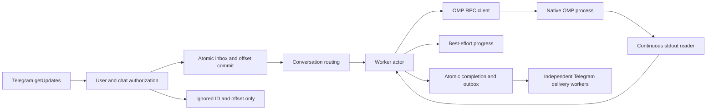

# Architecture and development

English | [中文](architecture.zh.md) | [User guide](../README.md)

This is a reference for the current implementation: ownership, state transitions, persistence, failure handling, and recovery. Installation, configuration examples, and command usage belong in the [README](../README.md). Source links identify the implementation boundary; test links identify regression coverage, not evidence of live Telegram validation.

**Contents**

- [Ownership and system boundaries](#ownership-and-system-boundaries)
- [Components and data flow](#components-and-data-flow)
- [Bootstrap, configuration, and process policy](#bootstrap-configuration-and-process-policy)
- [Execution workers and RPC](#execution-workers-and-rpc)
- [Native commands and Telegram menus](#native-commands-and-telegram-menus)
- [Progress, status and final replies](#progress-status-and-final-replies)
- [Interruption and conservative recovery](#interruption-and-conservative-recovery)
- [Managed autoresearch](#managed-autoresearch)
- [Session lifecycle](#session-lifecycle)
- [Session discovery and management](#session-discovery-and-management)
- [Runtime settings and diagnostics](#runtime-settings-and-diagnostics)
- [Persistence and recovery](#persistence-and-recovery)
- [Telegram delivery and progress cleanup](#telegram-delivery-and-progress-cleanup)
- [Attachments and host-tool file boundaries](#attachments-and-host-tool-file-boundaries)
- [Logging contract](#logging-contract)
- [Development, verification, and release](#development-verification-and-release)

## Ownership and system boundaries

The daemon bridges Telegram conversations to native OMP sessions. It owns authorization, routing, process lifecycle, RPC transport, task bookkeeping, and Telegram delivery. OMP owns model execution, tools, credentials, configuration, and native session history. The bridge neither emulates a terminal nor maintains a second model transcript.

One database belongs to one bot. Each supported conversation has one worker and one session binding: ordinary private chats use thread ID `0`; private-chat topics and group topics use their Telegram thread IDs. A group topic shares its session among authorized users. Group messages outside a topic are not routed to an inferred session. Independent sessions do not isolate filesystems or credentials.

Core invariants:

- Authorize both the user and chat for every input and callback, before retaining content or downloading attachments.
- Keep RPC stdout consumption independent of Telegram HTTP delivery. Acceptance is not completion.
- Fence asynchronous work by its original worker, client, generation, request, and task/session scope. A stale result cannot mutate a replacement runtime.
- Persist native session-file identities, not PIDs. Do not automatically replay work whose execution status is uncertain.
- Commit task settlement and final output atomically. A later `/new` or `/close` does not cancel already committed replies.
- Start native programs with argument arrays, without a shell. Do not implicitly alter OMP models, tools, configuration, or approval policy.

## Components and data flow

| Implementation | Responsibility |
| --- | --- |
| [`cmd/omp-telegram`](../cmd/omp-telegram/main.go) | CLI, signal handling, process-wide data-directory lock |
| [`internal/config`](../internal/config/config.go), [`config.go`](../config.go) | Strict TOML loading, executable-relative paths, embedded [`config.toml`](../config.toml), argv/environment policy |
| [`bridge.go`](../internal/bridge/bridge.go), [`steer.go`](../internal/bridge/steer.go), [`recovery.go`](../internal/bridge/recovery.go) | Routing, worker actors, task ownership, queueing, completion, startup/shutdown recovery |
| [`native_commands.go`](../internal/bridge/native_commands.go), [`command_menu.go`](../internal/bridge/command_menu.go) | Command-source validation, native submission, Telegram discovery menus |
| [`autoresearch.go`](../internal/bridge/autoresearch.go), `research_*.go` | Native research admission, controls, round settlement, disable recovery |
| [`session.go`](../internal/bridge/session.go), [`resume_picker.go`](../internal/bridge/resume_picker.go), [`binding_list.go`](../internal/bridge/binding_list.go), [`session_delete.go`](../internal/bridge/session_delete.go), [`export.go`](../internal/bridge/export.go) | Session transitions, listings, reservations, favorites, deletion, export |
| [`args.go`](../internal/bridge/args.go), [`model_picker.go`](../internal/bridge/model_picker.go), [`doctor.go`](../internal/bridge/doctor.go) | Startup presets, runtime settings, session-preserving diagnostics |
| [`progress_status.go`](../internal/bridge/progress_status.go), [`reply_status.go`](../internal/bridge/reply_status.go), [`reply_metrics.go`](../internal/bridge/reply_metrics.go), [`watchdog.go`](../internal/bridge/watchdog.go) | Best-effort live state, bounded final headers, conservative missing-completion recovery |
| [`internal/i18n`](../internal/i18n/i18n.go), [`language.go`](../internal/bridge/language.go) | English/Chinese Bridge templates and global language selection |
| [`internal/omp`](../internal/omp/client.go) | RPC v2 framing and correlation, process supervision, native metadata, ACP session listing, export/render/delete delegation |
| [`internal/store`](../internal/store/store.go) | SQLite schema, inbox/outbox, bindings, startup intents, atomic transitions and retention |
| [`internal/telegram`](../internal/telegram/client.go) | Bot API, Markdown-to-HTML rendering, reply fallback, transport/delivery classification |
| [`internal/media`](../internal/media/media.go), [`bridge/media.go`](../internal/bridge/media.go) | Authorized downloads, workspace-confined file access, snapshots and attachment lifecycle |
| [`internal/logging`](../internal/logging/logging.go) | Fixed component loggers, synchronized text/JSON output |



Polling persists updates before worker routing. Unauthorized or senderless updates keep only their ID and ignored state while advancing the offset; they cannot start OMP or download files. Authorized typed updates retain the content needed by routing. Routing rechecks authorization for inputs and callbacks. Replies, progress, and exports are visible to anyone with access to the destination conversation, not just the submitting user.

Polling failures use cancellable exponential backoff from one to 30 seconds. A positive Telegram `retry_after` can extend the actual delay beyond that ceiling; a successful poll resets backoff. Durable offset reads or update writes fail the daemon rather than acknowledging uncommitted inputs.

### Identity and stale work

| Identity | Representation and scope |
| --- | --- |
| Bot | Numeric `getMe` ID, checked against database ownership; not token or username |
| Conversation | `(bot, chat, thread)`; the daemon's worker map can use `(chat, thread)` because the bot is fixed |
| Binding | Workspace, native session-file path and validated session ID, persisted generation, running/interrupted state |
| Runtime | Current `omp.Client` and process-local monotonic client ID; never a durable PID |
| Root task | Inbox ID, worker generation, turn, and owning prompt request |
| Asynchronous operation or picker | Captured request/token plus the relevant client, generation, session, catalog/preset revision, and message/owner scope |
| Telegram input/output | Bot-database update ID / bridge outbox ID, distinct from Telegram message IDs |

The exact fence depends on the operation; no single generation check replaces all task, session, and menu checks. Session claims and export/delete reservations are synchronized under `sessionMu` and apply only within this daemon. They do not lock a workspace or prevent another program from opening native history. Recovery cannot infer Telegram chat type from a binding: zero-thread restoration requires a positive private-chat ID and the current chat allowlist.

`daemon.lock` prevents two daemons from opening the same data directory. Database bot ownership prevents another bot from reusing it. Neither prevents another poller from using the same bot token with a different directory or webhook; deployment must enforce a single consumer.

## Bootstrap, configuration, and process policy

### Startup and shutdown boundaries

[`main.go`](../cmd/omp-telegram/main.go) handles `--version`/`-v` before configuration. `--check` loads and validates configuration, resolves the OMP executable, and creates configured data/workspace directories; it does not open SQLite, start OMP, or contact Telegram.

Normal startup performs:

1. Configuration loading and logger creation, then restrictive umask and exclusive `daemon.lock` acquisition.
2. SQLite initialization/migration and runtime-state reconciliation.
3. Telegram `getMe`, database bot-ownership check, and persisted argument-preset and global interface-language initialization.
4. Best-effort default command registration for the default and `zh` language scopes.
5. Progress-cleanup reconciliation, restoration of eligible session claims/workers, and retention cleanup.
6. Polling, actor routing, four delivery workers, command-menu updates, progress cleanup, and the optional daily retention janitor.

Command-menu registration failure does not prevent polling. Durable-state failures are not hidden by best-effort UI paths. SIGINT/SIGTERM cancel the shared context; workers settle/cancel outstanding work conservatively, close owned processes, and complete background work before the store closes. Session-specific shutdown and unfinished-start recovery are described with the session lifecycle below.

### Configuration and path contracts

[`config.Load`](../internal/config/config.go) resolves symlinks on the bridge executable and uses its real directory for defaults. The implicit `config.toml` lives there; only an absent implicit file falls back to the embedded root configuration. An explicit missing file, unreadable file, invalid TOML, unknown field, or wrong table is an error. Explicit relative `--config`/`-c` paths remain caller-relative.

| Path or setting | Resolution |
| --- | --- |
| Relative `storage.data_dir` and `storage.workspace_root` | Real bridge executable directory, even when the config file lives elsewhere |
| Empty optional workspace root | `workspace/` beside the executable |
| Default OMP binary | `omp` resolved through the daemon's `PATH`, then made absolute |
| Lock, database, attachment spools | Under `storage.data_dir` |
| Native OMP configuration, credentials and session storage | OMP defaults or explicitly configured native arguments; not relocated by the bridge |

The supported tables are `[telegram]`, `[omp]`, `[omp.environment]`, `[storage]`, `[worker]`, `[logging]`, and `[logging.component_levels]`. Legacy flat fields and misplaced fields are rejected, not migrated automatically. Both allowlists must be nonempty; user IDs must be positive and chat IDs nonzero. `max_workers` is bounded to `1..64`, `queue_capacity` to `1..1024`, and retention days must be nonnegative. A positive Go duration enables idle release; empty, `0`, or `disabled` disables it.

String references expand once after TOML parsing: `$VAR`, `${VAR}`, and `$$` for a literal dollar. Inserted environment contents are not expanded again and cannot inject TOML. Numeric and allowlist fields accept their documented environment-reference strings. The default `OMP_TELEGRAM_ARGS` and workspace-root references may be unset; invalid/unset progress mode falls back to `summary`. Other required references fail when unset. Environment-policy mode/names and display-only `omp.args_labels` remain literal. `.env` files are not loaded.

`omp.args` accepts an ordered array of preset strings or a scalar normalized to one preset. Each string is tokenized with quoting support, not executed by a shell; all presets are validated before startup. Bridge-owned mode/cwd/session options, their protected short forms, `--`, and NUL bytes are rejected. Only the normalized preset fingerprint and chosen index are persisted, not raw arguments. Selection semantics and per-runtime snapshots are described under runtime settings.

### Child environment and containment limits

[`omp.Environment`](../internal/omp/env.go) filters parent variables for native RPC, ACP, model-query, render/export, deletion, and diagnostic child processes. `denylist` mode inherits everything except explicitly denied names. The bundled configuration denies `OMP_TELEGRAM_BOT_TOKEN`; the loader adds no implicit secret-name filtering. A custom token variable is inherited unless explicitly denied. `allowlist` mode requires an explicit `allow` list, possibly empty, and passes only listed names that exist. Each mode rejects the other list even if empty. Bridge-side TOML expansion is independent of this child policy.

Passing provider credentials is intentional when configured. This is not a sandbox: withholding `HOME` or a token variable does not prevent same-user filesystem/process access, tool access to other copies of credentials, or outbound networking. Use trusted OMP code and deployment-level isolation where required. The bridge does not enable automatic tool approval.

On Linux, native RPC, ACP, model-query, render/export and deletion paths using [`startProcess`](../internal/omp/process_linux.go) receive a dedicated process group and parent-death SIGTERM. The creating OS thread stays locked until `Wait` returns because Linux associates that signal with the creating thread. Their normal shutdown can escalate to killing the owned process group; parent death itself supplies no later SIGKILL escalation. The `/doctor` version probe instead uses direct `exec.CommandContext` and has neither of these process-group/parent-death guarantees. Ignored signals, surviving descendants, escaped groups, and programs clearing parent-death settings require external containment. RPC/ACP stderr is discarded; render path resolution inspects bounded native diagnostics internally. Raw diagnostics are not forwarded to logs or Telegram.

## Execution workers and RPC

### Actor ownership and input lanes

[`worker`](../internal/bridge/bridge.go) owns one conversation's logical binding, active root, deferred FIFO queue, control state, progress and callbacks. Connected processes are a separate resource: runtime state is `released`, `starting`, or `connected`. `worker.max_workers` limits connected OMP processes, not logical sessions. Idle release can return a process slot without discarding the validated binding or native session claim.

| Lane | Admission and ownership |
| --- | --- |
| Root | Ordinary text with no active root starts an independent submission. Its inbox owns the final reply and Telegram reply target. |
| Steer | Ordinary text during an active agent root uses native `prompt` with `streamingBehavior:"steer"`. It has a submitted inbox and correlated request, but no independent final reply or progress message. |
| Deferred root | `/followup`, attachments, bridge `/review`, and recognized native commands retain FIFO positions and become independent submissions. Attachment preparation is asynchronous; an unprepared head cannot be overtaken. |
| Control | Bridge controls and callbacks do not enter the prompt FIFO. Slow mutation/control RPCs run through one asynchronous operation lane; actor event handling remains separate. Startup and some bounded Telegram/RPC calls can still occupy the actor. |

`worker.queue_capacity` bounds queued roots plus unresolved steers. `/queue` reads only this worker's runtime queue/active/busy state; its Cancel buttons cancel selected pending inboxes and prepared resources, never the active root or OMP's native steer queue. Shutdown cancels waiting inputs. Neither queued inputs nor uncertain submissions are automatically replayed after restart.

A native-command owner remains native while acceptance omits `agentInvoked`; new ordinary text stays queued. Only `agentInvoked:true` or `agent_start` proves agent execution and enables ordinary root steering under the original reply owner. Text arriving while `controlAbort` is pending always becomes a new queued root, including unknown slash text classified during Stop. Managed research has a special long-lived owner; its terminal/settlement policy is not the ordinary-root policy.

### Transport and completion boundaries

[`Client`](../internal/omp/client.go) owns an OMP process group, a continuous stdout reader, serialized stdin writes, pending request IDs and an asynchronous event forwarder. Startup validates `ready` transport limits and negotiates public RPC v2. `Call` registers correlation before writing and waits for the command acknowledgment, not agent completion. Response IDs and command names must match; uncorrelated/malformed responses fail closed, while late responses for abandoned IDs are discarded rather than reinterpreted as events. Text steering additionally requires request-correlated `prompt_result` and settlement support.

The root inbox is durably `submitted` before the request is sent. Steers first validate frame size, reserve an ID, persist submission, and register `(request, root, client, generation, turn, admission)` before sending. Asynchronous operation results carry client/generation/root/turn fences. Runtime release drops waiting old-client operations but does not free an already-running RPC lane until its result returns. If the process exits during that call, exit policy waits for its result; an old exit fence cannot block a replacement runtime.

| Evidence | Ordinary-root outcome |
| --- | --- |
| Successful prompt acknowledgment | Accepted only; continue waiting unless explicit local completion applies. |
| `agent_end` with `isTerminal:false` | Await continuation; do not dispatch another root. |
| `agent_end` not explicitly `isTerminal:false`, with confirmed assistant text | `done`, subject to steer settlement and assistant error/cancellation metadata below. |
| Assistant `stopReason:"aborted"` | `cancelled`; retain available partial text. |
| Assistant error stop reason, nonempty `errorMessage`/`errorClassificationMessage`, or nonzero `errorStatus` | `uncertain`; retain available partial text and a safe notice. |
| Terminal event without confirmed text | `uncertain`, except confirmed local native-command completion. |

Terminal messages take precedence over cached `message_end` data for the current agent run, not earlier completed runs within the same ordinary root. RPC v2 may omit already-emitted messages from a compacted terminal frame, so the worker retains finalized assistant text and falls back to the current run's cache when needed. A continuation `agent_start` opens a new run without discarding earlier confirmed output; only the latest terminal metadata resets per run. Task settlement and teardown clear the task's output cache. A late/unsolicited `agent_start` without an active bridge owner cannot restart typing or wedge the queue. Managed research retains its separate per-round delivery lifecycle.

[`steerFence`](../internal/bridge/steer.go) requires a terminal root event, terminal results for every steer, and current-session settlement before finalization. Steer statuses map `completed` to `done`, `aborted` to `cancelled`, and `error` to `failed`; unknown status is uncertain. Explicit rejection fails that steer without claiming its instruction was applied; unconfirmed transport outcomes retire the runtime. A local-only `agentInvoked:false` acknowledgment can finish that steer but still requires quiescence evidence for its root.

Any later correlated `sessionSettled:false` invalidates earlier true evidence regardless of admission order. Only the latest admission's true result can establish settlement directly. Unkeyed `session_settled` requests a bounded `get_state.isSettled` probe, never releases the fence itself. Probe results are fenced by client/generation/root/turn/revision and yield to queued events or buffered RPC output. A new `agent_start` discards a deferred old terminal.

### Resource and privacy boundaries

| Resource | Bound and failure behavior |
| --- | --- |
| Physical RPC frame | At most 1 MiB, reduced to the negotiated limit. Oversized outgoing requests are rejected before writing. |
| Reassembled logical frame | At most 64 MiB, with validated chunk framing/order/length. |
| Buffered RPC resources | Shared 64 MiB credits for physical/reassembly capacity and queued event bytes; event credit returns when the worker receives it. Queue-slot or byte overflow fails the client. |
| Pre-terminal assistant text | 4 MiB logical finalized-plus-pending output and a separate 4 MiB retained stream cap. Finalized messages replace their streamed contribution to logical accounting. Overflow before completion is uncertain, not successful display truncation. |
| Confirmed final display | At most 1 MiB and 32 Telegram messages, including header/notices; explicit truncation does not turn a confirmed task into failure. |

Logical-frame capacity and buffered-resource policy are independent: a valid near-limit frame can still exhaust credits while a physical chunk or queued events remain retained. The RPC reader never performs Telegram delivery.

[`reply_context.go`](../internal/bridge/reply_context.go) adds only Telegram's supplied immediate reply context to ordinary prompts, steers, followups and current attachment prompts. An explicit selected quote wins over full replied text. Otherwise it uses text, photo/document labels, a document filename and caption, or an unsupported-message marker. It does not fetch older messages, recurse through replies, download replied-to media, or reveal sender names/IDs; the sender label is only `bot` or `user`.

The quoted envelope is capped at 3000 UTF-16 units, including delimiters and `...[truncated]`; the current user message is not truncated by this helper. Reserved delimiter strings inside quoted content are escaped. This is quoted input, not trusted instructions or an authorization boundary. Bridge controls and generic recognized native commands receive no reply-context wrapper. Bridge `/review` keeps its slash command first and appends the context. Queue previews use current-message text rather than the quoted envelope. Telegram payload persistence and eventual model input still contain the supplied quoted text; this is minimization, not secret redaction.

## Native commands and Telegram menus

### Native command recognition and submission

[`catalog.go`](../internal/omp/catalog.go) publishes immutable per-client catalogs with distinct `CatalogUnknown`, `CatalogReady` (including empty), and `CatalogUnsupported` states. Discovery is asynchronous and single-flight. Only the explicit native unknown-command response proves discovery unsupported; rejection, timeout, malformed catalogs and transport failure are not interchangeable fallback states.

Bridge commands and hidden `/start` take precedence. A valid `@bot` suffix is recognized only for a single-segment command with 1-32 ASCII letters/digits/underscores and a 5-32-character username-shaped target; foreign-bot commands are ignored. Paths such as `/opt/user@host/file` remain ordinary text. Invocation parsing follows OMP whitespace, including BOM but excluding NEL, and `:`. Native lookup first tries the whole name before the first literal space, preserving names such as `plugin:command`; only advertised builtins enable the additional separator syntax. Refused advertised sources also match those separators so they cannot fall back to model input.

| Catalog/source | Routing contract |
| --- | --- |
| Unknown | Slash input waits for classification in FIFO. Ordinary non-slash roots need not wait for discovery when their other admission evidence is available. |
| Ready, executable | `builtin`, `skill`, `custom`, `mcp_prompt`, and `file` commands/aliases enter the native deferred queue without steering or reply-context wrapping. |
| Ready, unrecognized slash input | Preserve text and ordinary prompt/steer routing, including absolute paths. |
| Unsupported discovery | Cancel non-bridge slash-headed input, including followup/attachment/steer paths; ordinary non-slash input and bridge controls remain usable. Explicit bridge `/review` provenance retains its exception. |
| Extension or unknown source | Recognize and refuse generically, without echoing catalog names, arguments or raw source. Only exact canonical extension `autoresearch` has a specialized owner; its aliases and other extensions do not inherit that permission. |

Names and aliases are opaque, unnormalized strings. Empty names, leading `/`, and invalid name/alias types invalidate the catalog; unusual whitespace/control/Unicode names alone do not. Missing/null/non-string/unknown sources stay recognizable but non-executable. Catalog validity does not imply that the current invocation parser can call every retained name.

The stdout reader publishes unsolicited catalog updates before later response waiters. Queries record their actual epoch and reader-update revision; a changed session or newer update wins over an older query response. Identical discovery preserves snapshot/revision, while even identical unsolicited updates advance revision. Worker catalog events are wakeups, not snapshots to reapply. Lazy restoration refreshes discovery.

A discovery waiter timeout/cancellation/rejection preserves a reader-published usable catalog. If discovery remains unknown, the worker pauses discovery for that client/epoch and leaves slash inputs pending; `/queue` cancellation of the waiting item can release later FIFO work. Scope changes or reader updates restore classification. Actual transport/protocol/process failure retains normal runtime-failure policy.

[`native_commands.go`](../internal/bridge/native_commands.go) revalidates the queue head immediately before submission, including after asynchronous admission work. It checks current source/name and native session identity; a removed command or changed native session cancels the entry, never downgrades it to model text. Same-session revision changes do not cancel a still-valid command; a replacement client restoring the same session is allowed. Raw slash-headed followups and prepared attachments cannot bypass source/lifecycle checks.

Lifecycle-mutating `/move`, `/wt`, `/worktree`, and `/session delete` are refused both at routing and dispatch, even without discovery. Session refusal matches only case-insensitive `delete` with no further arguments. `/session info` and `/session pin` keep native routing. Bridge session lifecycle APIs own the saved binding; arbitrary extension lifecycle mutations are not reconciled. Snapshot validation is not atomic upstream check-and-execute, and untagged old-session unsolicited updates cannot be reliably identified by bridge fences.

An explicit native local acknowledgment `agentInvoked:false`, or request-correlated local `prompt_result(status:"completed", agentInvoked:false)`, completes the submission without requiring assistant text. This does not prove background operations finished. Local `error` is uncertain, `aborted` cancelled, and missing/unknown status uncertain; generic notices commit with those states without exposing raw RPC errors, retiring a healthy runtime, or replaying the command. Recognition alone does not implement native `/plan` or `/plan-review` RPC support.

After the RPC client consumes private metadata-query replies, `command_output.text` from the connected runtime is delivered through the outbox as a standalone conversation notice with no inbox association. The event has no request ID: it does not change a task's preview or completion, and delayed output cannot become the next root's final reply. Blank output is ignored; each event uses the existing final-reply byte, message-count, and UTF-16 display budgets with truncation. Only the text is displayed, not the RPC frame, and the payload is not logged.

### Command menu publication

[`command_menu.go`](../internal/bridge/command_menu.go) keeps the default bridge menu and publishes chat-scoped unions of bridge commands plus executable native names/aliases. Telegram has no topic command scope: topics in one chat share the union, while chats remain separate. Menu visibility never grants execution permission. Names must already match `[a-z0-9_]{1,32}`; bridge entries/descriptions take precedence, hidden `/start` and refused lifecycle names are excluded, and sorted/deduplicated native entries fill the remaining space up to 100. Omitted executable names remain manually callable.

Before worker restoration and polling, startup runs one bounded `omp --mode rpc --no-session` discovery in `storage.workspace_root`, using the selected startup arguments and configured environment without overriding OMP settings. [`DiscoverCommands`](../internal/omp/catalog.go) drains and discards events, requests the official catalog, then closes and joins the process and event drainer before returning. Discovery has a 20-second deadline, sends no prompt, writes no native session history or bridge binding/start intent, and finishes before normal runtime slots are used. Only permitted builtin names and aliases seed the in-memory fallback; workspace-specific sources wait for real sessions. Failure logs a generic classification and leaves bridge-only menus and later per-worker discovery available.

Each chat uses the startup fallback until an active topic publishes an authoritative catalog. Real topic catalogs then replace the fallback, including empty or unsupported catalogs. An unknown catalog clears that topic's stale contribution without turning the fallback into an authoritative empty list. Removing or invalidating the last known contribution restores the fallback. The probe still performs normal OMP configuration and extension initialization; `--no-session` is not an isolation or no-side-effects guarantee.

Executable native commands and aliases use OMP-provided descriptions, normalized to a single line of at most 256 UTF-16 code units. Missing, null, non-string, or whitespace-only descriptions do not invalidate the catalog and use the generic menu label. Refused commands do not retain descriptions. Catalog equality includes normalized descriptions, so description-only changes advance the revision and refresh menus. When topics advertise the same name, prefer a nonempty description and choose the lexicographically smallest nonempty description to keep the chat union deterministic.

Session/catalog invalidation clears old contributions. Logical close/replacement/failure/shutdown removes only that worker's contribution; idle process release retains it. Pointer ownership and inactive tombstones prevent late updates/removals from retired workers. Startup publishes the discovered builtin fallback without first replacing chat menus with a bridge-only list, and preserves early authoritative catalogs.

One background publisher coalesces dirty chats and writes both default-language and `zh` scopes with 20-second deadlines outside actors/readers. It caches acknowledged lists per chat/language and skips unchanged successful scopes. Publication failures do not fail tasks. Uncertain publication invalidates the prior successful cache because Telegram may have applied the update; definite rejection retains it. Menu state is not persisted locally, and published native names and descriptions are visible to chat members even if they cannot operate the bot. Raw catalogs, descriptions and arguments do not enter menu diagnostics.

Network uncertainty, request timeouts, HTTP 5xx errors and rate limits requeue the failed chat through the existing dirty/pending/wake mechanism. Per-chat exponential backoff starts at one second and caps at one minute; a longer Telegram `retry_after` is respected. These intervals are not delivery deadlines. The publisher reuses one cancellable timer, rotates deferred chats behind ready work, and recomputes the latest language and catalog when eligible. Repeated updates coalesce without bypassing backoff. Only the first failed pass for a chat emits warnings until a full pass succeeds. Definite non-429 HTTP 4xx rejections do not schedule automatic retries, but later contributions/language updates can trigger a new attempt subject to the same backoff. Tests use `testing/synctest` to cover persisted-language recovery, partial scope success, latest-state selection, retry bounds, log suppression, cancellation, and permanent rejection.

### Interface language

[`internal/i18n`](../internal/i18n/i18n.go) localizes only Bridge-owned templates, with English as the default and Chinese selected by `/lang zh`. `/lang en` switches back, and `/lang` reports the current setting. The setting is global across all chats and topics, not inferred from Telegram user locale and not attached to an OMP session or binding. Any otherwise authorized caller may change it. The command remains available during tasks and unresolved migrations without submitting OMP work or clearing a migration lock.

[`language.go`](../internal/bridge/language.go) loads the singleton preference before workers and recovery notices start. A mutex orders database writes and atomic in-memory publication, so concurrent changes cannot leave persisted and live settings reversed. Workers read the shared atomic preference rather than retaining independent copies. Failed persistence leaves the active language unchanged. Session close, replacement, and binding removal do not reset it. Both default and `zh` Telegram menu scopes use the selected global language; changes dirty the global menu and all known/configured chat menus for the existing background publisher.

[`Message`](../internal/i18n/i18n.go) is a struct with private English/Chinese fields. The static [`Msg` catalog](../internal/i18n/messages.go) gives each bilingual object a stable semantic name. Small `Task`, `Session`, `Queue`, and `Language` groups hold related entries, for example `i18n.Msg.Task.SubmissionUncertain` and `i18n.Msg.Queue.Full`; other entries remain flat until needed. Names do not depend on English wording, and removed flat names have no aliases. English text is no longer a lookup key. `Text` and both Bridge `tr` helpers accept only `Message`, so raw strings, nonexistent catalog names, and missing constructor arguments fail compilation. Changing English wording requires editing the same entry as its Chinese text, not updating a separate lookup key. Typed Bridge errors and stable media/store sentinels select explicit messages; opaque errors are not classified by their English wording. Call sites select the language before formatting user/native values, rather than translating assembled output or intercepting generic delivery. Native OMP text and dialog content, model replies, tool arguments/results, paths, session titles, and user captions remain untranslated. Existing rendering limits and sanitization remain in force. Queued media keeps captions separate from Bridge fallback labels so newly rendered queues follow the latest language. Already rendered outbox text and delivered messages are not rewritten.

Telegram scope updates are separate requests, not an atomic multi-scope operation. An older in-flight publication may briefly remain visible before the queued language refresh converges. Regression tests block publication during a language change and verify every default/chat scope eventually reaches Chinese, then English after rapid switches. A task does not retain its startup language: newly generated Bridge receipts use the current global setting while previously rendered outbox text and OMP reply bodies remain unchanged.

`progress.NativeStatus` caches rendered Bridge status text. Switching languages does not eagerly rebuild it: the next accepted native-status result uses the global language at completion, including a switch while its RPC query was pending. Sampling normally runs every five seconds and still depends on a successful RPC response and identity fencing; this is not a five-second refresh guarantee. Existing progress messages are edited on the next normal update, without a new cache epoch or task-local language field. Native OMP extension text is outside this guarantee.

The message constructor rejects empty language text. Test-only reflection recursively traverses flat entries and nested groups in `Msg`, checking both languages and the ordered formatting directives, including argument count, verb, width, and precision; no separate runtime registry is maintained. A nested-message regression covers missing translations and mismatched format arguments. The checker understands sequential `%s`, `%d`, and `%f` directives and ignores escaped `%%`; unsupported syntax fails rather than being silently skipped. New formatting syntax must extend the checker before use. `formatDirectives` stays in `_test.go`. This guards the typed translation path, not arbitrary raw text deliberately sent outside it.

### Native dialogs and session operations

[`worker.ui`](../internal/bridge/bridge.go) maps native `confirm` to Confirm/Cancel buttons and `select` to an eight-option paged picker with cancellation. Empty selects are cancelled. `input`/`editor` requests are cancelled with guidance to send ordinary text; widgets and generic native output are not a terminal UI emulation. Tokens are owner/generation/client scoped and single-use; selections are also tied to their menu message. Unlike bridge-owned menus, native dialogs have no bridge expiry, including after pagination: OMP owns any native deadline and cancel signal. Without cancellation, they remain actionable until a user decision, task settlement, or runtime/session teardown, and block normal idle release while pending.

Native cancellation invalidates matching tokens. Teardown removes obsolete tokens before bounded keyboard cleanup. A menu receipt records the user's choice, not operation success; failed confirmation/select writes retire the runtime conservatively.

Manual `/compact` requires an idle logical session, not an already-connected process, and starts without confirmation after restoring a released runtime. It attempts a button-free `Compacting...` message with a five-second timeout, then runs native `compact` in the operation lane with a 180-second deadline. A post-success `get_state` query has at most three seconds within that remaining deadline. Missing/invalid usage or failed sampling displays `n/a` without changing confirmed compaction into failure. A different nonempty native session ID additionally retires the runtime while preserving the original binding/claim. Completion replaces the status message; absent status or failed edit falls back to durable outbox.

`/handoff` requires idle session controls and an empty queue, passes optional `customInstructions` to native RPC, and holds subsequent queue dispatch until its result. Its operation deadline is 180 seconds. Explicit compact/handoff rejection retains a reusable runtime; errors, timeouts, cancellation and unconfirmed results release it for lazy resume. Neither operation creates a model root or borrows its progress/Stop keyboard. Session/model/argument selection and native export/path resolution are separate lifecycle interfaces; [`render.go`](../internal/omp/render.go) resolves native history paths through `omp render`, not Telegram final-answer formatting.

## Progress, status and final replies

### Best-effort progress

[`worker.renderProgress`](../internal/bridge/bridge.go) uses one editable, in-memory preview. The 1.5-second worker tick evaluates creation after a three-second initial delay. `off` suppresses progress Send/Edit and typing, but still accumulates text for final replies. `summary` shows output, state and active tools; `verbose` adds bounded raw arguments, latest partial/final results and the five most recent tool outcomes, with an omitted-earlier count. Retry/compaction states are explicit. Only matching `tool_execution_end` completes a tool; host callbacks may correct its name/arguments but do not invent completion. Reasoning and whole frames are never rendered.

At most six active tools are displayed, with 64-unit names, 100 UTF-16-unit payload fields, a 1600-unit aggregate detail budget and a 2200-unit output tail within a 3500-unit preview budget. The bounded JSON payload decoder scans the event but copies only limited prefixes. Verbose payloads are not redacted and can expose credentials or private files to everyone who can read the conversation; truncation is not a privacy filter.

A root's Stop button is fenced by owner, generation, active inbox and turn. Valid use consumes the token before requesting interruption; stale buttons cannot abort later work. Initial Send failure suppresses further progress for that turn to avoid duplicates; Edit failure remains retryable. Preview and final replies target the root's original Telegram message when possible; reply rejection can fall back to a plain message without changing execution state. Progress cleanup is driven by durable completion/output delivery, not proof that a preview was visible. Typing runs at most every five seconds with a four-second timeout and is cancelled on completion, turn change, runtime release and shutdown.

### Native status projection

[`status.go`](../internal/bridge/status.go) decodes only display-safe fields, never raw model configuration. Detailed `/status` reports workspace, session/name, provider/model, configured thinking, fast setting/activity, native context usage, streaming/compaction, bridge queue count, native speed, runtime connectivity and idle age. Missing or invalid data is `n/a`, not a guessed value. Its `Running` flag is native streaming, not the bridge's active-root predicate. Inspecting a released running binding may temporarily restore and then release a durably idle runtime; new input, pending work/UI or buffered output prevents premature release.

[`progress_status.go`](../internal/bridge/progress_status.go) samples connected running roots independently of the mutation lane: one in-flight `get_state`, at most every five seconds after initial progress delay, with a three-second deadline. It never starts a process or changes idle-watchdog evidence. Results require matching request/client/generation/root/turn/catalog epoch and bound/native session. Failure clears only the UI block; it does not settle or replay the task. Task/session/runtime transitions cancel stale samples.

[`compact_status.go`](../internal/bridge/compact_status.go) presents bounded literal model IDs without provider, native thinking symbols, fast activity, context percentage/window capacity and native speed on one logical line. Unknown fields are omitted; it never estimates tokens/s from text deltas. Thinking comes from the runtime-scoped configured-selector cache populated by the local `/effort` metadata query and `thinking_level_changed`, not effective `get_state.thinkingLevel`. Unknown/model-default/non-adjustable selectors omit the compact symbol and show `n/a` in detailed status. Runtime stop clears the cache. Optional configured-selector read failures do not undo an already verified setting mutation; a stopping client still cannot be reused.

### Confirmed final rendering and metrics

[`reply_metrics.go`](../internal/bridge/reply_metrics.go) adds a first-message-only header to successful text replies independently of progress mode. Main-agent assistant `message_end` frames contribute model/provider identity and safe numeric usage/duration; terminal summaries are not counted again. Average generation speed is `sum(output tokens) * 1000 / sum(duration_ms)`, excluding queue/tool time and requiring positive output and at least 100 ms total duration. Any missing/invalid contributing call suppresses the aggregate rather than reporting a partial average. Counters reset per root or successful managed-research round.

Final context uses the last call's output-inclusive usage: prefer explicit `contextTokens`, otherwise positive `totalTokens` or a complete input/output/cache sum, subtract orchestration input/output/cache-read usage, and clamp at zero. Missing, negative or overflowing data is not estimated. This differs from `get_state.contextUsage.tokens`, which can still be the final input anchor.

After confirmed text completion, [`reply_status.go`](../internal/bridge/reply_status.go) makes an independent one-second `get_state` query for current window/model and idle evidence. Context is added only for matching model/provider/native session with explicit non-streaming/non-compacting state; percentage is recomputed from output-inclusive usage and the sampled window. Thinking/fast fields also require matching model identity. The query cannot free the mutation lane. Client/generation/root/turn/catalog epoch/session fences reject late results; new input, native activity, retirement or query failure commits the confirmed answer with already-known model/average fields. Harmless metadata/completion trailers may drain without replacing it.

The accepted header and answer enter the same durable inbox-completion/outbox transaction; failure before commit retains uncertain/no-replay recovery. Header space, Markdown-aware splitting/fence repair and explicit truncation share the 1 MiB/32-message display budget. Error/cancellation notices and local command receipts do not gain this success header. Attachment/output transport remains the responsibility of the media and durable-delivery interfaces.

Terminal errors expose fixed RPC failure classes through [`ClassifyError`](../internal/omp/errors.go), not raw rejections. Assistant failures can include a bounded 512-unit `errorMessage` summary after credential, request/trace/correlation ID, URL and filesystem-path filtering; ambiguous unkeyed secret markers suppress that detail. HTTP 429 or recognized rate-limit classification produces a generic provider-rate-limit notice. `errorClassificationMessage`/`errorStatus` classify failures but are never copied as raw detail. This filtering does not redact ordinary assistant answers or verbose tool payloads.

## Interruption and conservative recovery

### Stop and runtime retirement

Without a steer fence, Progress Stop preserves deferred bridge tasks while `/stop` cancels tasks already waiting when it is requested. Plain native `abort` uses the connected process without lazy restore. A successful abort acknowledgment cannot fence native asynchronous continuation, so the bridge immediately terminates the old process group without draining stdin before releasing following work. A still-active root becomes `cancelled`; a root already durably settled is not rewritten. The original binding, generation and session claim remain, and later work lazily resumes the same native session on a replacement process. New text received during abort remains a separate queued root.

With a steer fence, both Stop controls terminate first and settle the root and unresolved steers as `uncertain`, since native queued input cannot be safely withdrawn by plain abort. Progress Stop preserves followups; `/stop` clears them. Research has its own owner/off-confirmation policy. Termination cannot undo tool effects or guarantee that an unsaved/corrupted native session is resumable. Native queue-removal APIs are not used as authoritative per-prompt cancellation or as a stale-event barrier.

When no bridge root is active, Stop first probes native state asynchronously with a five-second deadline. It keeps the runtime only with explicit idle/settled evidence, no reported async/queued native work, no bridge session operation, UI/host request or buffered output. History-file existence is not evidence of activity; a confirmed idle unsaved session can remain connected. Otherwise normal abort/retirement applies. Explicit abort rejection retains the client; unconfirmed abort retires it and makes a still-active root uncertain before preserved work continues on a fresh runtime.

Ordinary root submission failure/unconfirmed acceptance, unexpected process exit, pre-terminal assistant overflow, and failed native UI response writes retire the runtime and cancel ordinary waiting work. Root acceptance still has a 30-second deadline, even if a native `/review` picker is waiting for a user choice; this is not a timeout on accepted model execution. Pre-write oversize rejection reports that no task was sent. Steered/research retirement has its own queue-preservation policy. Retirement clears session/control/compaction state, durably settles interrupted owners, and preserves the logical binding for explicit reuse. An absent native history file remains a restore failure, never permission to invent a replacement session.

### Missing completion watchdog

[`watchdog.go`](../internal/bridge/watchdog.go) is a conservative uncertainty path, not a success detector. An active busy ordinary root is eligible only after 30 seconds without activity and without compaction/session work, retry, running tools, host requests or native UI waits. A background `get_state` probe has a five-second timeout. Idle requires explicit `isStreaming:false` and `isCompacting:false`; absent/null/malformed fields or errors do not prove idle. Two confirmations at least 30 seconds apart are required before settling missing completion uncertain and retiring the old runtime before queue dispatch. The logical session and queued roots are preserved for lazy resume, never replay of the uncertain root.

Every event, including unknown/malformed input, and ordinary RPC activity invalidates idle evidence. Results carry client/generation/turn/active-inbox/activity-revision fences and yield to queued events and buffered output. Explicit nonterminal `agent_end` records `awaitingContinuation` and suppresses ordinary watchdog recovery until a new `agent_start`, settlement, dispatch or teardown; a legitimately silent native async continuation has no invented ordinary-root deadline. Managed research is excluded from this watchdog.

The steer fence is the exception to nonterminal suppression. Streaming, compaction, tools, retry and UI still prevent recovery. Repeated explicit idle snapshots with reported native async/queued work receive five minutes from the first continuous idle-pending confirmation; they do not continually reset the timer. Activity, non-idle/ineligible evidence or disappearance of pending work resets it. A current idle-pending confirmation at/after the limit terminates the process and marks the root/unresolved steers uncertain while preserving bridge followups. This bounds a stuck native queue but can interrupt legitimate work that stays wholly silent and pending for five minutes.

## Managed autoresearch

### Capability and ownership

The bridge manages research operation ownership, not experiments. The native extension owns experiment setup, Git operations, artifacts, and autonomous continuation. Startup adds no bridge approval override. The implementation is split between [research routing and round ownership](../internal/bridge/autoresearch.go), [admission](../internal/bridge/research_admission.go), [controls](../internal/bridge/research_control.go), and [settlement](../internal/bridge/research_settlement.go).

The command catalog grants a narrow exception to the canonical `autoresearch` command advertised with source `extension`. Extension aliases, another extension aliased as `autoresearch`, and unknown sources do not gain that permission. Managed research additionally requires the command to remain executable in the current catalog; queued commands are revalidated against their session and source. See [catalog classification](../internal/omp/catalog.go) and [native routing](../internal/bridge/native_commands.go).

| Input | Meaning |
| --- | --- |
| `/autoresearch <goal>` | Submit the goal to the native handler. |
| Empty `/autoresearch`, mode off | Enable through the native handler. It can complete locally without a model call; the next ordinary prompt supplies the research task. |
| Empty `/autoresearch`, mode on | Disable through the managed control path, rather than waiting behind the autonomous root. |
| `/autoresearch off` | Explicitly request confirmed disable, including recovery from unconfirmed mode. |
| `/autoresearch clear ...` | Request destructive native clear, subject to idle checks and confirmation. |

Thus enabling mode and starting an agent task are distinct steps. A confirmed local startup refusal or local native command completes without retaining a fictitious research root.

### Recorded mode and dispatch admission

[Client.AutoresearchMode](../internal/omp/autoresearch.go) reads recorded control intent on the current native branch. It does not reconstruct experiment state or prove effective Git-branch-dependent tool activation. Recorded-on mode can therefore retain a managed owner even when the native extension cannot continue; notifications and tool availability are not substitutes for authoritative mode evidence.

The reader:

1. Obtains the native session ID and absolute history path with `get_state`.
2. Reads only ancestry/control metadata from the JSONL file, then calls `get_entries` with `since` set to the last valid disk entry. RPC supplies the canonical suffix and current `leafId`.
3. Rechecks the session ID/path and walks the leaf's complete parent chain. The nearest `autoresearch-control` selects `on`, `off`, or `clear`; other branches do not select mode.

This avoids transferring an entire saved transcript through the 64 MiB logical RPC limit. Model/tool payloads are not retained in metadata. A new session without a persisted file uses RPC alone. A JSON syntax error stops disk reading at the valid prefix; RPC must supply the canonical remainder, including records after malformed middle entries. Legacy headers with `version < 2`, including omitted versions, use native in-memory migration through an initial RPC snapshot instead of disk ancestry. The bridge never repairs or rewrites history.

A valid empty branch or branch without a control entry means off. Missing required RPC fields, invalid controls, duplicate IDs, broken/cyclic ancestry, mismatched session headers, unreadable/nonregular history, and failed or inconsistent queries do not mean off. Admission cancels the attempted queue head and pauses waiting work when mode cannot be confirmed.

[Admission evidence](../internal/bridge/research_admission.go) belongs to one queue head, scoped by client, binding generation, turn, inbox ID, catalog epoch/revision, and native session. Catalog revision changes require fresh evidence; session/epoch changes reject the original admission. Cancellation, off, retirement, and submission invalidate it, so the next root cannot reuse it. Lookups run outside the actor in the cancellable operation lane; Stop and close remain actionable.

Pending slash inputs are classified before dispatch. Confirmed off permits ordinary roots while discovery is pending; confirmed on waits for the canonical extension. Once discovery is settled without that extension, managed-research admission is not applied. Discovery converts queued research inputs in place, preserving FIFO position; a control removes only its own entry when handled immediately.

### Root ownership and agent rounds

[The worker event dispatcher](../internal/bridge/bridge.go) distinguishes a submitted root from its agent rounds. Enabled mode makes the next agent task a research owner. Its inbox, request ownership, turn, and progress association survive successive `agent_start`/`agent_end` pairs. An end event, terminal-looking root `prompt_result`, temporary idleness, or a settled notification alone cannot finish it. The bridge neither replays the goal nor synthesizes continuation prompts.

Each successful round appends bounded replies to durable outbox while the root remains `submitted`, then clears round buffers. An end event without another start does not append the round again. Ordinary text can steer the same owner once native-command admission has crossed into agent execution, including between rounds. Before that boundary it remains queued. Native commands, attachments, and followups stay deferred. [Generic steering completion](../internal/bridge/steer.go), watchdogs, and idle release cannot conclude research between rounds.

A queued goal or enabling toggle does not start a competing routing lookup while a native-command root still owns local completion. If that root starts agent execution, deferred empty toggles return to the immediate control path with fresh session/catalog checks. Off takeover cancels queued empty toggles, including unclassified ones, so they cannot later re-enable research; ordinary work and nonempty goals remain queued.

Natural completion uses a separate [settlement probe](../internal/bridge/research_settlement.go). After the round closes and steers resolve, recorded mode must be off and `get_state` must explicitly report all of:

| Field | Required value |
| --- | --- |
| `isStreaming`, `isCompacting` | `false` |
| `isSettled` | `true` |
| `hasPendingAsyncWork` | `false` |
| `queuedMessageCount` | `0` |

Mode-on or pending work retains ownership. Missing fields or query errors retire the root as `uncertain` and pause the queue. Results are fenced by client, generation, root/request, turn, catalog/session, settlement revision, and steer admission. Before accepting off, the actor processes queued native events and checks buffered reader output; a new round or steer invalidates older evidence. Confirmed completion marks the root `done` without copying already committed replies.

### Stop, explicit off, and uncertain disable

[Research controls](../internal/bridge/research_control.go) are actor-owned phases: lookup, identity/catalog validation, final idle check, submission, acceptance, correlated local completion, and post-control mode confirmation. RPC closures return results without mutating worker state or consuming native events. Local research completion requires both acceptance and a matching `prompt_result` with `status=completed`, `agentInvoked=false`, and `sessionSettled=true`; off/clear additionally require recorded-off evidence afterward. A notification is never completion evidence. Display notices are sanitized, bounded, and limited to eight per round/local control.

| Action | Waiting work |
| --- | --- |
| Progress Stop | Preserve deferred work; active research must be disabled before dispatch resumes. |
| `/autoresearch off` | Preserve deferred work; confirm disable rather than steer or abort an ordinary owner. |
| `/stop` | Cancel the queue, then stop/disable the owner. |

Explicit off is read-only when a scoped off proof already exists or a fresh lookup proves an ordinary owner is mode-off: it preserves the ordinary task, runtime, binding, and replies without submitting native off. A failed lookup marks the control uncertain and pauses future dispatch, but leaves that ordinary task running. Repeated read-only off or replacement of an unsubmitted route lookup does not retire the ordinary runtime; confirmed off clears the pause.

An active research process cannot be fenced by ordinary abort alone. Stop/off retires its process group, marks the interrupted root and unresolved steers uncertain, and resumes the exact original session to disable it. An idle enabled runtime can instead complete off locally. Before native off, identity, file/workspace, session claim, catalog source, and idle/settled/no-pending state are checked. Acceptance, correlated completion, and post-off mode confirmation gate preserved work. Failures retain `disablePending`, close a mutated/uncertain runtime, and never replay the control. Interrupting an already loading control likewise retires uncertain work; cancellation itself does not prove mode-off.

Cold disable requires the original saved file and working directory, available session ownership, and runtime capacity. A connected session may confirm off before its history file exists. Recovery never invents a replacement session. Stop during a blocked admission lookup retires that runtime before attempting disable, rather than queueing another lookup behind it. Termination cannot undo tool effects or guarantee resumability.

### Destructive clear and crash recovery

Clear requires an idle instance, empty queue, no unresolved steers, and an owner-authorized confirmation tied to chat, topic, message, generation, and catalog epoch. Arguments are preserved. Busy clear is rejected, not saved for later; raw followup/attachment text cannot bypass confirmation. Confirmation rechecks availability, mode, scope, and native idle state before submission. Off and clear revalidate scope after the final idle query; a revoked source or changed session prevents submission. This is not an atomic upstream check-and-execute transaction.

The [native clear handler](https://github.com/can1357/oh-my-pi/blob/main/packages/coding-agent/src/autoresearch/index.ts) may hard-reset tracked files and delete untracked files. `--keep-tree` suppresses that worktree reset/clean, not artifact cleanup: native research artifacts can still be deleted, so the flag does not make clear nondestructive. The bridge warns about destructive behavior and cannot undo it; native code, not the bridge, owns artifact/worktree cleanup. An unconfirmed clear is not retried automatically.

[Startup recovery](../internal/bridge/recovery.go) restores session identity, not autonomous operation. Interrupted submitted work becomes uncertain and waiting work is cancelled; neither goals nor in-flight controls replay after shutdown/crash. Native recorded mode may survive: the next explicit prompt obtains fresh admission evidence, or explicit off restores the original owner and confirms disable first. Closing a runtime is not proof that its saved mode is off.

## Session lifecycle

### Logical session and runtime

A conversation binding identifies the selected workspace, native session ID and session-file path, plus its generation. It is not a PID. The binding's `running` flag means that the logical session is eligible for on-demand restoration; it does not mean an OMP process is connected. Native history and session titles remain OMP-owned.

| State or transition | Contract |
| --- | --- |
| Unbound | No committed workspace/session; `/new` or explicit `/resume ID` selects one. |
| Open, connected | A validated runtime holds a process slot and the conversation's native session claim. |
| Open, released | The binding and logical claim remain, but no runtime or process slot is held. Work requiring OMP restores the exact saved session first. |
| Pending start | A durable startup intent exists, but the requested transition has not published its validated binding. This is not permission to retry automatically. |
| Closed | `/close` cancels a pending intent, persists `running=false`, and tears down runtime/task state and the claim. Workspace, native history and the saved binding are retained. |
| Unexpected runtime exit | The active task is uncertain, queued work is cancelled, and the runtime is retired. The logical binding remains open; no task is replayed. |

[`worker.ensureRuntime`, `closeLogicalSession`, `failed` and runtime transitions](../internal/bridge/bridge.go) separate these states. Explicit successful `/new` and `/resume` transitions advance the binding generation; lazy restoration does not.

### Workspace selection and native ownership

`/new <name>` places a single-component name below `storage.workspace_root`. Absolute paths and `~/path` select a project directory. The resolver rejects control characters, relative multi-component paths and named workspaces that are symlinks, while resolving existing project-path components through symlinks. Missing directories for a new session are created with mode `0700`, subject to the process umask. With no argument, `/new` reuses the saved conversation workspace; with none saved, it uses the workspace root itself, not a generated conversation subdirectory. A binding read failure does not silently fall back.

There is no workspace lease or admission lock. Different native sessions and workers may share a directory and modify the same files or Git state. Session claims prevent reuse of the same native conversation within this daemon, not concurrent access to the same filesystem. See [`resolveWorkspace`](../internal/bridge/workspace.go) and [`worker.newWorkspace`](../internal/bridge/bridge.go).

`/resume ID` delegates session lookup to OMP and may restore the session's original directory; it does not recreate a missing original directory. The bridge accepts hex/hyphen IDs or prefixes of 8-64 characters, rejects leading/trailing hyphens, and verifies the returned full native identity. Picker resumes additionally require the listed canonical workspace.

### Start intent, validation and commit

A user-requested start follows two durable publication boundaries:

1. Reserve a runtime slot, unless replacing an already-connected runtime, and prepare the directory for `/new`.
2. `PrepareStart` saves the target, kind and next generation in `startup_intents`. Its transaction checks the expected prior binding or genuinely unbound target and makes any prior running binding ineligible for lazy restore. Replacement tears down the old runtime only after this preparation succeeds.
3. Start OMP using a frozen argv snapshot. Obtain `get_state` identity and local `/session info` metadata before submitting user work. Validate the native session ID, absolute session-file path and available CWD. Resume checks the requested ID prefix; lazy restore checks the original file identity and full ID; an expected workspace must match canonically.
4. Acquire the validated native session claim, query optional configured thinking, and register mandatory Telegram host tools.
5. `CommitStart` publishes the validated binding with `running=true` and removes the intent. Only then is the new logical session ready. Lazy restore instead retains the existing committed binding and generation.

[`startInternalWithArgs`](../internal/bridge/bridge.go) owns this sequence; [`Client.SessionInfo`](../internal/omp/session.go) obtains identity without an agent turn. A fresh native session may already have an ID and absolute file path without having written its history file; identity discovery does not create it.

The transactions do not make subprocess startup exactly once. A launch failure can leave an unresolved intent because the native outcome is uncertain. A failed post-launch validation closes the failed runtime; lazy-restore failures preserve the saved binding and submit no prompt. Recovery retains unresolved, unexpired intents, reports uncertainty, and requires `/close` followed by an explicit `/new` or `/resume`. Intent retention can remove an old bridge intent, but cannot prove that OMP created no session or undo its effects.

### Transactional context migration

[`migration.go`](../internal/bridge/migration.go), [`migration_claims.go`](../internal/bridge/migration_claims.go), [`Store` migration transactions](../internal/store/migration.go), and the bundled [`Extension Command`](../extensions/omp-telegram-migrate.ts) implement `/migrate`. The command is `omp_telegram_migrate_v1`, not a Hook command: only `ExtensionCommandContext` supplies the required `reload`. No OMP-core changes, approval changes, or initialization model turn are used. The Extension is loaded by the bridge only when `omp.migration_extension = true`; the default is `false`.

[`config.go`](../config.go) embeds the Extension. When enabled, [`prepareMigrationExtension`](../internal/config/migration_extension.go) atomically materializes it as a content-addressed `.ts` file in `<storage.data_dir>/.bridge-extensions/`, using private directory/file modes and rejecting cache symlinks. Paths are absolute, independent of the worker workspace, and versioned by content so another binary or `--check` cannot replace code used by an existing runtime. The loader appends `-e` and that path as separate argv elements to every parsed preset before computing the argument fingerprint. Ordinary startup, lazy/explicit resume, migration recovery, and native discovery reuse those effective presets. User arguments and OMP configuration files are not rewritten. Cached files are bridge-owned generated assets, not workspace or session history; standalone binary installation is sufficient.

Native migration compatibility is verified with OMP 18.12.2; other versions are not implied compatible by RPC v2 support alone. The opt-in [`TestRealOMPMigrationCompatibility`](../internal/config/migration_integration_test.go) exercises the actual embedded Extension, budget cleanup after a rejected handoff, strict journal/live-context validation, non-default model persistence across process restart, configured thinking `auto`, and Fast `false`. A new or changed initialization record must fail closed until its semantics have been verified; do not broaden the metadata whitelist merely to make an upgrade pass. This test does not cover Fast-enabled providers or production-provider behavior.

The worker first checks the exact source identity, settled native state, empty bridge queue and absence of competing controls. It freezes provider/model, configured thinking and fast-mode setting. `PrepareMigration` CAS-checks the source and excludes pending starts/migrations, but does not change its binding or `running` flag. Durable phases are `prepared`, `handoff`, `initialize`, and `verify`; unresolved failures retain their phase and a bounded error kind. The phase is persisted before each side-effecting step. Handoff has a 180-second deadline; other migration RPC stages are bounded separately.

Migration preflight requires both `omp_telegram_migrate_v1` and `omp_telegram_migrate_handoff_v1` in the Extension command catalog. Before the native handoff RPC, the latter validates the migration/source/workspace identities and temporarily overrides `compaction.keepRecentTokens` to `0` in the current process only, so the normal recent-history budget cannot reject a short conversation. It preserves the previous effective value and whether a runtime override existed. The native `session_compact` event restores the budget after the handoff commit; shutdown also restores it. The bridge additionally submits an owner-checked restore command on both success and failure, with a separate five-second cleanup deadline even when the handoff context is cancelled. Restoration clears the temporary override when none existed before, rather than persisting the previous value. No configuration file is written, and fresh-session initialization rejects an active budget lease. Unconfirmed restoration stops the runtime and retains the migration lock; a stopped process discards its in-memory override. Ordinary `/handoff` is unchanged. Native handoff still requires conversation messages; an empty session has no context to migrate.

Handoff capture reads the source header and a 4 KiB EOF fence, then at most 2 MiB of newly appended JSONL, with a 128 KiB summary limit. Replacement, truncation, changed fences, malformed records and ambiguous handoff entries fail closed. It never scans the old history for a summary. OMP itself may still load old history. Handoff mutates the source context in place; retaining the source does not promise byte-for-byte rollback.

The JSON request carries protocol version, random migration ID, source session/generation, workspace, exact summary and SHA-256. Full encoded RPC size is checked before submission. The Extension captures the current model before switching and writes its explicit `provider/model` selector with `appendModelChange` in `newSession.setup` before the user summary. This persists the model for native resume, rather than relying on the current runtime alone. It flushes, reloads, then appends and flushes a `custom` entry named `omp-telegram.migration.complete`. The marker records version, migration/source/target identities, workspace, summary entry ID/hash and `reloadCompleted=true`. This metadata is not sent to the model. It proves only successful Extension initialization, not Bridge publication or independently inspected live messages. SHA-256 checks consistency, not Extension authenticity; explicitly loaded Extensions are trusted local code.

Bridge verification independently compares native identity/CWD, the bounded fresh journal, RPC entries and active leaf, exact seed text/hash, live `get_messages`, and frozen settings. The active initialization chain must contain exactly the summary seed before the completion marker; only `model_change`, `thinking_level_change` and `service_tier_change` metadata may surround them. The final persisted model selector on that chain must match the frozen provider/model, and live messages must contain only the exact summary. Offline inspection does not claim a selected native leaf, but also rejects unexpected entries descending from the marker. Duplicate/conflicting markers, orphan or cyclic parents, markers outside the active chain, rewritten seed boundaries, extra messages and unknown chain entries all prevent publication. A matching string elsewhere in the file is not proof. Generic RPC success, `prompt_result`, notifications and session-switch events cannot commit a migration.

Both source and candidate remain reserved under `sessionMu`. Candidate observation checks conflicts before persisting the immutable identity and installing both reservations; it never calls the replacing `claimSession`. Observed identities are persisted before a cancellable result handoff, including during shutdown. Each asynchronous attempt has a separate token in addition to migration ID and client lease. Ordinary messages/media, callbacks, starts/resumes, binding replacement/forgetting, exports/deletion, idle release and ordinary restart restoration cannot bypass an active migration. Stop/close cancel runtime work without releasing the durable lock or either identity. Retention also preserves the originating inbox needed for resolution.

`CommitMigration` CAS-checks the source and migration, archives the source binding, publishes the validated target with generation + 1, removes the active migration and settles its inbox with a linked outbox notice in one transaction. Claims promote to the target only after commit. Notification failure cannot roll back the binding or rerun initialization. Active migration records are loaded before ordinary running-binding claims at startup, including when the source is closed; they never expire or automatically resume work.

Recovery is explicit. `old` selects the saved source; a full candidate ID uses native path resolution, or the user can specify an absolute file for custom stores. Candidates are boundedly inspected, exclusively reserved and persisted before starting their runtime. Recovery never calls handoff/newSession. Unknown candidates are not inferred from directory order. The 45-second recovery-start phase forwards cancellation to the actual process startup context; successful startup detaches this short-lived phase before runtime adoption. Canceled startup retains its own cancel/reap ownership and blocks another recovery until reaped; successful adoption transfers that cancel to runtime lifetime so committing the migration cannot kill the published process. All unresolved or ambiguous outcomes remain locked. Flush and process-crash recovery provide software-level persistence evidence, not a verified power-loss guarantee.

Operationally, `/status` reports the migration ID, persisted phase, source ID and a candidate's full ID only when that identity is durable. A crash after native initialization but before candidate observation can therefore leave a complete native session without any candidate identity in the bridge database or pre-crash logs. Logs are not a candidate index. In that window, restoring the source requires no candidate discovery; candidate recovery requires an independently supplied exact ID/path and the same strict evidence checks. Neither restart nor recovery scans for the newest file or generates another handoff/session. A known candidate remains identifiable through `/status` after restart even though ordinary logs need not expose its ID.


### Restart restoration and idle release

Before polling, [`restoreWorkers`](../internal/bridge/recovery.go) rebuilds logical claims for authorized, supported running bindings. It launches no saved-session OMP processes and consumes no runtime slots; the separate ephemeral menu-discovery process has already exited. Saved session files must be regular files at absolute paths and saved workspaces must be available absolute directories. An unavailable file or directory closes that binding's restoration eligibility and reports the skip; it never creates a replacement session. Conflicting or unavailable saved claim identities fail restoration rather than sharing a session.

An interrupted binding receives a warning and its interruption marker is cleared, without changing its generation. Submitted work is not replayed; pending prompt-like inputs are cancelled under the input-recovery policy. An unfinished start intent is reported, not resumed as another startup attempt. `/close` remains the explicit cancellation path.

Idle release is a runtime optimization. After the configured inactive interval, it requires no active task, deferred queue or preparation, session/control operation, unfinished preview, host request, listing/export/delete job, pending startup intent or runtime-bound confirmation. The saved session path must already be an existing regular file: an unsaved fresh session stays connected rather than losing its only in-memory state. Independent resume menus may survive release. Successful RPC activity refreshes the idle clock; failed calls invalidate watchdog evidence without extending that clock.

Release detaches the old client before closing it and returns its process slot, while preserving the binding and claim. Consequently an intentional close notification cannot be mistaken for an unexpected exit. The next prompt, attachment or state-requiring native control restores and validates the saved session before submission. Capacity or restore failures submit nothing. `/help`, `/stop` and `/close` do not wake a released runtime. Stop/abort and compaction execution semantics belong to the execution subsystem, not a second session lifecycle.

### Session claims and destructive-operation fences

[`session.go`](../internal/bridge/session.go) keeps claims under `sessionMu`. Ordinary claiming replaces a worker's previous native file/ID claim; migration reservations instead retain both source and candidate until durable resolution. Claims survive idle release and are reconstructed from committed bindings and active migrations at restart. Prefix-aware, case-insensitive checks prevent an abbreviated requested ID from bypassing another owner's claim. These are daemon-local claims, not cross-process locks on OMP history.

Export and delete have separate per-session reservations. Export excludes other logical owners and conflicting operations. Deletion distinguishes logical ownership from runtime activity: a released claim alone does not block deletion, but a connected or starting runtime, export or another deletion does. Pending resume intents also block matching deletion; legacy running bindings without a known ID conservatively block deletion in their own workspace only.

Lazy restore holds `sessionMu` while rechecking the persisted binding generation, file, ID, workspace and running flag, checking reservations, and marking its claim as starting. A delete reservation won first prevents `omp.Start`; a restore won first blocks deletion during startup. Picker resume carries its mutation epoch into the locked `PrepareStart` boundary, closing the race between UI validation and deletion. Binding forgetting similarly uses a generation-fenced closed-binding transaction that refuses an outstanding startup intent.

## Session discovery and management

### Native discovery, favorites and menus

[`ListSessions`](../internal/omp/list.go) launches a short-lived `omp acp --cwd ...` child and negotiates ACP `initialize` and `session/list`. OMP supplies the list; bridge `history` is not a browser, and the bridge does not scan directories to synthesize one. The client validates protocol responses, follows bounded pagination, rejects repeated cursors and oversized/malformed results, deduplicates IDs, and filters to the canonical requested workspace. Listing has a 4 MiB frame limit and a 10,000-entry safety bound. Cancellation drains and reaps the child process group.

[`resume_picker.go`](../internal/bridge/resume_picker.go) runs directory listing asynchronously with a deadline and a shared two-job listing/export limit. `/resume` requires a committed usable workspace and an idle conversation. Its eight-entry pages show native titles, full IDs, optional update times, current selection and in-use-elsewhere markers. Per-conversation, per-workspace favorites store identities only in `session_favorites`; pinned entries come first while preserving native ordering within each group. A pin absent from native listing remains hidden, not a synthetic result.

Bridge selection tokens are random, owner-bound and generation-fenced, normally expire after two minutes, and are lost on restart. Session pickers and delete confirmations also bind the source message and bridge-wide mutation epoch. Selection rechecks persisted generation and canonical workspace; consumed tokens cannot replay a mutation. A resume picker retains its listing preset index/fingerprint, rejects a changed global selection, and launches with the verified argv snapshot. Later global changes cannot alter that already-admitted launch.

A selection or `Confirmed` receipt records the user's decision, not restore/export/delete success. Settings menus show `Applying...` until a confirmed result; interruption is not presented as success. Decision edits and keyboard removal are bounded, best-effort UI; failing to edit does not reauthorize a consumed token or block the requested action.

### Binding list and forgetting

[`binding_list.go`](../internal/bridge/binding_list.go) implements `/bindings [old]` over committed bindings and unfinished startup intents for the current bot/chat, merged by conversation. An intent takes display precedence, giving `Pending new`, `Pending resume`, `Open` or `Closed`. Native titles are best-effort transient ACP metadata; fallback titles use the workspace basename, with no shadow title in SQLite.

The normal six-entry view puts the current conversation first, pending starts next, then remaining entries by most recent known `last_used_at`. `old` sorts by oldest known usage instead. Zero/future times are unknown; thread ID breaks ties. Asynchronous name updates do not reorder the snapshot. Current and pending entries cannot be forgotten from this UI. Eligible entries from other conversations open a separate destructive confirmation.

Forgetting a Closed binding removes bridge binding/history/favorite metadata only. An Open binding is routed to its owning worker, which checks the target generation and rejects active tasks, queued or incoming work, startup intents and session operations. An idle target fences new input, persists closure, releases the runtime/claim, then deletes the closed binding. A deletion failure after closure leaves it closed. Success refreshes the requesting viewer with its ordering and page retained; it creates no target-conversation notification and does not cancel already-committed outbox deliveries. Workspace files, native session history and Telegram topics remain intact.

`last_used_at` records explicit starts, accepted task submissions and confirmed native session-changing controls. Restore itself and read-only status/list/help operations do not refresh it. A failed timestamp update is a metadata failure, not a reversal of an accepted operation.

### Rename and export

`/name <title>` calls native `set_session_name` through the control lane, including during an active task, without creating another agent turn, replacing identity, changing workspace or interrupting queued work. OMP persists the title; `/status` reads it back. It does not rename Telegram topics. Only the first successful `/new` in an unbound topic schedules a best-effort topic-title update to the workspace basename; failure does not undo the start.

| Export entry point | Behavior |
| --- | --- |
| `/export` | Native session picker, JSONL snapshot by default. |
| `/export html` | Same native picker, OMP-rendered HTML. |
| `/export ID`, `/export html ID` | Direct selection, without listing. |

Export uses the committed binding's workspace and identity without `ensureRuntime`, prompt submission, a startup intent, a normal runtime slot, generation changes or last-use updates. Listing may run while a task is busy; exporting the current session requires its task/queue/maintenance/finalization to be idle. Another unclaimed inactive session can be exported concurrently. An export reservation protects the selected native session until completion.

For an exact committed session ID, export reads the committed session path even after idle release or `/close`. Other IDs are resolved by native `omp <args...> render ID -q -t`; [`ResolveSessionPath`](../internal/omp/render.go) validates the first native path diagnostic, a non-symlink regular file, and its native session header against the ID and canonical workspace. It does not implement OMP's store layout. Non-exact/inactive resolution is refused when permitted environment or argv selects a custom session directory, because native render cannot resolve that store safely.

[`export.go`](../internal/bridge/export.go) copies JSONL read-only into a private, size-bounded, synced outbox snapshot. HTML first snapshots the main JSONL, then delegates to [`omp --export`](../internal/omp/export.go), without replaying RPC/cwd/resume/startup arguments into the exporter. The outbox never references the original history file. Completion rechecks request, generation, mutation epoch and committed binding identity; stale or failed jobs remove their private files instead of publishing them. Successful enqueue hands snapshot ownership to durable attachment delivery.

Exports contain conversation/tool data and may contain secrets or local paths. They are not project archives: the bridge does not separately collect source files, Git state, configuration, credential files, or environment variables, but any such content already recorded in native history remains exportable. Source history is never deleted by export.

### Native deletion

The `/resume` Delete action is distinct from forgetting a binding. [`session_delete.go`](../internal/bridge/session_delete.go) validates the full listed ID and workspace, asks for destructive confirmation, then rechecks generation, epoch, runtime claims, pending resumes and reservations before starting a deadline-bounded isolated RPC child.

[`DeleteSession`](../internal/omp/delete.go) resumes that exact ID, verifies its full identity, canonical workspace and existing regular file, and arms destructive shutdown before writing local `/session delete`. Success requires all of: explicit `agentInvoked=false`, native deletion output for that exact file, immediate process-group termination, and verified file absence afterwards. This local command has no `prompt_result`. Graceful EOF after deletion can recreate history, so every path after the destructive boundary hard-stops the child, including rejection, missing output, cancellation and protocol failure. The bridge never unlinks OMP history or computes native artifact paths itself, and never retries an uncertain deletion.

After confirmed native deletion, `DeleteSessionReferences` atomically removes this bot's exact case-insensitive matching bindings, their bound-path history snapshots and matching pins across conversations/workspaces. Released claims are removed only after this transaction commits; active/starting claims are retained. The bridge advances its menu epoch even if reference cleanup fails, reports that failure separately from native success, and refreshes only a still-current picker. Native deletion cannot be rolled back by SQLite. Workspace files and Telegram topics are untouched.

If an unconfirmed deletion leaves the verified file absent after hard stop, it still reports failure and retains references/pins, but advances the epoch before releasing its reservation. Old menus cannot resume the missing session. If the file remains, no epoch advance is inferred. Pin updates serialize with cleanup, and stale lazy restores recheck the database rather than trusting a worker snapshot removed by another conversation's deletion. Closing such a stale binding treats `ErrStaleBinding` as already closed.

## Runtime settings and diagnostics

### Global argument selection and runtime snapshots

[`args.go`](../internal/bridge/args.go) owns a bot-global startup-preset selection, available while busy or without an OMP runtime. `/args [number]` commits a one-based index and configuration fingerprint to `omp_args_selection` before publishing the in-memory choice. Failed persistence leaves the previous choice active. Restart restores a matching, in-range selection; a changed fingerprint or invalid selection resets to preset 1. Raw argv is not stored in that table or shown in the picker. Valid configured labels are public menu text, not a place for secrets; absent/blank/mismatched labels fall back to `Preset N`.

A connected runtime keeps its launch argv unchanged. New starts and lazy restores take the then-current global preset, while connected model-role configuration queries use that runtime's own launch snapshot. Listing/export/name lookups freeze their own starting arguments. Resume picker admission additionally checks that its selection still matches the listing preset. `/args` neither rewrites configuration nor changes a connected process.

### Model, thinking and fast controls

[`model_picker.go`](../internal/bridge/model_picker.go) serializes model/thinking operations through the asynchronous RPC lane, fencing callbacks by generation/client/task context. Mutations require an idle native runtime and an empty bridge queue; `get_state` also rejects native streaming or compaction. State-requiring controls can lazily restore an open released session.

| Control | Native boundary |
| --- | --- |
| `/model` | Read `cycleOrder` and `modelRoles` through native read-only configuration queries; select a native `/model @role`. |
| `/model provider/model` | Call `set_model` and use the returned native identity. |
| `/thinking` | Call `set_thinking_level`, then verify `get_state.thinkingLevel`; report OMP's actual adjustment. |
| `/fast [on\|ultra\|off\|status]` | Submit the native `/fast` command through RPC `prompt`; require explicit `agentInvoked=false`. Bare `/fast` toggles without a picker. |

[`native_control.go`](../internal/bridge/native_control.go) owns the dedicated fast submission independently of the running root. It accepts controls while a task or queued work exists, without adding a prompt/steer or changing root identity, turn, owner, or final reply. Other active controls and bridge-owned compaction/handoff still exclude it. The shared asynchronous RPC lane serializes acknowledgments, not task completion; the next queued root waits for control settlement. Discovery waiting and the prompt RPC each have a 15-second deadline. Submission requires current builtin advertisement; catalog epoch/session, client and binding generation fence submission and acknowledgment. A reader-published catalog update can satisfy discovery without waiting for an older query response; unavailable or non-builtin commands are cancelled, never forwarded as model text.

Native `command_output` lacks request IDs and remains standalone output, not a captured fast receipt or part of the running answer. OMP owns argument validation, service tiers and user-facing text. Explicit RPC rejection preserves the running root. Missing, malformed, or agent-invoking acknowledgments and uncertain submissions mark the control uncertain and retire the current runtime without replay; an interrupted root remains uncertain. `/stop`, the task Stop button, `/close`, and runtime replacement cancel pending control ownership; stop does not wait behind its acknowledgment and preserves the existing research mode-off and steered-owner shutdown boundaries. Already-submitted controls remain uncertain, and late results cannot affect the replacement client or generation.

[`CycleRoles`](../internal/omp/model.go) retains native role ordering and default-role fallback. It applies the runtime's ordered `--config` overlays through native `PI_CONFIG_FILES` handling, honoring the child environment policy; explicit overlays still apply when inherited overlays are filtered out. It does not enumerate roles by switching models, duplicate selector resolution or modify configuration. A selected role is confirmed only after local-only acknowledgment, matching native success output and a matching `get_state` model. An unconfirmed role mutation retires the runtime. Explicit direct-setting RPC rejection is distinguished from an uncertain submission; uncertain mutations retire the process without changing the logical binding or replaying the mutation.

Provider capabilities, role defaults, effective thinking adjustments and fast service-tier support belong to OMP. Pickers and receipts never turn an unsupported or failed request into success. Manual compact/handoff execution and its recovery boundaries are described with task execution rather than duplicated here.

### Configured thinking and metadata failure classes

Display thinking is not the effective level in `get_state`. After identity validation, a three-second local `/effort` query obtains the configured selector, preserving `auto`; model-default or non-adjustable results leave it unknown. The runtime-scoped cache drives detailed status and compact progress/final headers. It is cleared on runtime stop and reread on restore, not persisted. `thinking_level_changed` uses `configured` when present, otherwise `thinkingLevel`; confirmed model/role/thinking mutations resynchronize before queued work continues. Missing configured data displays `n/a` or omits the compact indicator, never substitutes the effective value. `/thinking` mutation receipts still report the verified effective level.

[`SessionInfo`](../internal/omp/session.go), [`SetModelRole`](../internal/omp/model.go) and [`ConfiguredThinking`](../internal/omp/thinking.go) share an exclusive metadata lane because native `command_output` has no request correlation ID. Required output precedes acknowledgment; these methods do not wait for later unrelated output as a substitute. Intercepted metadata is not an ordinary Telegram reply. The failure boundaries deliberately differ:

| Query/outcome | Policy |
| --- | --- |
| `/session info` incomplete after submission | Metadata becomes unavailable; startup identity validation fails and the bridge closes the failed runtime. |
| `/model @role` unconfirmed at any mutation/verification step | Metadata becomes unavailable and the client stops; no switch success is claimed. |
| `/effort` explicitly rejected | Safe query failure; metadata lane and usable client remain available. |
| `/effort` acknowledged local, but output missing, malformed or over 4096 bytes | Safe bounded query failure; release the metadata lane without poisoning later session/role queries. |
| `/effort` submission or local acknowledgment uncertain, including timeout | Disable metadata and stop the client; late output cannot authorize another query. |

At startup, optional `/effort` failure leaves the cache empty and permits host-tool registration/binding commit only while the client remains usable. A stopping client aborts startup at this stage rather than misreporting an attachment-registration failure.

After a confirmed model switch or mandatory effective-thinking verification, optional `/effort` failure cannot reverse that success. The receipt keeps the actual mutation result, adds `Thinking: n/a` and a safe follow-up-query notice, and clears the old cache. If the synchronous stopping signal is set, the actor retires the runtime before dispatching more work and reports that distinction; the binding/claim and queued work remain. Safe output failures keep the same client. There is no automatic metadata retry, mutation replay or invented configured value.

### Status restoration and diagnostics

The status field projection is described with progress and final replies above. Detailed `/status` uses native context percentage when available, otherwise valid token/window arithmetic; its title retains a short native ID and home-relative workspaces use `~`. A conflicting logical session owner is reported before any runtime start, even if that owner is idle-released.

`/status` on an open released binding uses normal lazy restoration and capacity/identity checks. Its temporary client is released only with a surviving client-specific fence, durable history, quiescent local lifecycle and drained native output. A successful snapshot must explicitly be idle/settled without pending work. A failed query may also release the temporary client if local/event checks permit it; incoming work, dialogs, unknown settlement or a consumed native start retain it. The fence is armed before event handling and cannot be recreated by an older result. Already-connected clients are not released by status, and closed sessions are not opened. Observed settlement does not prove completion of unreported extension callbacks; process release terminates those callbacks.

[`doctor.go`](../internal/bridge/doctor.go) is an asynchronous, ten-second control-plane diagnostic, not a prompt or lazy runtime start. It checks runtime configuration, Telegram `getMe`, SQLite `quick_check`, data-directory create/write/sync/delete access, `omp --version`, committed workspace/history availability, runtime state, uncertain inbox/outbox counts and available disk space. Telegram and binary probes each have five-second deadlines. It does not mutate the binding or repair uncertain work; its temporary storage probe is removed. Reports use fixed safe summaries rather than raw errors, credentials, prompts, RPC state or full paths.

Only one doctor request runs per worker. Request identity plus a committed-binding/runtime/client snapshot fence rejects obsolete results; timeout or state change requests a fresh diagnostic rather than reporting a stale success. Missing history on a connected/starting open session is `WARN` because it may not yet be persisted; missing history on an open released session is `FAIL`, and on a closed binding is `WARN`. Disk availability is `WARN` below 1 GiB and `FAIL` below 128 MiB; unavailable platform probes report `WARN`. Linux uses available filesystem blocks in [`doctor_disk_linux.go`](../internal/bridge/doctor_disk_linux.go).

## Persistence and recovery

[`internal/store/store.go`](../internal/store/store.go) stores bridge metadata and Telegram input/output, not a second OMP transcript or model context. `storage.data_dir/omp-telegram.db` uses WAL, a 5-second busy timeout, and one open connection. The data directory must not be group- or world-writable; the database must be a regular file and is protected with mode `0600`.

### Schema and migration boundary

`PRAGMA user_version` is currently **20**, independently of the application version. A fresh empty database creates the schema, indexes, and version transactionally. Versions 1-19 follow the built-in migration chain; version 19 adds durable context migrations and version 20 adds the global interface-language singleton. A populated unversioned database, negative version, or future version is rejected. Schema migration, session-ID backfill, and in-flight-state reconciliation commit together.

| Table | Identity and retained data | Responsibility |
| --- | --- | --- |
| `meta` | `key`, integer `value` | Owning bot ID and next polling offset |
| `bindings` | `(bot,chat,thread)`; workspace, native session path/ID, generation, last-use time, running/interrupted flags | Last validated logical session binding; `running` is restoration eligibility, not a live PID |
| `startup_intents` | `(bot,chat,thread)`; new/resume kind, workspace, session target, next generation, creation time | Uncommitted startup transition; publishing a binding, archiving its predecessor, and deleting the matching intent are one transaction |
| `migrations` | `(bot,chat,thread)` and unique operation ID; immutable source/configuration, phase/error, source summary entry/hash, optional candidate identity, originating inbox | Durable migration lock and explicit recovery evidence; no summary copy, PID or automatic expiry |
| `history` | Bot/conversation, workspace, session path, generation | Previous binding snapshots, not a native session index or conversation transcript |
| `session_favorites` | `(bot,chat,thread,workspace,session_id)` | Conversation-local pinned native session identities |
| `omp_args_selection` | Singleton preset index and argument fingerprint | Global startup-preset selection; no raw arguments |
| `interface_language` | Singleton `id=1`, language `en` or `zh` | Global Bridge interface language; absent row means English |
| `inbox` | Update ID; typed-update JSON, state, reply target, progress message ID, creation/update times | Deduplication and durable input settlement |
| `outbox` | Increasing ID; optional inbox ID, chat/thread/reply target, text or attachment kind/path/name, state, retry deadline/counters, timestamps | Ordered durable delivery; attachment bytes remain in the private filesystem spool |

The migration scope is deliberately bridge-local. Earlier versions add startup metadata, input/output timestamps and reply/progress associations, native session IDs, last-use metadata, favorites, and retry scheduling. Legacy `last_used_at` remains zero; the separate server-rejection counter starts at zero rather than guessing from total delivery attempts. Versions 11/12 pass through removal of `activity_messages`; it is absent from the current schema. Legacy intents acquire their creation time at migration. Versions 14/15 advance without rebuilding obsolete workspace tables; version 17 adds the preset singleton, and version 18 drops `workspace_users` and `workspace_leases` if present. Native session files, selected workspace paths, and committed bindings are not migrated into a new storage model.

### Input acceptance and settlement

Authorization precedes payload persistence. `Accept` inserts a `pending` inbox row and advances the offset to at least `update_id + 1` in one transaction. `AcceptIgnored` instead stores an empty payload and `ignored` state for an unauthorized update. Both forms deduplicate by update ID without replacing the first durable decision; a failed insert or offset write rolls back both. Routing rechecks authorization, and changing an existing pending row to `ignored` clears its payload.

| Input path | Durable contract |
| --- | --- |
| Ordinary root, attachment, review, or supported native submission | `Submit` records `submitted` and the originating Telegram message ID before RPC submission. Completion atomically changes the submitted inbox to `done`, `uncertain`, or `cancelled` and inserts all final text parts with the same inbox ID and persisted reply target. A failed transaction leaves both unchanged and stops the worker rather than claiming completion. |
| Tracked steer | Uses the same pre-write `Submit`; `FinishSubmitted` settles exactly one submitted row as `done`, `cancelled`, `failed`, or `uncertain`. It creates no independent final-reply outbox; the root owns the reply. |
| Managed research round | `AppendInboxReplies` atomically appends a round's text and original reply target while leaving its owner `submitted`. A visible round is not completion of the research owner; already committed output survives owner interruption. |
| Bridge controls and callbacks | Use their own inbox marking and notification path. A control inbox reaching `done` is not a universal receipt for completion of an asynchronous native operation; correlated operation handling remains authoritative. `say()` enqueues notifications separately and is not the root completion transaction. |
| Host-tool attachment or export | Enqueues a separate attachment outbox row after snapshot creation. It is not retroactively part of the root's final-text transaction and carries no root progress association. |

| Inbox source | Allowed settlement |
| --- | --- |
| `pending` | `submitted`, or direct `done`, `cancelled`, `failed`, `ignored` |
| `submitted` | Root completion: `done`, `uncertain`, `cancelled`; tracked submission settlement additionally supports `failed` |
| Terminal state | No normal transition back to pending or automatic replay |

On opening the database, `submitted` inputs become `uncertain` and `sending` outputs become `uncertain`. These conversions acknowledge missing evidence, not execution failure. Bridge startup/shutdown separately cancels deferred pending prompts, including attachments, review/followup, and native slash submissions; it does not reconstruct the runtime queue or albums. Remaining pending controls go through normal authorization/routing, and lost in-memory callback tokens are not restored. Durable input is therefore **not** permission to replay uncertain work. Pending outbox work, including durable retry deadlines, remains deliverable.

### Retention

`storage.database_retention_days` defaults to 90; `0` disables automatic message/attachment retention cleanup. The best-effort janitor runs at startup and every 24 hours, uses the latest state-transition time (`updated_at`), deletes in committed batches of 1000, and never automatically runs `VACUUM`.

Only terminal inbox states (`done`, `cancelled`, `ignored`, `failed`, `uncertain`) and terminal outbox states (`done`, `failed`, `uncertain`, `cancelled`, legacy `sent`) expire. Pending/submitted inputs and pending/sending outputs do not. A retained progress association protects its inbox and related outbox records; after the cutoff, with no related pending/sending output, retention may clear only the local association and delete expired records without calling Telegram Delete. It does not remove bindings, binding history, favorites, workspaces, or native session data. Startup intents use their own `created_at` and generation-fenced retirement; their lifecycle and recovery rules belong to session management.

Attachment cleanup follows separate filesystem ownership checks below. Failure of periodic cleanup is logged and retried later, not treated as task failure.

## Telegram delivery and progress cleanup

[`internal/bridge/bridge.go`](../internal/bridge/bridge.go) runs four delivery workers independently of RPC event consumption. `ClaimNextOutput` transactionally selects a due row and marks it `sending`, incrementing total `attempt_count`. At most one output per `(chat,thread)` is sending; an older pending row blocks later rows in that conversation even while waiting for a retry deadline. Other conversations can proceed. This is conversation ordering, not a global delivery barrier.

### Delivery states and failure certainty

[`internal/telegram/client.go`](../internal/telegram/client.go) and [`internal/telegram/media.go`](../internal/telegram/media.go) classify certainty at the HTTP boundary. A trustworthy rejection requires a complete explicit Telegram failure envelope with an error code and nonblank description; HTTP status alone does not establish non-delivery. Network interruption, truncated/malformed responses, invalid success results, and contradictory responses remain uncertain. Local failures before sending are definite. Earlier uncertainty is never erased by a later failure.

| Outbox transition | Condition and policy |
| --- | --- |
| `pending -> sending -> done` | Telegram send succeeds and the terminal state is persisted |
| `sending -> pending` | Definite 429: persist Telegram's `retry_after`, or one second when absent/invalid; no retry-count cap |
| `sending -> pending` or `failed` | Definite 500/502/503/504 rejection: exponential delay from one second, capped at five minutes; the 12th server rejection atomically marks `failed` |
| `sending -> failed` | Other definite failures, including permanent API rejection or local upload failure |
| `sending -> uncertain` | Delivery may already have happened; no automatic resend |
| `sending -> uncertain` on database reopen | The last network side effect cannot be reconstructed safely |
| `sending -> cancelled` or legacy `sent` | Recognized store terminal states; normal delivery emits `done`, `failed`, or `uncertain` |

`server_retry_count` counts only the listed definite server rejections; 429 and total claim count do not consume that budget. Retry scheduling survives restart and preserves conversation ordering. The client does not independently retry an ambiguous send or file upload. SQLite cannot atomically commit a Telegram side effect, so neither durable delivery nor completion transactions promise exactly-once network delivery. Persistence failures in claim, retry, or terminal state handling are fatal rather than silently losing state.

The stored target is `(chat,thread,reply_to)`: every final part replies to the root's originating Telegram message, not the most recent steer. A definite unavailable-reply-target rejection permits one attempt without reply binding for text or attachments. A missing topic is not permission to send into another thread. This fallback changes presentation, not ownership or settlement.

### Message rendering and progress association

[`internal/telegram/markdown.go`](../internal/telegram/markdown.go) converts escaped Markdown into Telegram's HTML subset. Splitting measures rendered UTF-16 units against the 4096-unit message limit, retains block structure where possible, repeats oversized table headers, and splits oversized fences into valid fences. Wide tables degrade to labelled lines. HTML entity rejection falls back to plain text; a conversion whose rendered length exceeds the limit is sent plain rather than knowingly exceeding the limit.

A successful initial progress send records its Telegram message ID on the root inbox; later edits cannot recreate a cleared association. Generation/turn fences prevent old previews from updating new tasks, while a late successful initial send can still be recorded for cleanup. Progress remains a best-effort UI lane rather than replayable outbox work. Its live rendering, Stop controls, and privacy limits are described with execution and status above.

### Progress deletion

Once a terminal inbox has associated outbox rows and all of them are terminal, progress deletion becomes eligible. Failed or uncertain final deliveries do not prevent cleanup; pending/sending deliveries do. Cleanup runs after terminal delivery, at startup, and every minute. Each delete has a five-second timeout.

Success clears the matching local association. A confirmed permanent 4xx other than 429 abandons deletion and also clears it. A 429, 5xx, transport failure, or uncertain response retains it for another cleanup attempt. Cleanup never changes task or outbox results. Retention eventually drops expired local associations with no active delivery even if Telegram deletion never succeeds; it cannot guarantee that every preview disappears remotely.

## Attachments and host-tool file boundaries

[`internal/bridge/media.go`](../internal/bridge/media.go), [`internal/media/media.go`](../internal/media/media.go), and [`internal/media/incoming.go`](../internal/media/incoming.go) separate incoming originals, optional inline previews, and outgoing immutable snapshots. Files are not stored as database BLOBs. Preparation and snapshot work share two bounded media slots; preparation reserves its prompt queue position while running.

### Incoming originals and albums

Only authorized messages can trigger downloads. Originals are saved under private `storage.data_dir/attachments/inbox/incoming-*` directories with sanitized bounded filenames and exclusive `0600` files. If the data directory lies within a workspace, so do these attachments; this layout is not filesystem isolation. Telegram file paths must be relative ASCII path segments, redirects are refused, and both advertised and streamed size are bounded to 20,000,000 bytes. Partial downloads and failed preparations are removed. Prompt text explicitly labels filenames and contents as untrusted data.

Decodable JPEG/PNG/GIF/WebP images are inspected within a 16-million-pixel limit. Inline image payloads are bounded to 512 KiB; larger originals may receive a JPEG preview with a longest side of 1280 pixels. Unsupported, invalid, or over-budget inline images keep their originals and a textual path. Submission includes only the leading inline images fitting the negotiated RPC frame, never discards originals to make a frame fit, and fails an oversized text-only pending prompt without submitting it.

Albums are worker-local collections keyed by media group and sender. The first member reserves one queue slot and owns the input; consumed continuations become `done`. Collection seals after a 500 ms quiet period, no later than two seconds from the first member, with at most ten items. Members are ordered by Telegram message ID and prepared all-or-nothing into one directory with indexed filenames. One prompt uses the first nonempty caption and first available reply context; its final reply targets the first ordered message. Failure removes the directory and owner queue entry, marks the owner failed, and emits one album notice. Fenced timers and temporary suppression reject stale/late continuations; restart does not reconstruct an album.

### Outgoing snapshots and target authority

`telegram_send` is an essential host tool available only during an active Telegram request. Its arguments contain a workspace path, optional `photo`/`document` kind, and caption, never a Telegram destination. The bridge fixes the destination to the current conversation, defaults to `document`, rejects unknown fields/kinds, deduplicates outstanding request IDs, and bounds pending host requests to 16. Results are fenced by originating client and generation.

| Boundary | Enforced contract |
| --- | --- |
| Source access | Absolute or relative paths must resolve inside the current workspace through `os.Root`; escaping symlinks, traversal, directories, FIFOs, and other nonregular files are rejected. Symlinks staying inside the workspace may be used. Nonblocking open plus post-open stat protects against file-type substitution. |
| Snapshot | Copy into a random `attachment-*` spool file, enforce the byte limit while copying, and reject detected source size/mtime changes. Protect with `0400`, sync the file and containing directory, then enqueue. Later source edits cannot change the queued snapshot. |
| Limits | Documents: 50,000,000 bytes. Photos: 10,000,000 bytes, fully decodable JPEG/PNG, at most 16 million pixels, dimension sum at most 10000 and aspect ratio at most 20. Caption: 1024 UTF-16 units. |
| Upload | Stream multipart data instead of loading the whole file; reopen with no-follow/nonblocking semantics and verify regular-file identity and limits. |
| Acknowledgment | Host-tool success means durably queued, not delivered. Failure to return the host result retires the affected runtime conservatively; the task is not replayed to manufacture an acknowledgment. |

Confinement is a path-access boundary, not secret detection or a sandbox for OMP's other tools. A secret already inside the workspace is still a regular eligible file; the tool instruction not to send secrets does not inspect its contents.

`/export` hands its completed private document snapshot to the same attachment outbox. Failed, canceled, or stale export results remove their temporary files; after enqueue, delivery owns cleanup. Export session resolution and native rendering remain session-management responsibilities.

### Ownership and cleanup ordering

Before incoming preparation, a durable `.preparing` marker identifies bridge-owned interrupted downloads. Successful preparation writes `.owner.json` with native session ID and workspace, then removes the marker. These names are reserved; a user document with either name receives an `attachment-` prefix. Metadata is bounded and validated on both write and read.

Queued/active paths are retained in memory. Pre-submission cancellation and preparation failure remove them; task settlement refreshes directory mtime before releasing in-use protection. Retention considers only old, unused direct `incoming-*` directories. A valid owner requires successful native session listing across configured argument presets: the session must be absent or its last update older than the cutoff. Current session/export/delete claims, pending resume intents, failed listing, or invalid timestamps retain the directory. Final claim/intent checks and removal share the session mutex, so a concurrent resume cannot pass between the last ownership check and deletion. The whole incoming cleanup pass has a 30-second timeout.

An old interrupted preparation with the exact bridge marker but no valid owner can be removed without session lookup. Unmarked directories with absent/invalid owners, symlink entries, unrelated paths, and legacy workspace `.telegram/incoming/` directories are preserved. Native history may retain a path after retention removes the file.

For outgoing files, terminal outbox state is committed **before** best-effort snapshot removal, regardless of delivery success. A persistence failure therefore retains the snapshot; observing `done` alone is not proof that file removal has finished. A terminal attachment failure also queues a delivery notice without resending the attachment. Source workspace files are untouched. Retention removes remaining snapshots only after deleting their outbox rows and confines removal to `attachments/outbox`; the spool janitor also removes old, unreferenced regular `attachment-*` files. Referenced pending or uncertain snapshots are never blindly treated as orphan files.

## Logging contract

[`internal/logging`](../internal/logging/logging.go) creates one `slog` registry after configuration succeeds. It has exactly six components: `daemon`, `bridge`, `rpc`, `telegram`, `store`, and `media`. `logging.level` sets the default threshold; `[logging.component_levels]` overrides only these fixed names. Valid levels are `debug`, `info`, `warn`, and `error`. Configuration failures and early CLI output precede the registry and remain plain text.

Both formats write to stderr through one synchronized writer:

- `text`: `YYYY-MM-DD HH:MM:SS LEVEL [component] message key=value`, with escaping that prevents control characters from creating extra physical records.
- `json`: standard `slog.JSONHandler` objects, including `component`, one record per line.

There is no bridge log file, rotation, network exporter, asynchronous queue, or runtime policy reload. Deployment owns collection and rotation. The writer synchronizes this registry's output, not other processes. Sink failures do not change task state.

### Events and correlation

| Component | Logging boundary |
| --- | --- |
| `daemon` | Startup/stop, lock and initialization failures; startup includes effective limits and logging/progress policy, not raw configuration |
| `bridge` | Worker/runtime/session lifecycle, accepted root tasks, durable completion, queue refusal and watchdog recovery |
| `rpc` | Protocol/overflow/process failures and debug-level RPC lifecycle projection |
| `telegram` | Polling, menu registration, delivery certainty, rate limits/retries and best-effort UI cleanup |
| `store` | Durable read/write/commit failures and retention cleanup |
| `media` | Preparation, snapshot, persistence and cleanup failures |

Events use stable `snake_case` names and reviewed reason/error classifications. Successful lifecycle milestones are normally info, recoverable transport/UI failures warn, and protocol/overflow/durable-state failures error; ordinary user cancellation is not itself a warning. A failure is logged at the boundary that owns its policy rather than copied as raw errors through every caller. `task_complete` is emitted only after durable settlement and includes `result=done|cancelled|uncertain` and duration when available.

Correlation fields include `chat_id`, `thread_id`, `generation`, `turn`, `inbox_id`, and `client_id` where applicable. `thread_id=0` is meaningful. Validated native session UUIDs may be logged; paths are never session log identities. Bot ID remains part of internal/database identity but is omitted from logs in this single-bot deployment. Outbox failures use `outbox_id`, kind, API code, retry metadata, and uncertainty rather than Telegram descriptions or bodies. Asynchronous operations capture their original identity; they do not read identity from a subsequently reused worker.

RPC debug records use `event=rpc_lifecycle`, an allowlisted `rpc_event`, and a phase such as `received`, `event_queued`, `response_queued`, `response_ignored`, `rejected`, or bridge-side `handled`. Optional terminal metadata is classified as `absent|true|false|invalid`. Request IDs are logged only after safe decimal parsing. Set both `logging.component_levels.rpc` and `logging.component_levels.bridge` to `debug` to trace transport receipt through actor handling; this does not enable frame logging.

### Confidentiality

Log call sites project approved metadata; the handler is not a general secret scrubber. Do not pass prompts, output, reasoning, tokens, authentication headers, URLs, whole frames, raw errors, tool payloads, callback tokens, filenames, workspace/session paths, authorization lists, raw `omp.args`, or unreviewed configuration values to it. Chat/thread IDs are linkable identifiers: restrict log access and replace them consistently before public sharing.

`telegram.progress_mode=verbose` is an explicit UI-only exception for bounded, unredacted tool arguments/results. These fields may contain credentials or private file content and are visible to conversation readers. The bridge does not log or persist that verbose tool history. It never renders raw reasoning, whole RPC frames, or provider headers as progress/status. Attachments and final answers have their separate explicit persistence policies.

## Development, verification, and release

### Verification boundaries

The minimum Go toolchain is Go 1.27.2, declared in [go.mod](../go.mod). CI and `just fmt` select that version from the module file. Use the repository's [justfile](../justfile):

| Command | Effect |
| --- | --- |
| `just build` or `just` | Build the daemon |
| `just fmt` | Format Go source and tests using the `go.mod` Go version, matching CI |
| `just test` | Run unit tests without starting/restarting a service |
| `just check` | Unit tests, race checks, and vet; no Telegram polling |
| `just install` | Build and install only the binary; leave configuration/data user-managed |
| `just deploy` | Install, then schedule a detached restart of the existing supervisor service after five seconds |

`just test` and `just check` set `umask 0077` in their own recipe shell. Go's `testing.T.TempDir` creates numbered subdirectories with mode `0777` filtered by the process umask, so a caller mask such as `0002` otherwise makes store fixtures group-writable and fails initialization before behavioral assertions. The recipe-local mask does not alter the caller's shell or chmod existing directories. Keep the store's rejection of group/world-writable data directories unchanged.

For local configuration checks, build and run `./omp-telegram --check`; provide explicit `--config` when needed. It creates directories, so use disposable paths when testing configuration behavior.

Regression coverage belongs at observable boundaries: authorization, request correlation, cancellation, stale callbacks, atomic completion, restart identity, delivery uncertainty, retention, and process ownership. Representative suites are [`bridge`](../internal/bridge/bridge_test.go), [`steer`](../internal/bridge/steer_test.go), [`recovery`](../internal/bridge/recovery_test.go), [`research control`](../internal/bridge/research_control_test.go), [`store`](../internal/store/store_test.go), [`RPC`](../internal/omp/client_test.go), [`Telegram`](../internal/telegram/client_test.go), and [`logging`](../internal/bridge/logging_test.go). Saved-history tests include histories larger than one RPC frame; their test deadlines do not change production query deadlines.

Worker lifecycle tests may cancel a real command-discovery waiter and inject a deadline error while preserving its request and epoch; root, session, and queue assertions still apply. RPC tests separately exercise real context deadlines, coalesced discovery, and late responses. Production query deadlines are not shortened for test performance.

Recovery tests wait for a newly delivered status reply identifying the saved session, not a transient `OMP: released` label. A temporary status runtime may still be connected while buffered metadata drains. Dedicated released-runtime tests cover eventual process release and preservation of incoming work.

Unit tests that reach native startup must use the RPC subprocess fixture by absolute executable path and an isolated workspace. Startup cancellation and registration-rejection coverage runs with no `omp` on `PATH`; only explicit real-OMP smoke checks may depend on an installed OMP.

To exercise an installed OMP version explicitly, run:

```sh
OMP_TELEGRAM_TEST_OMP=/absolute/path/to/omp \
  GOFLAGS='-run=^TestRealOMPMigrationCompatibility$ -count=1 -v' just test
```

Without `OMP_TELEGRAM_TEST_OMP`, the native compatibility test skips and the ordinary suite does not depend on OMP being installed. The selected executable's actual version and journal entry types are reported. Profiles, workspaces, sessions, data and child environment are isolated; no provider request or Telegram delivery is needed. This is an optional developer/maintainer check: before deploying a new OMP version, point it at the candidate executable. It is not a required upgrade step for ordinary users.

A real OMP smoke must use isolated profiles, workspaces, databases, and explicit environment policy. A deterministic local provider verifies native RPC/model-tool interaction without proving production-provider compatibility. Injected Telegram updates or simulated callbacks verify bridge handling, not phone-originated input, button behavior, or live Bot API delivery. Real Telegram credentials and actual user-client interaction are required for those claims. Parent-death/process-group tests do not prove containment of arbitrary descendants. Do not retain per-fix smoke transcripts here or treat historical runs as current deployment certification.

The implementation has no bridge-side undo/rewind/redo or file rollback engine. `/queue` controls bridge-pending work, not individual native queued prompts. Stop cannot rely on an idle snapshot as a cancellation barrier; runtime retirement and no-replay semantics remain architectural constraints, not promises of exactly-once native execution.

### Build and publication

The application version is `Version` in [`main.go`](../cmd/omp-telegram/main.go), optionally overridden by `-ldflags "-X main.Version=..."`. `--version`, `-v`, `/help`, and `/start` use the same display version, including Git revision/dirty metadata when available. Application and SQLite schema versions are independent.

The [release workflow](../.github/workflows/release.yaml) runs on `main` pushes, pull requests, and manual dispatch. It selects Go from `go.mod`, checks formatting and dependency consistency once on amd64, and runs `govulncheck`, vet and ordinary tests on native Linux amd64/arm64 runners. The full amd64 race suite runs in a separate job, concurrently with both native builds. Test commands use `-vet=off` to avoid repeating the automatic vet subset; independent full vet checks still run on both native builds. Each build uses CGO disabled, exercises version/help output, and packages the binary and LICENSE as `.txz`; `SHA256SUMS` accompanies published archives. The migration Extension is embedded in the binary and loaded only when its config switch is enabled. Both the CI gate and publishing require all native builds and the race job to succeed.

`govulncheck` is version-pinned in the workflow. Go upgrades must also select a scanner whose `x/tools` SSA implementation supports the new Go syntax. Scanner crashes remain CI failures; do not suppress them or reduce scan depth to bypass compatibility problems.

The cache action is SHA-pinned and uses Node.js 24. Go module and build caches are separated by runner OS/architecture, build versus race job, and dependency-file hash. Each source revision gets a new cache key and restores the preceding compatible cache, so compiled packages are refreshed without waiting for a `go.sum` change. The first run with a new cache prefix is cold; caching does not skip ordinary test execution.

A new source version on `main` creates a formal release without moving an existing version tag. Other eligible runs publish the moving `dev-latest` prerelease. Same-repository PRs build/publish the actual head commit; fork PRs build without publishing. Only the release job has repository-content write permission. Publishing is serialized, and the workflow only replaces the moving prerelease tag or creates a new version tag. Releasing requires an explicit source-version update, not a database schema bump.
