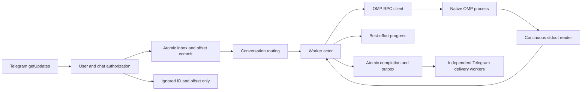

# 架构与开发说明

[English](architecture.md) | 中文 | [用户指南](../README.zh.md)

本文是当前实现的架构参考, 描述职责, 状态转换, 持久化, 失败处理和恢复. 安装, 配置示例和命令用法见 [README](../README.zh.md). 源码链接标明实现边界; 测试链接标明回归覆盖, 不代表已经验证真实 Telegram 客户端.

**目录**

- [职责与系统边界](#职责与系统边界)
- [组件与数据流](#组件与数据流)
- [启动, 配置与进程策略](#启动-配置与进程策略)
- [执行 worker 与 RPC](#执行-worker-与-rpc)
- [原生命令与 Telegram 菜单](#原生命令与-telegram-菜单)
- [Progress, status 与最终回复](#progress-status-与最终回复)
- [中断与保守恢复](#中断与保守恢复)
- [受管理的 autoresearch](#受管理的-autoresearch)
- [会话生命周期](#会话生命周期)
- [会话发现与管理](#会话发现与管理)
- [运行时设置与诊断](#运行时设置与诊断)
- [持久化与恢复](#持久化与恢复)
- [Telegram 交付与进度清理](#telegram-交付与进度清理)
- [附件与 host tool 文件边界](#附件与-host-tool-文件边界)
- [日志契约](#日志契约)
- [开发, 验证与发布](#开发-验证与发布)

## 职责与系统边界

Daemon 将 Telegram 对话桥接到原生 OMP session. 它负责鉴权, 路由, 进程生命周期, RPC transport, 任务状态以及 Telegram 交付. 模型执行, 工具, 凭据, 配置和原生 session history 由 OMP 管理. Bridge 不模拟终端, 不维护第二份模型上下文.

一个数据库属于一个 Bot. 每个受支持的对话有一个 worker 和一个 session binding: 普通私聊使用 thread ID `0`, 私聊 topic 和群组 topic 使用 Telegram thread ID. 群组 topic 内获授权用户共享同一个 session. 群组非 topic 消息不会被路由到推断出的 session. 独立 session 不等于文件系统或凭据隔离.

核心不变量:

- 每条输入和 callback 同时校验用户与 chat, 先鉴权, 后保留内容或下载附件.
- RPC stdout 消费独立于 Telegram HTTP 交付. 接受请求不等于任务完成.
- 异步工作绑定原 worker, client, generation, request 以及任务/session 范围. 过期结果不能修改替换后的 runtime.
- 持久化原生 session 文件身份, 不持久化 PID. 执行状态不确定的工作不自动重放.
- 任务结算与最终输出原子提交. 后续 `/new` 或 `/close` 不会取消已经提交的回复.
- 使用参数数组启动原生程序, 不经过 shell. 不隐式修改 OMP 的模型, 工具, 配置或 approval policy.

## 组件与数据流

| 实现 | 职责 |
| --- | --- |
| [`cmd/omp-telegram`](../cmd/omp-telegram/main.go) | CLI, 信号处理, 进程级数据目录锁 |
| [`internal/config`](../internal/config/config.go), [`config.go`](../config.go) | 严格 TOML 加载, 可执行文件相对路径, 内嵌 [`config.toml`](../config.toml), argv/environment 策略 |
| [`bridge.go`](../internal/bridge/bridge.go), [`steer.go`](../internal/bridge/steer.go), [`recovery.go`](../internal/bridge/recovery.go) | 路由, worker actor, 任务所有权, 排队, 结算, 启停恢复 |
| [`native_commands.go`](../internal/bridge/native_commands.go), [`command_menu.go`](../internal/bridge/command_menu.go) | 命令来源校验, 原生提交, Telegram 命令发现菜单 |
| [`autoresearch.go`](../internal/bridge/autoresearch.go), `research_*.go` | 原生研究准入, 控制, round 结算, disable 恢复 |
| [`session.go`](../internal/bridge/session.go), [`resume_picker.go`](../internal/bridge/resume_picker.go), [`binding_list.go`](../internal/bridge/binding_list.go), [`session_delete.go`](../internal/bridge/session_delete.go), [`export.go`](../internal/bridge/export.go) | Session 转换, 列表, reservation, 收藏, 删除, 导出 |
| [`args.go`](../internal/bridge/args.go), [`model_picker.go`](../internal/bridge/model_picker.go), [`doctor.go`](../internal/bridge/doctor.go) | 启动预设, 运行设置, 不改变 session 的诊断 |
| [`progress_status.go`](../internal/bridge/progress_status.go), [`reply_status.go`](../internal/bridge/reply_status.go), [`reply_metrics.go`](../internal/bridge/reply_metrics.go), [`watchdog.go`](../internal/bridge/watchdog.go) | 尽力而为的实时状态, 有界最终回复状态头, 保守的终结信号缺失恢复 |
| [`internal/i18n`](../internal/i18n/i18n.go), [`language.go`](../internal/bridge/language.go) | Bridge 中英模板与全局语言切换 |
| [`internal/omp`](../internal/omp/client.go) | RPC v2 分帧与关联, 进程管理, 原生 metadata, ACP session 列表, export/render/delete 委托 |
| [`internal/store`](../internal/store/store.go) | SQLite schema, inbox/outbox, binding, startup intent, 原子转换与保留清理 |
| [`internal/telegram`](../internal/telegram/client.go) | Bot API, Markdown 转 HTML, reply fallback, transport/交付确定性分类 |
| [`internal/media`](../internal/media/media.go), [`bridge/media.go`](../internal/bridge/media.go) | 鉴权后下载, workspace 限定的文件访问, snapshot 和附件生命周期 |
| [`internal/logging`](../internal/logging/logging.go) | 固定组件 logger, 同步 text/JSON 输出 |



Polling 在 worker 路由前持久化 update. 未授权或没有 sender 的 update 只保留 ID 和 ignored 状态, 同时推进 offset; 它们不能启动 OMP 或下载文件. 已授权的 typed update 保留路由所需内容. 处理输入和 callback 时再次检查鉴权. 回复, progress 和 export 对目标对话内所有可读成员可见, 不仅对提交者可见.

Polling 失败采用可取消的指数退避, 从一秒增加到 30 秒. Telegram 正数 `retry_after` 可将实际等待延长至该上限之外; polling 成功后重置退避. 持久化 offset 读取或 update 写入失败会终止 daemon, 不确认未提交输入.

### 身份与过期工作

| 身份 | 表示与范围 |
| --- | --- |
| Bot | `getMe` 返回的数字 ID, 用于数据库所有权检查; 不是 token 或 username |
| 对话 | `(bot, chat, thread)`; daemon 的 worker map 可使用 `(chat, thread)`, 因为 Bot 固定 |
| Binding | Workspace, 原生 session 文件路径及已验证 session ID, 持久化 generation, running/interrupted 状态 |
| Runtime | 当前 `omp.Client` 与进程内单调递增 client ID; 不使用持久化 PID |
| Root 任务 | Inbox ID, worker generation, turn 和拥有它的 prompt request |
| 异步 operation 或 picker | 捕获的 request/token, 以及对应 client, generation, session, catalog/preset revision, message/owner 范围 |
| Telegram 输入/输出 | Bot 数据库内的 update ID / bridge outbox ID, 不等于 Telegram message ID |

具体 fence 取决于操作类型; 单独检查 generation 不能替代任务, session 和菜单校验. Session claim 及 export/delete reservation 通过 `sessionMu` 同步, 只在本 daemon 内有效. 它们不锁定 workspace, 也不能阻止其他程序打开原生 history. Binding 不保存 Telegram chat type: 恢复零 thread 目标要求正数私聊 chat ID, 并继续检查当前 chat 白名单.

`daemon.lock` 阻止两个 daemon 同时打开同一数据目录. 数据库 Bot 所有权阻止另一个 Bot 复用数据库. 两者都不能阻止其他 poller 使用同一 token 和不同数据目录或 webhook; 部署必须保证单一消费者.

## 启动, 配置与进程策略

### 启停边界

[`main.go`](../cmd/omp-telegram/main.go) 在加载配置前处理 `--version`/`-v`. `--check` 加载并校验配置, 解析 OMP 可执行文件, 创建配置的数据和 workspace 目录; 不打开 SQLite, 不启动 OMP, 不访问 Telegram.

正常启动顺序:

1. 加载配置并创建 logger, 然后设置严格 umask, 获取独占 `daemon.lock`.
2. 初始化/迁移 SQLite, 整理上次运行遗留状态.
3. Telegram `getMe`, 数据库 Bot 所有权检查, 初始化持久化参数预设选择和全局界面语言.
4. 尽力注册 default 和 `zh` 语言范围的默认命令菜单.
5. 整理 progress 清理关联, 恢复符合条件的 session claim/worker, 执行保留清理.
6. 运行 polling, actor 路由, 四个交付 worker, 命令菜单更新, progress 清理以及可选的每日保留清理任务.

命令菜单注册失败不阻止 polling. 尽力而为的 UI 路径不能掩盖持久状态失败. SIGINT/SIGTERM 取消共享 context; worker 保守结算/取消未完成工作, 关闭所属进程, 等待后台工作结束后再关闭 store. Session 相关的关闭和未完成启动恢复见后文生命周期章节.

### 配置与路径契约

[`config.Load`](../internal/config/config.go) 解析 bridge 可执行文件符号链接, 使用真实目录作为默认路径基准. 隐式 `config.toml` 位于该目录; 只有隐式文件不存在时才回退到内嵌根配置. 显式文件缺失, 不可读, TOML 无效, 未知字段或字段放错 table 都报错. 显式相对 `--config`/`-c` 路径仍相对于调用目录.

| 路径或配置 | 解析基准 |
| --- | --- |
| 相对 `storage.data_dir` 和 `storage.workspace_root` | Bridge 真实可执行文件目录, 即使配置文件放在别处 |
| 可选 workspace root 为空 | 可执行文件旁的 `workspace/` |
| 默认 OMP binary | 从 daemon 的 `PATH` 查找 `omp`, 然后转绝对路径 |
| Lock, 数据库, 附件 spool | `storage.data_dir` 下 |
| 原生 OMP 配置, 凭据和 session 存储 | OMP 默认值或显式原生参数; bridge 不重定位 |

支持 `[telegram]`, `[omp]`, `[omp.environment]`, `[storage]`, `[worker]`, `[logging]` 和 `[logging.component_levels]`. 旧式平铺字段和错位字段会被拒绝, 不自动迁移. 两个白名单都必须非空; user ID 必须为正数, chat ID 不能为零. `max_workers` 范围为 `1..64`, `queue_capacity` 为 `1..1024`, 保留天数不能为负. 正数 Go duration 启用空闲释放; 空值, `0` 或 `disabled` 关闭.

TOML 解析后仅展开一次字符串引用: `$VAR`, `${VAR}`, `$$` 表示字面美元符号. 插入的环境变量内容不会再次展开, 也不能注入 TOML. 数值和白名单字段支持其文档中约定的环境引用字符串. 默认 `OMP_TELEGRAM_ARGS` 和 workspace-root 引用允许未设置; progress mode 无效或未设置时回退为 `summary`. 其他必需引用未设置时报错. Environment 策略的 mode/变量名以及仅展示的 `omp.args_labels` 保持字面值. 不读取 `.env` 文件.

`omp.args` 接受有序预设字符串数组, 或归一化为一个预设的标量字符串. 每项使用支持引号的 tokenizer 解析, 不经过 shell; 启动前校验全部预设. 拒绝覆盖 bridge 管理的 mode/cwd/session 选项及受保护短选项, `--`, NUL 字节. 只持久化归一化预设 fingerprint 与所选 index, 不保存原始参数. 选择语义和每 runtime 快照见运行设置章节.

### 子进程环境与隔离限制

[`omp.Environment`](../internal/omp/env.go) 为原生 RPC, ACP, model-query, render/export, 删除和诊断子进程过滤父环境变量. `denylist` 继承除显式 deny 名称外的全部变量. 随附配置排除 `OMP_TELEGRAM_BOT_TOKEN`; 加载器不隐式过滤秘密变量名. 自定义 token 变量若未显式 deny, 仍会继承. `allowlist` 要求显式 `allow` 列表, 可为空, 仅传递列出且已存在的变量. 每种 mode 都拒绝另一种列表, 即使列表为空. Bridge 侧 TOML 展开独立于该子进程策略.

显式配置下传递 provider 凭据是预期行为. 这不是 sandbox: 不传 `HOME` 或某个 token 变量, 不能阻止同用户文件/进程访问, 工具读取其他凭据副本或出站网络. 应使用可信 OMP 代码, 必要时通过部署层隔离. Bridge 不自动批准工具操作.

Linux 上通过 [`startProcess`](../internal/omp/process_linux.go) 启动的原生 RPC, ACP, model-query, render/export 和删除路径使用独立 process group 与 parent-death SIGTERM. 创建进程的 OS thread 在 `Wait` 返回前保持锁定, 因为 Linux 将该信号关联到创建线程. 这些路径正常关闭时可升级为 kill 所属进程组; parent death 本身不提供后续 SIGKILL 升级. `/doctor` 版本探针直接使用 `exec.CommandContext`, 不具备上述进程组/父死亡保护. 忽略信号, 继续存活的后代, 逃离进程组或清除 parent-death 设置都需要外部 containment. RPC/ACP stderr 被丢弃; render 路径解析仅在内部检查有界原生诊断. 原始诊断不会转发到日志或 Telegram.

## 执行 worker 与 RPC

### Actor 所有权与输入通道

[`worker`](../internal/bridge/bridge.go) 拥有一个会话的逻辑绑定, 活动 root, 延后 FIFO 队列, 控制状态, progress 和回调. 已连接进程是独立资源: runtime 状态为 `released`, `starting` 或 `connected`. `worker.max_workers` 限制已连接 OMP 进程, 而非逻辑会话数. 空闲释放可归还进程槽位, 但保留已验证绑定和原生 session claim.

| 通道 | 接纳与所有权 |
| --- | --- |
| Root | 无活动 root 时, 普通文本创建独立提交. 其 inbox 拥有最终回复及 Telegram 回复目标. |
| Steer | 活动 agent root 期间的普通文本通过原生 `prompt` 和 `streamingBehavior:"steer"` 提交. 它有 submitted inbox 和关联请求, 但不拥有独立最终回复或 progress 消息. |
| 延后 root | `/followup`, 附件, 桥接 `/review` 和已识别原生命令保留 FIFO 位置, 成为独立提交. 附件异步准备; 未准备好的队首不能被越过. |
| Control | 桥接控制和回调不进入 prompt FIFO. 慢速变更/控制 RPC 通过单一异步 operation 通道执行, actor 仍单独处理事件. 启动及部分有超时限制的 Telegram/RPC 调用仍可能占用 actor. |

`worker.queue_capacity` 限制排队 root 与未解决 steer 的总数. `/queue` 只读取当前 worker 的运行时 queue/active/busy 状态; Cancel 按钮取消选定 pending inbox 及准备资源, 不终止活动 root, 也不管理 OMP 原生 steer 队列. 关闭会取消等待输入. 重启后不自动重放队列输入或 uncertain 提交.

原生命令的 acceptance 若省略 `agentInvoked`, 仍保留 native owner, 新普通文本继续排队. 只有 `agentInvoked:true` 或 `agent_start` 能证明已进入 agent 执行, 从而在原回复 owner 下允许普通 root steering. `controlAbort` 期间收到的文本始终成为新的排队 root, 包括 Stop 期间才完成分类的未知 slash 文本. 托管研究使用特殊长期 owner, 不采用普通 root 的终结/settlement 规则.

### 传输与完成边界

[`Client`](../internal/omp/client.go) 拥有 OMP 进程组, 连续 stdout reader, 串行 stdin 写入, pending request ID 和异步事件转发器. 启动验证 `ready` 的传输限制并协商公开 RPC v2. `Call` 在写入前注册关联, 等待命令 acknowledgment, 而非 agent 完成. 响应 ID 和命令名必须匹配; 无关联/畸形响应按失败关闭处理, 已放弃 ID 的迟到响应直接丢弃, 不重新解释为事件. 文本 steering 还要求请求关联的 `prompt_result` 和 settlement 支持.

Root 请求发送前, inbox 必须已持久标记为 `submitted`. Steer 先验证帧大小, 预留 ID, 持久提交, 再注册 `(request, root, client, generation, turn, admission)`, 最后发送. 异步 operation 结果携带 client/generation/root/turn 围栏. 释放 runtime 会丢弃等待中的旧 client operation, 但正在执行的 RPC 通道须等结果返回才能释放. 进程在调用期间退出时, 退出策略也等待其结果; 旧退出围栏不能阻塞替换 runtime.

| 证据 | 普通 root 结果 |
| --- | --- |
| prompt acknowledgment 成功 | 仅表示接受; 除明确 local completion 外继续等待. |
| `agent_end` 且 `isTerminal:false` | 等待 continuation, 不派发下一个 root. |
| `agent_end` 未显式设置 `isTerminal:false`, 且有确认 assistant 文本 | `done`, 仍须满足 steer settlement, 并应用下列 assistant 错误/取消 metadata. |
| Assistant `stopReason:"aborted"` | `cancelled`, 保留已有部分文本. |
| Assistant error stop reason, 非空 `errorMessage`/`errorClassificationMessage`, 或非零 `errorStatus` | `uncertain`, 保留已有部分文本和安全通知. |
| terminal 事件没有确认文本 | `uncertain`, 明确完成的本地原生命令除外. |

Terminal 消息优先于当前 agent run 的 `message_end` 缓存, 不覆盖同一普通 root 中此前已完成轮次的输出. RPC v2 可从压缩后的 terminal 帧中省略已发出的消息, 因此 worker 保留 finalized assistant 文本, 必要时回退到当前轮缓存. Continuation 的 `agent_start` 开启新轮, 不丢弃此前已确认的输出; 每轮只重置最新终结 metadata. 任务结算和 teardown 才清空任务输出缓存. 没有活动桥接 owner 的迟到/主动 `agent_start` 不能重启 typing 或卡住队列. 托管研究仍使用独立的逐轮交付生命周期.

[`steerFence`](../internal/bridge/steer.go) 要求 root terminal 事件, 所有 steer 的 terminal 结果以及当前 session settlement 全部成立后才最终结算. Steer 状态 `completed` 映射为 `done`, `aborted` 为 `cancelled`, `error` 为 `failed`; 未知状态为 uncertain. 明确拒绝只使该 steer 失败, 不声称其指令已生效; 未确认传输结果会退役 runtime. 仅本地的 `agentInvoked:false` acknowledgment 可完成该 steer, 但 root 仍须有静止证据.

任何较晚收到的关联 `sessionSettled:false` 都会使先前 true 证据失效, 不受 admission 顺序影响. 只有最新 admission 的 true 结果能直接建立 settlement. 无请求键的 `session_settled` 只触发有超时限制的 `get_state.isSettled` 探测, 本身不释放围栏. 探测结果检查 client/generation/root/turn/revision, 并让已排队事件或缓冲 RPC 输出先处理. 新 `agent_start` 会丢弃延迟的旧 terminal.

### 资源与隐私边界

| 资源 | 上限及失败行为 |
| --- | --- |
| 物理 RPC 帧 | 最大 1 MiB, 按协商值进一步缩小. 出站超大请求在写入前拒绝. |
| 重组逻辑帧 | 最大 64 MiB, 验证 chunk 帧结构/顺序/长度. |
| RPC 缓冲资源 | 物理/重组容量及排队事件字节共享 64 MiB credit; worker 接收事件后归还其 credit. 队列槽位或字节超限使 client 失败. |
| terminal 前 assistant 文本 | finalized 加 pending 输出有 4 MiB 逻辑上限, 保留的 stream 另有 4 MiB 上限. Finalized 消息替换其对应流式文本的逻辑计数. 完成前超限是 uncertain, 不是成功后的显示截断. |
| 已确认最终显示 | 含 header/通知最多 1 MiB 和 32 条 Telegram 消息; 明确截断不会把确认完成的任务变为失败. |

逻辑帧容量与缓冲资源策略相互独立: 接近上限的合法帧在物理 chunk 或排队事件仍被保留时, 也可能耗尽 credit. RPC reader 从不执行 Telegram 投递.

[`reply_context.go`](../internal/bridge/reply_context.go) 只把 Telegram 提供的直接回复上下文加入普通 prompt, steer, followup 和当前附件 prompt. 显式选中 quote 优先于被回复全文. 否则使用文本, photo/document 标签, 文档文件名与 caption, 或不支持消息标记. 它不获取更早消息, 不递归回复链, 不下载被回复媒体, 不暴露发送者姓名/ID; 发送者标签只有 `bot` 或 `user`.

引用 envelope 含分隔符及 `...[truncated]` 最多 3000 UTF-16 单位; 此 helper 不截断当前用户消息. 引用内容中的保留分隔字符串会转义. 这是引用输入, 不是可信指令或授权边界. 桥接控制与一般已识别原生命令不附回复上下文 wrapper. 桥接 `/review` 保持 slash 命令在前, 将上下文追加在后. 队列预览使用当前消息文本, 而非引用 envelope. Telegram payload 持久化与最终模型输入仍含所提供的引用文本; 这是信息最小化, 不是秘密脱敏.

## 原生命令与 Telegram 菜单

### 原生命令识别与提交

[`catalog.go`](../internal/omp/catalog.go) 发布每 client 不可变目录, 区分 `CatalogUnknown`, `CatalogReady` (含空目录) 和 `CatalogUnsupported`. Discovery 异步且 single-flight. 只有原生明确 unknown-command 响应能证明 discovery 不支持; 拒绝, 超时, 畸形目录与传输失败不能互作回退状态.

桥接命令和隐藏 `/start` 优先. 只有单段命令由 1-32 个 ASCII 字母/数字/下划线组成, 且目标是 5-32 字符的 username 形状时, 才识别有效 `@bot` 后缀; 发给其他 bot 的命令会忽略. `/opt/user@host/file` 等路径仍是普通文本. Invocation parser 遵循 OMP 空白字符规则, 包含 BOM 而排除 NEL, 也接受 `:`. 原生查找先匹配首个字面空格之前的完整名称, 保留 `plugin:command` 等名称; 只有已发布 builtin 才启用额外分隔语法. 已发布但被拒绝的来源也按这些分隔符匹配, 防止回落为模型输入.

| 目录/来源 | 路由契约 |
| --- | --- |
| Unknown | Slash 输入在 FIFO 中等待分类. 普通非 slash root 的其他接纳证据具备时, 不必等待 discovery. |
| Ready, 可执行 | `builtin`, `skill`, `custom`, `mcp_prompt`, `file` 命令/别名进入 native 延后队列, 不作 steer, 不包回复上下文. |
| Ready, 未识别 slash 输入 | 保留文本, 按普通 prompt/steer 路由, 包括绝对路径. |
| Discovery 不支持 | 取消非桥接 slash 开头输入, 包括 followup/附件/steer 路径; 普通非 slash 输入和桥接控制仍可用. 明确具有桥接 `/review` provenance 的项保留例外. |
| Extension 或未知来源 | 识别后以通用通知拒绝, 不回显目录名称, 参数或原始来源. 只有精确 canonical extension `autoresearch` 使用专门 owner; 其别名及其他 extension 不继承权限. |

名称和别名是未经规范化的不透明字符串. 空名称, 前导 `/`, 非法名称/别名类型使目录无效; 特殊空白/控制/Unicode 名称本身不会. 缺失/null/非字符串/未知来源仍可识别但不可执行. 目录有效不代表当前 invocation parser 能调用所有保留名称.

Stdout reader 在唤醒后续响应 waiter 前发布主动目录更新. Query 记录实际 epoch 和 reader-update revision; session 改变或较新 update 优先于旧 query response. 相同 discovery 保持 snapshot/revision, 但即使内容相同的主动 update 也增加 revision. Worker 的目录事件只是唤醒信号, 不携带可重新应用的 snapshot. Lazy restore 后刷新 discovery.

Discovery waiter 超时/取消/拒绝不会推翻 reader 已发布的可用目录. 若仍 unknown, worker 暂停该 client/epoch 的 discovery, slash 输入继续 pending; 用 `/queue` 取消等待项可释放后续 FIFO 工作. Scope 改变或 reader update 可恢复分类. 真正传输/协议/进程失败仍使用正常 runtime 失败策略.

[`native_commands.go`](../internal/bridge/native_commands.go) 在提交前立即复核队首, 包括异步接纳工作之后. 它检查当前 source/name 与原生 session 身份; 命令消失或原生 session 改变会取消队列项, 绝不降级成模型文本. 同 session revision 改变不会取消仍有效的命令; 新 client 恢复同 session 也允许. 原始 slash 开头 followup 和已准备附件不能绕过 source/lifecycle 检查.

会改变生命周期的 `/move`, `/wt`, `/worktree`, `/session delete` 在路由和派发时都拒绝, 即使 discovery 不可用也如此. Session 拒绝只匹配不区分大小写且没有额外参数的 `delete`. `/session info` 和 `/session pin` 保持原生路由. 已保存绑定由桥接 session 生命周期 API 管理; 任意 extension 生命周期变更不在协调范围内. Snapshot 校验不是上游原子 check-and-execute, 桥接围栏也无法可靠识别没有 session 标记的旧 session 主动 update.

明确原生 local acknowledgment `agentInvoked:false`, 或请求关联的 local `prompt_result(status:"completed", agentInvoked:false)`, 无需 assistant 文本即可完成提交. 这不证明后台 operation 已结束. Local `error` 为 uncertain, `aborted` 为 cancelled, 缺失/未知状态为 uncertain; 通用通知与状态一起提交, 不泄露原始 RPC 错误, 不退役健康 runtime, 不重放命令. 仅目录识别不能实现原生 `/plan` 或 `/plan-review` 的 RPC 支持.

RPC client 消费私有元数据查询回复后, 已连接 runtime 的 `command_output.text` 通过 outbox 作为独立对话通知交付, 不关联 inbox. 该事件没有 request ID: 不改变任务预览或完成状态, 迟到输出也不会成为下一个根任务的最终回复. 忽略空白输出; 每个事件复用最终回复的字节, 消息数和 UTF-16 展示预算并在超限时截断. 只展示文字, 不展示 RPC frame, 不记录 payload 日志.

### 命令菜单发布

[`command_menu.go`](../internal/bridge/command_menu.go) 保留默认桥接菜单, 并发布 chat 范围的桥接命令与可执行原生名称/别名并集. Telegram 没有 topic 命令 scope: 同 chat topic 共享并集, 不同 chat 相互独立. 菜单可见性不授予执行权限. 名称本身须匹配 `[a-z0-9_]{1,32}`; 桥接条目/描述优先, 排除隐藏 `/start` 与被拒绝生命周期名称, 排序去重的原生条目填充剩余空间直到总数 100. 省略的可执行名称仍能手动调用.

恢复 worker 和开始轮询前, 启动流程在 `storage.workspace_root` 中运行一个有界的 `omp --mode rpc --no-session` 发现进程, 沿用已选启动参数和配置的环境, 不覆盖 OMP 设置. [`DiscoverCommands`](../internal/omp/catalog.go) 持续读取并丢弃事件, 请求官方目录, 返回前关闭并回收进程和事件读取协程. 发现 deadline 为 20 秒, 不发送 prompt, 不写原生 session 历史或 bridge binding/start intent, 在正常运行时名额投入使用前结束. 仅允许的 builtin 名称和别名填充内存回退目录; workspace 专属来源等待真实会话. 失败只记录通用分类, 保留 bridge 菜单及后续 worker 的发现路径.

每个 chat 在活跃 topic 公布权威目录前使用启动回退目录. 真实 topic 目录随后替换回退目录, 包括空目录和不支持目录. 未知目录清除该 topic 的旧贡献, 但不把回退目录替换成权威空列表. 移除或使最后一个已知贡献失效后恢复回退目录. 探针仍会正常初始化 OMP 配置和扩展; `--no-session` 不保证隔离或没有任何副作用.

可执行原生命令及别名使用 OMP 提供的说明, 规范为最多 256 个 UTF-16 单位的单行文本. 缺失, null, 非字符串或仅有空白的说明不使目录无效, 菜单使用通用说明. 被拒绝的命令不保留说明. 目录相等性包含规范化说明, 因而只修改说明也会推进 revision 并刷新菜单. 不同 topic 公布同名命令时优先非空说明, 多个非空说明选择字典序最小者, 保持 chat 并集确定性.

Session/catalog 失效清空旧 contribution. 逻辑 close/replacement/failure/shutdown 只移除该 worker 的 contribution; 空闲进程释放保留它. 指针 owner 与 inactive tombstone 阻止退役 worker 的迟到更新/移除. 启动时直接发布发现的 builtin 回退目录, 不先把 chat 菜单替换为仅含 bridge 命令的列表, 同时保留早到的权威目录.

单一后台 publisher 合并 dirty chat, 在 actor/reader 外以 20 秒 deadline 写入默认语言和 `zh` scope. 每 chat/language 缓存已确认列表, 跳过未变化的成功 scope. 发布失败不使任务失败. 不确定发布会清空先前成功缓存, 因 Telegram 可能已应用更新; 明确拒绝保留缓存. 菜单状态不在本地持久化, 已发布原生名称和说明对 chat 成员可见, 包括无权操作 bot 的成员. 原始目录, 描述和参数不进入菜单诊断.

网络不确定结果, 请求超时, HTTP 5xx 和限流通过既有 dirty/pending/wake 机制重新排入失败 chat. 每 chat 的指数退避从一秒起步, 上限一分钟; Telegram 的 `retry_after` 更长时遵守其要求. 这些间隔不是交付 deadline. Publisher 复用一个可取消 timer, 将退避中的 chat 轮转到就绪工作之后, 到期时重新计算最新语言和目录. 重复更新只合并, 不绕过退避. 每 chat 连续失败只在首轮记录 warning, 完整成功后重置. 明确的非 429 HTTP 4xx 拒绝不安排自动重试, 但后续 contribution/语言更新仍可在相同退避约束下触发新尝试. 测试使用 `testing/synctest` 覆盖持久化语言恢复, scope 部分成功, 最新状态选择, 重试边界, 日志抑制, 取消和永久拒绝.

### 界面语言

[`internal/i18n`](../internal/i18n/i18n.go) 只本地化 Bridge 自有模板, 默认英文, `/lang zh` 切换中文, `/lang en` 切回英文, `/lang` 查看当前设置. 语言设置在所有私聊和 topic 之间全局共享, 不根据 Telegram 用户语言推断, 不附着于 OMP session 或 binding. 通过原有鉴权的调用者均可修改. 任务执行及迁移未解决期间也能使用该命令, 不提交 OMP 工作, 不清除迁移锁.

[`language.go`](../internal/bridge/language.go) 在 worker 启动及恢复通知之前读取单例设置. 互斥锁串行化数据库写入和内存原子发布, 避免并发切换造成持久值与运行值顺序倒置. Worker 读取共享的原子设置, 不保留独立副本. 持久化失败时保持当前语言. 关闭或替换 session, 删除 binding 均不重置语言. Telegram 默认及 `zh` 菜单 scope 都使用选定的全局语言; 切换会将全局菜单和所有已知/配置的 chat 菜单标为 dirty, 由既有后台 publisher 刷新.

[`Message`](../internal/i18n/i18n.go) 是英中字段私有的结构体. 静态 [`Msg` 目录](../internal/i18n/messages.go) 为每个双语对象提供稳定的语义名称. 小范围 `Task`, `Session`, `Queue`, `Language` 分组收纳相关词条, 例如 `i18n.Msg.Task.SubmissionUncertain` 和 `i18n.Msg.Queue.Full`; 其余词条保持扁平, 按需迁移. 名称不依赖英文措辞, 移除的扁平名称不保留别名. 英文文本不再作为查找 key. `Text` 和 Bridge 的两个 `tr` helper 只接受 `Message`, 因而原始字符串, 不存在的词条名及缺少构造参数都会编译失败. 修改英文措辞时在同一词条中维护中文, 不再同步另一份查找 key. 类型化 Bridge 错误和稳定的 media/store sentinel 显式选择词条, 不按英文措辞识别不透明错误. 调用点先选择语言模板, 再填入用户/原生值, 不翻译拼接后的输出, 不在通用交付层拦截翻译. 原生 OMP 文字及交互内容, 模型回复, 工具参数/结果, 路径, session 标题和用户 caption 均不翻译. 既有渲染限制和脱敏行为保持不变. 排队媒体将 caption 与 Bridge 默认标签分开, 新渲染的队列使用最新语言. 不重写已经渲染的 outbox 文本或已交付消息.

Telegram 各 scope 分别请求更新, 不是跨 scope 原子操作. 旧语言的在途发布可能短暂可见, 随后由已排队的语言刷新收敛. 回归测试在语言切换时阻塞发布, 确认所有默认/chat scope 最终使用中文, 再快速切换并确认收敛到英文. Task 不保存启动时的语言: 新生成的 Bridge 回执使用当前全局设置, 此前已渲染的 outbox 文本和 OMP 回复正文不变.

`progress.NativeStatus` 缓存已渲染的 Bridge 状态文本. 切换语言不会立即重建缓存: 下一次通过校验的原生状态结果按完成时的全局语言生成, 包括 RPC 查询在途期间发生的切换. 正常采样间隔为五秒, 但仍受 RPC 成功及身份 fencing 约束, 不保证五秒内刷新. 已有进度消息在下一次正常更新时编辑, 不增加缓存 epoch 或 task 语言字段. 原生 OMP 扩展文本不在此保证范围内.

词条构造函数拒绝空语言文本. 测试使用反射递归遍历 `Msg` 的扁平词条和嵌套分组, 检查英中两种文本及有序格式指令, 包括参数数量, verb, width 和 precision; 不维护另一份运行时注册表. 嵌套词条回归覆盖缺少翻译和格式参数不匹配. 检查器理解顺序 `%s`, `%d`, `%f` 指令, 忽略转义的 `%%`; 不支持的语法会失败, 不会被静默跳过. 使用新的格式语法前需先扩展检查器. `formatDirectives` 保持在 `_test.go` 中. 这保护类型化翻译路径, 不检查主动绕过该路径发送的任意原始文本.

### 原生对话与 session operation

[`worker.ui`](../internal/bridge/bridge.go) 将原生 `confirm` 映射为 Confirm/Cancel 按钮, `select` 映射为每页十个选项且可取消的 picker. 空 select 会取消. `input`/`editor` 请求被取消并提示发送普通文本; widget 和一般原生输出不是终端 UI 仿真. Token 绑定 owner/generation/client 且单次使用; selection 还绑定菜单消息. 不同于 bridge 自有菜单, 原生对话没有 bridge 过期时间, 翻页也不会增加期限: 原生 deadline 和 cancel 信号由 OMP 管理. 没有取消时, 按钮一直有效到用户决定, 任务结算或 runtime/session teardown, 等待期间阻止正常空闲释放.

原生 cancel 使匹配 token 失效. Teardown 先移除失效 token, 再进行有界键盘清理. 菜单 receipt 记录用户选择, 不是操作成功; confirm/select 写入失败按保守策略退役 runtime.

手动 `/compact` 要求逻辑 session 空闲, 不要求进程已连接; 恢复已释放 runtime 后直接开始, 无需确认. 它尝试用五秒超时发送无按钮 `Compacting...`, 再以 180 秒 deadline 在 operation 通道执行原生 `compact`. 成功后 `get_state` 在剩余 deadline 内最多再用三秒. 缺失/非法 usage 或采样失败显示 `n/a`, 不把确认完成的 compaction 改为失败. 不同且非空的原生 session ID 还会退役 runtime, 保留原绑定/claim. 完成后替换状态消息; 状态消息不存在或 edit 失败则经持久 outbox 发送结果.

`/handoff` 要求 session 控制空闲且队列为空, 将可选 `customInstructions` 传给原生 RPC, 并阻止后续队列在结果返回前派发. Operation deadline 为 180 秒. Compact/handoff 明确拒绝保留可复用 runtime; 错误, 超时, 取消及未确认结果释放 runtime 供 lazy resume. 两者都不创建模型 root, 不借用其 progress/Stop 键盘. Session/model/argument 选择及原生 export/path resolution 是独立生命周期接口; [`render.go`](../internal/omp/render.go) 通过 `omp render` 解析原生历史路径, 不负责 Telegram 最终答案格式化.

## Progress, status 与最终回复

### 尽力而为的 progress

[`worker.renderProgress`](../internal/bridge/bridge.go) 使用单条可编辑内存 preview. 每 1.5 秒 worker tick 在三秒初始延迟后判断是否创建. `off` 关闭 progress Send/Edit 和 typing, 但继续累积文本供最终回复. `summary` 显示输出, 状态和活动工具; `verbose` 增加有界原始参数, 最新 partial/final result 和最近五个工具结果, 另计省略的更早调用数. Retry/compaction 有明确状态. 只有匹配 `tool_execution_end` 才完成工具; host callback 可修正名称/参数但不能虚构完成. 不显示 reasoning 或整帧.

最多显示六个活动工具, 名称最多 64 单位, payload 字段最多 100 UTF-16 单位, detail 总预算 1600 单位, output tail 最多 2200 单位, preview 总预算 3500 单位. 有界 JSON payload decoder 扫描事件但只复制有限前缀. Verbose payload 不脱敏, 可向所有能读此会话的人暴露凭据或私有文件; 截断不是隐私过滤.

Root Stop 按钮检查 owner, generation, active inbox 和 turn. 有效点击先消费 token 再请求中断; 旧按钮不能终止后续工作. 初始 Send 失败抑制该 turn 后续 progress, 避免重复消息; Edit 失败仍可重试. Preview 和最终回复尽可能回复 root 的原 Telegram 消息; 回复目标被拒绝时可退回普通消息, 不改变执行状态. Progress 清理由持久完成/输出投递驱动, 不证明 preview 曾可见. Typing 至多每五秒一次, 四秒超时, 在完成, turn 变化, runtime release 和 shutdown 时取消.

Stop callback 确认和键盘清理在 actor 外的有界 UI 通道执行, 受 worker 取消控制, 单次请求的 deadline 为五秒. Owner, 过期时间, generation, active inbox 和 turn 检查仍由 actor 执行, 中断前的 token 消费也留在 actor 内. 通道只接收 UI 目标和回执文本; 迟到结果不能改变任务所有权, 结算或重放任务. 背压可以丢弃 UI 操作, 不丢弃停止请求. 其他 callback 类型保留原行为.

### 原生 status 投影

[`status.go`](../internal/bridge/status.go) 只解码可安全展示字段, 不解码原始模型配置. 详细 `/status` 显示 workspace, session/name, provider/model, configured thinking, fast 设置/实际活动, 原生 context usage, streaming/compaction, 桥接队列长度, 原生速度, runtime 连接状态和空闲时长. 缺失/非法数据为 `n/a`, 不估算. `Running` 是原生 streaming, 不是桥接 active-root 判定. 检查已释放的 running binding 可临时恢复再释放已持久且空闲的 runtime; 新输入, pending work/UI 或缓冲输出会阻止过早释放.

[`progress_status.go`](../internal/bridge/progress_status.go) 独立于变更通道采样已连接的运行 root: 初始 progress 延迟后至多每五秒一次 `get_state`, 仅一条在途, 三秒 deadline. 它不启动进程, 不改变 idle-watchdog 证据. 结果须匹配 request/client/generation/root/turn/catalog epoch 和绑定/原生 session. 失败只清空 UI block, 不结算或重放任务. Task/session/runtime 变化取消旧采样.

[`compact_status.go`](../internal/bridge/compact_status.go) 在一个逻辑行显示有界字面 model ID (不带 provider), 原生 thinking 符号, fast 活动, context 百分比/窗口容量和原生速度. 未知字段省略, 不从 text delta 估算 tokens/s. Thinking 来源是由本地 `/effort` 元数据查询和 `thinking_level_changed` 填充的 runtime configured-selector 缓存, 而非有效 `get_state.thinkingLevel`. 未知/model-default/不可调 selector 不显示 compact 符号, 详细 status 为 `n/a`. Runtime 停止清空缓存. 可选 configured-selector 读取失败不推翻已验证设置变更; 已 stopping client 仍不能复用.

### 已确认最终渲染与指标

[`reply_metrics.go`](../internal/bridge/reply_metrics.go) 独立于 progress 模式, 只在成功文本回复首条消息添加 header. 主 agent assistant `message_end` 提供 model/provider 身份与安全数字 usage/duration; terminal summary 不重复计数. 平均生成速度为 `sum(output tokens) * 1000 / sum(duration_ms)`, 不包含 queue/tool 时间, 要求正输出且总 duration 至少 100 ms. 任一贡献调用指标缺失/非法就省略平均值, 不显示部分聚合. 每个 root 或成功托管研究 round 重置计数.

最终 context 使用最后一次调用包含输出的 usage: 优先显式 `contextTokens`, 否则用正 `totalTokens` 或完整 input/output/cache 总和, 再减 orchestration input/output/cache-read usage, 最低为零. 缺失, 负值或溢出不估算. 这不同于可能仍指向最终 input anchor 的 `get_state.contextUsage.tokens`.

确认文本完成后, [`reply_status.go`](../internal/bridge/reply_status.go) 独立发出一秒 deadline 的 `get_state`, 获取当前窗口/model 和 idle 证据. 只有 model/provider/native session 匹配, 且明确非 streaming/非 compacting 时才显示 context; 百分比由含输出 usage 与采样窗口重新计算. Thinking/fast 也须匹配 model 身份. 该 query 不能释放变更通道. Client/generation/root/turn/catalog epoch/session 围栏拒绝迟到结果; 新输入, 原生活动, retirement 或查询失败时, 使用已知 model/average 字段提交确认答案. 无害元数据/完成尾事件可继续消费而不替换答案.

被接受的 header 与答案进入同一 inbox-completion/outbox 持久事务; commit 前失败保留 uncertain/不重放恢复语义. Header 空间, Markdown-aware 分割/fence repair 与明确截断共享 1 MiB/32 消息显示预算. Error/cancellation 通知及 local command receipt 不加成功 header. 附件/输出传输仍由 media 和持久投递接口负责.

Terminal 错误通过 [`ClassifyError`](../internal/omp/errors.go) 暴露固定 RPC 失败类别, 而非原始 rejection. Assistant 失败可附最多 512 单位的 `errorMessage` 摘要, 先过滤 credential, request/trace/correlation ID, URL 和文件路径; 歧义的无键 secret 标记会抑制整个 detail. HTTP 429 或已识别 rate-limit 分类只生成通用 provider 限流通知. `errorClassificationMessage`/`errorStatus` 用于分类但不直接复制为原始 detail. 此过滤不脱敏普通 assistant 答案或 verbose tool payload.

## 中断与保守恢复

### Stop 与 runtime retirement

无 steer fence 时, Progress Stop 保留延后桥接任务, `/stop` 取消请求当时已等待的任务. 普通原生 `abort` 使用已连接进程, 不 lazy restore. Abort acknowledgment 成功也不能隔离原生异步 continuation, 所以桥接在释放后续工作前立即终止旧进程组, 不排空 stdin. 仍活动的 root 成为 `cancelled`; 已持久结算的 root 不重写. 原 binding, generation 和 session claim 保留, 后续工作在替换进程上 lazy resume 同一原生 session. Abort 期间收到的新文本始终是独立排队 root.

有 steer fence 时, 两种 Stop 都先终止进程, 再将 root 和未解决 steer 标记为 `uncertain`, 因普通 abort 无法安全撤回原生排队输入. Progress Stop 保留 followup; `/stop` 清空它们. 研究有独立 owner/off 确认策略. 终止不能撤销工具副作用, 也不保证未保存/损坏原生 session 可恢复. 原生队列移除 API 不作为权威的逐 prompt 取消或旧事件屏障.

无桥接活动 root 时, Stop 先以五秒 deadline 异步探测原生状态. 只有明确 idle/settled, 无报告的 async/queued native work, 无桥接 session operation, UI/host request 或缓冲输出, 才保留 runtime. History 文件存在与否不是活动证据; 确认空闲但未保存 session 仍可保持连接. 其他情况执行正常 abort/retirement. 明确 abort 拒绝保留 client; 未确认 abort 则退役 client, 将仍活动 root 标记 uncertain, 然后在新 runtime 继续保留工作.

普通 root 提交失败/acceptance 未确认, 意外进程退出, terminal 前 assistant 超限及原生 UI response 写入失败会退役 runtime, 并取消普通等待工作. Root acceptance 仍有 30 秒 deadline, 即使原生 `/review` picker 正等待用户选择; 这不是已接受模型执行的时间上限. 写前超大拒绝报告未发送任务. Steered/research retirement 有自己的队列保留策略. Retirement 清除 session/control/compaction 状态, 持久结算中断 owner, 保留逻辑绑定供显式复用. 原生历史不存在仍是 restore 失败, 绝不据此虚构替代 session.

### 缺失完成的 watchdog

[`watchdog.go`](../internal/bridge/watchdog.go) 是保守 uncertain 路径, 不是成功检测器. 活动 busy 普通 root 只有在 30 秒无活动且无 compaction/session work, retry, 运行工具, host request 或 native UI wait 时才可探测. 后台 `get_state` probe 五秒超时. Idle 要求显式 `isStreaming:false` 和 `isCompacting:false`; 字段缺失/null/畸形或 error 都不能证明 idle. 两次确认须至少间隔 30 秒, 才将缺失完成结算 uncertain, 并在队列派发前退役旧 runtime. 逻辑 session 和排队 root 保留供 lazy resume, 绝不重放 uncertain root.

每个事件, 包括 unknown/malformed 输入, 以及普通 RPC 活动都会使 idle 证据失效. 结果检查 client/generation/turn/active-inbox/activity-revision 围栏, 已排队事件和缓冲输出优先. 显式 nonterminal `agent_end` 记录 `awaitingContinuation`, 抑制普通 watchdog 恢复, 直到新 `agent_start`, settlement, dispatch 或 teardown; 不为合法静默 native async continuation 虚构普通 root deadline. 托管研究不进入该 watchdog.

Steer fence 是 nonterminal 抑制的例外. Streaming, compaction, tool, retry 和 UI 仍阻止恢复. 明确 idle snapshot 若报告 native async/queued work, 从首次连续 idle-pending 确认开始给予五分钟, 重复确认不持续重置计时. 活动, 非 idle/不合格证据或 pending work 消失会重置. 达到期限后的当前 idle-pending 确认会终止进程, 将 root/未解决 steer 标记 uncertain, 同时保留桥接 followup. 这限制卡住的原生队列, 但也可能中断完全静默且 pending 满五分钟的合法工作.

## 受管理的 autoresearch

### 能力和所有权

Bridge 管理研究操作的所有权, 不管理实验本身. 实验准备, Git 操作, 产物和自主续跑属于原生扩展. 启动不增加 bridge 的审批绕过. 实现分为[研究路由和轮次所有权](../internal/bridge/autoresearch.go), [准入](../internal/bridge/research_admission.go), [控制](../internal/bridge/research_control.go)和[终态确认](../internal/bridge/research_settlement.go).

命令目录只对以 `extension` 来源公布的规范名称 `autoresearch` 开放有限例外. 扩展别名, 其他扩展使用的 `autoresearch` 别名以及未知来源都不会获得该权限. 受管理的研究还要求命令在当前目录中保持可执行; 排队命令会重新校验所属会话和来源. 参见[目录分类](../internal/omp/catalog.go)和[原生命令路由](../internal/bridge/native_commands.go).

| 输入 | 含义 |
| --- | --- |
| `/autoresearch <goal>` | 将目标提交给原生处理器. |
| 空参数 `/autoresearch`, 模式已关闭 | 通过原生处理器开启模式. 它可以不调用模型而在本地完成; 下一条普通提示才提供研究任务. |
| 空参数 `/autoresearch`, 模式已开启 | 通过受管理的控制路径关闭, 不等待自主研究根任务结束. |
| `/autoresearch off` | 显式要求确认关闭, 也用于从模式不确定状态恢复. |
| `/autoresearch clear ...` | 请求破坏性的原生清理, 必须通过空闲检查和确认. |

因此, 开启模式和启动代理任务是两个步骤. 已确认的本地启动拒绝或本地原生命令会正常结束, 不保留虚假的研究根任务.

### 保存模式和派发准入

[Client.AutoresearchMode](../internal/omp/autoresearch.go) 读取当前原生分支保存的控制意图, 不重建实验状态, 也不证明依赖 Git 分支的工具实际激活状态. 因此, 即使原生扩展无法继续, 保存的开启模式仍可能使 bridge 保留受管理的任务所有权; 通知和工具可用性不能替代权威模式证据.

读取过程如下:

1. 通过 `get_state` 获取原生会话 ID 和历史文件的绝对路径.
2. 只读取 JSONL 文件的祖先关系和控制元数据, 再以最后一个有效磁盘条目的 ID 为 `since` 调用 `get_entries`. RPC 提供权威后缀和当前 `leafId`.
3. 再次核对会话 ID/路径, 遍历当前叶节点的完整父链. 最近的 `autoresearch-control` 决定 `on`, `off` 或 `clear`; 其他分支不参与模式选择.

这样无需通过逻辑消息上限为 64 MiB 的 RPC 传输完整历史. 元数据不保留模型或工具载荷. 尚未落盘的新会话完全依靠 RPC. JSON 语法错误使磁盘读取停在有效前缀; 后续权威条目必须由 RPC 补齐, 包括文件中间损坏记录之后的条目. `version < 2` 的旧头部, 包括没有版本的头部, 改用原生内存迁移后的初始 RPC 快照, 不使用磁盘祖先关系. Bridge 不修复或重写历史文件.

有效空分支或没有控制条目的分支表示关闭. RPC 必需字段缺失, 控制条目无效, ID 重复, 祖先断裂或成环, 会话头身份不匹配, 历史不可读或不是普通文件, 以及查询失败或不一致, 都不能解释为关闭. 无法确认模式时, 准入会取消尝试中的队首输入, 暂停等待工作.

[准入证据](../internal/bridge/research_admission.go) 只属于一个队首, 绑定客户端, 绑定代次, 轮次, inbox ID, 命令目录 epoch/revision 和原生会话. 目录 revision 变化要求重新查询; 会话或 epoch 变化拒绝原准入. 取消, off, 运行时退役和提交都会使证据失效, 下一根任务不能复用. 查询通过可取消操作通道在 actor 外执行; Stop 和关闭仍可处理.

待发现的斜杠输入必须先分类再派发. 目录发现期间, 已确认关闭允许普通根任务启动, 已确认开启则等待规范扩展. 目录发现结束且不含该扩展时, 不应用研究准入. 发现过程原地转换排队的研究输入, 保留 FIFO 位置; 立即处理的控制只移除自己的队列项.

### 根任务所有权和代理轮次

[Worker 事件分发器](../internal/bridge/bridge.go) 区分已提交根任务和其中的代理轮次. 模式开启时, 下一次代理任务成为研究所有者. 其 inbox, 请求所有权, 轮次和进度关联在连续的 `agent_start`/`agent_end` 之间保持不变. 结束事件, 看似终态的根请求 `prompt_result`, 短暂空闲或已稳定通知本身都不能完成根任务. Bridge 不重放目标, 也不生成续跑提示.

每个成功轮次向持久化 outbox 追加有界回复, 根任务保持 `submitted`, 然后清空轮次缓冲. 没有新开始事件的重复结束事件不会再次追加该轮回复. 原生命令准入进入代理执行后, 普通文本可以引导同一个所有者, 包括轮次间隙; 在该边界之前则继续排队. 原生命令, 附件和 followup 保持延后. [通用引导完成逻辑](../internal/bridge/steer.go), 看门狗和空闲释放不能在轮次之间结束研究.

原生命令根任务仍拥有本地完成边界时, 排队目标或开启模式的切换命令不会启动竞争的路由查询. 如果根任务进入代理执行, 延后的空参数切换命令通过重新校验会话/目录返回立即控制路径. Off 接管会取消排队的空参数切换命令, 包括尚未分类的输入, 防止它们稍后重新开启研究; 普通工作和非空目标继续排队.

自然完成使用独立的[终态探测](../internal/bridge/research_settlement.go). 当前轮次关闭且引导请求全部解决后, 保存模式必须为关闭, 且 `get_state` 必须明确报告:

| 字段 | 必需值 |
| --- | --- |
| `isStreaming`, `isCompacting` | `false` |
| `isSettled` | `true` |
| `hasPendingAsyncWork` | `false` |
| `queuedMessageCount` | `0` |

模式开启或仍有待处理工作时保留所有权. 字段缺失或查询错误会将根任务退役为 `uncertain`, 暂停队列. 结果受客户端, 代次, 根任务/请求, 轮次, 目录/会话, 终态修订号和引导准入约束. 接受关闭证据前, actor 先处理已排队的原生事件并检查 reader 缓冲输出; 新轮次或引导会使旧证据失效. 确认完成后将根任务标为 `done`, 不复制已经提交的轮次回复.

### Stop, 显式 off 和未确认关闭

[研究控制](../internal/bridge/research_control.go) 按 actor 拥有的阶段执行: 查询, 身份/目录校验, 最终空闲检查, 提交, 接受, 关联的本地完成, 以及控制后的模式确认. RPC 闭包只返回结果, 不修改 worker 状态或消费原生事件. 本地研究命令完成要求同时具备接受结果和匹配的 `prompt_result`, 其中 `status=completed`, `agentInvoked=false`, `sessionSettled=true`; off/clear 还要求后续证据确认保存模式已关闭. 通知从不作为完成证据. 展示通知经过净化和长度限制, 每个轮次/本地控制最多八条.

| 操作 | 等待工作 |
| --- | --- |
| 进度 Stop | 保留延后工作; 活动研究关闭后才恢复派发. |
| `/autoresearch off` | 保留延后工作; 确认关闭, 不引导或中止普通所有者. |
| `/stop` | 取消队列, 然后停止/关闭当前所有者. |

已有作用域有效的关闭证据, 或新查询证明普通所有者处于关闭模式时, 显式 off 只读: 不提交原生 off, 保留普通任务, 运行时, 绑定和回复. 查询失败会将控制标为不确定并暂停后续派发, 但普通任务继续运行. 重复只读 off 或替换尚未提交的路由查询不会退役普通运行时; 确认关闭会解除暂停.

普通 abort 无法隔离活动研究的异步行为. Stop/off 会退役其进程组, 将被中断的根任务和未解决引导标为不确定, 再恢复完全相同的原生会话以关闭模式. 已开启但空闲的运行时可以原地完成 off. 发送原生 off 前, 必须检查身份, 文件/工作目录, 会话占用, 目录来源, 以及空闲/稳定/无待处理工作状态. 接受结果, 关联完成和控制后的关闭证据共同决定保留工作何时可派发. 失败保留 `disablePending`, 关闭已变更或结果不确定的运行时, 不重放控制. 中断加载中的控制同样会退役不确定工作; 取消本身不能证明模式已关闭.

冷恢复关闭要求原保存文件和工作目录可用, 会话未被冲突占用, 且有运行时容量. 已连接会话可以在历史文件尚未存在时确认 off. 恢复不会虚构替代会话. Stop 中断阻塞的准入查询时, 会先退役该运行时再尝试关闭, 不把另一个查询排在它后面. 终止无法撤销工具副作用, 也不能保证会话仍可恢复.

### 破坏性 clear 和崩溃恢复

Clear 要求实例空闲, 队列为空, 没有未解决引导, 并取得绑定到聊天, 话题, 消息, 代次和目录 epoch 的所有者确认. 原始参数保持不变. 忙碌时拒绝 clear, 不延后保存; 原始 followup/附件文本不能绕过确认. 确认后会重新检查可用性, 模式, 作用域和原生空闲状态. Off 和 clear 在最终空闲查询后重新校验作用域; 来源被撤销或会话变化时禁止提交. 这不是上游原子化的检查并执行事务.

[原生 clear handler](https://github.com/can1357/oh-my-pi/blob/main/packages/coding-agent/src/autoresearch/index.ts) 可能硬重置已跟踪文件并删除未跟踪文件. `--keep-tree` 只抑制工作树的 reset/clean, 不抑制产物清理: 原生研究产物仍可能被删除, 因此该参数不代表 clear 没有破坏性. Bridge 会警告破坏性行为, 但无法撤销; 产物/工作树清理由原生代码负责, 不由 bridge 实现. 未确认的 clear 不会自动重试.

[启动恢复](../internal/bridge/recovery.go) 恢复会话身份, 不恢复自主操作. 中断的已提交工作变为不确定, 等待工作被取消; 关闭/崩溃之后不重放目标或进行中的控制. 原生保存模式可能继续存在: 下一次显式提示重新获取准入证据, 或显式 off 先恢复原所有者并确认关闭. 关闭运行时不证明保存模式已关闭.

## 会话生命周期

### 逻辑会话与运行时

对话绑定保存所选工作目录, 原生会话 ID, 会话文件路径及代际. 它不是 PID. 绑定的 `running` 表示逻辑会话可以按需恢复, 不表示已有 OMP 进程连接. 原生历史与会话标题仍由 OMP 管理.

| 状态或转换 | 契约 |
| --- | --- |
| 未绑定 | 没有已提交的工作目录/会话; 通过 `/new` 或显式 `/resume ID` 选择. |
| 开启且已连接 | 已验证的运行时占用一个进程名额, 并持有该对话的原生会话认领. |
| 开启但已释放 | 保留绑定与逻辑认领, 不持有运行时或进程名额. 需要 OMP 的操作先恢复原来的确切会话. |
| 启动待定 | 已有持久化启动意图, 但尚未发布验证后的绑定. 这不是自动重试许可. |
| 已关闭 | `/close` 取消启动意图, 持久化 `running=false`, 清理运行时/任务状态并释放认领. 工作目录, 原生历史和已保存绑定仍保留. |
| 运行时意外退出 | 活跃任务标为不确定, 等待任务被取消, 运行时被退役. 逻辑绑定仍开启, 不重放任务. |

[`worker.ensureRuntime`, `closeLogicalSession`, `failed` 及运行时转换](../internal/bridge/bridge.go)区分这些状态. 显式成功的 `/new` 和 `/resume` 推进绑定代际; 惰性恢复不推进代际.

### 工作目录选择与原生所有权

`/new <name>` 将单级名称放在 `storage.workspace_root` 下. 绝对路径和 `~/path` 可以选择项目目录. 解析器拒绝控制字符, 多级相对路径以及本身为符号链接的命名工作目录, 但会解析项目路径中已有部分的符号链接. 新会话需要的缺失目录按 `0700` 创建, 仍受进程 umask 约束. 不带参数时, `/new` 复用对话已保存的工作目录; 尚未保存时直接使用工作目录根路径, 不生成对话专属子目录. 读取绑定失败不会静默回退.

不存在工作目录租约或准入锁. 不同原生会话和 worker 可以使用同一目录, 修改相同文件或 Git 状态. 会话认领只防止本守护进程重复打开同一个原生对话, 不阻止共享文件系统的并发访问. 参见 [`resolveWorkspace`](../internal/bridge/workspace.go) 和 [`worker.newWorkspace`](../internal/bridge/bridge.go).

`/resume ID` 将会话查找交给 OMP, 可能恢复该会话原来的目录; 不会重新创建已缺失的原目录. 桥接层接受 8-64 字符的十六进制/连字符 ID 或前缀, 拒绝首尾连字符, 并核对返回的完整原生身份. 从选择器恢复时还必须匹配列表所属的规范化工作目录.

### 启动意图, 验证与提交

用户请求的启动有两个持久化发布边界:

1. 预留运行时名额, 替换已有连接时可复用名额; `/new` 还要准备目录.
2. `PrepareStart` 将目标, 类型和下一代际写入 `startup_intents`. 事务核对预期旧绑定或确实未绑定的目标, 并使旧运行中绑定不再可惰性恢复. 只有准备成功后才拆除被替换的旧运行时.
3. 使用冻结的 argv 快照启动 OMP. 在提交用户任务前通过 `get_state` 身份和本地 `/session info` 获取元数据. 核对原生 ID, 绝对会话文件路径和可用 CWD. 显式恢复核对请求 ID 前缀; 惰性恢复核对原文件身份与完整 ID; 指定了预期工作目录时必须规范化匹配.
4. 认领验证后的原生会话, 查询可选的 configured thinking, 并注册必需的 Telegram host tools.
5. `CommitStart` 发布 `running=true` 的已验证绑定并删除意图. 至此新逻辑会话才就绪. 惰性恢复则保留已有绑定与代际.

[`startInternalWithArgs`](../internal/bridge/bridge.go)负责此流程; [`Client.SessionInfo`](../internal/omp/session.go)不启动模型轮次即可取得身份. 新原生会话可能已获得 ID 和绝对文件路径, 但尚未写入历史文件; 身份查询不会创建历史文件.

这些事务不保证子进程恰好启动一次. 启动失败可能留下未解决意图, 因为原生结果仍不确定. 启动后验证失败会关闭失败运行时; 惰性恢复失败保留已保存绑定, 不提交提示词. 恢复流程保留未过期且未解决的意图, 报告不确定状态, 要求先 `/close` 再显式 `/new` 或 `/resume`. 保留策略可以移除陈旧的桥接意图, 但不能证明 OMP 未创建会话, 也不能撤销其效果.

### 事务化上下文迁移

[`migration.go`](../internal/bridge/migration.go), [`migration_claims.go`](../internal/bridge/migration_claims.go), [`Store` 迁移事务](../internal/store/migration.go) 和内嵌的 [Extension Command](../extensions/omp-telegram-migrate.ts) 实现 `/migrate`. 命令名为 `omp_telegram_migrate_v1`, 不是 Hook 命令: 所需 `reload` 由 `ExtensionCommandContext` 提供. 不修改 OMP 核心, 不改变审批策略, 初始化不启动模型回合. Bridge 只在 `omp.migration_extension = true` 时加载该 Extension, 默认为 `false`.

[`config.go`](../config.go) 内嵌 Extension. 启用时, [`prepareMigrationExtension`](../internal/config/migration_extension.go) 在 `<storage.data_dir>/.bridge-extensions/` 中以内容寻址文件名原子释放 `.ts` 文件, 使用私有目录/文件权限, 拒绝缓存符号链接. 使用与 worker workspace 无关的绝对路径, 内容版本化使另一个二进制或 `--check` 不会替换现有 runtime 使用的代码. 配置加载器向每个解析后的预设追加独立的 `-e` 和路径 argv, 再计算参数指纹. 普通启动, 惰性/显式 resume, 迁移恢复和原生发现复用这些有效预设. 不重写用户参数或 OMP 配置文件. 缓存是 bridge 拥有的生成资源, 不是 workspace 或 session 历史; 仅安装二进制即可使用.

原生迁移兼容已验证 OMP 18.12.2; 不能仅凭支持 RPC v2 就推定其他版本兼容. 可选的 [`TestRealOMPMigrationCompatibility`](../internal/config/migration_integration_test.go) 实跑内嵌 Extension, handoff 被拒绝后的预算清理, 严格 journal/实时上下文验证, 非默认模型跨进程恢复, configured thinking `auto` 和 Fast `false`. 新增或变化的初始化记录在语义验证前必须安全拒绝, 不应只为通过升级而扩大 metadata 白名单. 该测试不覆盖 Fast 已启用的 provider 或生产 provider 行为.

Worker 首先检查精确源身份, 原生已静止状态, 空 bridge 队列及没有竞争控制, 冻结 provider/model, configured thinking 和 fast-mode 设置. `PrepareMigration` 用 CAS 核对源并排斥待定启动/迁移, 不修改源 binding 或 `running` 标记. 持久阶段为 `prepared`, `handoff`, `initialize`, `verify`; 未解决失败保留阶段及有界错误分类. 每个有副作用步骤之前先持久化阶段. Handoff deadline 为 180 秒, 其他迁移 RPC 阶段分别有界.

迁移前置检查要求 Extension 命令目录同时包含 `omp_telegram_migrate_v1` 和 `omp_telegram_migrate_handoff_v1`. 调用原生 handoff RPC 前, 后者核对迁移/源/workspace 身份, 仅在当前进程内将 `compaction.keepRecentTokens` 临时覆盖为 `0`, 避免正常近期历史预算拒绝短会话. 保存此前有效值及是否已有 runtime override. 原生 `session_compact` 事件在 handoff 提交后恢复预算, shutdown 也执行恢复. Bridge 在成功和失败路径还会提交核对所有者的恢复命令; 即使 handoff context 已取消, 清理仍有独立的五秒 deadline. 原先没有 runtime override 时清除临时覆盖, 不把原值写入持久配置. 不写任何配置文件, 新 session 初始化拒绝仍有活动预算 lease 的状态. 恢复未确认时关闭 runtime 并保留迁移锁; 进程停止会丢弃内存覆盖. 普通 `/handoff` 行为不变. 原生 handoff 仍要求已有对话消息; 空 session 没有可迁移上下文.

Handoff 捕获只读源 header 和 EOF 前 4 KiB 栅栏, 再读最多 2 MiB 的本次新增 JSONL, 摘要上限 128 KiB. 文件替换, 截断, 栅栏变化, 非法记录和不唯一 handoff 都拒绝继续. 不扫描旧历史找摘要, 但 OMP 自身仍可能加载旧历史. Handoff 原位改变源上下文; 保留源不等于按字节回滚.

JSON 请求携带协议版本, 随机迁移 ID, 源 session/generation, workspace, 精确摘要和 SHA-256. 提交前检查完整编码 RPC 大小. Extension 在切换前捕获当前模型, 在 `newSession.setup` 中先通过 `appendModelChange` 写入明确的 `provider/model` selector, 再写 user 摘要. 这让原生 resume 能恢复模型, 不只依赖当前 runtime. Flush 和 reload 后再追加并 flush 名为 `omp-telegram.migration.complete` 的 `custom` 记录. 标记包含版本, 迁移/源/目标身份, workspace, 摘要 entry ID/hash 及 `reloadCompleted=true`. 该 metadata 不进入模型上下文. 它只证明 Extension 初始化完成, 不证明 Bridge 已发布绑定或已独立检查实时消息. SHA-256 校验一致性, 不认证 Extension 身份; 显式加载的 Extension 是受信任本地代码.

Bridge 独立比较原生身份/CWD, 有界新 journal, RPC entries 和 active leaf, 精确 seed 原文/hash, 实时 `get_messages` 及冻结配置. 初始化有效链中只允许唯一摘要 seed 位于完成 marker 之前; 两者周围只允许 `model_change`, `thinking_level_change` 和 `service_tier_change` metadata. 链上最终持久模型 selector 必须匹配冻结的 provider/model, 实时消息必须只有精确摘要. 离线检查不声称已确定原生 active leaf, 但也拒绝 marker 后代中的非预期记录. 重复/冲突标记, 孤立或成环父链接, 不在有效链上的标记, 被改写的 seed 边界, 额外消息及未知链记录都阻止发布. 文件其他位置出现同一字符串不是证据. 普通 RPC success, `prompt_result`, 通知或会话切换事件均不能提交迁移.

源和候选在 `sessionMu` 下同时预留. 候选观察先检查冲突, 再持久化不可变身份并登记双预留, 不调用会替换旧认领的 `claimSession`. 已观察身份在可取消的结果交接前持久化, 包括关机期间. 异步尝试除迁移 ID 和 client lease 外另有独立 token. 普通消息/附件, callback, new/resume, binding 替换/遗忘, export/delete, idle release 及普通重启恢复均不能绕过活动迁移. Stop/close 取消 runtime 工作但保留持久锁和双身份, 保留清理也保留解决迁移所需的原始 inbox.

`CommitMigration` CAS 检查源与迁移记录, 在同一事务中归档源 binding, 发布 generation + 1 的已验证目标, 删除活动迁移并结算 inbox 和关联 outbox 通知. 提交成功后才将双认领提升为目标认领. 通知失败不回滚绑定, 不重跑初始化. 启动时先于普通 running binding claim 加载活动迁移, 源已关闭也恢复迁移锁; 不过期, 不自动恢复工作.

恢复必须显式请求. `old` 选择保存的源; 完整候选 ID 通过原生接口解析路径, 自定义存储也可由用户给出绝对文件路径. 启动候选 runtime 前先有界离线检查, 排他预留并持久化. 恢复不调用 handoff/newSession, 不按目录顺序猜未知候选. 恢复启动阶段的 45 秒取消会传到实际进程启动 context; 启动成功后先解除短阶段关联, 再接管 runtime. 已取消的启动保留独立 cancel/reap 所有权, 回收前拒绝另一次恢复; 成功接管后取消权转入 runtime 生命周期, 提交迁移不会杀死已发布进程. 所有未解决或模糊结果保持锁定. Flush 和进程崩溃恢复只提供软件级持久化证据, 不表示已验证断电保证.

操作上, `/status` 显示迁移 ID, 持久阶段, 源 ID, 且只在候选身份已持久化时显示其完整 ID. 原生初始化完成但尚未观察候选就崩溃, 因而可能留下完整原生 session, 但 bridge 数据库与崩溃前日志均没有候选身份. 日志不是候选索引. 此窗口中恢复源不需要发现候选; 恢复候选则必须由外部明确提供准确 ID/路径, 并通过相同严格证据校验. 重启和恢复都不会扫描最新文件, 不会再次生成 handoff/session. 已知候选在重启后仍可从 `/status` 识别, 即使普通日志不包含其 ID.


### 重启恢复与空闲释放

轮询前, [`restoreWorkers`](../internal/bridge/recovery.go)为已授权且受支持的运行中绑定重建逻辑认领. 此时不启动保存会话的 OMP 进程, 不占运行时名额; 独立的临时菜单发现进程已经退出. 保存的会话文件必须是绝对路径上的普通文件, 工作目录必须是可用的绝对目录. 文件或目录不可用时, 关闭该绑定的恢复资格并报告跳过, 不创建替代会话. 已保存认领身份冲突或不可用时使恢复失败, 而不是共享会话.

带中断标记的绑定收到警告并清除标记, 不改变代际. 已提交任务不重放; 按输入恢复策略取消待处理的提示词类输入. 未完成的启动意图只报告, 不作为另一次启动尝试执行. `/close` 仍是显式取消路径.

空闲释放只优化运行时资源. 达到配置的无活动时长后, 还必须没有活跃任务, 延后队列或准备任务, 会话/控制操作, 未完成预览, host 请求, 列表/导出/删除任务, 待定启动意图或绑定运行时的确认. 已保存会话路径必须已是普通文件: 尚未持久化的新会话保持连接, 避免丢失唯一的内存状态. 独立恢复菜单可以在释放后保留. 成功 RPC 活动刷新空闲时钟; 失败调用使 watchdog 证据失效, 但不延长空闲时钟.

释放先摘除旧客户端再关闭它并归还进程名额, 同时保留绑定与认领. 因此主动关闭通知不会被误认为意外退出. 下一个提示词, 附件或需要原生状态的控制在提交前先恢复并验证旧会话. 容量不足或恢复失败时不提交任何任务. `/help`, `/stop`, `/close` 不唤醒已释放运行时. Stop/abort 和 compact 的执行语义属于执行子系统, 不构成另一套会话生命周期.

### 会话认领与破坏性操作栅栏

[`session.go`](../internal/bridge/session.go) 在 `sessionMu` 下管理认领. 普通认领替换 worker 之前的原生文件/ID 认领; 迁移预留则保留源和候选直到持久化解决. 空闲释放保留认领, 重启时从已提交 binding 和活动迁移重建. 不区分大小写且感知前缀的检查防止缩写 ID 绕过其他所有者. 这是守护进程内的认领, 不是对 OMP 历史的跨进程锁.

导出和删除另有按会话保留的 reservation. 导出排斥其他逻辑所有者及冲突操作. 删除区分逻辑所有权与运行时活动: 只有已释放认领不阻止删除, 已连接或正在启动的运行时, 导出及其他删除则阻止删除. 待定恢复意图也阻止匹配删除; 缺失原生 ID 的旧运行中绑定只保守阻止其工作目录内的删除.

惰性恢复持有 `sessionMu`, 重新核对持久化绑定的代际, 文件, ID, 工作目录与 running 标记, 检查 reservation, 并将认领标为正在启动. 删除先取得 reservation 时不会调用 `omp.Start`; 恢复先标为启动时, 删除在启动期间被拒绝. 选择器恢复把 mutation epoch 带入锁内的 `PrepareStart` 边界, 关闭 UI 验证与删除之间的竞态. 遗忘绑定同样使用代际栅栏保护的已关闭绑定事务, 并拒绝尚有启动意图的记录.

## 会话发现与管理

### 原生发现, 收藏与菜单

[`ListSessions`](../internal/omp/list.go)启动短期 `omp acp --cwd ...` 子进程, 通过 ACP `initialize` 协商并调用 `session/list`. 列表由 OMP 提供; 桥接 `history` 不是浏览器, 桥接层也不扫描目录拼装列表. 客户端校验协议响应, 有界分页, 拒绝重复 cursor 和超大/畸形结果, 对 ID 去重, 并只保留规范化后属于请求工作目录的记录. 列表帧上限 4 MiB, 条目安全上限 10,000. 取消会排空输出并回收子进程组.

[`resume_picker.go`](../internal/bridge/resume_picker.go)带截止时间异步列目录, 列表与导出共享两个并发任务名额. `/resume` 要求已有可用的已提交工作目录, 且对话空闲. 每页十项显示原生标题, 完整 ID, 可选更新时间, 当前项和其他位置占用标记. `session_favorites` 只保存每个对话/工作目录下的收藏身份; 收藏优先, 每组保持原生顺序. 原生列表中不存在的收藏仅隐藏, 不生成合成结果.

重新选择当前开启的会话不替换绑定, 也不启动已释放的 runtime. 选择器将当前已释放会话提示为本对话已绑定, 而非其他对话占用, 并说明下一条消息会按正常流程恢复 runtime. 当前已连接会话保留原有已运行提示; 其他对话持有的 claim 仍阻止选择.

桥接选择 token 随机生成, 绑定用户并受代际栅栏保护, 通常两分钟过期, 重启后丢失. 会话选择器与删除确认还绑定来源消息和全桥接 mutation epoch. 选择时重新检查持久化代际与规范化工作目录; 消费后的 token 不能重放修改. 恢复选择器保留列目录时的 preset 索引/fingerprint, 全局选择变化后拒绝旧选择, 有效选择使用经核对的 argv 快照启动. 后续全局变化不能改写已经准入的启动.

选择回执或 `Confirmed` 只记录用户决定, 不是恢复/导出/删除成功证明. 设置菜单在结果确认前显示 `Applying...`; 中断不显示成功. 决定回执编辑和键盘清理是有界的尽力 UI 操作; 编辑失败不会重新授权已消费 token, 也不阻止请求操作.

### 绑定列表与遗忘

[`binding_list.go`](../internal/bridge/binding_list.go)实现 `/bindings [old]`, 读取当前 bot/chat 的已提交绑定与未完成启动意图, 按对话合并. 意图优先决定显示的工作目录和待启动状态. 原生标题只是尽力取得的临时 ACP 元数据; 缺失时使用工作目录 basename, 不在 SQLite 保存影子标题.

默认每页十项, 当前对话优先, 待定启动其次, 其余按已知 `last_used_at` 从新到旧排列. `old` 的清理排序见下文. 零值/未来时间视为未知; 同序用 thread ID 排序. 异步名称更新不重排快照. 每个条目为一颗整行按钮, 合并名称, 话题, 逻辑会话图标, 时间和 home 缩写后的 workspace. `📖` 表示逻辑 Open, `📕` 表示 Closed, 依据持久化 binding 标记而非 OMP 进程连接状态; 未完成的启动或恢复使用 `⏳`. 按钮文本有长度上限, Telegram 客户端也可能截断显示. 当前项与待定项禁用. 点击符合条件的条目打开独立的破坏性确认, 展示完整的已解析名称, Open/Closed 状态文本, 未缩写 workspace 和 session ID; 长确认先发送所有前序分段, 最后一段附带 Binding/Binding+Session/Cancel 按钮. 不再单独显示 `Del` 按钮或只读详情行.

删除确认中的名称只归一化空白和控制字符, 不额外截断; 列表按钮仍按 UTF-16 上限裁剪.

时间向下取整, 仅显示一个不随语言变化的单位: `m`, `h`, `d`, `w`, `mo` (30 天) 或 `y` (365 天). 不足一分钟显示 `now`; 缺失, 非正数或未来时间戳显示 `-`. 每次渲染页面只取一次当前时间.

`Binding` 只移除桥接绑定/history/favorite 元数据, 保留本地会话历史, 不创建目录. Open 绑定请求会路由到所属 worker, 核对目标代际, 拒绝活跃任务, 等待或新到输入, 启动意图及会话操作. 空闲目标封住新输入, 持久化关闭并释放运行时/认领. `Binding` 随后移除已关闭绑定. 原生会话文件存在且身份验证通过时, `Binding+Session` 保留绑定直到原生删除确认成功, 复用 `/resume` Delete 的会话预留和引用清理. 文件已确认不存在时改走下述仅清理引用路径, 不启动 OMP. 原生失败, 结果不确定或临时目录清理失败时保留绑定, 它可能已变为 Closed; 原生删除后数据库清理失败会明确报告部分成功. 两类情况均不自动重试. 成功后保留原排序和页码刷新请求方列表; 不向目标对话发送通知, 不取消已提交 outbox 投递. 工作目录文件和 Telegram topic 均保留. `Cancel` 不修改绑定或原生会话.

`Binding+Session` 清理本 bot 下引用已删除会话的所有绑定, 包括其他 Topic 的 Closed 绑定或已释放运行时的绑定. 能否删除取决于 Session 的实际占用状态, 不取决于 Binding 数量或持久化的逻辑 `Running`/Open 状态. 特别是 Runtime 已 Released 的 Open Binding 允许删除. `sessionDeleteStatusLocked` 检查 runtime-active 和 runtime-starting 标记, 迁移认领及其他操作预留; `sessionDeleteAvailable` 还检查持久化迁移, 待启动意图及不确定身份. 无需先执行仅删除绑定. `Binding` 仍只处理选中绑定, 保留其他 Topic 的绑定和原生 Session.

`DeleteBoundSession` 将初次检查时文件已不存在, 与其他访问错误及原生删除结果不确定区分处理. 只有这一缺失文件结果允许不执行原生删除而清理引用. `DeleteMissingSessionReferences` 在清理所用的同一数据库事务中, 核对本 bot 下全部同 ID 绑定是否记录完全相同的缺失文件路径; 不同或空路径会拒绝整个清理, 不修改绑定, history 或 Pin. 原生删除确认成功仍使用 `DeleteSessionReferences`, 不受此缺失文件限制影响. Bridge 明确提示两种结果, 并按原排序/页码刷新请求方绑定列表. 其他失败保留既有保守处理; 此路径不移除工作目录文件或残留的原生 artifacts.

缺失文件引用清理前, worker 持有 Bridge session mutex 重新检查原路径. 文件已重新出现或无法确认仍不存在时, 保留引用并返回列表. 缺失文件的元数据清理失败使用独立提示, 不声称执行过原生删除. 复查可拒绝过期的缺失结果, 但无法令外部文件写入与 SQLite 事务成为原子操作.

Worker teardown 使等待中的 binding-forget confirmation 失效, 但不提前释放 pending 回复槽位; 旧回复回收后新请求才能使用该槽位. 迟到的目标关闭回复仍须匹配发起者代际, 才能启动原生删除. 删除操作保留 context 直到结果结算: 已取消或超时的缺失文件结果保留引用并释放 reservation, 不重新打开旧菜单. 已确认的原生删除即使随后取消, 仍结算引用; 取消不能撤销原生变更. Linux 使用 `O_PATH|O_DIRECTORY|O_NOFOLLOW|O_CLOEXEC` 固定目录身份, 因而接受仅有搜索权限的祖先, 同时保持 inode 检查和仅清理自建空目录的规则. 其他平台保留原有目录打开行为.

缺失文件清理通过 `BeginTx`, `QueryRowContext` 和 `ExecContext` 将操作 context 贯穿数据库连接获取及全部查询/删除. 事务取消时保留引用, 不作为持久化失败提示, 也不重新打开选择器.

每个删除任务在 worker 取消后仍将唯一结果保留到有缓冲的 `deleteResults` 通道. 优雅停机时, `worker.run` 等待后台任务结束, 再通过 `sessionDeleteFinished` 排空结果, 然后才关闭数据库. 已确认原生删除成功时仍结算引用; 缺失, 失败和未确认结果保留引用, 释放删除状态及 reservation, 不重放操作. 退出中的 worker 不发送删除提示或刷新选择器; 元数据失败写入日志. 此机制不消除原生删除与 SQLite 之间的崩溃窗口.

引用清理仅删除本 bot 下同 ID 的 Binding, 本 bot 下路径匹配这些目标 Binding 当前记录路径的 Bridge history 行, 以及本 bot 下同 ID 的 Pin. 这不是全库孤立 history 清扫, 不清理其他 bot 的引用或项目的全部历史. 文件缺失结果不查找或删除原生 artifacts.

`last_used_at` 记录显式启动, 已接受任务提交和成功确认的原生会话修改控制. 恢复本身及只读 status/list/help 不刷新它. 更新时间失败只是元数据失败, 不撤销已接受操作.

#### `/bindings old` 清理排序

`old` 是用于找出长期不用的项目并遗忘绑定的清理视图, 不是会话健康诊断. 只使用已有 binding 元数据; 默认 `/bindings` 排序保持不变.

| 优先级 | 分组 | 判断条件 |
| --- | --- | --- |
| 1 | Closed (`📕`) | 已提交 binding 的 `Running=false`, 且没有启动意图. |
| 2 | Open (`📖`) | 已提交 binding 的 `Running=true`, 且没有启动意图, 包括运行时已空闲释放的情况. |
| 3 | Pending (`⏳`) | 存在未完成的启动或恢复意图, 不受旧 binding 标记影响. |

依次应用以下规则:

1. 先检查启动意图, 存在意图就归入 Pending, 再考虑已提交 binding. 不根据运行时连接, 进程是否存在或任务是否活跃来分组; 释放 OMP 进程不等于关闭逻辑会话.
2. 按 Closed, Open, Pending 排列分组. Open 或 Pending 不能仅因时间更久就排到 Closed 前面.
3. Closed 和 Open 各组内按有效 `last_used_at` 升序排列, 即最久未使用优先. 缺失, 非正数或未来时间戳视为未知, 排在同组所有已知时间之后. 时间未知的 Closed 仍排在所有 Open 和 Pending 之前. Open 不另设长期未使用阈值.
4. 时间相同或都未知时, 按 Topic/thread ID 升序排列. 比较原始时间戳, 不比较向下取整后的时间标签. Pending 固定最后, 按 Topic/thread ID 而非时间排序. 显示时间仍可沿用旧 binding 的 `last_used_at`, 没有则未知, 不改用意图创建时间.
5. `old` 不将当前 Topic 置顶, 但保留 `*` 标记和不可删除限制. 默认 `/bindings` 的当前项优先, 待启动项其次规则保持不变.
6. 翻页和异步名称更新沿用快照顺序. 重新列出或删除成功后刷新时应用新排序; 删除刷新仍保留所选模式, 并按需收敛页码. 既有授权, 二次确认和 generation/epoch 栅栏不变.

显示时间仍表示距上次使用的时长, 不是关闭或释放了多久. 此排序不新增持久化字段或数据库迁移, 不检查 Worker 是否存活, 不查询运行时或启动 OMP 进程. 长期未使用只是清理线索; 既有活动工作检查和删除二次确认仍然生效.

验收示例:

- 3 天前使用的 Closed 排在一年前使用的 Open 前面, 即使后者没有连接中的进程.
- 时间未知的 Closed 排在已知时间的 Closed 后面, 但仍排在 Open 前面.
- 旧 Closed binding 上存在未完成恢复意图时, 归入 Pending, 排在所有 Open 后面.
- Closed 和 Open 各组内旧时间在前, 新时间在后; 同时间和未知时间按 Topic ID 稳定排列. Pending 不受旧使用时间影响, 按 Topic ID 排列. 默认 `/bindings` 排序和删除/分页刷新行为不变.

### 重命名与导出

`/name <title>` 通过控制通道调用原生 `set_session_name`, 可在任务活跃时执行, 不创建新的模型轮次, 不替换身份, 不更换工作目录, 不打断排队工作. 标题由 OMP 持久化, `/status` 读回. 它不重命名 Telegram topic. 仅未绑定 topic 中首次成功 `/new` 会尽力异步将 topic 标题设为工作目录 basename; 失败不撤销启动.

| 导出入口 | 行为 |
| --- | --- |
| `/export` | 原生会话选择器, 默认导出 JSONL 快照. |
| `/export html` | 相同原生选择器, 导出 OMP 渲染的 HTML. |
| `/export ID`, `/export html ID` | 直接选择, 不列目录. |

导出使用已提交绑定的工作目录和身份, 不调用 `ensureRuntime`, 不提交提示词, 不创建启动意图, 不占普通运行时名额, 不修改代际或最近使用时间. 任务忙碌时仍可列目录; 导出当前会话必须等待任务/队列/维护/最终输出收尾空闲. 可并发导出另一个未被认领的非活动会话. 导出 reservation 持续保护所选原生会话直到任务完成.

ID 精确匹配已提交会话时直接读取已提交路径, 空闲释放或 `/close` 后也可导出. 其他 ID 通过原生 `omp <args...> render ID -q -t` 解析; [`ResolveSessionPath`](../internal/omp/render.go)核对首条原生路径诊断, 非符号链接的普通文件, 以及原生 session header 的 ID 和规范化工作目录. 它不实现 OMP 存储布局. 允许传入子进程的环境或 argv 选择自定义会话目录时, 拒绝非精确/非活动路径解析, 因为原生 render 无法安全解析该存储.

[`export.go`](../internal/bridge/export.go)只读复制 JSONL 到私有, 限大小并完成同步的 outbox 快照. HTML 先快照主 JSONL, 再交给 [`omp --export`](../internal/omp/export.go), 不把 RPC/cwd/resume/启动参数重放给导出器. outbox 从不引用原历史文件. 完成时重新核对请求, 代际, mutation epoch 与已提交绑定身份; 陈旧或失败任务删除私有文件, 不发布. 成功入队后, 快照所有权交给持久化附件投递.

导出含对话/工具数据, 可能包含秘密或本地路径. 它不是项目归档: bridge 不额外收集源码文件, Git 状态, 配置, 凭据文件或环境变量, 但原生 history 中已记录的此类内容仍会被导出. 导出不会删除原始历史.

### 原生删除

`/resume` 的 Delete 和 `/bindings` 的 `Binding+Session` 都删除原生历史, 与单独的 `Binding` 不同. [`session_delete.go`](../internal/bridge/session_delete.go)校验精确身份, 检查运行时认领, 待定恢复和 reservation, 在破坏性确认后启动有截止时间的隔离 RPC 子进程. 绑定删除还会重查持久化代际, workspace, 完整 session ID 和文件; 启动参数在确认框创建时冻结.

[`DeleteSession`](../internal/omp/delete.go)恢复精确 ID, 核对完整身份, 规范化工作目录和已有普通文件, 并在写入本地 `/session delete` 前启用破坏性关闭边界. 成功必须同时满足: 显式 `agentInvoked=false`, 原生输出确认删除确切文件, 立即终止进程组, 随后验证文件缺失. 此本地命令没有 `prompt_result`. 删除后优雅 EOF 可能重建历史, 因而越过破坏性边界后的所有路径都强制停止子进程, 包括拒绝, 输出缺失, 取消和协议失败. 桥接层绝不自行 unlink OMP 历史或推算原生 artifact 路径, 不重试不确定删除.

[`DeleteBoundSession`](../internal/omp/delete.go)额外验证持久化的原生文件, 可临时重建缺失的原工作目录层级. 创建和清理使用不跟随符号链接的目录描述符及记录的目录身份. 子进程停止后, 只移除本次创建, 身份未变且仍为空的目录; 已有目录, 替换目录和新写入文件均保留. 无法完整清理时返回安全错误并保留绑定, 即使原生会话可能已被删除.

原生删除确认后, `DeleteSessionReferences` 原子移除本 bot 下不区分大小写且精确 ID 匹配的绑定, 它们关联路径的历史快照, 以及跨对话/工作目录的匹配收藏. 只有该事务提交后才移除已释放认领, 保留活动/启动中认领. 即使引用清理失败也推进菜单 epoch, 将清理失败与原生成功分开报告, 仅刷新仍有效的选择器. SQLite 无法回滚原生删除. 工作目录文件和 Telegram topic 均不受影响.

如果未确认删除在强制停止后发现已验证文件缺失, 仍报告失败并保留引用/收藏, 但在释放 reservation 前推进 epoch, 防止旧菜单恢复缺失会话. 文件仍存在时不推断 epoch 变化. 收藏修改与清理串行化; 另一对话删除绑定后, 陈旧惰性恢复重新查数据库而不是信任 worker 快照. 关闭这种陈旧绑定时将 `ErrStaleBinding` 视为已经关闭.

## 运行时设置与诊断

### 全局参数选择与运行时快照

[`args.go`](../internal/bridge/args.go)管理 bot 全局启动预设选择. `/args [number]` 要求当前对话空闲且队列为空; 菜单点击时重新检查. 已连接运行时通过异步 RPC 通道确认原生明确空闲, settled 且无 pending work. 新输入, 运行时事件, Stop, close 或 client/session 范围改变会使待处理查询失效; 查询失败或无法确认时不改选择, 不停止进程. 从 1 开始的索引和配置 fingerprint 先提交到 `omp_args_selection`, 再发布内存选择. 持久化失败保持原选择. 服务重启恢复 fingerprint 匹配且索引有效的选择; fingerprint 改变或索引无效时重置为预设 1. 表中不存原始 argv, 菜单也不展示 argv. 有效配置标签是公开菜单文本, 不应放秘密; 标签缺失, 空白或数量不符时回退 `Preset N`.

空闲查询前捕获所选 argv. 保存选择后, 当前开启的会话立即以该快照恢复; 若已连接且启动 argv 不同, 先退役旧进程. 退役前必须确认已保存会话可用; 保留 binding, generation 和 claim, 不重放任务. 开启但已 Released 的会话立即恢复; 已关闭或不存在的会话只保存选择. 恢复失败保留原绑定和新选择并报告失败, 不回滚其他对话的选择. 其他已连接运行时不变, 后续新启动或惰性恢复取得当时的全局预设. 已连接的 model-role 配置查询使用该运行时自己的启动快照. 列表/导出/名称查询冻结各自启动时的参数. 恢复选择器准入还核对当前选择是否仍匹配列目录的预设. `/args` 不改写 OMP 配置.

只有 `/args` 发起的恢复会在验证 Session 身份后, 报告成功前调用既有 `SetModelRole("default")` 原生选择路径. 新运行时自行解析默认角色; Bridge 不解析模型 selector, 不修改 OMP 持久配置. 默认模型选择必须通过既有的本地执行, 原生输出和结果模型校验. 失败时退役替换进程, 保留绑定和已保存预设. 普通恢复和其他已连接对话的模型行为不变.

### Model, thinking 与 fast 控制

[`model_picker.go`](../internal/bridge/model_picker.go)通过异步 RPC 通道串行执行 model/thinking 操作, 结果受代际/客户端/任务上下文栅栏保护. 修改要求原生运行时空闲且桥接队列为空; `get_state` 还会拒绝原生 streaming 或 compacting 状态. 需要状态的控制可以惰性恢复开启但已释放的会话.

| 控制 | 原生边界 |
| --- | --- |
| `/model` | 原生只读配置查询取得 `cycleOrder` 和 `modelRoles`; 选择时执行原生 `/model @role`. |
| `/model provider/model` | 调用 `set_model`, 使用原生返回身份. |
| `/thinking` | 调用 `set_thinking_level`, 然后验证 `get_state.thinkingLevel`, 报告 OMP 的实际调整. |
| `/fast [on\|ultra\|off\|status]` | 通过 RPC `prompt` 提交原生 `/fast` 命令; 要求明确 `agentInvoked=false`. 裸 `/fast` 直接切换, 不弹选择器. |

[`native_control.go`](../internal/bridge/native_control.go)独立于运行中的 root 管理 fast 提交. 有活动任务或排队工作时仍可接受控制, 不新增 prompt/steer 任务, 不改变 root 身份, turn, owner 或最终回复. 其他活动控制及 Bridge 管理的 compact/handoff 仍与它互斥. 共享异步 RPC 通道串行等待 acknowledgment, 不等待任务完成; 下一个排队 root 等待控制结算后才启动. 目录发现等待和 prompt RPC 各有 15 秒 deadline. 提交要求当前目录公布 builtin; 提交和 acknowledgment 受 catalog epoch/session, client 和 binding generation 栅栏保护. Reader 发布的新目录可满足发现条件, 无需等待旧查询响应; 命令不可用或并非 builtin 时取消, 不作为模型文本转发.

原生 `command_output` 没有请求 ID, 仍独立输出, 不捕获为某次 fast 专属回执, 也不并入当前答案. 参数校验, service tier 和用户可见文本归 OMP 所有. RPC 明确拒绝时保留当前 root. acknowledgment 缺失, 畸形或表示启动了 agent, 以及提交结果不确定时, 将控制标为 uncertain 并退役当前 runtime, 不自动重放; 被中断的 root 保留 uncertain. `/stop`, 任务 Stop 按钮, `/close` 和 runtime 替换会取消待处理控制的所有权; stop 不等待其 acknowledgment, 并保留既有研究模式关闭和 steered owner 停止边界. 已提交控制保留 uncertain, 晚到结果不能影响替换后的 client 或 generation.

[`CycleRoles`](../internal/omp/model.go)保留原生 role 顺序和 default-role 回退. 它通过原生 `PI_CONFIG_FILES` 处理应用运行时有序的 `--config` overlay, 遵守子进程环境策略; 即使继承 overlay 被过滤, 显式 overlay 仍生效. 它不通过切换模型枚举 role, 不复制 selector 解析, 不修改配置. 选择 role 必须经本地执行确认, 匹配的原生成功输出及匹配的 `get_state` 模型共同确认. role 修改未确认时退役运行时. 直接设置 RPC 的明确拒绝与不确定提交不同; 不确定修改退役进程, 不改变逻辑绑定, 不重放修改.

Provider 能力, role 默认值, effective thinking 调整和 fast service tier 支持归 OMP 所有. 选择器和回执不会把不支持或失败请求描述为成功. 手动 compact/handoff 的执行及恢复边界与任务执行一并描述, 此处不重复.

### Configured thinking 与元数据失败分类

显示用 thinking 不是 `get_state` 的 effective level. 身份验证后通过三秒本地 `/effort` 查询获取 configured selector, 保留 `auto`; model default 或不可调整结果视为未知. 运行时范围缓存用于详细 status 及精简 progress/最终回复头. 运行时停止即清空, 恢复重新读取, 不持久化. `thinking_level_changed` 优先使用 `configured`, 缺省时使用 `thinkingLevel`; 成功确认的 model/role/thinking 修改在释放排队工作前重新同步. configured 数据缺失显示 `n/a` 或省略精简指示, 不用 effective 值替代. `/thinking` 修改回执仍报告经验证的 effective level.

[`SessionInfo`](../internal/omp/session.go), [`SetModelRole`](../internal/omp/model.go), [`ConfiguredThinking`](../internal/omp/thinking.go)共享排他的元数据通道, 因为原生 `command_output` 没有请求关联 ID. 必需输出先于 acknowledgment; 不等待后来的无关输出替代缺失结果. 截获的元数据不是普通 Telegram 回复. 失败边界有意区分:

| 查询/结果 | 策略 |
| --- | --- |
| `/session info` 提交后未完整完成 | 元数据通道不可用; 启动身份验证失败, 桥接层关闭失败运行时. |
| `/model @role` 任一修改/验证步骤未确认 | 元数据不可用且客户端停止; 不宣称切换成功. |
| `/effort` 明确被拒绝 | 安全的查询失败; 元数据通道与可用客户端保持可用. |
| `/effort` 已确认本地执行, 但输出缺失, 畸形或超过 4096 字节 | 有界的安全查询失败; 释放元数据通道, 不毒化后续 session/role 查询. |
| `/effort` 提交或本地 acknowledgment 不确定, 包括超时 | 禁用元数据并停止客户端; 晚到输出不能授权另一次查询. |

启动时, 可选 `/effort` 失败留下空缓存; 仅客户端仍可用时才继续 host-tool 注册与绑定提交. 客户端已停止则在此阶段中止启动, 不误报为附件注册失败.

已确认模型切换或必需的 effective-thinking 验证之后, 可选 `/effort` 失败不能反转修改成功. 回执保留实际修改结果, 补充 `Thinking: n/a` 和安全的后续查询失败说明, 并清空旧缓存. 同步 stopping 信号已置位时, actor 在调度更多工作前退役运行时并说明区别; 绑定/认领与排队工作仍保留. 安全输出失败继续使用原客户端. 不自动重试元数据查询, 不重放修改, 不虚构 configured 值.

### 状态恢复与诊断

Status 字段投影见前文 progress 与最终回复章节. 详细 `/status` 优先使用原生上下文百分比, 否则使用有效 token/window 计算; 有标题的会话另行显示完整原生 ID, home 内工作目录以 `~` 缩写. 消息宽度和换行由 Telegram 控制. 在任何启动前先报告冲突的逻辑会话所有者, 即使对方已空闲释放.

`/status` 对开启但已释放绑定使用正常惰性恢复与容量/身份检查. 临时客户端只有在 client 专属栅栏仍有效, 历史已持久化, 本地生命周期静止且原生输出排空后才释放. 成功快照必须明确 idle/settled 且无 pending work. 查询失败时若本地/事件检查允许, 也可释放临时客户端; 新到工作, 对话框, 未知 settlement 或已消费的原生 start 使其保持连接. 栅栏在处理事件前设置, 旧结果不能重建它. 已连接客户端不因 status 释放, 已关闭会话不被打开. 已观察的 settlement 不能证明未上报的扩展回调完成; 进程释放会终止这些回调.

[`doctor.go`](../internal/bridge/doctor.go)是十秒异步控制面诊断, 不是提示词或惰性运行时启动. 它检查运行配置, Telegram `getMe`, SQLite `quick_check`, 数据目录创建/写入/sync/删除权限, `omp --version`, 已提交工作目录/历史可用性, 运行时状态, 不确定 inbox/outbox 数量及可用磁盘空间. Telegram 和 binary probe 各有五秒截止时间. 它不修改绑定, 不修复不确定工作; 临时存储探针会被移除. 报告只用固定安全摘要, 不展示原始错误, 凭据, 提示词, RPC 状态或完整路径.

现有 Outbox 项显示当前 chat/thread 的 pending/sending 计数, 最老 pending 等待时间, 队首状态和 uncertain 数量. 队首为该会话中 `pending` 或 `sending` 的最小 outbox ID, 与投递排序一致. 仅 pending 队首自身的 `next_attempt_at` 用于区分等待重试和等待发送; sending 队首显示其 `updated_at` 距今时长, 不显示后续记录的重试时间. 空闲, 就绪, 发送中, 队列年龄和正常重试等待不新增告警. 不确定结果沿用已有告警. 全局 outbox 仅包含 pending/sending/uncertain 计数, 不显示其他 topic 的 ID, 内容, 文件名, 路径或时间戳.

投递诊断在已有 store 上使用一条支持 context 的只读 SQLite 语句, 不领取任务, 不改重试字段, 不另开 store 触发对账, 不改 schema. 查询在 doctor deadline 内最后执行; 其超时或数据库错误仅令 Outbox 不可用/`WARN`, 保留之前包括 Inbox 在内的检查结果. 诊断完成时只向已有 `doctor` 日志事件增加最多六个当前 topic 元数据字段: `pending_count`, `sending_count`, `uncertain_count`, `head_state`, `head_wait_seconds`, `retry_in_seconds`. Pending 队首等待时长使用 `created_at`, sending 使用 `updated_at`, 重试秒数仅适用于 pending. 查询不可用时只记录 `head_state=unavailable`, 不伪造零计数. 这是按需摘要, 不新增监控服务; Telegram 无法接收诊断请求或交付排队报告时, 仍通过已有 polling/delivery 日志排查.

每个 worker 同时只运行一个 doctor 请求. 请求身份和已提交绑定/运行时/客户端快照栅栏拒绝过时结果; 超时或状态改变要求重新诊断, 不报告陈旧成功. 开启且连接/启动中会话的历史文件缺失为 `WARN`, 因为可能尚未持久化; 开启且已释放会话缺历史为 `FAIL`, 已关闭绑定缺历史为 `WARN`. 可用磁盘低于 1 GiB 为 `WARN`, 低于 128 MiB 为 `FAIL`; 平台探针不可用为 `WARN`. Linux 在 [`doctor_disk_linux.go`](../internal/bridge/doctor_disk_linux.go)使用文件系统可用块数计算.

## 持久化与恢复

[`internal/store/store.go`](../internal/store/store.go) 保存 bridge metadata 和 Telegram 输入/输出, 不维护第二份 OMP transcript 或模型上下文. `storage.data_dir/omp-telegram.db` 使用 WAL, 5 秒 busy timeout 和单个数据库连接. 数据目录不能允许 group 或 world 写入; 数据库必须是普通文件, 权限设为 `0600`.

### Schema 与迁移边界

`PRAGMA user_version` 当前为 **20**, 与应用版本独立变化. 新空库在一个事务中创建 schema, 索引和版本号. 版本 1-19 按内置迁移链升级; 版本 19 增加持久化上下文迁移, 版本 20 增加全局界面语言单例. 已有内容但没有版本的数据库, 负版本和未来版本均拒绝打开. Schema 迁移, session ID 回填和在途状态整理在同一事务中提交.

| 表 | 身份与保留内容 | 职责 |
| --- | --- | --- |
| `meta` | `key`, 整数 `value` | 所属 Bot ID 和下次 polling offset |
| `bindings` | `(bot,chat,thread)`; workspace, 原生 session 路径/ID, generation, 最近使用时间, running/interrupted 标记 | 最后验证的逻辑 session binding; `running` 表示恢复资格, 不是实时 PID |
| `startup_intents` | `(bot,chat,thread)`; new/resume 类型, workspace, session 目标, 下一代 generation, 创建时间 | 尚未提交的启动转换; 发布 binding, 归档旧 binding 和删除匹配 intent 在同一事务中完成 |
| `migrations` | `(bot,chat,thread)` 和唯一操作 ID; 不可变源/配置, 阶段/错误, 源摘要 entry/hash, 可选候选身份, 原始 inbox | 持久迁移锁与显式恢复证据; 不保存摘要副本或 PID, 不自动过期 |
| `history` | Bot/对话, workspace, session 路径, generation | 旧 binding 快照, 不是原生 session 索引或对话 transcript |
| `session_favorites` | `(bot,chat,thread,workspace,session_id)` | 当前对话收藏的原生 session identity |
| `omp_args_selection` | 单行预设索引和参数指纹 | 全局启动预设选择, 不保存原始参数 |
| `interface_language` | 单行 `id=1`, 语言为 `en` 或 `zh` | 全局 Bridge 界面语言; 没有记录时使用英文 |
| `inbox` | Update ID; typed update JSON, 状态, reply target, progress message ID, 创建/更新时间 | 去重和输入的持久化结算 |
| `outbox` | 递增 ID; 可选 inbox ID, chat/thread/reply target, 文本或附件类型/路径/名称, 状态, 重试时间/计数, 时间戳 | 有序的持久化交付; 附件字节保存在私有文件 spool |

迁移范围仅限 bridge. 早期版本补充启动 metadata, 输入/输出时间戳及 reply/progress 关联, 原生 session ID, 最近使用时间, 收藏和重试调度. 旧 `last_used_at` 保持为零; 独立的服务端拒绝计数从零开始, 不根据总尝试次数猜测. 版本 11/12 的迁移路径会移除 `activity_messages`, 当前 schema 不包含该表. 旧 intent 的创建时间记为迁移时间. 版本 14/15 直接推进, 不重建已废弃的 workspace 表; 版本 17 增加预设 singleton, 版本 18 删除存在的 `workspace_users` 和 `workspace_leases`. 不会把原生 session 文件, 已选择的 workspace 路径或已提交 binding 迁入另一套存储模型.

### 输入接收与结算

鉴权先于 payload 持久化. `Accept` 在一个事务中插入 `pending` inbox, 并将 offset 推进到至少 `update_id + 1`. `AcceptIgnored` 对未授权 update 改为保存空 payload 和 `ignored` 状态. 两者都按 update ID 去重, 不覆盖第一次持久化决定; 插入或 offset 写入失败会整体回滚. 路由时再次鉴权, 已有 pending 行改为 `ignored` 时清空 payload.

| 输入路径 | 持久化契约 |
| --- | --- |
| 普通 root, 附件, review 或受支持的原生提交 | RPC 提交前由 `Submit` 记录 `submitted` 和来源 Telegram message ID. 完成时原子地将 submitted inbox 改为 `done`, `uncertain` 或 `cancelled`, 并插入全部最终文本分段, 使用同一 inbox ID 和持久化 reply target. 事务失败时两者都不变, worker 停止而不宣称完成. |
| 已跟踪的 steer | 同样在写入 RPC 前调用 `Submit`; `FinishSubmitted` 将一条 submitted 行结算为 `done`, `cancelled`, `failed` 或 `uncertain`. 不创建独立最终回复 outbox, 最终回复仍由 root 拥有. |
| 受管理的研究轮次 | `AppendInboxReplies` 原子地追加本轮文本及原始 reply target, owner 保持 `submitted`. 已显示一轮结果不等于研究 owner 完成; 已提交输出在 owner 中断后仍然保留. |
| Bridge 控制命令和 callback | 使用各自的 inbox 标记和通知路径. 控制 inbox 到达 `done` 不是所有异步原生操作均已完成的通用回执, 仍以关联的 operation 处理为准. `say()` 单独将通知入队, 不属于 root 完成事务. |
| Host tool 附件或 export | 创建快照后单独插入附件 outbox 行. 不追溯纳入 root 最终文本事务, 也不关联 root progress. |

| Inbox 来源状态 | 允许的结算 |
| --- | --- |
| `pending` | `submitted`, 或直接进入 `done`, `cancelled`, `failed`, `ignored` |
| `submitted` | Root 完成使用 `done`, `uncertain`, `cancelled`; 已跟踪提交的结算还支持 `failed` |
| 终态 | 正常路径不退回 pending, 不自动重放 |

打开数据库时, `submitted` 输入转为 `uncertain`, `sending` 输出转为 `uncertain`. 这表示缺少结果证据, 不表示执行已失败. Bridge 启动/关闭还会单独取消延后执行的 pending prompt, 包括附件, review/followup 和原生斜杠提交; 不重建 runtime queue 或相册. 剩余 pending 控制命令仍经过正常鉴权/路由, 丢失的内存 callback token 不恢复. 因此, 持久化输入**不等于**允许重放不确定工作. Pending outbox 及其持久化重试时间仍可继续交付.

### 保留策略

`storage.database_retention_days` 默认 90; `0` 关闭自动消息/附件保留期清理. 尽力而为的 janitor 在启动时及之后每 24 小时运行, 使用最近状态转换时间 `updated_at`, 每批 1000 行提交删除事务, 不自动执行 `VACUUM`.

只有终态 inbox (`done`, `cancelled`, `ignored`, `failed`, `uncertain`) 和终态 outbox (`done`, `failed`, `uncertain`, `cancelled`, 旧 `sent`) 会过期. Pending/submitted 输入和 pending/sending 输出不会过期. 保留中的 progress 关联会保护其 inbox 和相关 outbox 记录; 超过截止时间且没有关联 pending/sending 输出后, retention 可以只清除本地关联并删除过期记录, 不调用 Telegram Delete. 不删除 binding, binding history, favorites, workspace 或原生 session 数据. Startup intent 使用自己的 `created_at` 和 generation fence 退役, 其生命周期和恢复规则由 session 管理章节说明.

附件清理还必须通过下文的文件所有权检查. 周期清理失败只记录日志并稍后重试, 不作为任务失败.

## Telegram 交付与进度清理

[`internal/bridge/bridge.go`](../internal/bridge/bridge.go) 运行四个 delivery worker, 与 RPC event 消费相互独立. `ClaimNextOutput` 在事务中选择到期行并标记为 `sending`, 同时增加总 `attempt_count`. 每个 `(chat,thread)` 最多一行处于 sending; 更早的 pending 行即使正在等待重试时间, 也会阻止该对话后续行. 其他对话可以继续. 这是对话内排序, 不是全局交付屏障.

### 交付状态与失败确定性

[`internal/telegram/client.go`](../internal/telegram/client.go) 和 [`internal/telegram/media.go`](../internal/telegram/media.go) 在 HTTP 边界判断确定性. 可信拒绝要求完整明确的 Telegram failure envelope, 包含错误码和非空 description; 仅凭 HTTP 状态码不能证明未交付. 网络中断, 截断/格式错误的响应, 无效 success result 或矛盾响应仍属不确定. 本地发送前失败属于明确失败. 先前的不确定性不会被后续失败抹掉.

| Outbox 转换 | 条件与策略 |
| --- | --- |
| `pending -> sending -> done` | Telegram send 成功, 并持久化终态 |
| `sending -> pending` | 明确 429: 持久化 Telegram `retry_after`, 缺失/无效时等待一秒; 不限制重试次数 |
| `sending -> pending` 或 `failed` | 明确 500/502/503/504 拒绝: 从一秒开始指数退避, 最长五分钟; 第 12 次服务端拒绝原子地标记为 `failed` |
| `sending -> failed` | 其他明确失败, 包括永久 API 拒绝或本地 upload 失败 |
| `sending -> uncertain` | 可能已经交付, 不自动重发 |
| 数据库重新打开时 `sending -> uncertain` | 无法安全重建最后一次网络副作用 |
| `sending -> cancelled` 或旧 `sent` | Store 识别的终态; 正常 delivery 产生 `done`, `failed` 或 `uncertain` |

`server_retry_count` 只记录上述明确服务端拒绝; 429 和总认领次数不消耗该预算. 重试调度跨重启保留并遵守对话内顺序. Client 不自行重试含糊的 send 或文件 upload. SQLite 无法与 Telegram 副作用原子提交, 因此持久化交付和完成事务都不承诺网络 exactly-once. Claim, retry 或终态写入失败属于致命持久化错误, 不静默丢弃状态.

保存的目标是 `(chat,thread,reply_to)`: 每个最终文本分段都回复 root 的来源 Telegram message, 不是最新 steer. 明确的 reply target 不可用拒绝允许文本或附件去掉 reply binding 再尝试一次. Topic 不存在不代表可以改投其他 thread. 这种 fallback 只改变展示, 不改变所有权或结算.

### 消息渲染与进度关联

[`internal/telegram/markdown.go`](../internal/telegram/markdown.go) 将已转义的 Markdown 转成 Telegram HTML 子集. 分段按渲染后 UTF-16 单位计算, 遵守每条 4096 单位限制, 尽可能保持 block 结构, 为超长表格重复表头, 将超长 code fence 拆成有效 fence. 宽表降级为带标签的行. HTML entity 解析被拒绝时回退纯文本; 转换后渲染长度超限时直接使用纯文本, 不发送已知超限的转换结果.

Progress 初次发送成功后将 Telegram message ID 记录到 root inbox; 后续 edit 不会重建已清除关联. Generation/turn fence 阻止旧 preview 修改新任务, 迟到的首次发送成功仍可登记供清理. Progress 仍是尽力而为的 UI 通道, 不是可重放的 outbox 工作. 实时渲染, Stop 控制和隐私限制见前文执行与 status 章节.

### 进度消息删除

终态 inbox 存在关联 outbox, 且所有关联行均为终态时, progress 才具备删除条件. 最终交付 failed 或 uncertain 不阻止清理, pending/sending 会阻止. 清理在终态交付后, 启动时及每分钟执行, 每次 Delete 超时为五秒.

成功会清除匹配的本地关联. 明确的永久 4xx (429 除外) 会放弃删除并清除关联. 429, 5xx, 传输失败或不确定响应保留关联, 等待再次清理. 清理不改变任务或 outbox 结果. 即使 Telegram 删除一直失败, retention 最终也会清除超期且无活动交付的本地关联; 无法保证每条 preview 都从远端消失.

## 附件与 host tool 文件边界

[`internal/bridge/media.go`](../internal/bridge/media.go), [`internal/media/media.go`](../internal/media/media.go) 和 [`internal/media/incoming.go`](../internal/media/incoming.go) 区分输入原文件, 可选 inline preview 和输出不可变快照. 文件不保存为数据库 BLOB. Preparation 和 snapshot 工作共享两个有界 media slot; preparation 期间保留原 prompt 队列位置.

### 输入原文件与相册

只有授权消息可以触发下载. 原文件保存到私有 `storage.data_dir/attachments/inbox/incoming-*` 目录, 文件名经过清理和长度限制, 使用独占创建的 `0600` 文件. 数据目录如果位于 workspace 内, 附件也在其中; 这种布局不是文件系统隔离. Telegram file path 必须由相对 ASCII 路径段组成, 不接受重定向, 声明大小和实际读取大小都限制为 20,000,000 字节. 部分下载和失败的 preparation 会删除. Prompt 明确将文件名与内容标为不可信数据.

可解码 JPEG/PNG/GIF/WebP 在 1600 万像素限制内检查. Inline image payload 最多 512 KiB; 较大的原图可以生成最长边 1280 像素的 JPEG preview. 不支持, 无效或 inline 超预算时保留原文件和文字路径. 提交只携带能放入协商后 RPC frame 的前几张 inline image, 不为满足 frame 大小而丢弃原文件; 纯文本已超限的 pending prompt 会失败, 不提交.

相册是按 media group 和 sender 标识的 worker 本地集合. 第一位成员保留一个 queue slot 并拥有输入, 被消费的后续成员变为 `done`. 收集在 500 ms quiet period 后封存, 距首位成员最多两秒, 最多十项. 成员按 Telegram message ID 排序, 使用带序号文件名, 在一个目录内整体准备成功或整体失败. 一次 prompt 使用第一个非空 caption 和第一个可用 reply context; 最终回复定位排序后第一条消息. 失败会删除目录和 owner queue entry, 标记 owner failed, 只发一条相册提示. 带 fence 的 timer 和短期 suppression 拒绝过期/迟到成员; 重启不重建相册.

### 输出快照与目标权限

`telegram_send` 是 essential host tool, 只在活跃 Telegram 请求期间可用. 参数包含 workspace 路径, 可选 `photo`/`document` 类型及 caption, 不包含 Telegram 目标. Bridge 固定发送到当前对话, 默认使用 `document`, 拒绝未知字段/类型, 对未完成 request ID 去重, 最多保留 16 个待处理 host request. 结果按来源 client 和 generation 加 fence.

| 边界 | 强制契约 |
| --- | --- |
| 源文件访问 | 绝对或相对路径必须通过 `os.Root` 解析在当前 workspace 内; 拒绝逃逸 symlink, traversal, directory, FIFO 和其他非普通文件. 允许仍位于 workspace 内的 symlink. Nonblocking open 和打开后的 stat 防止文件类型替换. |
| Snapshot | 复制到随机 `attachment-*` spool 文件, 复制时强制字节限制, 检测到源文件大小/mtime 改变则拒绝. 设为 `0400`, 同步文件与目录, 然后入队. 后续源文件修改不影响已入队快照. |
| 限制 | Document: 50,000,000 字节. Photo: 10,000,000 字节, 可完整解码的 JPEG/PNG, 最多 1600 万像素, 宽高和最多 10000, 长宽比最多 20. Caption: 1024 个 UTF-16 单位. |
| Upload | 使用 multipart 流, 不将整个文件载入内存; 重新打开时禁止跟随 symlink 并使用 nonblocking, 验证普通文件身份和大小限制. |
| 确认 | Host tool 成功仅表示持久化入队, 不表示已交付. Host result 无法返回时保守地退役相关 runtime; 不重放任务来补造确认. |

Confinement 是路径访问边界, 不是秘密识别, 也不是 OMP 其他工具的 sandbox. 附件元数据和工具定义只描述中转事实及实际执行的限制, 不额外添加内容策略或任务指令. 没有 caption 的附件仍会提交 OMP 任务, 并非仅保存文件.

`/export` 将生成完成的私有 document snapshot 交给同一附件 outbox. 失败, 取消或过期 export 结果会删除临时文件; 入队后由 delivery 拥有清理职责. Export session 解析和原生渲染仍属于 session 管理.

### 所有权与清理顺序

输入 preparation 前先持久化 `.preparing` marker, 用于识别 bridge 所有的中断下载. 准备成功后写入包含原生 session ID 和 workspace 的 `.owner.json`, 再移除 marker. 这些名称为 metadata 保留; 同名用户 document 会加 `attachment-` 前缀. Metadata 在写入和读取两端都有大小限制和校验.

排队/活跃路径由内存保留. 提交前取消和 preparation 失败会移除目录; 任务结算先刷新目录 mtime, 再解除 in-use 保护. Retention 只检查旧的, 未使用的直接子目录 `incoming-*`. 有效 owner 要求跨配置参数预设的原生 session listing 全部成功: session 不存在, 或最近更新时间早于 cutoff 才能删除. 当前 session/export/delete claim, pending resume intent, listing 失败或无效时间戳都会保留目录. 最后的 claim/intent 复查与删除共用 session mutex, 因而并发 resume 不能插入最后检查与删除之间. 整轮输入清理超时为 30 秒.

旧的中断 preparation 如果包含准确的 bridge marker 但没有有效 owner, 可以不查询 session 直接删除. 没有 marker 且 owner 缺失/无效的目录, symlink entry, 无关路径和旧 workspace `.telegram/incoming/` 目录保持不动. Retention 删除文件后, 原生 history 仍可能保留该路径.

输出文件先提交 outbox 终态, **再**尽力删除快照, 无论交付成功与否. 因此终态写入失败时保留快照; 仅看到 `done` 不代表文件删除已完成. 附件终态失败还会单独将交付提示入队, 不重发附件. Workspace 源文件不受影响. Retention 仅在删除 outbox 行后移除残留快照, 并将路径限定在 `attachments/outbox`; spool janitor 还会删除超期, 无引用的普通 `attachment-*` 文件. 不会把仍被 pending 或 uncertain 行引用的快照直接当作孤儿文件删除.

## 日志契约

[`internal/logging`](../internal/logging/logging.go) 在配置成功后创建一个 `slog` registry. 固定六个组件: `daemon`, `bridge`, `rpc`, `telegram`, `store`, `media`. `logging.level` 设置默认阈值; `[logging.component_levels]` 只能覆盖这些固定名称. 级别为 `debug`, `info`, `warn`, `error`. 配置错误和早期 CLI 输出发生在 registry 创建前, 保持纯文本.

两种格式都通过一个同步 writer 写入 stderr:

- `text`: `YYYY-MM-DD HH:MM:SS LEVEL [component] message key=value`, 转义控制字符, 避免产生额外物理记录.
- `json`: 标准 `slog.JSONHandler` 对象, 包含 `component`, 每行一条记录.

Bridge 不提供日志文件, 轮转, 网络 exporter, 异步队列或运行时策略重载. 采集与轮转属于部署层. Writer 只同步本 registry 的输出, 不同步其他进程. 日志写失败不改变任务状态.

### 事件与关联

| 组件 | 日志边界 |
| --- | --- |
| `daemon` | 启停, 锁与初始化失败; 启动记录生效限制和日志/progress 策略, 不记录原始配置 |
| `bridge` | Worker/runtime/session 生命周期, 接受的 root 任务, 持久化结算, 队列拒绝和 watchdog 恢复 |
| `rpc` | 协议/溢出/进程失败及 debug 级 RPC 生命周期投影 |
| `telegram` | Polling, 菜单注册, 交付确定性, 限流/重试, 尽力而为的 UI 清理 |
| `store` | 持久化读写/提交失败和保留清理 |
| `media` | 准备, snapshot, 持久化和清理失败 |

事件使用稳定的 `snake_case` 名称和经过审查的 reason/error 分类. 成功生命周期节点通常为 info, 可恢复 transport/UI 失败为 warn, 协议/溢出/持久状态失败为 error; 用户正常取消本身不是 warning. 失败由拥有相应策略的边界记录, 不在每层复制原始 error. 只有持久化结算后才发出 `task_complete`, 包含 `result=done|cancelled|uncertain`, 可用时包含耗时.

按适用范围使用 `chat_id`, `thread_id`, `generation`, `turn`, `inbox_id`, `client_id` 关联. `thread_id=0` 有意义. 可记录已验证的原生 session UUID, 不以路径作为 session 日志身份. Bot ID 保留在内部/数据库身份中, 但单 Bot 部署日志省略它. Outbox 失败记录 `outbox_id`, kind, API code, retry metadata 和 uncertainty, 不记录 Telegram description/body. 异步操作捕获原始身份, 不从后续复用的 worker 读取身份.

原生删除失败使用 `event=session_delete`, `result=failed` 和有限枚举 `reason`: `invalid_request`, `file_unavailable`, `workspace_unavailable`, `startup_failed`, `identity_unconfirmed`, `identity_mismatch`, `native_unconfirmed`, `native_failed`, `cleanup_failed`, `timeout`, `cancelled`, 或兜底 `unknown`. 分类保留原错误及 `errors.Is` 行为; 取消/超时优先, 否则原始失败阶段优先于后续临时目录清理错误. 已确认缺失文件的引用清理使用 `reason=file_missing`; 数据库引用清理失败使用 `reason=reference_cleanup_failed`. reason 不包含原始错误, 原生输出, SQL 诊断或文件路径, 也不表示不确定删除可以安全重放.

RPC debug 记录使用 `event=rpc_lifecycle`, 白名单 `rpc_event` 和阶段, 包括 `received`, `event_queued`, `response_queued`, `response_ignored`, `rejected` 及 bridge 侧 `handled`. 可选 terminal metadata 分为 `absent|true|false|invalid`. Request ID 只有安全解析为十进制数后才能记录. 同时将 `logging.component_levels.rpc` 和 `logging.component_levels.bridge` 设为 `debug`, 可跟踪 transport 接收到 actor 处理的路径; 这不会开启 frame 日志.

### 保密边界

日志调用点必须投影获准 metadata; handler 不是通用 secret scrubber. 不得传入 prompt, 输出, reasoning, token, 认证 header, URL, 完整 frame, 原始 error, 工具 payload, callback token, 文件名, workspace/session 路径, 白名单, 原始 `omp.args` 或未经审查的配置值. Chat/thread ID 可关联用户活动: 限制日志访问, 公开分享前使用一致的替代值.

`telegram.progress_mode=verbose` 是仅限 UI 的显式例外, 展示有界且未脱敏的工具参数/结果. 这些字段可能含凭据或私有文件内容, 对话可读成员均可见. Bridge 不记录或持久化这份 verbose 工具历史. 原始 reasoning, 完整 RPC frame 和 provider header 从不作为 progress/status 展示. 附件和最终答案遵循各自的显式持久化策略.

## 开发, 验证与发布

### 验证边界

最低 Go 工具链为 Go 1.27.3, 由 [go.mod](../go.mod) 指定. CI 和 `just fmt` 从该模块文件选择版本. 使用仓库 [justfile](../justfile):

| 命令 | 效果 |
| --- | --- |
| `just build` 或 `just` | 构建 daemon |
| `just fmt` | 使用 `go.mod` 的 Go 版本格式化源码和测试, 与 CI 保持一致 |
| `just test` | 运行单元测试, 不启动或重启服务 |
| `just check` | 单元测试, race 检查, vet; 不启动 Telegram polling |
| `just smoke-omp /absolute/path/to/omp` | 运行 opt-in 真实 OMP Bridge 和迁移兼容检查; 不安装或部署 |
| `just install` | 构建并仅安装二进制; 配置和数据由用户管理 |
| `just deploy` | 安装后, 安排五秒后分离执行已有 supervisor 服务重启 |

`just test` 和 `just check` 在各自 recipe shell 内设置 `umask 0077`. Go 的 `testing.T.TempDir` 以 `0777` 经进程 umask 过滤后创建编号子目录, 调用方使用 `0002` 等掩码时会令 store fixture 可被组写入, 在业务断言之前就初始化失败. Recipe 内的掩码不影响调用方 shell, 也不对已有目录执行 chmod. 保持 store 对组/其他用户可写数据目录的拒绝校验不变.

本地配置检查先构建, 再运行 `./omp-telegram --check`; 需要时显式指定 `--config`. 该命令会创建目录, 测试配置行为时使用一次性路径.

回归应覆盖可观察边界: 鉴权, request 关联, 取消, 过期 callback, 原子结算, 重启身份, 交付不确定, 保留清理和进程所有权. 代表性测试包括 [`bridge`](../internal/bridge/bridge_test.go), [`steer`](../internal/bridge/steer_test.go), [`recovery`](../internal/bridge/recovery_test.go), [`research control`](../internal/bridge/research_control_test.go), [`store`](../internal/store/store_test.go), [`RPC`](../internal/omp/client_test.go), [`Telegram`](../internal/telegram/client_test.go) 和 [`logging`](../internal/bridge/logging_test.go). 保存历史测试包含超过单个 RPC frame 大小的文件; 测试 deadline 不改变生产查询 deadline.

Worker 生命周期测试可取消真实的命令发现 waiter, 保留其 request 和 epoch, 再注入 deadline 错误; 根任务, session 和队列断言仍然适用. RPC 测试单独覆盖真实 context deadline, 合并发现请求和迟到响应. 不为测试提速缩短生产查询 deadline.

恢复测试等待新交付的状态回执确认已保存的会话身份, 不依赖瞬时的 `OMP: released` 标签. 临时状态 runtime 排空缓冲元数据期间仍可能显示已连接. 独立的 runtime 释放测试覆盖最终进程释放及新到任务不被中断.

仅 Linux 运行的 [`TestCrashRecovery`](../internal/bridge/crash_recovery_linux_test.go) 在三个同步断点向独立 daemon 子进程发送 `SIGKILL`: prompt 已提交但未收到确认, 本地 Telegram 服务端已接收发送但未返回响应, startup intent 已持久化但 binding 尚未提交. 每次崩溃后由新 daemon 打开同一数据库. 断言覆盖 uncertain 结算且不重放/重发, 排队任务取消, 已保存 session 身份保留, 以及启动中断后的显式取消/resume. 父进程通过只读连接观察 SQLite, 避免观察本身触发启动对账. 进程内独立 subreaper 在清理临时目录前终止并回收测试所属的 RPC fixture 子进程. 这些测试使用 RPC 子进程 fixture 和本地假 Telegram HTTP 服务, 不验证真实 OMP, provider 或线上 Bot API.

会进入原生启动路径的单元测试必须使用 RPC 子进程 fixture 的绝对可执行路径和隔离 workspace. 启动取消及菜单注册拒绝场景在 `PATH` 中没有 `omp` 的环境下验证; 只有显式真实 OMP smoke 可以依赖本机安装的 OMP.

显式验证某个已安装的 OMP 版本:

```sh
just smoke-omp /absolute/path/to/omp
```

Recipe 要求显式提供可执行文件路径, 设置 `OMP_TELEGRAM_TEST_OMP`, 不使用测试缓存运行两个真实兼容测试. 未设置该变量时两者均跳过, 普通测试不依赖已安装 OMP. 测试报告所选可执行文件的真实版本. Profile, workspace, session, data 和子进程环境均隔离; 每个原生进程都显式传入临时目录内的绝对 `--session-dir`. 不需要生产 provider 凭据或线上 Telegram 交付. 这是开发和维护人员选择新版 OMP 前的可选检查, 不是普通用户升级 OMP 的必需步骤.

[`TestRealOMPBridgeCompatibility`](../internal/bridge/real_omp_integration_test.go) 使用真实 worker 和 RPC client, 对接确定性的本地 OpenAI-compatible HTTP/SSE provider. 检查启动/catalog 和 host-tool 注册, prompt 接受与任务完成的区别, root 暂停期间的 fast 控制, 排队最终回复归属及后续请求实际携带的 `service_tier=priority`. 原生 `telegram_send` 调用/结果必须为原 topic 入队不可变 workspace 快照, 不宣称已交付. Stop 必须退役旧 runtime 并取消排队任务; 惰性 resume 必须保留 session 身份和原生上下文, 不重放任务. 已有迁移兼容测试继续独立检查原生 Extension/journal. 两者都不证明生产 provider 或线上 Bot API 兼容.

独立的 [OMP 兼容性工作流](../.github/workflows/omp-compatibility.yaml) 在 Linux amd64 支持手动和每周运行. 官方 standalone 资产下载到 runner 临时目录, 按 release 提供的 SHA-256 摘要校验, 并记录解析后的 release tag. 基线固定为 18.12.2; 候选默认为最新正式 release, 也可显式指定 tag. 两个矩阵结果独立可见, 候选失败不取消基线. 不改变发布 CI, 不安装或重启生产 daemon.

真实 OMP smoke 必须使用隔离的 profile, workspace, 数据库和显式 environment 策略. 确定性本地 provider 可验证原生 RPC/model-tool 交互, 不能证明生产 provider 兼容性. 注入 Telegram update 或模拟 callback 验证的是 bridge 处理, 不是手机端输入, 按钮交互或真实 Bot API 交付. 后者必须具备真实 Telegram 凭据并进行用户客户端操作才能声明验证. Parent-death/process-group 测试不能证明任意后代都被 containment. 本文不保留逐次修复的 smoke 转录, 历史运行也不代表当前部署认证.

当前实现没有 bridge 侧 undo/rewind/redo 或文件回滚引擎. `/queue` 管理 bridge-pending 工作, 不逐条控制原生排队 prompt. Stop 不能把 idle 快照当作取消 barrier; runtime 退役和不重放仍是架构约束, 不承诺原生任务 exactly-once 执行.

### 构建与发布

应用版本来自 [`main.go`](../cmd/omp-telegram/main.go) 的 `Version`, 可用 `-ldflags "-X main.Version=..."` 覆盖. `--version`, `-v`, `/help`, `/start` 使用同一 display version, 构建信息可用时附带 Git revision/dirty 标记. 应用版本与 SQLite schema 版本独立.

[发布工作流](../.github/workflows/release.yaml) 响应 `main` push, PR 和手动触发. 根据 `go.mod` 选择 Go, 格式和依赖一致性检查只在 amd64 执行一次, 在 Linux amd64/arm64 原生 runner 上运行 `govulncheck`, vet 和普通测试. 完整 amd64 race 测试独立为一个 job, 与两个架构构建并行. 测试命令使用 `-vet=off` 避免重复执行自动 vet 子集; 两个原生构建仍分别执行独立的完整 vet 检查. 各架构以 CGO disabled 构建, 实跑 version/help, 将二进制和 LICENSE 打包为 `.txz`; 发布包附带 `SHA256SUMS`. 迁移 Extension 内嵌于二进制, 只在配置开关启用时加载. CI 门禁和发布都要求两个原生构建及 race job 成功.

工作流固定 `govulncheck` 版本. 升级 Go 时还需选择 `x/tools` SSA 实现支持新 Go 语法的扫描器. 扫描器崩溃仍须使 CI 失败, 不通过忽略错误或降低扫描深度绕过兼容问题.

缓存 action 固定到 commit SHA, 使用 Node.js 24. Go module 和编译缓存按 runner OS/架构, build/race job 及依赖文件 hash 隔离. 每个源码 revision 使用新缓存键, 恢复前一个兼容缓存, 无需等待 `go.sum` 变化才能更新编译产物. 新缓存前缀的首次运行是冷缓存; 普通测试不会因缓存而跳过执行.

`main` 上的新源码版本创建正式 release, 不移动已有版本 tag. 其他符合条件的运行发布滚动 `dev-latest` prerelease. 同仓库 PR 构建/发布真实 head commit; fork PR 只构建, 不发布. 只有 release job 有仓库内容写权限. 发布串行化, workflow 只替换滚动 prerelease tag 或创建新版本 tag. 发布要求显式更新源码版本, 不等于升级数据库 schema.
