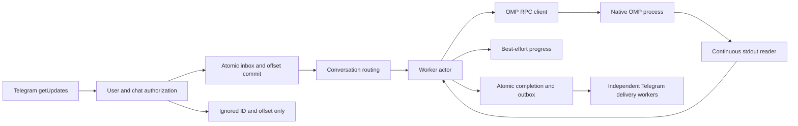

# 架构与开发说明

[English](architecture.md) | 中文 | [用户指南](../README.zh.md)

本文是当前实现的架构参考, 描述职责, 状态转换, 持久化, 失败处理和恢复. 安装, 配置示例和命令用法见 [README](../README.zh.md). 源码链接标明实现边界; 测试链接标明回归覆盖, 不代表已经验证真实 Telegram 客户端.

**目录**

- [职责与系统边界](#职责与系统边界)
- [组件与数据流](#组件与数据流)
- [启动, 配置与进程策略](#启动-配置与进程策略)
- [执行 worker 与 RPC](#执行-worker-与-rpc)
- [原生命令与 Telegram 菜单](#原生命令与-telegram-菜单)
- [Progress, status 与最终回复](#progress-status-与最终回复)
- [中断与保守恢复](#中断与保守恢复)
- [受管理的 autoresearch](#受管理的-autoresearch)
- [会话生命周期](#会话生命周期)
- [会话发现与管理](#会话发现与管理)
- [运行时设置与诊断](#运行时设置与诊断)
- [持久化与恢复](#持久化与恢复)
- [Telegram 交付与进度清理](#telegram-交付与进度清理)
- [附件与 host tool 文件边界](#附件与-host-tool-文件边界)
- [日志契约](#日志契约)
- [开发, 验证与发布](#开发-验证与发布)

## 职责与系统边界

Daemon 将 Telegram 对话桥接到原生 OMP session. 它负责鉴权, 路由, 进程生命周期, RPC transport, 任务状态以及 Telegram 交付. 模型执行, 工具, 凭据, 配置和原生 session history 由 OMP 管理. Bridge 不模拟终端, 不维护第二份模型上下文.

一个数据库属于一个 Bot. 每个受支持的对话有一个 worker 和一个 session binding: 普通私聊使用 thread ID `0`, 私聊 topic 和群组 topic 使用 Telegram thread ID. 群组 topic 内获授权用户共享同一个 session. 群组非 topic 消息不会被路由到推断出的 session. 独立 session 不等于文件系统或凭据隔离.

核心不变量:

- 每条输入和 callback 同时校验用户与 chat, 先鉴权, 后保留内容或下载附件.
- RPC stdout 消费独立于 Telegram HTTP 交付. 接受请求不等于任务完成.
- 异步工作绑定原 worker, client, generation, request 以及任务/session 范围. 过期结果不能修改替换后的 runtime.
- 持久化原生 session 文件身份, 不持久化 PID. 执行状态不确定的工作不自动重放.
- 任务结算与最终输出原子提交. 后续 `/new` 或 `/close` 不会取消已经提交的回复.
- 使用参数数组启动原生程序, 不经过 shell. 仅配置参数, 用户命令或已说明的保存模型 default 回退可以选择模型; 不隐式修改工具, 配置文件或 approval policy.

## 组件与数据流

| 实现 | 职责 |
| --- | --- |
| [`cmd/omp-telegram`](../cmd/omp-telegram/main.go) | CLI, 信号处理, 进程级数据目录锁 |
| [`internal/config`](../internal/config/config.go), [`config.go`](../config.go) | 严格 TOML 加载, 可执行文件相对路径, 内嵌 [`config.toml`](../config.toml), argv/environment 策略 |
| [`bridge.go`](../internal/bridge/bridge.go), [`steer.go`](../internal/bridge/steer.go), [`recovery.go`](../internal/bridge/recovery.go) | 路由, worker actor, 任务所有权, 排队, 结算, 启停恢复 |
| [`native_commands.go`](../internal/bridge/native_commands.go), [`command_menu.go`](../internal/bridge/command_menu.go) | 命令来源校验, 原生提交, Telegram 命令发现菜单 |
| [`autoresearch.go`](../internal/bridge/autoresearch.go), `research_*.go` | 原生研究准入, 控制, round 结算, disable 恢复 |
| [`session.go`](../internal/bridge/session.go), [`resume_picker.go`](../internal/bridge/resume_picker.go), [`binding_list.go`](../internal/bridge/binding_list.go), [`session_delete.go`](../internal/bridge/session_delete.go), [`export.go`](../internal/bridge/export.go) | Session 转换, 列表, reservation, 收藏, 删除, 导出 |
| [`args.go`](../internal/bridge/args.go), [`model_picker.go`](../internal/bridge/model_picker.go), [`doctor.go`](../internal/bridge/doctor.go) | 启动预设, 运行设置, 不改变 session 的诊断 |
| [`progress_status.go`](../internal/bridge/progress_status.go), [`reply_status.go`](../internal/bridge/reply_status.go), [`reply_metrics.go`](../internal/bridge/reply_metrics.go), [`watchdog.go`](../internal/bridge/watchdog.go) | 尽力而为的实时状态, 有界最终回复状态头, 保守的终结信号缺失恢复 |
| [`internal/i18n`](../internal/i18n/i18n.go), [`language.go`](../internal/bridge/language.go) | Bridge 中英模板与全局语言切换 |
| [`internal/omp`](../internal/omp/client.go) | RPC v2 分帧与关联, 进程管理, 原生 metadata, ACP session 列表, export/render/delete 委托 |
| [`internal/store`](../internal/store/store.go) | SQLite schema, inbox/outbox, binding, startup intent, 原子转换与保留清理 |
| [`internal/telegram`](../internal/telegram/client.go) | Bot API, Markdown 转 HTML, reply fallback, transport/交付确定性分类 |
| [`internal/media`](../internal/media/media.go), [`bridge/media.go`](../internal/bridge/media.go) | 鉴权后下载, workspace 限定的文件访问, snapshot 和附件生命周期 |
| [`internal/logging`](../internal/logging/logging.go) | 固定组件 logger, 同步 text/JSON 输出 |



Polling 在 worker 路由前持久化 update. 未授权或没有 sender 的 update 只保留 ID 和 ignored 状态, 同时推进 offset; 它们不能启动 OMP 或下载文件. 已授权的 typed update 保留路由所需内容. 处理输入和 callback 时再次检查鉴权. 回复, progress 和 export 对目标对话内所有可读成员可见, 不仅对提交者可见.

Polling 失败采用可取消的指数退避, 从一秒增加到 30 秒. Telegram 正数 `retry_after` 可将实际等待延长至该上限之外; polling 成功后重置退避. 持久化 offset 读取或 update 写入失败会终止 daemon, 不确认未提交输入.

### 身份与过期工作

| 身份 | 表示与范围 |
| --- | --- |
| Bot | `getMe` 返回的数字 ID, 用于数据库所有权检查; 不是 token 或 username |
| 对话 | `(bot, chat, thread)`; daemon 的 worker map 可使用 `(chat, thread)`, 因为 Bot 固定 |
| Binding | Workspace, 原生 session 文件路径及已验证 session ID, 持久化 generation, running/interrupted 状态 |
| Runtime | 当前 `omp.Client` 与进程内单调递增 client ID; 不使用持久化 PID |
| Root 任务 | Inbox ID, worker generation, turn 和拥有它的 prompt request |
| 异步 operation 或 picker | 捕获的 request/token, 以及对应 client, generation, session, catalog/preset revision, message/owner 范围 |
| Telegram 输入/输出 | Bot 数据库内的 update ID / bridge outbox ID, 不等于 Telegram message ID |

具体 fence 取决于操作类型; 单独检查 generation 不能替代任务, session 和菜单校验. Session claim 及 export/delete reservation 通过 `sessionMu` 同步, 只在本 daemon 内有效. 它们不锁定 workspace, 也不能阻止其他程序打开原生 history. Binding 不保存 Telegram chat type: 恢复零 thread 目标要求正数私聊 chat ID, 并继续检查当前 chat 白名单.

`daemon.lock` 阻止两个 daemon 同时打开同一数据目录. 数据库 Bot 所有权阻止另一个 Bot 复用数据库. 两者都不能阻止其他 poller 使用同一 token 和不同数据目录或 webhook; 部署必须保证单一消费者.

## 启动, 配置与进程策略

### 启停边界

[`main.go`](../cmd/omp-telegram/main.go) 在加载配置前处理 `--version`/`-v`. `--check` 加载并校验配置, 解析 OMP 可执行文件, 创建配置的数据和 workspace 目录; 不打开 SQLite, 不启动 OMP, 不访问 Telegram.

正常启动顺序:

1. 加载配置并创建 logger, 然后设置严格 umask, 获取独占 `daemon.lock`.
2. 初始化/迁移 SQLite, 整理上次运行遗留状态.
3. Telegram `getMe`, 数据库 Bot 所有权检查, 初始化持久化参数预设选择和全局界面语言.
4. 尽力注册 default 和 `zh` 语言范围的默认命令菜单.
5. 整理 progress 清理关联, 恢复符合条件的 session claim/worker, 执行保留清理.
6. 运行 polling, actor 路由, 四个交付 worker, 命令菜单更新, progress 清理以及可选的每日保留清理任务.

命令菜单注册失败不阻止 polling. 尽力而为的 UI 路径不能掩盖持久状态失败. SIGINT/SIGTERM 取消共享 context; worker 保守结算/取消未完成工作, 关闭所属进程, 等待后台工作结束后再关闭 store. Session 相关的关闭和未完成启动恢复见后文生命周期章节.

Fatal 边界仅将匹配已结束 daemon context 的错误视为正常关闭. Daemon 仍运行时的取消以及其他上报错误继续传播. 停机取消进行中的 assistant append 时, 未提交文字保留给保守的 teardown 结算, 不重放.

### 配置与路径契约

[`config.Load`](../internal/config/config.go) 解析 bridge 可执行文件符号链接, 使用真实目录作为默认路径基准. 隐式 `config.toml` 位于该目录; 只有隐式文件不存在时才回退到内嵌根配置. 显式文件缺失, 不可读, TOML 无效或已知配置项非法会报错. 未知键/table 被忽略, 将类型化解码器的缺失字段诊断转为仅包含行列号的启动 ERROR 日志, `--check` 也会打印. 即使存在未知项, 已知字段的类型和值仍须验证. 显式相对 `--config`/`-c` 路径仍相对于调用目录.

| 路径或配置 | 解析基准 |
| --- | --- |
| 相对 `storage.data_dir` 和 `storage.workspace_root` | Bridge 真实可执行文件目录, 即使配置文件放在别处 |
| 可选 workspace root 为空 | 可执行文件旁的 `workspace/` |
| 默认 OMP binary | 从 daemon 的 `PATH` 查找 `omp`, 然后转绝对路径 |
| Lock, 数据库, 附件 spool | `storage.data_dir` 下 |
| 原生 OMP 配置, 凭据和 session 存储 | OMP 默认值或显式原生参数; bridge 不重定位 |

支持 `[telegram]`, `[telegram.status_bar]`, `[omp]`, `[omp.environment]`, `[sub2api]`, `[storage]`, `[worker]`, `[logging]` 和 `[logging.component_levels]`. 未知和错位字段直接忽略, 不自动迁移或展开环境变量. 未知日志组件名同样作为未知键处理; 六个已知组件的非法值仍拒绝. 两个白名单都必须非空; user ID 必须为正数, chat ID 不能为零. `max_workers` 范围为 `1..64`, `queue_capacity` 为 `1..1024`, 保留天数不能为负. 正数 Go duration 启用空闲释放; 空值, `0` 或 `disabled` 关闭.

TOML 解析后仅展开一次字符串引用: `$VAR`, `${VAR}`, `$$` 表示字面美元符号. 插入的环境变量内容不会再次展开, 也不能注入 TOML. 数值和白名单字段支持其文档中约定的环境引用字符串. 默认 `OMP_TELEGRAM_ARGS` 和 workspace-root 引用允许未设置; progress mode 无效或未设置时回退为 `summary`. 其他必需引用未设置时报错. Environment 策略的 mode/变量名, 仅展示的 `omp.args_labels`, `telegram.status_bar` 字段以及 `telegram.final_actions` 标签/命令保持字面值. 不读取 `.env` 文件.

`omp.args` 接受有序预设字符串数组, 或归一化为一个预设的标量字符串. 每项使用支持引号的 tokenizer 解析, 不经过 shell; 启动前校验全部预设. 拒绝覆盖 bridge 管理的 mode/cwd/session 选项及受保护短选项, `--`, NUL 字节. 只持久化归一化预设 fingerprint 与所选 index, 不保存原始参数. 选择语义和每 runtime 快照见运行设置章节.

`[sub2api]` 仅在 `base_url`, `api_key`, `providers` 全空时关闭. 这些字符串及每个 provider 元素沿用单次环境变量展开. 部分配置, 不安全的 HTTP(S) base URL (凭据, query, fragment, 非法 port 或点路径段), 非法/重复 provider ID, 或未显式启用 `sub2api.extension = true` 时启用数据源, 都校验失败, 不回显输入或环境引用名称. Provider 按精确且区分大小写的 OMP ID 匹配, 不是 model selector 或 URL alias. 也允许仅显式启用观察器而不配置额度源.

根 [`config.go`](../config.go) 内嵌 `Sub2apiExtension`. 显式启用观察器后复用迁移 Extension 的私有, 内容寻址, 原子释放机制, 缓存在 `<storage.data_dir>/.bridge-extensions/`, 拒绝缓存符号链接, 向全部 OMP argv 预设只追加绝对 `-e` 路径. 启动及 `--check` 均不修改全局 OMP 配置. Sub2api 模型/provider URL, context 设置及凭据仍由 OMP 管理; 管理 key 仅由 bridge HTTP client 使用, 不加入 OMP argv, 不注入子环境. 既有环境策略不变: 使用环境变量存放管理 key 时应显式 deny, 或不列入 allowlist.

### 子进程环境与隔离限制

[`omp.Environment`](../internal/omp/env.go) 为原生 RPC, ACP, model-query, render/export, 删除和诊断子进程过滤父环境变量. `denylist` 继承除显式 deny 名称外的全部变量. 随附配置排除 `OMP_TELEGRAM_BOT_TOKEN`; 加载器不隐式过滤秘密变量名. 自定义 token 变量若未显式 deny, 仍会继承. `allowlist` 要求显式 `allow` 列表, 可为空, 仅传递列出且已存在的变量. 每种 mode 都拒绝另一种列表, 即使列表为空. Bridge 侧 TOML 展开独立于该子进程策略.

显式配置下传递 provider 凭据是预期行为. 这不是 sandbox: 不传 `HOME` 或某个 token 变量, 不能阻止同用户文件/进程访问, 工具读取其他凭据副本或出站网络. 应使用可信 OMP 代码, 必要时通过部署层隔离. Bridge 不自动批准工具操作.

Linux 上通过 [`startProcess`](../internal/omp/process_linux.go) 启动的原生 RPC, ACP, model-query, render/export 和删除路径使用独立 process group 与 parent-death SIGTERM. 创建进程的 OS thread 在 `Wait` 返回前保持锁定, 因为 Linux 将该信号关联到创建线程. 这些路径正常关闭时可升级为 kill 所属进程组; parent death 本身不提供后续 SIGKILL 升级. `/doctor` 版本探针直接使用 `exec.CommandContext`, 不具备上述进程组/父死亡保护. 忽略信号, 继续存活的后代, 逃离进程组或清除 parent-death 设置都需要外部 containment. RPC/ACP stderr 被丢弃; render 路径解析仅在内部检查有界原生诊断. 原始诊断不会转发到日志或 Telegram.

## 执行 worker 与 RPC

### Actor 所有权与输入通道

[`worker`](../internal/bridge/bridge.go) 拥有一个会话的逻辑绑定, 活动 root, 延后 FIFO 队列, 控制状态, progress 和回调. 已连接进程是独立资源: runtime 状态为 `released`, `starting` 或 `connected`. `worker.max_workers` 限制已连接 OMP 进程, 而非逻辑会话数. 空闲释放可归还进程槽位, 但保留已验证绑定和原生 session claim.

| 通道 | 接纳与所有权 |
| --- | --- |
| Root | 无活动 root 时, 普通文本创建独立提交. 其 inbox 拥有最终回复及 Telegram 回复目标. |
| Steer | 活动 agent root 期间的普通文本通过原生 `prompt` 和 `streamingBehavior:"steer"` 提交. 它有 submitted inbox 和关联请求, 但不拥有独立最终回复或 progress 消息. |
| 延后 root | `/followup`, 附件, 桥接 `/review` 和已识别原生命令保留 FIFO 位置, 成为独立提交. 附件异步准备; 未准备好的队首不能被越过. |
| Control | 桥接控制和回调不进入 prompt FIFO. 慢速变更/控制 RPC 通过单一异步 operation 通道执行, actor 仍单独处理事件. 启动及部分有超时限制的 Telegram/RPC 调用仍可能占用 actor. |

`worker.queue_capacity` 限制排队 root 与未解决 steer 的总数. 队列检查读取当前 worker 的运行时 queue/active/busy 状态; 取消 pending 工作会结算选定 inbox 并释放已准备资源. 关闭会取消等待输入. 重启后不自动重放队列输入或 uncertain 提交.

原生命令的 acceptance 若省略 `agentInvoked`, 仍保留 native owner, 新普通文本继续排队. 只有 `agentInvoked:true` 或 `agent_start` 能证明已进入 agent 执行, 从而在原回复 owner 下允许普通 root steering. `controlAbort` 期间收到的普通文本成为新的排队 root; slash invocation 仍须严格 Bridge/native 分类, 未知命令不能变成模型 prompt. 托管研究使用特殊长期 owner, 不采用普通 root 的终结/settlement 规则.

### 传输与完成边界

[`Client`](../internal/omp/client.go) 拥有 OMP 进程组, 连续 stdout reader, 串行 stdin 写入, pending request ID 和异步事件转发器. 启动验证 `ready` 的传输限制并协商公开 RPC v2. `Call` 在写入前注册关联, 等待命令 acknowledgment, 而非 agent 完成. 响应 ID 和命令名必须匹配; 无关联/畸形响应按失败关闭处理, 已放弃 ID 的迟到响应直接丢弃, 不重新解释为事件. 文本 steering 还要求请求关联的 `prompt_result` 和 settlement 支持.

进程保持 Bridge 持有的 `--mode rpc-ui`. `ready` 后先为基于 questions 的扩展 `ui.askDialog` 尝试 `set_ask_dialog enabled:true`, 再进行普通 v2 协商; 这与原生 HTML 表单独立. 只有请求关联正确的 `success:false` 且错误字符串精确为 `Unknown command: set_ask_dialog`, 才允许在同一进程继续使用通用 `select`/`input`/`editor` 代替扩展组合对话. 其他拒绝, 畸形成功, 超时, 断连, 无关联或命令不匹配响应均关闭进程; 它们不能证明版本较旧, 也不允许切换到普通 `rpc`. 公开 RPC v2 协商仍为必需, 但不能仅凭这一点推定兼容. 兼容目标仅为最新稳定版 OMP.

启动仍是同步流程: worker 仅在 `Start` 完成协商后接管 UI 事件. 不支持在接管前阻塞 `session_start` 的对话; 协商超时后启动失败, Telegram 不会出现可操作的对话. Bridge 不自动回答. 连接后的无 root UI 不会仅因没有活动任务而拒绝.

在接管前, reader 旁观未应答的 `ask`/`confirm`/`select`/`input`/`editor` 请求, 不消费或回答事件. 仅启动期使用的 tracker 最多保留 128 个 SHA-256 ID 键和 allowlist 方法名; `cancel.targetId` 只移除对应请求. 失败时先冻结证据, 再读取终态错误并关闭进程; 冻结期间发布的协议/传输错误优先于 deadline, 由父 deadline 触发的 teardown 取消仍保留原超时分类. 启动成功即丢弃 tracker. 只有超时且仍有 pending 证据时, 才分类为 `startup_timeout_pending_confirm` (确认优先) 或 `startup_timeout_pending_ui`; 拒绝, 协议失败, 断连及正常取消不会借用该诊断. Pending UI 是线索, 不能证明它是超时的唯一原因.

`rpc_startup_failed` 记录 `client_id`, `stage` (`ready`, `set_ask_dialog`, `negotiate_protocol`), 安全 `reason`, `pending_ui_count` 和 allowlist `pending_ui_methods`. Bridge 的 `runtime_start_failed` 补充对话/generation 关联, 并根据错误分类选择本地化恢复提示. 两类诊断均不包含原始 UI ID, 标题, 问题, 选项, 默认值, 输入值或 RPC 帧; 正常 context cancellation 不产生这些失败日志. 启动 deadline, 协议回退规则和 startup intent 恢复规则不变.

启动失败处理分别接收生命周期父 context 和 startup 请求 context. 读取终态错误后直接检查父 context, 即使 deadline 尚未传播至子 context, 父 deadline 的 teardown 也不能覆盖已确定的握手拒绝, 协议失败或超时. 真正的父取消归一为 `context.Canceled`, 不产生失败诊断. Ready 前的已保存模型识别仍使用 startup 请求 context; timeout/UI 证据与协议/传输错误的优先级保持不变.

除正常取消外, 每个阶段均返回并记录最终解析的失败分类. 仅 ready 前的 `process_exit` 可根据完整回收后的 stderr 识别为 `model_restore`, 保留已有 startup context 和协议保护; 其他 ready 失败不再回读原始 client 错误.

Ask 接纳及 response 完成同时检查 reader 权威 catalog 的 session ID 和 epoch, 旧排队事件不能接管替换后的原生 session.

Root 请求发送前, inbox 必须已持久标记为 `submitted`. Steer 先验证帧大小, 预留 ID, 持久提交, 再注册 `(request, root, client, generation, turn, admission)`, 最后发送. 异步 operation 结果携带 client/generation/root/turn 围栏. 释放 runtime 会丢弃等待中的旧 client operation, 但正在执行的 RPC 通道须等结果返回才能释放. 进程在调用期间退出时, 退出策略也等待其结果; 旧退出围栏不能阻塞替换 runtime.

| 证据 | 普通 root 结果 |
| --- | --- |
| prompt acknowledgment 成功 | 仅表示接受; 除明确 local completion 外继续等待. |
| `agent_end` 且 `isTerminal:false` | 等待 continuation, 不派发下一个 root. |
| `agent_end` 未显式设置 `isTerminal:false`, 且有确认 assistant 文本 | `done`, 仍须满足 steer settlement, 并应用下列 assistant 错误/取消 metadata. |
| Assistant `stopReason:"aborted"` | `cancelled`, 保留已有部分文本. |
| Assistant error stop reason, 非空 `errorMessage`/`errorClassificationMessage`, 或非零 `errorStatus` | `uncertain`, 保留已有部分文本和安全通知. |
| terminal 事件没有确认文本 | `uncertain`, 明确完成的本地原生命令除外. |

Terminal metadata 优先于当前 agent run 的 `message_end` metadata 缓存. 已完成正文已属于持久 outbox, 不被 terminal 快照替换. RPC v2 可能省略不变的前缀, 因此 worker 按所有 role 的位置及原始 `messageCount` 对账, 仅保留当前未提交文字和最新终结 metadata. Continuation 的 `agent_start` 开启新轮, 不丢弃此前已排入输出或任务级资源计数. 任务结算和 teardown 清空临时投递状态. 没有活动桥接 owner 的迟到/主动 `agent_start` 不能重启 typing 或卡住队列. 托管研究仍使用独立的逐轮交付生命周期.

[`steerFence`](../internal/bridge/steer.go) 要求 root terminal 事件, 所有 steer 的 terminal 结果以及当前 session settlement 全部成立后才最终结算. Steer 状态 `completed` 映射为 `done`, `aborted` 为 `cancelled`, `error` 为 `failed`; 未知状态为 uncertain. 明确拒绝只使该 steer 失败, 不声称其指令已生效; 未确认传输结果会退役 runtime. 仅本地的 `agentInvoked:false` acknowledgment 可完成该 steer, 但 root 仍须有静止证据.

任何较晚收到的关联 `sessionSettled:false` 都会使先前 true 证据失效, 不受 admission 顺序影响. 只有最新 admission 的 true 结果能直接建立 settlement. 无请求键的 `session_settled` 只触发有超时限制的 `get_state.isSettled` 探测, 本身不释放围栏. 探测结果检查 client/generation/root/turn/revision, 并让已排队事件或缓冲 RPC 输出先处理. 新 `agent_start` 会丢弃延迟的旧 terminal.

### 资源与隐私边界

| 资源 | 上限及失败行为 |
| --- | --- |
| 物理 RPC 帧 | 最大 1 MiB, 按协商值进一步缩小. 出站超大请求在写入前拒绝. |
| 重组逻辑帧 | 最大 64 MiB, 验证 chunk 帧结构/顺序/长度. |
| RPC 缓冲资源 | 物理/重组容量及排队事件字节共享 64 MiB credit; worker 接收事件后归还其 credit. 队列槽位或字节超限使 client 失败. |
| terminal 前 assistant 文本 | finalized 加 pending 输出有 4 MiB 逻辑上限, 保留的 stream 另有 4 MiB 上限. Finalized 消息替换其对应流式文本的逻辑计数. 完成前超限是 uncertain, 不是成功后的显示截断. |
| 已确认最终显示 | 含 header/通知最多 1 MiB 和 32 条 Telegram 消息; 明确截断不会把确认完成的任务变为失败. |

逻辑帧容量与缓冲资源策略相互独立: 接近上限的合法帧在物理 chunk 或排队事件仍被保留时, 也可能耗尽 credit. RPC reader 从不执行 Telegram 投递.

[`reply_context.go`](../internal/bridge/reply_context.go) 只把 Telegram 提供的直接回复上下文加入普通 prompt, steer, followup 和当前附件 prompt. 显式选中 quote 优先于被回复全文. 否则使用文本, photo/document 标签, 文档文件名与 caption, 或不支持消息标记. 它不获取更早消息, 不递归回复链, 不下载被回复媒体, 不暴露发送者姓名/ID; 发送者标签只有 `bot` 或 `user`.

引用 envelope 含分隔符及 `...[truncated]` 最多 3000 UTF-16 单位; 此 helper 不截断当前用户消息. 引用内容中的保留分隔字符串会转义. 这是引用输入, 不是可信指令或授权边界. 桥接控制与一般已识别原生命令不附回复上下文 wrapper. 桥接 `/review` 保持 slash 命令在前, 将上下文追加在后. 队列预览使用当前消息文本, 而非引用 envelope. Telegram payload 持久化与最终模型输入仍含所提供的引用文本; 这是信息最小化, 不是秘密脱敏.

## 原生命令与 Telegram 菜单

### 原生命令识别与提交

[`catalog.go`](../internal/omp/catalog.go) 发布每 client 不可变目录, 区分 `CatalogUnknown`, `CatalogReady` (含空目录) 和 `CatalogUnsupported`. Discovery 异步且 single-flight. 只有原生明确 unknown-command 响应能证明 discovery 不支持; 拒绝, 超时, 畸形目录与传输失败不能互作回退状态.

桥接命令和隐藏 `/start` 优先. 只有单段命令由 1-32 个 ASCII 字母/数字/下划线组成, 且目标是 5-32 字符的 username 形状时, 才识别有效 `@bot` 后缀; 发给其他 bot 的命令会忽略. `/opt/user@host/file` 等路径仍是普通文本. Invocation parser 遵循 OMP 空白字符规则, 包含 BOM 而排除 NEL, 也接受 `:`. 原生查找先匹配首个字面空格之前的完整名称, 保留 `plugin:command` 等名称; 只有已发布 builtin 才启用额外分隔语法. 已发布但被拒绝的来源也按这些分隔符匹配, 防止回落为模型输入.

| 目录/来源 | 路由契约 |
| --- | --- |
| Unknown | Slash 输入在 FIFO 中等待分类. 普通非 slash root 的其他接纳证据具备时, 不必等待 discovery. |
| Ready, 可执行 | `builtin`, `skill`, `custom`, `mcp_prompt`, `file` 命令/别名进入 native 延后队列, 不作 steer, 不包回复上下文. |
| Ready, 未识别 slash 输入 | 保留文本, 按普通 prompt/steer 路由, 包括绝对路径. |
| Discovery 不支持 | 取消非桥接 slash 开头输入, 包括 followup/附件/steer 路径; 普通非 slash 输入和桥接控制仍可用. 明确具有桥接 `/review` provenance 的项保留例外. |
| Extension 或未知来源 | 识别后以通用通知拒绝, 不回显目录名称, 参数或原始来源. 只有精确 canonical extension `autoresearch` 使用专门 owner; 其别名及其他 extension 不继承权限. |

名称和别名是未经规范化的不透明字符串. 空名称, 前导 `/`, 非法名称/别名类型使目录无效; 特殊空白/控制/Unicode 名称本身不会. 缺失/null/非字符串/未知来源仍可识别但不可执行. 目录有效不代表当前 invocation parser 能调用所有保留名称.

Stdout reader 在唤醒后续响应 waiter 前发布主动目录更新. Query 记录实际 epoch 和 reader-update revision; session 改变或较新 update 优先于旧 query response. 相同 discovery 保持 snapshot/revision, 但即使内容相同的主动 update 也增加 revision. Worker 的目录事件只是唤醒信号, 不携带可重新应用的 snapshot. Lazy restore 后刷新 discovery.

Discovery waiter 超时/取消/拒绝不会推翻 reader 已发布的可用目录. 若仍 unknown, worker 暂停该 client/epoch 的 discovery, slash 输入继续 pending; 用 `/queue` 取消等待项可释放后续 FIFO 工作. Scope 改变或 reader update 可恢复分类. 真正传输/协议/进程失败仍使用正常 runtime 失败策略.

[`native_commands.go`](../internal/bridge/native_commands.go) 在提交前立即复核队首, 包括异步接纳工作之后. 它检查当前 source/name 与原生 session 身份; 命令消失或原生 session 改变会取消队列项, 绝不降级成模型文本. 同 session revision 改变不会取消仍有效的命令; 新 client 恢复同 session 也允许. 原始 slash 开头 followup 和已准备附件不能绕过 source/lifecycle 检查.

会改变生命周期的 `/move`, `/wt`, `/worktree`, `/session delete` 在路由和派发时都拒绝, 即使 discovery 不可用也如此. Session 拒绝只匹配不区分大小写且没有额外参数的 `delete`. `/session info` 和 `/session pin` 保持原生路由. 已保存绑定由桥接 session 生命周期 API 管理; 任意 extension 生命周期变更不在协调范围内. Snapshot 校验不是上游原子 check-and-execute, 桥接围栏也无法可靠识别没有 session 标记的旧 session 主动 update.

明确原生 local acknowledgment `agentInvoked:false`, 或请求关联的 local `prompt_result(status:"completed", agentInvoked:false)`, 无需 assistant 文本即可完成提交. 这不证明后台 operation 已结束. Local `error` 为 uncertain, `aborted` 为 cancelled, 缺失/未知状态为 uncertain; 通用通知与状态一起提交, 不泄露原始 RPC 错误, 不退役健康 runtime, 不重放命令. 仅目录识别不能实现原生 `/plan` 或 `/plan-review` 的 RPC 支持.

RPC client 消费私有元数据及 `/usage` 查询回复后, 已连接 runtime 的 `command_output.text` 通过 outbox 作为独立对话通知交付, 不关联 inbox. 该事件没有 request ID: 不改变任务预览或完成状态, 迟到输出也不会成为下一个根任务的最终回复. 忽略空白输出; 每个事件复用最终回复的字节, 消息数和 UTF-16 展示预算并在超限时截断. 只展示文字, 不展示 RPC frame, 不记录 payload 日志.

### 命令菜单发布

[`command_menu.go`](../internal/bridge/command_menu.go) 保留默认桥接菜单, 并发布 chat 范围的桥接命令与可执行原生名称/别名并集. Telegram 没有 topic 命令 scope: 同 chat topic 共享并集, 不同 chat 相互独立. 菜单可见性不授予执行权限. 名称本身须匹配 `[a-z0-9_]{1,32}`; 桥接条目/描述优先, 排除隐藏 `/start` 与被拒绝生命周期名称, 排序去重的原生条目填充剩余空间直到总数 100. 省略的可执行名称仍能手动调用.

恢复 worker 和开始轮询前, 启动流程在 `storage.workspace_root` 中运行一个有界的 `omp --mode rpc-ui --no-session` 发现进程, 沿用已选启动参数和配置的环境, 不覆盖 OMP 设置. [`DiscoverCommands`](../internal/omp/catalog.go) 持续读取并丢弃事件, 请求官方目录, 返回前关闭并回收进程和事件读取协程. 发现 deadline 为 20 秒, 不发送 prompt, 不写原生 session 历史或 bridge binding/start intent, 在正常运行时名额投入使用前结束. 仅允许的 builtin 名称和别名填充内存回退目录; workspace 专属来源等待真实会话. 失败只记录通用分类, 保留 bridge 菜单及后续 worker 的发现路径.

每个 chat 在活跃 topic 公布权威目录前使用启动回退目录. 真实 topic 目录随后替换回退目录, 包括空目录和不支持目录. 未知目录清除该 topic 的旧贡献, 但不把回退目录替换成权威空列表. 移除或使最后一个已知贡献失效后恢复回退目录. 探针仍会正常初始化 OMP 配置和扩展; `--no-session` 不保证隔离或没有任何副作用.

可执行原生命令及别名使用 OMP 提供的说明, 规范为最多 256 个 UTF-16 单位的单行文本. 缺失, null, 非字符串或仅有空白的说明不使目录无效, 菜单使用通用说明. 被拒绝的命令不保留说明. 目录相等性包含规范化说明, 因而只修改说明也会推进 revision 并刷新菜单. 不同 topic 公布同名命令时优先非空说明, 多个非空说明选择字典序最小者, 保持 chat 并集确定性.

Session/catalog 失效清空旧 contribution. 逻辑 close/replacement/failure/shutdown 只移除该 worker 的 contribution; 空闲进程释放保留它. 指针 owner 与 inactive tombstone 阻止退役 worker 的迟到更新/移除. 启动时直接发布发现的 builtin 回退目录, 不先把 chat 菜单替换为仅含 bridge 命令的列表, 同时保留早到的权威目录.

单一后台 publisher 合并 dirty chat, 在 actor/reader 外以 20 秒 deadline 写入默认语言和 `zh` scope. 每 chat/language 缓存已确认列表, 跳过未变化的成功 scope. 发布失败不使任务失败. 不确定发布会清空先前成功缓存, 因 Telegram 可能已应用更新; 明确拒绝保留缓存. 菜单状态不在本地持久化, 已发布原生名称和说明对 chat 成员可见, 包括无权操作 bot 的成员. 原始目录, 描述和参数不进入菜单诊断.

网络不确定结果, 请求超时, HTTP 5xx 和限流通过既有 dirty/pending/wake 机制重新排入失败 chat. 每 chat 的指数退避从一秒起步, 上限一分钟; Telegram 的 `retry_after` 更长时遵守其要求. 这些间隔不是交付 deadline. Publisher 复用一个可取消 timer, 将退避中的 chat 轮转到就绪工作之后, 到期时重新计算最新语言和目录. 重复更新只合并, 不绕过退避. 每 chat 连续失败只在首轮记录 warning, 完整成功后重置. 明确的非 429 HTTP 4xx 拒绝不安排自动重试, 但后续 contribution/语言更新仍可在相同退避约束下触发新尝试. 测试使用 `testing/synctest` 覆盖持久化语言恢复, scope 部分成功, 最新状态选择, 重试边界, 日志抑制, 取消和永久拒绝.

### 界面语言

[`internal/i18n`](../internal/i18n/i18n.go) 只本地化 Bridge 自有模板, 默认英文, `/lang zh` 切换中文, `/lang en` 切回英文, `/lang` 查看当前设置. 语言设置在所有私聊和 topic 之间全局共享, 不根据 Telegram 用户语言推断, 不附着于 OMP session 或 binding. 通过原有鉴权的调用者均可修改. 任务执行及迁移未解决期间也能使用该命令, 不提交 OMP 工作, 不清除迁移锁.

[`language.go`](../internal/bridge/language.go) 在 worker 启动及恢复通知之前读取单例设置. 互斥锁串行化数据库写入和内存原子发布, 避免并发切换造成持久值与运行值顺序倒置. Worker 读取共享的原子设置, 不保留独立副本. 持久化失败时保持当前语言. 关闭或替换 session, 删除 binding 均不重置语言. Telegram 默认及 `zh` 菜单 scope 都使用选定的全局语言; 切换会将全局菜单和所有已知/配置的 chat 菜单标为 dirty, 由既有后台 publisher 刷新.

[`Message`](../internal/i18n/i18n.go) 是英中字段私有的结构体. 静态 [`Msg` 目录](../internal/i18n/messages.go) 为每个双语对象提供稳定的语义名称. 小范围 `Task`, `Session`, `Queue`, `Language` 分组收纳相关词条, 例如 `i18n.Msg.Task.SubmissionUncertain` 和 `i18n.Msg.Queue.Full`; 其余词条保持扁平, 按需迁移. 名称不依赖英文措辞, 移除的扁平名称不保留别名. 英文文本不再作为查找 key. `Text` 和 Bridge 的两个 `tr` helper 只接受 `Message`, 因而原始字符串, 不存在的词条名及缺少构造参数都会编译失败. 修改英文措辞时在同一词条中维护中文, 不再同步另一份查找 key. 类型化 Bridge 错误和稳定的 media/store sentinel 显式选择词条, 不按英文措辞识别不透明错误. 调用点先选择语言模板, 再填入用户/原生值, 不翻译拼接后的输出, 不在通用交付层拦截翻译. 原生 OMP 文字及交互内容, 模型回复, 工具参数/结果, 路径, session 标题和用户 caption 均不翻译. 既有渲染限制和脱敏行为保持不变. 排队媒体将 caption 与 Bridge 默认标签分开, 新渲染的队列使用最新语言. 不重写已经渲染的 outbox 文本或已交付消息.

Telegram 各 scope 分别请求更新, 不是跨 scope 原子操作. 旧语言的在途发布可能短暂可见, 随后由已排队的语言刷新收敛. 回归测试在语言切换时阻塞发布, 确认所有默认/chat scope 最终使用中文, 再快速切换并确认收敛到英文. Task 不保存启动时的语言: 新生成的 Bridge 回执使用当前全局设置, 此前已渲染的 outbox 文本和 OMP 回复正文不变.

`progress.NativeStatus` 缓存已渲染的 Bridge 状态文本. 切换语言不会立即重建缓存: 下一次通过校验的原生状态结果按完成时的全局语言生成, 包括 RPC 查询在途期间发生的切换. 正常采样间隔为五秒, 但仍受 RPC 成功及身份 fencing 约束, 不保证五秒内刷新. 已有进度消息在下一次正常更新时编辑, 不增加缓存 epoch 或 task 语言字段. 原生 OMP 扩展文本不在此保证范围内.

词条构造函数拒绝空语言文本. 测试使用反射递归遍历 `Msg` 的扁平词条和嵌套分组, 检查英中两种文本及有序格式指令, 包括参数数量, verb, width 和 precision; 不维护另一份运行时注册表. 嵌套词条回归覆盖缺少翻译和格式参数不匹配. 检查器理解顺序 `%s`, `%d`, `%f` 指令, 忽略转义的 `%%`; 不支持的语法会失败, 不会被静默跳过. 使用新的格式语法前需先扩展检查器. `formatDirectives` 保持在 `_test.go` 中. 这保护类型化翻译路径, 不检查主动绕过该路径发送的任意原始文本.

### 原生对话与 session operation

从 OMP 18.18.3 起, 原生 `ask` 工具接收 `{html}`, 不再使用 `questions[]`. 表单由 OMP 解析. RPC 没有 `formDialog` 时 (包括 OMP 18.18.6), 它逐字段发出通用 `select`/`input`/`editor` 请求; checkbox 字段通过多次 `select` 收集. Bridge 复用通用 RPC UI, 不解析 HTML 或另建表单渲染器. 每个答案通过 `extension_ui_response` 回应对应请求, 不新增 prompt 或 steer; 完成归属仍为原 root/client/turn.

[`worker.ui`](../internal/bridge/bridge.go) 将原生 `confirm` 映射为 Confirm/Cancel 按钮, `select` 映射为按内容分页, 每页最多十项且可取消的 picker. 空 select 会取消. [`ask.go`](../internal/bridge/ask.go) 处理基于 questions 的扩展 `method:"ask"` 和非 secret 的 `input`/`editor` 文字回复; widget 和一般原生输出不是终端 UI 仿真. Token 绑定 owner/generation/client 且单次使用; selection 还绑定菜单消息. 不同于 Bridge 自有菜单, 原生对话没有 Bridge 过期时间, 翻页也不会增加期限: 原生 deadline 和 cancel 信号由 OMP 管理. 待回答对话阻止正常空闲释放.

通用 `input`/`editor` 请求保留原始文字. `placeholder` 作为提示展示; `prefill` 与有界 literal 展示分开保存, 包括显式为空的编辑器默认值. **提交空值** 与 **使用完整默认值** callback 受 owner 和 interaction 围栏保护, 发送 `value:""` 或原始 prefill, 不发送 `cancelled:true`; 取消仍是独立响应. 在 owner 的私聊 (`chat == user > 0`) 中, `askRequest.inlineInput` 选择单条问题, inline keyboard 带 `force_reply:true`; 提示说明及末尾 `[ask:...]` marker 均属于该问题, `inputID == messageID`. 接受后保留问题正文并清除键盘, 不回显提交值. 群聊保留独立定向 ForceReply 输入, 在主问题追加 **本次提交** 回执, 空字符串使用独立的零字符状态. 消息回复必须实际包含文字, 贴纸, 语音或位置等纯非文字回复不能悄悄提交空字段. 必填/类型/pattern 校验归 OMP 所有, 它可在拒绝后用新 request ID 重问. 扩展组合 Ask 自定义答案继续裁剪首尾空白并要求非空, 保持现有独立提示流程.

私聊文字问题沿用既有标题预算, 在 renderer footer 为 placeholder 和默认值预览分别保留空间. 每项预览独立截断到 500 UTF-16 units, 并编码为独立 fenced literal, 长标题不能占用其预算, 预览中的反引号也不能吞掉后续字段或末尾回复 marker. 截断仅影响展示; **使用完整默认值** 仍提交完整原始 prefill.
标题 literal 包含连续反引号时, 使用长于展示内容反引号序列的独占行围栏, 避免块解析吞掉标题或重新解释后续预览.

待选择的扩展 Ask 和全部原生 `select` 菜单 (包括 Review) 在正文展示带全局编号的完整标签, description 和 preview, 保留换行与间隔. 选择按钮仅显示全局数字编号, 扩展多选额外显示 ☐/☑; 控制按钮保留简短动作文字. `selectionPages` 将选项纯文字片段缓存到 `askRequest.pages` 和原生 confirmation 的 `uiPages`. 每页携带原始选项索引的半开区间 `[start,end)`; callback 按该范围校验, 不再使用 `page*10`. 每页选项正文 payload 最多 1600 UTF-8 字节, 最多十项. 超长单项在字符边界安全分段, 优先换行; 每个续段重复同一全局编号, 与上一页的选项范围可以重叠. 翻页不提交响应, 也不重置多选状态. 原生 `select` 按原始选项索引读取可选的 `optionDetails[i].description` 和 `.preview`. Literal 展示复用 `progressToolLiteral`, 多行内容使用独占行围栏, 避免选项内容激活 Markdown. 重复问题沿用既有的 700 字节题目及 200 字节 header 预算; 先前选择历史沿用 600 字节. 待选择的组合 Ask 为自定义答案 footer 预留 500 字节; 独立自定义文字输入不重复选项页, 沿用既有 1400 字节 footer 预算. 所有多页视图均显示页码. 原始选项值与展示分开保存, 原样返回; 编号, 续页和转义不改变 RPC 答案或默认值.

	原问题, 历史和已选答案能放入一条 Telegram 消息时, 完成回执会展示全部带全局编号的标签, description 和 preview. 完整回执超出源文本或渲染消息预算时, 回退到既有有界渲染并显示明确省略标记; RPC 答案始终使用原始值. 当前原生 RPC select envelope 不传递本地 `initialIndex` 或 checkbox 勾选状态元数据. Bridge 无法从字符串选项重建这些标记或整张表单的布局/图片; 仅返回原始选项标签, 由原生映射到值. 多次 checkbox select 只记录逐次动作, 不推断最终勾选集合, 也不将 "Done" 等标签识别为协议标记; 原生 HTML 回退发送字符串选项.
待回答和完成态的选择展示片段均以单个换行连接. 分页 payload 的相邻选项也以单个换行分隔, 不额外插入空行. Renderer 仅移除生成的 literal 包装前的合成换行, 不裁剪 payload 内部空白; 问题/选项/答案的原始换行及 RPC 值保持不变.

活跃的 Ask/文字对话在显示确认前后均排除卡死任务恢复, 即使原生报告 idle 且没有 active tool. 对话结束后恢复原有 watchdog 策略; 只有暂存指导不算等待用户.

原生 cancel 使匹配 token 失效. Teardown 先移除失效 token, 再进行有界键盘清理. 菜单 receipt 记录用户选择, 不是操作成功; confirm/select RPC response 写入失败按保守策略退役 runtime. Telegram 回执编辑是尽力而为的 UI, 不是业务 acknowledgment: 成功或失败均不改变原生响应, 不重放答案.

连续的原生 `select` 仅在相同活动 root, turn, client 和 generation 内复用前一个已完成菜单, 中间不能跨模型 run/消息或 session 变化. 后续选择处于 pending, 翻页, 取消或失效状态时, 之前的选择仍在菜单文字预算内保持可见. 被复用的 Telegram 消息已不存在时, 重新发送可用菜单; 其他编辑失败不重发交付状态不明的菜单. Pending 菜单保留创建时的 scope, 包括 root/turn 为零的情况, 完成时不能借用后来的 root. 并发请求会取消, 不修改当前菜单或原有回执. 取消, 任务结算和 runtime teardown 清除可复用回执缓存, 不移除已显示的历史选择; 原有单次 token, 消息绑定和原生 response 处理保持不变.

Extensions 保留独立的 questions-based `ui.askDialog` 协议和 `set_ask_dialog` opt-in. RPC `method:"ask"` 承载这些组合对话, 不是原生工具的 `{html}` schema 或 HTML `formDialog`. 以下组合对话行为适用于这一扩展 UI 路径.

组合 Ask 保留不可变的 client/generation/session/catalog-epoch/root/turn/request 身份和可变的 question/interaction epoch. 每题使用独立主消息; 下一题打开后, 已确认的本地选择仍保留在该题原消息中. 选项跨页保持全局编号, 不改变 RPC 标签. 最后一题完成后才按原问题顺序一次性提交全部答案. 单选直接推进; 多选切换勾选并要求确认, 包括明确确认的空集合. 多选自定义文字补充已选选项. 进入/退出文字输入或切题时撤销旧 token 和提示身份. 每次文字输入单独发送定向 ForceReply 提示, 带不透明且由 bot 发出的 `[ask:...]` marker. 返回的消息 ID 及当前 token/owner/对话必须同时匹配. 一条早到回复可以等待显示回执确认精确 ID; 取消时结算该 pending inbox, 不重放. Marker 识别过期/重启后的提示, 不持久化另一份对话副本. 普通文本和 queued followup 不取消 Ask, 也不进入答案路由.

异步 display job 在启动前捕获不可变的已渲染 snapshot, 目标 message ID 及 question/interaction epoch; 不从可能已推进的 dialog 指针读取内容来渲染. Display result 必须匹配捕获的身份与 epoch, 才能发布消息/提示状态. 最终本地回执使用独立的 `ask_receipt` operation result 和原 message ID, 不依赖可变对话生命周期或 RPC response 结算. 因而即使答案响应已完成或后续问题已开始, 回执编辑仍可结束, 不会借用后题内容或完成后题. 问题/选项文字, description, preview 和回执 literal 仅在 Telegram 展示时限长; UI 写入失败不变成原生答案失败.

Actor 在调度时持有交互取消 context. Ask 的十秒显示网络 deadline 仅在有序发送链等待结束后启动, 排队投递不消耗该预算. 失效时取消同一个交互 context, 无论网络投递是否已经开始; 后台 job 不替换 actor 的取消句柄.

紧凑私聊文字输入及 Follow-up 使用 [`bridge.go`](../internal/bridge/bridge.go) 的 `queueInlineInputReceipt`: 在受跟踪且独立的五秒 context 下, 按消息 ID 清除键盘, 或编辑正文并传入空 inline keyboard. 不发送收尾消息, 不删除历史. 捕获的 display/request 身份决定收尾路径, 包括迟到结果及 shutdown; 清除旧消息不能清除新消息的 inline keyboard. 群聊输入及扩展组合对话保留 `queueForceReplyCleanup`/`queueForceReplyReceipt`, 发送定向 `ReplyKeyboardRemove` 回执. `orderForceReply` 在启动前预留初始提示及旧式回执的发送顺序; 只有这些有序 job 访问每用户最新提示 ID. 旧收尾跳过失效提示, 已打开新输入时入队确认仍发送但不移除 Reply. UI 收尾尽力执行, 不持久化重放, 不结算, 改变或重放原生工作. Shutdown 在等待后台任务前处理已缓冲的 `ask_display`/`followup_prompt` result; 在途发送也会在 worker context 结束时安排收尾. Ask 提示 ID 不持久化, 不在重启后恢复.

收尾回执失败时, 在 `telegram` component 记录 `WARN` 事件 `force_reply_cleanup_failed`, 包含 `chat_id`, `thread_id`, 原提示 `message_id`, 安全分类 `reason`/`uncertain` 及可用时的 `api_code`. 不记录原始 Telegram 错误, 凭据或消息正文. 成功发送保持静默; 没有该事件不能证明已执行收尾或客户端已清除回复界面.

取消扩展组合 Ask 时, 捕获当前问题和展示长度内的全部选项快照, footer 标记为已取消, 不作为答案. 立即撤销 token 并安排键盘清理; 回执编辑独立于 RPC 取消. 当前 display 仍在途时, 用其捕获的 epoch 限定结果返回后的一次最终取消编辑, 包括首次发送迟到返回消息 ID 的情况. 因而旧渲染不能覆盖取消留痕, 也不能借用替换后对话的内容; 之前已确认题目的回执保持不变.

[`steer.go`](../internal/bridge/steer.go) 在 Ask/文字对话, response 写入或原生 `ask` 工具活跃时, 按 FIFO 暂存本应作为 steer 的输入. Inbox 保持 pending, 与普通排队任务和 in-flight steer 共用容量. 每条绑定原 root/client/generation/turn 及已绑定的原生 session/catalog epoch, 不变成独立 followup. 派发重新校验身份, 等待 UI 结算和 `tool_execution_end`, 且要求 RPC lane 空闲及无原生输出缓冲. `BufferedOutput` 同时包含 reader 尚未分帧的 `bufio` 预读和 frame/event byte credit, 已发布的旧 tool end 不能遮蔽已预读的后继对话帧. 随后由原有 steer 提交流程负责接纳与完成. Stop, runtime/session 替换和 root 完成取消未发送指导; 最终回复在异步 metadata 采样前取消这些输入. 不覆盖 OMP interrupt 策略, 不重放不确定输入, 控制命令仍走原有路径.

首次 steering admission 与 deferred dispatch 共用同一 `steeringBlocked` 门限. Actor 优先处理 Telegram input 时, 也不能绕过已经缓冲的原生 Ask 或终止事件. 无阻塞的首次 steer 仍直接提交, 不额外分配临时 deferred 队列.

预读非空标志与 frame/event byte credit 共用一个 atomic 占用状态. `BufferedOutput` 只读取一次: 清除旧预读标志前先申请 frame credit, 释放对应 frame credit 前先发布新的预读标志. 该标志不计入分配预算和字节诊断数值.

私有 stdout reader 在底层 `Read` 返回非空数据后立即发布该标志, 早于 `bufio` 等待物理行剩余内容. 空闲阻塞读取不发布占用. 完整行保留标志直到申请 frame credit; EOF 和致命解码路径清除标志, 不改变仍由事件持有的 credit.

已识别的 Bridge 命令, 原生 `/autoresearch off` 控制和 foreign-bot 命令先于 Ask 的早到回复等待及过期答案拒绝分类. 研究关闭复用既有 `autoresearchArguments` 精确解析, 其他原生 slash 输入不变. 检查 bot 发出的回复目标及对话后, 去掉 Ask 引用并进入既有命令路由, 沿用正常授权/生命周期或 foreign 命令忽略逻辑, 均不作为答案. 专属提示中的问题正文截断至 1000 UTF-16 units, 使用已有的不冲突 fenced literal 编码, 与 owner mention 和 marker 独立构造. 这限制 Markdown 渲染规模, 防止表格展开或引入额外 mention, 保留 selective ForceReply 的定向目标.

`ui` 入口为原生 `ask`/`select`/`confirm`/`input`/`editor` 共用接纳检查: 已有 Ask/文字请求或 pending 原生 UI confirmation 时, 不接纳新请求. 不同并发 ID 通过现有 response sender 取消一次, 当前菜单不变. 若仅剩 response 写入结果尚未消费, 则将一条后继 UI 事件暂存在已有 `askRequest` 中, 占用同一个单请求槽位, 不显示也不取消. 写入结算后, actor 重新核验其 client/generation/session/catalog-epoch/root/turn 和存活 runtime, 再由 `applyUI` 显示, 不重复接纳. Stop, 原生 cancel, 任务/runtime teardown 及当前 runtime 的写失败会撤销待显示事件, 迟到结果不能重开. 相同 ID 在 pending, 完成或拒绝后均忽略. 每个 runtime 共用的请求 receipt 上限为 4096; 耗尽时保守退役该 runtime, 不重新开放旧请求. 原生 cancel 只清理本地状态. Stop 立即撤销输入, 保留已有普通/research/steer 停止路径. Root 结算, session 替换和 runtime teardown 使交互失效. Ask/文字显示在 actor 外执行, deadline 十秒; 迟到完成仅清理旧键盘. 显示失败取消请求. 提交先消费本地状态, 再独立于 RPC operation lane 尝试一次五秒的 `extension_ui_response` 写入. 没有业务 ACK 或重试; 不确定写入仅退役仍对应原身份的 runtime/session. 空闲释放和新 root 派发等待未完成的 response 写入. 超时和默认答案仅由 OMP 决定; 启用 UI 从不改变审批策略.

Stop 会记录任务级 UI 接纳围栏, 即使当前没有 `askRequest`, 仅剩上一条 response 写入结果尚未消费. 围栏生效时取消新 UI ID, 延后显示也检查同一围栏. 新任务或 runtime 替换/teardown 会重置围栏. Stop 成功结算也会清除围栏, 包括确认空闲或确认关闭 autoresearch 模式后保留连接中 runtime 的 Stop; 结算前围栏仍生效. Stop 已撤销 pending Ask 输入后, 即使原生 abort 明确拒绝也会退役该 runtime, 将活动 root 结算为 uncertain, 不能让无法回答的对话继续阻塞 worker. 没有 pending Ask 时的 abort 拒绝会清除围栏, 继续沿用原有 runtime 可复用策略.

当前会话导出复用既有 runtime 交互忙闲判断, 存在 active/deferred 对话或未结算的 response 写入时拒绝开始快照. 导出期间, 共用 UI 接纳入口记录作用域有效的新请求 ID, 但在问题校验, 显示及自动取消前直接拒绝, 不发送任何原生 response. 导出结束后不重放这些 ID. 过期显示结果仍只清理旧界面. 导出其他会话不阻止当前 UI.

手动 `/compact` 要求逻辑 session 空闲, 不要求进程已连接; 恢复已释放 runtime 后直接开始, 无需确认. 它尝试用五秒超时发送无按钮 `Compacting...`, 再以 180 秒 deadline 在 operation 通道执行原生 `compact`. 成功后 `get_state` 在剩余 deadline 内最多再用三秒. 缺失/非法 usage 或采样失败显示 `n/a`, 不把确认完成的 compaction 改为失败. 不同且非空的原生 session ID 还会退役 runtime, 保留原绑定/claim. 完成后替换状态消息; 状态消息不存在或 edit 失败则经持久 outbox 发送结果.

`/handoff` 要求 session 控制空闲且队列为空, 将可选 `customInstructions` 传给原生 RPC, 并阻止后续队列在结果返回前派发. Operation deadline 为 180 秒. Compact/handoff 明确拒绝保留可复用 runtime; 错误, 超时, 取消及未确认结果释放 runtime 供 lazy resume. 两者都不创建模型 root, 不借用其 progress/Stop 键盘. Session/model/argument 选择及原生 export/path resolution 是独立生命周期接口; [`render.go`](../internal/omp/render.go) 通过 `omp render` 解析原生历史路径, 不负责 Telegram 最终答案格式化.

Bridge 自有会话, 绑定, 模型角色和参数预设列表复用 `selectionPages`, 在正文中以 literal 展示完整条目, 按内容分页, 续段保留全局编号. 会话动作保留 `resumePickerOption.session`; 绑定删除保留原绑定索引和身份; 模型及参数选择通过当前页 `[start,end)` 范围将页内按钮映射到原条目. 模型和参数菜单翻页不应用设置; 生成页正文已有展示预算, 不再经过通用确认的源文字截断. 绑定名称及队列更新重建分页并收敛请求页码, 不改变快照顺序或任务 ID. 队列正文仍使用有界的 80 UTF-16 单位预览, 不维护第二份 prompt 历史; 取消仍以原 inbox ID 为目标. 既有 owner, token, message, generation, mutation epoch 和预设校验继续生效. 简短的 thinking level, 确认及完成快捷按钮不变.
`appendSelectionButton` 只将编号选项按每行最多五个分组, 保留 callback 索引和多选/当前预设标记. 控制按钮另起行, 不混入未满的编号行. 会话, 绑定和队列的逐条动作行不重新分组.

## Progress, status 与最终回复

### 完成快捷按钮与后续输入 (#99 契约)

`telegram.final_actions` 是按顺序排列的 literal `{label, command}` 列表, 最多六项; 省略或空列表关闭完成按钮. 标签非空, 单行, 最多 64 个 UTF-16 单位. Command 只能是一个 slash invocation, 不允许控制字符, 变量展开或 shell 解释. 加载配置不虚构原生命令目录: 点击时重新检查实际可用性, 来源策略, binding 和 session. 自定义标签与命令永不记入日志.

完成按钮只属于成功结算的 root task 的最后一个真实 assistant 正文片段, 不挂在 header, 截断/错误提示或原生命令输出上. 尾片 Telegram ID 与首片 header 目标分别跟踪, header 关闭时也保存. 待发正文携带 keyboard; 已发正文只编辑 reply markup. Markup 失败或不确定不能重发正文, header/quota 编辑须保留当前 markup. 现有 outbox 顺序, claim 和不确定交付策略继续有效. 每个按钮拥有独立持久化一次性 token. 接收时先预留且不移除 markup (`consumed=0, consumed_by>0`); 原命令 handler 保留资格检查, 确定性本地拒绝时原子释放预留并结算该 callback inbox. 接受任务入队, 提交目标 RPC 或开始本地操作前才消费 token. 执行确认携带预留直到接受, 取消或超时; 已成功打开的菜单视为菜单命令已执行. 重复 update 不能重新打开已结算的尝试. 旧 binding/generation/configuration 动作拒绝. 启动恢复保守消费中断的预留, 取消其 pending callback inbox, 不重放. 预留期间保留清理不能删除来源正文.

同一个已交付 outbox 行的 header 和 markup 编辑共享独占 `actions_pending=2` claim, 覆盖远端调用及确认. 按钮变化保留进行中的 claim; 与请求快照不同时, 释放后仍待更新. 其他行仍可并行编辑. 已取消但尚未发起的 markup claim 回到待处理状态; 已尝试或不确定的编辑都不能重发正文.

Progress 同一行显示 `Stop | Follow-up`, `off` 时两者都不发送. Stop 保持原 task-fenced token 及索引 `0`; Follow-up 使用同一 token 的 `followup` 索引且不消费 Stop. 点击 Follow-up 仅异步打开同 topic 的 ForceReply 输入, 不暂停也不提交当前任务. 新请求替代此用户在此对话中的旧请求. 请求在发送前持久化, 带不透明随机 marker, 十分钟到期, 只接受目标用户对已明确交付的 prompt ID 的回复. Send-uncertain prompt, 错误身份, 陈旧/过期/取消请求及其他 bridge instance 的未完成请求一律拒绝, 不作为普通 prompt 或附件. 已消费请求拒绝新任务; 仅允许下文所述的尚在收集图集继续接收同组成员. 最小持久化 metadata 支持重启后识别拒绝, 不重复保存 prompt/model 正文.

自然完成后, binding/session 稳定时已发输入请求仍有效; 提交不绑定旧 active turn. Stop/Close 取消请求, new/resume 改变 binding 后请求失效. 空/不支持的输入及现有 worker queue 已满不会消费新任务的请求或谎报入队成功. 接受时先按接纳的 inbox ID 原子关联请求, 再入队; 接受后中断遵循既有 uncertain/cancelled inbox 恢复, 不重放为普通输入. 只有有效的纯文字回复才让已知 Bridge slash 命令维持普通处理, 并只剥离 bridge ForceReply 上下文. 当前 Bot 的合法 marker 识别出的失效或缺记录提示, 连控制命令也拒绝. 其他有效文字, 图片和文件独立排队, 不 steer, 不引用 ForceReply prompt. 附件说明属于内容, 不作为控制命令执行. 快捷按钮同样保留原 callback inbox ID 和真实点击者身份; 严格 bridge/native dispatch 不把未知 slash 变成 prompt/steer.

图片和文件在持久化消费 Follow-up 后复用 `queueMedia`, 沿用既有下载, owner marker, 图像准备, generation 围栏及清理路径. 图集复用 `collectAlbum`: 请求关联图集 owner 的 pending inbox ID, 包括首个收到的成员未携带回复 metadata 的情况. 对已消费提示的后续回复, 只有在 sender, media group, prompt 和请求 scope 均匹配时才能加入该请求尚在收集的图集, 不额外占队列名额. 每个识别出的 Follow-up 成员在准备前仅剥离生成的 reply/quote. 下载或准备失败将已接纳 inbox 结算为 failed, 请求保持 consumed, 不重新开放或自动重放.

迁移预检期间拦截的 Stop/Close 也取消待处理 Follow-up 请求, 即使尚未建立持久化 migration 记录.

Worker 按 token 维护 map, 跟踪待处理 Follow-up 输入的用户, 提示 ID, generation, 过期时间及捕获的 inline 输入模式. 私聊提示使用带 **取消** 的 inline ForceReply 键盘; 持久化接受后, 在原提示编辑已入队状态并清空键盘. 其他 chat 保留独立入队确认. 接受后在排队任务执行前移除跟踪条目. 替换, 取消及过期 tick 清除旧输入, 不删除提示或轮询数据库. 空/不支持/满队列及未授权/错误消息回复保留有效输入. Send 完成后重新检查持久化请求, 陈旧结果不能恢复请求或清除新输入. 原任务自然完成及空闲 runtime 释放保留有效请求; 完整对话 teardown 则取消请求. UI 失败不撤销接受, 不重放工作; 持久化拒绝 metadata 保留, 崩溃后不扫描 Telegram 历史.

私聊取消 callback 使用 `followup_cancel:` token, 核验 bot, owner, chat/thread, instance, binding 及消息身份. Send acknowledgment 返回前, bot 发出的末尾 marker 证明对应请求; 返回后必须匹配已存 prompt ID. `CancelFollowupRequest` 在当前 binding 及过期围栏下原子地只修改 pending/delivered 状态, 不修改已消费工作. 迟到发送可记录已取消提示的 ID, 不能提升其状态. 对已消费或不确定请求, 经身份核验的 callback 只能清除该消息的键盘, 不移除排队任务. Send result 和跟踪条目捕获 inline 模式; 旧 instance 记录保持旧收尾路径. 不需要修改数据库 schema.

Follow-up 历史与消息清理共用 `storage.database_retention_days`. 每批最多删除 1000 条到期时间同时早于保留 cutoff 且不晚于当前时间的请求, 包括未回复的过期 pending/delivered 提示, 但保留关联 pending/submitted inbox 的记录. 现有 schema 24 数据库也安装 expiry 索引. 删除后仍可通过当前 Bot 的合法 marker 拒绝迟到输入; 若既无保留的 prompt 身份也无可识别 marker, 就无法与普通引用区分.

Marker 回退仅接受非空正文末尾独立完整的 `[followup:token]` 行, 该行不能有额外前后缀. 不再搜索任意正文子串, 也不匹配翻译后的提示文案. 已知 prompt ID 仍独立于文本回退识别回复.

Telegram 文字发送选项最多允许一个 markup 对象: `Keyboard` 新增官方 inline `force_reply` 字段, 独立定向 `ForceReply` 与 `ReplyKeyboardRemove` 仍为其他互斥选项. Inline ForceReply 没有 selective 字段, 因而紧凑流程仅用于 owner 的私聊. 编辑键盘时不能切换该字段; 通用文字请求在首次发送时启用, 完成时移除整副键盘. 扩展组合 Ask 保持原有定向自定义输入流程. `EditKeyboard` 使用 `editMessageReplyMarkup`; reply fallback 和 not-modified 处理保持不变.

旧式定向提示及收尾回执通过 `tg://user?id=...` 链接显式 mention 目标用户. Selective 定向不能依赖原始 reply target: Favorite 可从 bot 消息启动任务, reply fallback 也可能移除该 target. 紧凑原生文字问题不需要定向 mention, 因为私聊身份已与 owner 匹配.

### 尽力而为的 progress

[`worker.renderProgress`](../internal/bridge/bridge.go) 使用可编辑的工具/状态内存 preview, 包含当前 assistant 正文的有界尾部. 每 1.5 秒 worker tick 在三秒初始延迟后判断是否创建. `off` 关闭 progress Send/Edit 和 typing, 不关闭已完成的 assistant 消息. `summary` 显示状态, 活动工具及正文预览; `verbose` 增加有界原始参数, 最新 partial/final result 和最多 `telegram.progress_recent_tools` 条近期工具结果 (默认 5, 范围 1..100), 另计省略的更早调用数. 渲染超出 preview 预算时丢弃最旧行, 保留最新可见后缀. Retry/compaction 有明确状态. 只有匹配 `tool_execution_end` 才完成工具; host callback 可修正名称/参数但不能虚构完成. 不向此气泡追加 reasoning 或整帧.

Assistant 预览保留当前文字尾部最多 2200 UTF-16 单位, 不修改正式正文. 最多显示六个活动工具, 名称最多 64 单位, payload 字段最多 100 单位, detail 总预算 1600 单位, preview 总预算 3500 单位. 有界 JSON payload decoder 扫描事件但只复制有限前缀. Verbose payload 不脱敏, 可向所有能读此会话的人暴露凭据或私有文件; 截断不是隐私过滤.

Root Stop 按钮检查 owner, generation, active inbox 和 turn. 有效点击先消费 token 再请求中断; 旧按钮不能终止后续工作. 接受 Steer 和正文持久入队通过 `retirePreview` 推进 preview epoch. Steer 可立即退役未受保护的实时预览; 已完成正文记录首个 outbox ID 和分片数量, 等待整个替代范围成功交付后才允许删除. 每个预览保留首次退役边界, 后续 Steer 或正文入队不能覆盖交付保护. 同步共享的退役凭据将边界带入迟到的初次 Send 回执, 包括 shutdown 处理. 轮换取消过时 Edit, 但让初次 Send 返回消息身份以供清理. 新 preview 等待当前对话没有 pending/sending outbox 行后才创建, 不抢在正式回复前; 此 UI 屏障不延迟 RPC 消费或任务执行. Steer preview 回复该用户消息, 不改变 root 所有权, 不重启 OMP. 初始 Send 失败抑制该 epoch 后续 progress, 避免重复消息; Edit 失败仍可重试. 只有首条正式文本分片引用原 root 请求. 回复目标被拒绝时可退回普通消息, 不改变执行状态. Typing 至多每五秒一次, 四秒超时, 在完成, turn 变化, runtime release 和 shutdown 时取消.

已完成的 assistant 正文是独立持久消息, 不属于临时 Progress. 每条 preview 身份持久保存在 `progress_messages`, 包括旧 epoch 迟到但成功的 Send. 即使正文已在 inbox 完成前全部投递且没有新增终结行, 终结清理仍检查全部关联. 迟到的 Progress 结果按原 task/generation/turn/epoch fencing, 不能重新绑定当前 preview, 改写 assistant 问题或让替换任务接管旧消息.

Stop callback 确认和键盘清理在 actor 外的有界 UI 通道执行, 受 worker 取消控制, 单次请求的 deadline 为五秒. Owner, 过期时间, generation, active inbox 和 turn 检查仍由 actor 执行, 中断前的 token 消费也留在 actor 内. 通道只接收 UI 目标和回执文本; 迟到结果不能改变任务所有权, 结算或重放任务. 背压可以丢弃 UI 操作, 不丢弃停止请求. 其他 callback 类型保留原行为.

### 原生 status 投影

[`status.go`](../internal/bridge/status.go) 只解码可安全展示字段, 不解码原始模型配置. 详细 `/status` 显示 workspace, session/name, provider/model, configured thinking, fast 设置/实际活动, 原生 context usage, streaming/compaction, 桥接队列长度, 原生速度, runtime 连接状态和空闲时长. 缺失/非法数据为 `n/a`, 不估算. `Running` 是原生 streaming, 不是桥接 active-root 判定. 检查已释放的 running binding 可临时恢复再释放已持久且空闲的 runtime; 新输入, pending work/UI 或缓冲输出会阻止过早释放.

[`progress_status.go`](../internal/bridge/progress_status.go) 独立于变更通道采样已连接的运行 root: 初始 progress 延迟后至多每五秒一次 `get_state`, 仅一条在途, 三秒 deadline. 仅当已启用的 Progress 状态栏或中间状态栏选择了依赖原生数据的字段时运行. 它不启动进程, 不改变 idle-watchdog 证据. 结果须匹配 request/client/generation/root/turn/catalog epoch 和绑定/原生 session. 当前 scope 的读取完成后立即触发 preview 刷新, 仍受投递屏障限制. 同 session 的标题/metadata 更新保留在途及已完成样本; 真正的 scope 变化使其失效. 读取失败清除陈旧展示值, 不显示占位, 不结算或重放任务. 采样不受等待中的正式投递影响.

Progress 关闭或被抑制时, 采样仍可服务中间状态栏. 已完成中间消息可用已确认且包含输出的 usage, 配合同 scope/model/provider 的正窗口容量计算 context, 即使样本仍处于 streaming 或 compacting. 这不声明 idle; 最终 context 仍要求明确的 idle 证据. 未读取, 不可用或读取失败的字段始终省略, 不延迟正文投递, 不增加查询. 最终 metadata 可以更新最新正式消息的状态栏, 不修改正文.

选择 `status` 时, 正式 assistant 消息显示 **💬**, 仅 root 确认成功后将最新首片状态栏改为 **✅**. 一条 `message_end` 完成不代表 root 已结束. 取消, 结果不确定的任务和仍在继续的研究轮次不标成功. 研究轮次重置时仅保留最新状态栏 outbox ID 和有界 metrics, 不复制历史正文. 只要 intermediate 或 final 选择了字段, 正文分片就预留 512 UTF-16 单位的状态栏预算, 包括初始无状态栏的消息, 保证后续可附加状态栏而不改写或重发正文.

[`assistant_delivery.go`](../internal/bridge/assistant_delivery.go) 在 root 仍为 submitted 时, 通过 `AppendAssistantReplies` 立即排入每条完成的 assistant `message_end`, 包括模型 stop 正文. Outbox 将首片状态栏与不可变正文分开保存, 保留 bot 消息顺序. 只有该 inbox 首条持久文本回复引用原始请求; 后续消息及分片不设置回复目标. 投递不等待最终 metadata. 只有缺少 `message_end` 的 terminal-only 文字可继续 staged 并等待最终采样. 内存仅保留当前未提交文字, 最多一条 staged 正文及位置/资源计数, 不保存另一份已完成正文历史. `message_end` 不结束 root, 不派发下一个 prompt. 不使用问题检测器或自动审批.

位置去重区分 staged 文字与不可变的已排入历史. `agent_end` 快照包括 `isTerminal:false` 时只能修正未提交正文; 重复位置可更新终结 metadata, 但不能改写已提交文字或重复累计指标. 只有 metadata 的快照保留未提交文字. 非终结修正在排入输出前仍受任务剩余输入预算限制. UI 请求仅 `ask`, `confirm`, `select`, `input` 和 `editor` 属于交互式 continuation. 被动 UI metadata 不冲刷 staged 文字, 也不中断正在等待的最终状态采样.

原生 `agent_end` 可能重复已流送消息, 也可能只包含压缩后的后缀. 对账按所有 role 的位置计数, 包括 user 和 tool-result, 存在原始 `messageCount` 时使用它定位后缀; 不同位置的相同 assistant 正文仍是独立消息. 缺少最终 `message_end` 或原生 continuation/中断时保留未提交正文, 不重发此前内容. 原有每 root 或研究 round 的字节/消息预算跨所有正文消息累计, 预留终结状态及单次明确截断提示. 普通输入, steer, 所有权, session 围栏及交付不确定时不重放的策略不变.

[`markdown_inline.go`](../internal/telegram/markdown_inline.go) 在 HTML 转义前对源码分词, 在普通段落内跨 soft newline 配对 delimiter run, 将 code 和链接目标排除在 delimiter 配对之外, 不使用可被原文伪造的占位符. ASCII 标点转义保留原始源码以重建预览, 同时解码可见正文; code 正文和 URL 目标中的反斜线保持字面含义. 包括重叠标签在内的链接候选通过一次线性扫描建立索引, URL 和 title 使用有限后缀状态; 消费转义 opener 或 code span 后不重新搜索整段后缀. Delimiter 搜索按 marker 和 closer 规则类别缓存搜索下界, 不能继续匹配的删除线残余移出匹配栈. 相邻字符缺失通过源码偏移识别, 不使用 NUL rune 哨兵, 原始 NUL 字形不会被误当成消息边缘. 输出 code 前关闭活动的 emphasis/link 实体, 后续普通文本按需恢复, heading 也遵循同一规则. Inline code padding 支持在字面反引号外围选择安全标记. 列表空行保留为 block 层的段落间隔. Telegram 拒绝 entity 解析时, 原文能容纳则重试原文; 否则客户端仅移除自己生成的 HTML 标签并解码转义, 重试相同的有界可见正文, 不截断内容. 这些渲染修复不证明所有 Telegram iOS 展示报告的根因已确定.

最终分片按完整表头和行转换后的长度计算预算, 包括 compact table 的标签. 普通表格重复表头; 表头或单行过长时, 整表降级为未转义的带标签文本, 再按字面围栏分片, 仅在最终转换时转义. Code 和字面表格片段保留正文字符及换行顺序, 不拆可容纳的完整行, 硬切后选择不冲突的围栏. 超长普通段落复用已配对的 inline token, 按可见正文切分并重建可独立转换的 Markdown. 常数种 delimiter 编码均与原始 span 语义, 实际渲染 UTF-16 长度及块解释核对. 当前上下文没有合法编码时, 由生成 delimiter 的事件定位必要的实体边界分片; 未决的单字形实体使用结构上有效的终端编码, 不依赖源文触发 panic, 不丢弃正文. 实体上下文可表达时保留完整短行; 超长行硬切, 不可表达的实体边界可能需要额外消息. 段落可见正文和非空白字形的格式保持不变. 边缘空白可置于 emphasis 外, 纯空白正文按字面代码保护. 块外围既有的空行规范化及总字节/消息数截断预算保持不变.

[`compact_status.go`](../internal/bridge/compact_status.go) 中的 `compactFields` 和 `renderCompactFields` 投影安全数值, 再按配置顺序选择. Model, configured thinking, fast 活动, context, speed, quota 和 Git 是独立字段; 未知值为空, 不显示占位或多余分隔符. Metrics 为 nil 时使用原生样本; 已确认回复的 metrics 提供整轮速度和包含输出的 context, 并校验 model 专属设置的归属. Thinking 来源是由本地 `/effort` 元数据查询和 `thinking_level_changed` 填充的 runtime configured-selector 缓存, 而非有效 `get_state.thinkingLevel`. 未知/model-default/不可调 selector 省略; 详细 `/status` 仍可显示 `n/a`. Runtime 停止清空缓存. 可选 selector 读取失败不推翻已验证设置变更; 已 stopping client 仍不能复用. 不从 text delta 估算 tokens/s.

### 已确认最终渲染与指标

[`reply_metrics.go`](../internal/bridge/reply_metrics.go) 独立于 progress 模式记录 model/provider 及安全 usage/duration. 中间状态栏使用已确认数据. 最终完成原子记录任务结算与最新正式消息首片的状态栏, 或将 terminal-only 正文和最终状态栏一起排入队列. 现有投递循环发送待发正文时使用最新状态栏; 已投递正文则使用保存的 Telegram 消息 ID 及不变正文尽力 Edit. 状态栏完成按快照 fencing, 不丢失更新后的 pending 状态. 编辑失败不重发答案, 不另发孤立状态气泡. 状态栏字节及分片计入累计输出预算. 主 agent assistant `message_end` 只贡献一次指标, 重复 terminal summary 不再计数. 平均生成速度为 `sum(output tokens) * 1000 / sum(duration_ms)`, 不包含 queue/tool 时间, 要求正输出且总 duration 至少 100 ms. 缺失/非法贡献指标时省略聚合. 每个 root 或成功托管研究 round 重置计数.

Progress 和中间/最终回复 header 共用 model/thinking/fast 格式, 精简 context (`46% (500k)`), 速度单位 (`3.8 t/s`) 和字段分隔符. 实时数值仍使用原生采样; 最终数值仍使用包含输出的 context 和整轮平均速度. 三类 header 从同一份 last-good 缓存读取可选 provider 额度, 渲染不触发查询. 详细 `/status` 渲染不变. 换行由 Telegram 客户端决定, 一个逻辑 header 行不保证只占一个视觉行.

首字段的行内字面值若使用较长反引号围栏, 外层加 emphasis 以避免被识别为段落级代码块. 不增加可见字符, 保留正文 Markdown 实体, 额外编码计入 512 UTF-16 单位状态栏预算. Research root 在既有结算围栏后重新填入 actor 已确认的 thinking selector; 原生 `get_state` 不会填充该 actor 投影.

通过 splitter 的截断标记及片段数量区分实际 assistant 正文与纯生成提示, 不按正文是否等于本地化截断提示分类. 即使真实正文与提示完全同名, 仍保留其可编辑最终目标, 包括 terminal-only 完成和后续额度编辑; 生成提示不替换此前的真实正文目标.

`[telegram.status_bar]` 包含有序的 `progress`, `intermediate`, `final` 数组. 解析时将字符串归一化为单字段组, 将内层字符串数组归一化为字段组, 省略空组. 渲染直接遍历组, 不在每次渲染时展平: 组内可见字段用一个空格分隔, 可见组间用 ` | ` 分隔. 无数据或超出预算的字段不消耗分隔符; UTF-16 预算仍按完整字段省略. 未配置时 `intermediate` 默认使用 `[]`, `progress` 和 `final` 默认使用 `["status", ["thinking", "model", "fast"], "context", "speed"]`. 显式 `[]` 隐藏对应状态栏及图标, 不隐藏 Progress 正文及 Stop/Follow-up 控件. 未知/重复字段值 (含跨组重复), 非字符串成员, 更深层嵌套及非 final 中的 `git` 会报错. 字段选择检查遍历各组, 因此分组不改变采样需求. 旧 `telegram.provider_usage` 键被忽略并打印 ERROR 日志, 改为选择 `quota` 显式启用. 未选择的字段不启动仅为显示服务的 native/account/quota/Git 采样; 任务安全及显式命令查询不变.

Schema 23 增加独立于 header 内容的 `outbox.header_editable`, 回填现有 assistant 状态栏. 仅 assistant 正文的首片可编辑. 即使 header 为空也保存 Telegram ID; pending 编辑可添加或删除 header, 使用快照 CAS 确认, 相同内容不产生冗余编辑. 普通输出不可编辑. Intermediate 关闭/final 开启和相反组合均支持发送前, 发送中及发送后切换.

普通最终采样使用共享可取消父 context, 每次原生状态/账号 RPC 使用独立的 1 秒 context, Git 使用配置预算. 研究结算为每次状态/账号 RPC 单独建立 5 秒 context, Git 从 operation 父 context 而非 RPC context 派生配置 deadline. 仅 `research_settlement` 移除通用的 30 秒 operation 上限, 因为有限次 RPC 和 Git 探针仍各自有界. Operation/控制取消及全部所有权/session 围栏保持有效.

最终 context 使用最后一次调用包含输出的 usage: 优先显式 `contextTokens`, 否则用正 `totalTokens` 或完整 input/output/cache 总和, 再减 orchestration input/output/cache-read usage, 最低为零. 缺失, 负值或溢出不估算. 这不同于可能仍指向最终 input anchor 的 `get_state.contextUsage.tokens`.

确认文本完成后, 仅当选定状态栏需要原生字段时, [`reply_status.go`](../internal/bridge/reply_status.go) 独立发出一秒 deadline 的 `get_state`. 只有 model/provider/native session 匹配, 且明确非 streaming/非 compacting 时才显示 context; 百分比由含输出 usage 与采样窗口重新计算. Thinking/fast 也须匹配 model 身份. 该 query 不能释放变更通道. Client/generation/root/turn/catalog epoch/session 围栏拒绝迟到结果; 新输入, 原生活动, retirement 或查询失败时, 使用已知 model/average 字段提交确认答案. 无害元数据/完成尾事件可继续消费而不替换答案.

#### Git 状态采样

[`reply_git.go`](../internal/bridge/reply_git.go) 在完成时从当前原生确认的 binding workspace 采样. 安全预检和状态命令共用配置的 Git deadline (默认 450 ms) 及累计 64 KiB stdout 预算. [`reply_git_probe.go`](../internal/bridge/reply_git_probe.go) 检查配置, 已跟踪文件属性和已初始化子模块, 不对工作区正文做哈希. 相关内容过滤器使字段不可用, 未使用的全局 driver 定义不影响普通仓库. 对已知 driver 设置空 clean/process 命令及 `required=true` guard, 状态读取后再次检查属性. 父 status 使用 `--ignore-submodules=dirty`, 通过独立受保护的子探测补充子模块工作区/untracked 改动, 不让 Git 隐式递归调用未经检查的 helper. 每条命令禁用 optional locks 和 fsmonitor; 子环境显式关闭三个 Trace2 目标, 交互提示和 lazy fetch, 不绕过 ownership 检查. 不对并发同时新增未知 filter driver 和属性提供原子快照. Staged, unstaged 和未忽略的 untracked 条目追加字面 `*`; ahead/behind 不算 dirty. Detached HEAD 显示 `HEAD`; 失败, 不安全, 超预算或不完整结果省略. 不发布文件名或诊断. 普通最终采样让 Git 与所需原生读取并行; 研究结算复用权威 idle/off 读取及既有围栏, 中间轮次不采样 Git. 后续额度编辑保留已捕获的 Git 字段.

[`reply_git_command.go`](../internal/bridge/reply_git_command.go) 为普通任务和研究 root 的最终采样选择实现. `telegram.status_bar.git_command` 未配置或为空时, 调用安全 `readReplyGit`, 保留全部内置防护. 非空 argv 直接使用 `exec.CommandContext`, `Dir` 为当前 binding workspace, 沿用现有 OMP 子环境策略, 不经过 shell, 不展开变量, 不添加 Git 参数, 不做 Git 专用环境清理或安全预检. 自定义命令的安全及副作用由用户负责. 自定义路径使用配置的 Git deadline, 保留 64 KiB stdout 上限及有界管道清理; 丢弃 stderr, 去掉末尾 CR/LF, 拒绝内嵌换行/控制字符和非法 UTF-8, 将原始单行文本按字符边界裁剪至 64 UTF-8 字节, 不做 Git 格式解析. 渲染复用内置结果的字面字段编码和 header 预算. 失败及空输出省略字段, 不回退到 Git. 只有最终状态栏选择 Git 才执行命令, 研究中间轮次不执行. 既有研究围栏可能要求再次结算探测, 自定义命令不能假设恰好执行一次. 后续额度编辑复用已捕获的文本.

`telegram.status_bar.git_timeout` 是正数字面 Go duration 字符串, 内置和自定义采样默认均为 `"450ms"`; 大仓库可增至如 `"2s"`. 配置拒绝显式空串, 零, 负数, 非法, 溢出及非字符串值, 错误不包含输入内容, 不展开环境引用. `config.DefaultGitTimeout` 提供共享默认值; 程序直接构造的 `StatusBar.GitTimeout` 非正时, 两个 bridge 读取函数均回退此默认值. 内置预检和状态命令消耗同一个 deadline, 不为每个子进程重新计时. 不增加重试或关闭超时的配置值. 增大预算不改变内置防护, 64 KiB 输出及 64 字节 label 上限; 大仓库超过输出上限仍可能省略字段.

#### sub2api 额度

在可见状态栏数组选择 `quota` 开启显示, 但上游采样还要求完整 `[sub2api]` 配置和显式观察器 opt-in. 内嵌[观察器](../extensions/omp-telegram-sub2api.ts) 处理 `after_provider_response`, 仅用 `ctx.ui.notify` 发送 `omp-telegram.sub2api.v1 ` marker 和紧凑 `{sessionId,provider,clientRequestId}` JSON. Request ID 来自服务端 `x-client-request-id` UUID, 不本地生成猜测值. 不写 session entry/history, 不发送整组 header. Bridge 在通用 UI 处理前消费已识别 marker, 包括非法 payload, 防止私有元数据成为 Telegram 通知.

归属支持 HTTP/SSE 响应头. `after_provider_response` 观察到 header 时, 响应流和异步 usage 记账写入不一定已经完成, 因此有效 Request ID 不代表对应 usage 行已经可查询. 观察器严格只接受成功的 `2xx` 响应, 不接受 WebSocket `101` upgrade. WebSocket 每轮归属不受支持: 握手 ID 不能证明后续轮次实际服务的账号或对应 usage 行. Bridge 尊重 OMP 的 transport 配置, 不切换 transport 或修改 provider/model 凭据.

观察器依赖 RPC 扩展通知: 启用 sub2api 时拒绝任一包含 `--no-ui` 的参数预设. Headless 扩展 UI 会丢弃 `notify`, bridge 不覆盖用户的显式选项. `--no-extensions` 只关闭发现, 与显式观察器路径兼容.

Bridge 侧有界 HTTP 工作不占 RPC 操作通道. 每批归属/额度查询使用独立的 10 秒总预算, 覆盖所有顺序执行的 Request ID 反查和账号额度读取; 原生 RPC `/usage` 保留三秒预算. 任务 scope 或 runtime 取消可提前结束 HTTP 工作. GET 使用 `x-api-key`, 拒绝 redirect, 不暴露原始 HTTP/RPC 响应或秘密. 精确 `client:<UUID>` usage 查询必须在经过校验的分页中得到唯一匹配账号; 对配置的 provider 不回退到最新日志, provider 单独 scope 或原生凭据. 真实账号的 `/api/v1/admin/openai/accounts/:id/quota` 响应只提供 18000/604800 秒窗口中有限且在 0..100 范围内的已用百分比. ID 缺失, hook/header 不受支持, 映射歧义/缺失, HTTP/权限失败或窗口缺失时, 若没有 last-good sample 则省略对应值; 否则保留旧显示, 不推断新的账号或额度.

每次占用账号额度缓存的刷新槽位前, 批次检查 context, 已取消或超时则停止 HTTP 工作. 批次尚未访问的账号不进入刷新冷却; 已占用的槽位保留正常冷却, 不回滚共享缓存状态. 下次额度刷新取全部已确认账号的共享 claim 截止时间的最小值, 包括尚未访问的账号; 批次错误不对整个 worker 施加统一冷却.

响应头通知只收集任务的全部 Request ID, 不在执行中启动 HTTP 工作. 任务最终完成后, 共享 idle gate 才允许批次解析全部保留 ID, 按实际账号去重后读取额度. Worker 会为该 provider/session 保留最近一次成功额度, 新归属或刷新 pending 期间直接显示. 当前任务的新样本成功后替换; 空结果或读取失败时保留 last-good. 该快照不用于请求归属; Sub2API 换账号时, 新结果到达前可能暂时显示上一账号的额度. AutoResearch final 优先使用产生正文的轮次额度; 该轮没有 sample 时, 才回退到同 provider/session 的 last-good, 后续空轮不会覆盖正文归属. `ErrNotReady` usage 查询在 scope 仍有效且 idle 时以至少一秒的间隔重试, 窗口为 10 秒; 实际调度由 worker 的 1.5 秒 tick 决定, scope 失效可提前取消. 批次 context 仍有效时, 一个 ID 查询失败不阻断其他 ID. 只要存在未就绪结果, 独立查询失败就不覆盖有界短重试; 没有未就绪结果时, 查询错误保留五分钟的归属查询退避, 与账号额度调度分开. 记账未就绪不占用五分钟账号额度刷新槽位. 重试不占住任务完成, 不重放 provider 请求; 迟到成功结果只能在既有围栏内更新最新对应的最终 header 目标.

窗口耗尽只停止未解析 Request ID 的归属查询; 已确认账号仍按常规额度刷新门控采样. 仅刷新额度不会延长或重启已耗尽的归属窗口. 全部任务 ID 在 idle 采样前收集完毕, 不只保留最后一个响应 ID, 也不在执行中对变化中的请求集合发起探测.

[`client.go`](../internal/sub2api/client.go) 保留各窗口的 `reset_at` Unix 秒数, 或以正数 `reset_after_seconds` 加 `fetched_at` (缺失时取本地接收时间) 推导粗略重置时间. 绝对时间优先, 包括已过去的时间. 重置元数据缺失, 无效或溢出不影响原本可用的百分比. 窗口时长仅用于识别 5h/7d, 不用于估算重置时间.

请求身份属于当前任务, 受 runtime generation, 原生 session 和 turn 围栏约束. 新任务在自己的真实账号确认前不能显示前一任务账号的额度; model 名或缓存额度均不能证明身份. 同一任务用到多个真实账号时, 去重后分别保留. 迟到结果不能修改新任务或无关最终状态栏. 仅在 Telegram header 中持久化选定的格式化套餐/账号标签, 百分比及倒计时; 不持久化关联 ID, key 或原始响应. 其他 provider 从下述原生来源获取样本; model/context 计量及详细 `/status` 不变.

普通 `agent_start` 续跑保留同一任务已确认的账号和未解析 ID. 真正的任务/scope 替换会重置它们, 而 research `agent_start` 开启独立归属的轮次, 不复用上一轮请求集合. 全部已配置 provider ID 共用同一 Sub2api 后端, 其请求进入同一集合, 跨 provider 按账号去重. 状态中的 provider 绑定实际正文的 header, 在最终完成或 research 正文轮提交时赋值, 不取首个响应的 provider. `get_state` 模型投影只更新原生展示/缓存 scope, 不删除这些响应身份.

两种来源在 [`reply_usage.go`](../internal/bridge/reply_usage.go) 中共用 `providerUsageCache` 生命周期: `claim` 只推进同账号五分钟刷新门控而不删除样本, `save` 仅提交可用样本, `load` 独立于门控返回保留的 last-good 样本. 刷新中, 失败或空结果均不清除成功样本. 两种来源都没有显示 TTL. 缓存仅在内存中, 跨消息及已确认的同账号 scope 共享, daemon 重启后清空, 不增加额度数据库表. 来源代码只负责确认账号 scope 和采集规范化额度样本; 缓存, 渲染与 idle 调度共用.

`providerUsageRefreshReady()` 是原生与 sub2api 刷新的共享调度 gate, 周期尝试也必须遵守. 必须启用额度, 且没有活动任务, session control, awaiting continuation, steer, enabled/disabling/restoring research, runtime resume, 进行中或排队的 RPC operation, 队列工作或待处理输入. 两种来源均不在任务执行或研究轮次中采样. 队列与控制操作优先; 不会只为查询额度启动进程, 刷新不重置 runtime 空闲活动计时. 忙碌时若当前 scope 已确认, 仍可渲染缓存数据.

新输入取消待处理采样, 不清除已确认 scope 或缓存值; 普通只读控制保留身份. 真正的任务/scope 或 generation 替换丢弃旧归属. 已占用的刷新槽位保留冷却. Research 保留实际正文所属轮次的完整 deferred 归属状态, 包括 Request ID 和最终 header 目标, 而非仅保留预先读取的额度快照. 提交有正文轮次时转移该状态所有权并重置当前轮次, 空轮不覆盖它. 仅在最终完成事务成功后, 才以新 epoch 和当前结果通道恢复正文轮状态, 绑定实际最终目标. 清除任务状态并通过共享 idle gate 后, 归属与额度可回填该 header. 队列派发, 新 scope 或 runtime 退役可抢占这些工作; 不保证历史必补, 研究执行中不发 HTTP 探测.

HTTP API 边界要求可读取全站 usage 日志的全局 `usage.read`, 以及目标 OpenAI OAuth 组上的资源 `openai.quota.read`. 可选资源 `accounts.identity.read` 用于套餐标签; 否则用已确认账号 ID 标记额度. Client 只访问只读 endpoint, 不枚举账号或请求通用 account-usage 报告.

#### 原生 provider 额度

未配置 sub2api 的 provider 使用下述原生路径.

选择 `quota` 后, 对应状态栏从共享 last-good 缓存读取额度, 独立于刷新及 progress 模式. 原生额度只有在同 scope 的账号读取确认可用缓存后, 才显示已识别的 5h/7d **已用**百分比. 未读取, 未知或不明确的 scope 始终省略; 失败, 跳过, 不受支持或空的刷新结果均保留已确认账号的 last-good 样本, 无年龄上限.

[`reply_quota.go`](../internal/bridge/reply_quota.go) 从结构化窗口样本而非缓存文本渲染: 直接使用 `used`, 双窗口固定 5h/7d 顺序且省略标签, 单窗口标签后加空格. 百分比方向与 context 字段的已用比例一致. 每次渲染以重置时间减去当前时间, 不触发额度查询或定时修改历史消息. 原生 `resets in Nd/Nh/Nm/Ns` 仅关联当前账号行, 以观测时刻为基准并标记粗略值. 保留原始单位精度, 不编造更细时间. 重置行缺失, 无效或重复时只省略倒计时. 精确时长不足一小时显示 `<1h`; 重置时间已过时省略倒计时, 不恢复额度或滚动到下一周期. Sub2api 使用相同结构化样本和渲染器, 包括保留的研究正文轮状态.

短任务完成后仍未确认原生 scope 且 final 未选择 quota 时, 仅 idle 进行有界 scope 发现, 不占住任务结算. 未知 scope 的发现至少间隔五秒; 已确认账号的刷新使用共享五分钟缓存门控. 可见状态栏均未选择 quota 时不发出 account/quota 展示查询. Header 预算省略完整字段, 不截断字面围栏或 dirty 标记.

缓存键包含 provider, 启动 argv namespace 及只读 `get_logout_accounts` RPC 返回的唯一 active OAuth credential 所确定的保守账号 scope. 不按 provider 单独回退缓存. Scope 未知或不明确时隐藏其他账号的缓存, 不删除已有值. Metadata 采样只通过只读账号 RPC 建立 scope, 不调用 `/usage` 或账号变更操作. 刷新在额度查询前后读取账号 scope, 只有两次 scope 一致才接受结果. Client/generation/native-session 和 operation 所有权围栏也拒绝迟到结果; 编辑 header 还必须匹配最近对应的最终状态栏目标. 该上游接口的限制集中记录在[已知上游限制与依赖](#已知上游限制与依赖).

原生额度刷新使用共享仅 idle 调度器, 独立于任务结算, 最终 metadata 及五秒 Progress 采样. 其 RPC 工作保留三秒 deadline, 并独占既有 operation lane; sub2api 的有界 HTTP 批次在该通道外执行, 但遵守相同 idle gate 和账号冷却. 刷新成功后仅在 final 选择 `quota` 时更新最近匹配的最终 header, 不修改不可变正文. 刷新失败不延迟结算, 不重发答案, 不另建状态气泡.

Terminal-only 最终正文与首片 header 在同一完成事务中分开存储. 提交后的 outbox ID 作为额度刷新目标, 即使之前已有中间消息也不会更新其中间 header. 完成失败会同时回滚最终输出和 owner 状态.

刷新只为 `anthropic` 或 `openai-codex` 使用现有原生 builtin `prompt("/usage")`, 不直接请求供应商. 私有 `Client.Usage` 路径要求目录中存在 builtin `/usage` 且返回明确的 `agentInvoked:false`, 在 RPC reader 中有界捕获输出, 并在捕获期间排除竞争的原生 prompt 和变更操作. Parser 只接受所选 provider 下, 原生报告明确标记为当前账号的已识别 5h/7d 已用百分比. 缺失或无法识别的数据, 以及只有 token/cost 的回退报告都不替换缓存. 原始报告, 账号身份, 邮箱及 credential ID 不作为普通事件发布, 不发送到 Telegram, 不写入日志或数据库. 不增加独立 CLI, 鉴权数据库访问或上游修改.

装饰性方括号进度条行作为不透明文本忽略; 语义字段中的控制字符仍使报告无效. 队列安全依据同步 `Client.Stopping()` 信号, 不依赖稍后才到达的 `Done()` 清理通知: 派发待执行任务前先退役失败 runtime, 保留已确认答案和队列, 供同一 session 恢复后继续执行.

私有 `/usage` 保存获准时的 session ID 和 catalog epoch, 获取 RPC 写门后, 在启用捕获前复核作用域及 builtin 身份. 发送边界前授权失效会返回错误, 不发送或重放 prompt, 不标记执行不确定, 也不退役原本健康的 client. 同一作用域中的 builtin 仍有效时, 仅目录 revision 更新不会取消查询.

新输入或控制工作在后续提交前取消 idle 额度刷新. Sub2api HTTP 工作通过 context 取消. 对原生私有 `/usage`, 取消检查及私有发送 hook 在 client mutex 下串行: 未发送即取消时保留 runtime, 已发送或不确定的私有工作仍退役 runtime, 不重放, 不从 `runtimeStopped` 重入释放. 后续提交仍由既有 RPC 操作通道串行化, 不改变排队任务的 root 归属. 取消不清除已确认 scope 或 last-good 缓存, 不回滚已占用冷却, 不占住最终结算.

#### 结算与失败处理

进入最终状态渲染时取消残留的 steer settlement probe; 最终 metadata 等待期间, 迟到的探针结果不能退役 runtime. Runtime teardown 只提交等待中的已确认答案, client 关闭及进程 slot 的一次归还由外层释放负责.

原生事件触发等待中最终回复的 flush 时, 若 flush 退役或替换了事件所属 client, 就消费并丢弃当前事件, 不再在 teardown 后更新 compaction, progress 或 tool 状态. 若保留同一 client, 则继续正常处理该事件, 包括原生 compaction start/end 状态转换.

被接受的最终 metadata 与任务结算进入同一 inbox-completion/outbox 持久事务; 正式 `message_end` 正文此前已独立提交. 结算 commit 前失败保留 uncertain/不重放恢复语义. 状态栏空间, Markdown-aware 分割/fence repair 与明确截断共享 1 MiB/32 消息显示预算. Error/cancellation 通知及 local command receipt 不加成功状态栏. 附件/输出传输仍由 media 和持久投递接口负责.

Terminal 错误通过 [`ClassifyError`](../internal/omp/errors.go) 暴露固定 RPC 失败类别, 而非原始 rejection. Assistant 失败可附最多 512 单位的 `errorMessage` 摘要, 先过滤 credential, request/trace/correlation ID, URL 和文件路径; 歧义的无键 secret 标记会抑制整个 detail. HTTP 429 或已识别 rate-limit 分类只生成通用 provider 限流通知. `errorClassificationMessage`/`errorStatus` 用于分类但不直接复制为原始 detail. 此过滤不脱敏普通 assistant 答案或 verbose tool payload.

## 中断与保守恢复

### Stop 与 runtime retirement

无 steer fence 时, Progress Stop 保留延后桥接任务, `/stop` 取消请求当时已等待的任务. 普通原生 `abort` 使用已连接进程, 不 lazy restore. Abort acknowledgment 成功也不能隔离原生异步 continuation, 所以桥接在释放后续工作前立即终止旧进程组, 不排空 stdin. 仍活动的 root 成为 `cancelled`; 已持久结算的 root 不重写. 原 binding, generation 和 session claim 保留, 后续工作在替换进程上 lazy resume 同一原生 session. Abort 期间收到的新文本始终是独立排队 root.

有 steer fence 时, 两种 Stop 都先终止进程, 再将 root 和未解决 steer 标记为 `uncertain`, 因普通 abort 无法安全撤回原生排队输入. Progress Stop 保留 followup; `/stop` 清空它们. 研究有独立 owner/off 确认策略. 终止不能撤销工具副作用, 也不保证未保存/损坏原生 session 可恢复. 原生队列移除 API 不作为权威的逐 prompt 取消或旧事件屏障.

无桥接活动 root 时, Stop 先以五秒 deadline 异步探测原生状态. 只有明确 idle/settled, 无报告的 async/queued native work, 无桥接 session operation, UI/host request 或缓冲输出, 才保留 runtime. History 文件存在与否不是活动证据; 确认空闲但未保存 session 仍可保持连接. 其他情况执行正常 abort/retirement. 明确 abort 拒绝保留 client; 未确认 abort 则退役 client, 将仍活动 root 标记 uncertain, 然后在新 runtime 继续保留工作.

普通 root 提交失败/acceptance 未确认, 意外进程退出, terminal 前 assistant 超限及原生 UI response 写入失败会退役 runtime, 并取消普通等待工作. Root acceptance 仍有 30 秒 deadline, 即使原生 `/review` picker 正等待用户选择; 这不是已接受模型执行的时间上限. 写前超大拒绝报告未发送任务. Steered/research retirement 有自己的队列保留策略. Retirement 清除 session/control/compaction 状态, 持久结算中断 owner, 保留逻辑绑定供显式复用. 原生历史不存在仍是 restore 失败, 绝不据此虚构替代 session.

### 缺失完成的 watchdog

[`watchdog.go`](../internal/bridge/watchdog.go) 是保守 uncertain 路径, 不是成功检测器. 活动 busy 普通 root 只有在 30 秒无活动且无 compaction/session work, retry, 运行工具, host request 或 native UI wait 时才可探测. 后台 `get_state` probe 五秒超时. Idle 要求显式 `isStreaming:false` 和 `isCompacting:false`; 字段缺失/null/畸形或 error 都不能证明 idle. 两次确认须至少间隔 30 秒, 才将缺失完成结算 uncertain, 并在队列派发前退役旧 runtime. 逻辑 session 和排队 root 保留供 lazy resume, 绝不重放 uncertain root.

每个事件, 包括 unknown/malformed 输入, 以及普通 RPC 活动都会使 idle 证据失效. 结果检查 client/generation/turn/active-inbox/activity-revision 围栏, 已排队事件和缓冲输出优先. 显式 nonterminal `agent_end` 记录 `awaitingContinuation`, 抑制普通 watchdog 恢复, 直到新 `agent_start`, settlement, dispatch 或 teardown; 不为合法静默 native async continuation 虚构普通 root deadline. 托管研究不进入该 watchdog.

Steer fence 是 nonterminal 抑制的例外. Streaming, compaction, tool, retry 和 UI 仍阻止恢复. 明确 idle snapshot 若报告 native async/queued work, 从首次连续 idle-pending 确认开始给予五分钟, 重复确认不持续重置计时. 活动, 非 idle/不合格证据或 pending work 消失会重置. 达到期限后的当前 idle-pending 确认会终止进程, 将 root/未解决 steer 标记 uncertain, 同时保留桥接 followup. 这限制卡住的原生队列, 但也可能中断完全静默且 pending 满五分钟的合法工作.

## 受管理的 autoresearch

### 能力和所有权

Bridge 管理研究操作的所有权, 不管理实验本身. 实验准备, Git 操作, 产物和自主续跑属于原生扩展. 启动不增加 bridge 的审批绕过. 实现分为[研究路由和轮次所有权](../internal/bridge/autoresearch.go), [准入](../internal/bridge/research_admission.go), [控制](../internal/bridge/research_control.go)和[终态确认](../internal/bridge/research_settlement.go).

命令目录只对以 `extension` 来源公布的规范名称 `autoresearch` 开放有限例外. 扩展别名, 其他扩展使用的 `autoresearch` 别名以及未知来源都不会获得该权限. 受管理的研究还要求命令在当前目录中保持可执行; 排队命令会重新校验所属会话和来源. 参见[目录分类](../internal/omp/catalog.go)和[原生命令路由](../internal/bridge/native_commands.go).

| 输入 | 含义 |
| --- | --- |
| `/autoresearch <goal>` | 将目标提交给原生处理器. |
| 空参数 `/autoresearch`, 模式已关闭 | 通过原生处理器开启模式. 它可以不调用模型而在本地完成; 下一条普通提示才提供研究任务. |
| 空参数 `/autoresearch`, 模式已开启 | 通过受管理的控制路径关闭, 不等待自主研究根任务结束. |
| `/autoresearch off` | 显式要求确认关闭, 也用于从模式不确定状态恢复. |
| `/autoresearch clear ...` | 请求破坏性的原生清理, 必须通过空闲检查和确认. |

因此, 开启模式和启动代理任务是两个步骤. 已确认的本地启动拒绝或本地原生命令会正常结束, 不保留虚假的研究根任务.

### 保存模式和派发准入

[Client.AutoresearchMode](../internal/omp/autoresearch.go) 读取当前原生分支保存的控制意图, 不重建实验状态, 也不证明依赖 Git 分支的工具实际激活状态. 因此, 即使原生扩展无法继续, 保存的开启模式仍可能使 bridge 保留受管理的任务所有权; 通知和工具可用性不能替代权威模式证据.

读取过程如下:

1. 通过 `get_state` 获取原生会话 ID 和历史文件的绝对路径.
2. 只读取 JSONL 文件的祖先关系和控制元数据, 再以最后一个有效磁盘条目的 ID 为 `since` 调用 `get_entries`. RPC 提供权威后缀和当前 `leafId`.
3. 再次核对会话 ID/路径, 遍历当前叶节点的完整父链. 最近的 `autoresearch-control` 决定 `on`, `off` 或 `clear`; 其他分支不参与模式选择.

这样无需通过逻辑消息上限为 64 MiB 的 RPC 传输完整历史. 元数据不保留模型或工具载荷. 尚未落盘的新会话完全依靠 RPC. JSON 语法错误使磁盘读取停在有效前缀; 后续权威条目必须由 RPC 补齐, 包括文件中间损坏记录之后的条目. `version < 2` 的旧头部, 包括没有版本的头部, 改用原生内存迁移后的初始 RPC 快照, 不使用磁盘祖先关系. Bridge 不修复或重写历史文件.

有效空分支或没有控制条目的分支表示关闭. RPC 必需字段缺失, 控制条目无效, ID 重复, 祖先断裂或成环, 会话头身份不匹配, 历史不可读或不是普通文件, 以及查询失败或不一致, 都不能解释为关闭. 无法确认模式时, 准入会取消尝试中的队首输入, 暂停等待工作.

[准入证据](../internal/bridge/research_admission.go) 只属于一个队首, 绑定客户端, 绑定代次, 轮次, inbox ID, 命令目录 epoch/revision 和原生会话. 目录 revision 变化要求重新查询; 会话或 epoch 变化拒绝原准入. 取消, off, 运行时退役和提交都会使证据失效, 下一根任务不能复用. 查询通过可取消操作通道在 actor 外执行; Stop 和关闭仍可处理.

待发现的斜杠输入必须先分类再派发. 目录发现期间, 已确认关闭允许普通根任务启动, 已确认开启则等待规范扩展. 目录发现结束且不含该扩展时, 不应用研究准入. 发现过程原地转换排队的研究输入, 保留 FIFO 位置; 立即处理的控制只移除自己的队列项.

### 根任务所有权和代理轮次

[Worker 事件分发器](../internal/bridge/bridge.go) 区分已提交根任务和其中的代理轮次. 模式开启时, 下一次代理任务成为研究所有者. 其 inbox, 请求所有权, 轮次和进度关联在连续的 `agent_start`/`agent_end` 之间保持不变. 结束事件, 看似终态的根请求 `prompt_result`, 短暂空闲或已稳定通知本身都不能完成根任务. Bridge 不重放目标, 也不生成续跑提示.

每个成功轮次向持久化 outbox 追加有界回复, 根任务保持 `submitted`, 然后清空轮次缓冲. 没有新开始事件的重复结束事件不会再次追加该轮回复. 原生命令准入进入代理执行后, 普通文本可以引导同一个所有者, 包括轮次间隙; 在该边界之前则继续排队. 原生命令, 附件和 followup 保持延后. [通用引导完成逻辑](../internal/bridge/steer.go), 看门狗和空闲释放不能在轮次之间结束研究.

原生命令根任务仍拥有本地完成边界时, 排队目标或开启模式的切换命令不会启动竞争的路由查询. 如果根任务进入代理执行, 延后的空参数切换命令通过重新校验会话/目录返回立即控制路径. Off 接管会取消排队的空参数切换命令, 包括尚未分类的输入, 防止它们稍后重新开启研究; 普通工作和非空目标继续排队.

自然完成使用独立的[终态探测](../internal/bridge/research_settlement.go). 当前轮次关闭且引导请求全部解决后, 保存模式必须为关闭, 且 `get_state` 必须明确报告:

| 字段 | 必需值 |
| --- | --- |
| `isStreaming`, `isCompacting` | `false` |
| `isSettled` | `true` |
| `hasPendingAsyncWork` | `false` |
| `queuedMessageCount` | `0` |

模式开启或仍有待处理工作时保留所有权. 字段缺失或查询错误会将根任务退役为 `uncertain`, 暂停队列. 结果受客户端, 代次, 根任务/请求, 轮次, 目录/会话, 终态修订号和引导准入约束. 接受关闭证据前, actor 先处理已排队的原生事件并检查 reader 缓冲输出; 新轮次或引导会使旧证据失效. 确认完成后将根任务标为 `done`, 不复制已经提交的轮次回复.

Deferred 指导在原生 admission 前也是原 owner 持有的 pending 工作, 因而阻止新 settlement probe 和旧 off/idle 结果的接纳. 若派发因原生 session/epoch 变化取消指导, 且其 Bridge owner 仍匹配当前 research root, 则将该 owner 退役为 `uncertain`: 替换会话不能确认旧 root, 且不会再有 steer 回调唤醒 settlement. 其他 owner 的旧指导不会退役当前 root.

### Stop, 显式 off 和未确认关闭

[研究控制](../internal/bridge/research_control.go) 按 actor 拥有的阶段执行: 查询, 身份/目录校验, 最终空闲检查, 提交, 接受, 关联的本地完成, 以及控制后的模式确认. RPC 闭包只返回结果, 不修改 worker 状态或消费原生事件. 本地研究命令完成要求同时具备接受结果和匹配的 `prompt_result`, 其中 `status=completed`, `agentInvoked=false`, `sessionSettled=true`; off/clear 还要求后续证据确认保存模式已关闭. 通知从不作为完成证据. 展示通知经过净化和长度限制, 每个轮次/本地控制最多八条.

| 操作 | 等待工作 |
| --- | --- |
| 进度 Stop | 保留延后工作; 活动研究关闭后才恢复派发. |
| `/autoresearch off` | 保留延后工作; 确认关闭, 不引导或中止普通所有者. |
| `/stop` | 取消队列, 然后停止/关闭当前所有者. |

已有作用域有效的关闭证据, 或新查询证明普通所有者处于关闭模式时, 显式 off 只读: 不提交原生 off, 保留普通任务, 运行时, 绑定和回复. 查询失败会将控制标为不确定并暂停后续派发, 但普通任务继续运行. 重复只读 off 或替换尚未提交的路由查询不会退役普通运行时; 确认关闭会解除暂停.

普通 abort 无法隔离活动研究的异步行为. Stop/off 会退役其进程组, 将被中断的根任务和未解决引导标为不确定, 再恢复完全相同的原生会话以关闭模式. 已开启但空闲的运行时可以原地完成 off. 发送原生 off 前, 必须检查身份, 文件/工作目录, 会话占用, 目录来源, 以及空闲/稳定/无待处理工作状态. 接受结果, 关联完成和控制后的关闭证据共同决定保留工作何时可派发. 失败保留 `disablePending`, 关闭已变更或结果不确定的运行时, 不重放控制. 中断加载中的控制同样会退役不确定工作; 取消本身不能证明模式已关闭.

冷恢复关闭要求原保存文件和工作目录可用, 会话未被冲突占用, 且有运行时容量. 已连接会话可以在历史文件尚未存在时确认 off. 恢复不会虚构替代会话. Stop 中断阻塞的准入查询时, 会先退役该运行时再尝试关闭, 不把另一个查询排在它后面. 终止无法撤销工具副作用, 也不能保证会话仍可恢复.

### 破坏性 clear 和崩溃恢复

Clear 要求实例空闲, 队列为空, 没有未解决引导, 并取得绑定到聊天, 话题, 消息, 代次和目录 epoch 的所有者确认. 原始参数保持不变. 忙碌时拒绝 clear, 不延后保存; 原始 followup/附件文本不能绕过确认. 确认后会重新检查可用性, 模式, 作用域和原生空闲状态. Off 和 clear 在最终空闲查询后重新校验作用域; 来源被撤销或会话变化时禁止提交. 这不是上游原子化的检查并执行事务.

[原生 clear handler](https://github.com/can1357/oh-my-pi/blob/main/packages/coding-agent/src/autoresearch/index.ts) 可能硬重置已跟踪文件并删除未跟踪文件. `--keep-tree` 只抑制工作树的 reset/clean, 不抑制产物清理: 原生研究产物仍可能被删除, 因此该参数不代表 clear 没有破坏性. Bridge 会警告破坏性行为, 但无法撤销; 产物/工作树清理由原生代码负责, 不由 bridge 实现. 未确认的 clear 不会自动重试.

[启动恢复](../internal/bridge/recovery.go) 恢复会话身份, 不恢复自主操作. 中断的已提交工作变为不确定, 等待工作被取消; 关闭/崩溃之后不重放目标或进行中的控制. 原生保存模式可能继续存在: 下一次显式提示重新获取准入证据, 或显式 off 先恢复原所有者并确认关闭. 关闭运行时不证明保存模式已关闭.

## 会话生命周期

### 逻辑会话与运行时

对话绑定保存所选工作目录, 原生会话 ID, 会话文件路径及代际. 它不是 PID. 绑定的 `running` 表示逻辑会话可以按需恢复, 不表示已有 OMP 进程连接. 原生历史与会话标题仍由 OMP 管理.

| 状态或转换 | 契约 |
| --- | --- |
| 未绑定 | 没有已提交的工作目录/会话; 通过 `/new` 或显式 `/resume ID` 选择. |
| 开启且已连接 | 已验证的运行时占用一个进程名额, 并持有该对话的原生会话认领. |
| 开启但已释放 | 保留绑定与逻辑认领, 不持有运行时或进程名额. 需要 OMP 的操作先恢复原来的确切会话. |
| 启动待定 | 已有持久化启动意图, 但尚未发布验证后的绑定. 这不是自动重试许可. |
| 已关闭 | `/close` 取消启动意图, 持久化 `running=false`, 清理运行时/任务状态并释放认领. 工作目录, 原生历史和已保存绑定仍保留. |
| 运行时意外退出 | 活跃任务标为不确定, 等待任务被取消, 运行时被退役. 逻辑绑定仍开启, 不重放任务. |

[`worker.ensureRuntime`, `closeLogicalSession`, `failed` 及运行时转换](../internal/bridge/bridge.go)区分这些状态. 显式成功的 `/new` 和 `/resume` 推进绑定代际; 惰性恢复不推进代际.

### 工作目录选择与原生所有权

`/new <name>` 将单级名称放在 `storage.workspace_root` 下. 绝对路径和 `~/path` 可以选择项目目录. 解析器拒绝控制字符, 多级相对路径以及本身为符号链接的命名工作目录, 但会解析项目路径中已有部分的符号链接. 新会话需要的缺失目录按 `0700` 创建, 仍受进程 umask 约束. 不带参数时, `/new` 复用对话已保存的工作目录; 尚未保存时直接使用工作目录根路径, 不生成对话专属子目录. 读取绑定失败不会静默回退.

不存在工作目录租约或准入锁. 不同原生会话和 worker 可以使用同一目录, 修改相同文件或 Git 状态. 会话认领只防止本守护进程重复打开同一个原生对话, 不阻止共享文件系统的并发访问. 参见 [`resolveWorkspace`](../internal/bridge/workspace.go) 和 [`worker.newWorkspace`](../internal/bridge/bridge.go).

`/resume ID` 将会话查找交给 OMP, 可能恢复该会话原来的目录; 不会重新创建已缺失的原目录. 桥接层接受 8-64 字符的十六进制/连字符 ID 或前缀, 拒绝首尾连字符, 并核对返回的完整原生身份. 从选择器恢复时还必须匹配列表所属的规范化工作目录.

### 启动意图, 验证与提交

用户请求的启动有两个持久化发布边界:

1. 预留运行时名额, 替换已有连接时可复用名额; `/new` 还要准备目录.
2. `PrepareStart` 将目标, 类型和下一代际写入 `startup_intents`. 事务核对预期旧绑定或确实未绑定的目标, 并使旧运行中绑定不再可惰性恢复. 只有准备成功后才拆除被替换的旧运行时.
3. 使用冻结的 argv 快照启动 OMP. 在提交用户任务前通过 `get_state` 身份和本地 `/session info` 获取元数据. 核对原生 ID, 绝对会话文件路径和可用 CWD. 显式恢复核对请求 ID 前缀; 惰性恢复核对原文件身份与完整 ID; 指定了预期工作目录时必须规范化匹配.
4. 认领验证后的原生会话, 查询可选的 configured thinking, 并注册必需的 Telegram host tools.
5. `CommitStart` 发布 `running=true` 的已验证绑定并删除意图. 至此新逻辑会话才就绪. 惰性恢复则保留已有绑定与代际.

[`startInternalWithArgs`](../internal/bridge/bridge.go)负责此流程; [`Client.SessionInfo`](../internal/omp/session.go)不启动模型轮次即可取得身份. 新原生会话可能已获得 ID 和绝对文件路径, 但尚未写入历史文件; 身份查询不会创建历史文件.

普通 Topic 启动和已保存 autoresearch 控制恢复会启用 `omp.Start` 的单次保存模型回退; discovery, 迁移恢复和破坏性会话删除不启用. 首次启动仍按原生规则恢复保存模型. 只有 RPC 就绪前的进程失败明确带有原生 `SessionModelRestoreError: Could not restore model ...` 诊断, 才允许在参数副本中将已有的 `--model <值>` 和 `--model=<值>` 替换为唯一一组 `--model @default`, 再启动同一会话一次. 原生字符串选项与其值保持完整, 即使值看起来像模型选项; 其他参数保持原顺序, 原始预设不变. 重试前完整回收失败进程. 有界内存 stderr 分类器只识别错误类别, 不记录或持久化原始诊断; 无关退出, 取消, 超时, 协议, 字节预算和就绪后错误不回退, 包括进程退出先被记录后才发现的重组预算错误. Default 解析, 模型历史记录和会话加载仍由 OMP 负责. 普通启动通过身份, 文件, CWD, 认领, host-tool 和 binding 提交检查后才报告回退成功. 研究控制恢复在受栅栏保护的身份, 文件, CWD 和认领验证后报告. 两条路径均按 client 最多提示一次, 后续复用运行时的控制不重复提示. 重试失败保留既有启动意图及不重放语义.

重试在保留的预设参数之前放置 `--model @default`, 而不是追加到末尾. 这样可保留 `--system-prompt` 和 `--append-system-prompt` 等末尾缺值选项的原生处理语义, 避免它们吞掉模型覆盖, 或将 `@default` 变成 `@file` 输入.

读取终止时若仍有未以换行结束的物理帧或未收齐的分片序列, 则无论返回 EOF 还是其他 I/O 错误, 包括 supervisor 强制关闭 stdout, 均不能触发模型回退. 排除标记在已停止进程的短路处理之前记录. 无残留数据时保持原有错误语义.

这些事务不保证子进程恰好启动一次. 启动失败可能留下未解决意图, 因为原生结果仍不确定. 启动后验证失败会关闭失败运行时; 惰性恢复失败保留已保存绑定, 不提交提示词. 恢复流程保留未过期且未解决的意图, 报告不确定状态, 要求先 `/close` 再显式 `/new` 或 `/resume`. 保留策略可以移除陈旧的桥接意图, 但不能证明 OMP 未创建会话, 也不能撤销其效果.

### 事务化上下文迁移

[`migration.go`](../internal/bridge/migration.go), [`migration_claims.go`](../internal/bridge/migration_claims.go), [`Store` 迁移事务](../internal/store/migration.go) 和内嵌的 [Extension Command](../extensions/omp-telegram-migrate.ts) 实现 `/migrate`. 命令名为 `omp_telegram_migrate_v1`, 不是 Hook 命令: 所需 `reload` 由 `ExtensionCommandContext` 提供. 不修改 OMP 核心, 不改变审批策略, 初始化不启动模型回合. Bridge 只在 `omp.migration_extension = true` 时加载该 Extension, 默认为 `false`.

[`config.go`](../config.go) 内嵌 Extension. 启用时, [`prepareMigrationExtension`](../internal/config/migration_extension.go) 在 `<storage.data_dir>/.bridge-extensions/` 中以内容寻址文件名原子释放 `.ts` 文件, 使用私有目录/文件权限, 拒绝缓存符号链接. 使用与 worker workspace 无关的绝对路径, 内容版本化使另一个二进制或 `--check` 不会替换现有 runtime 使用的代码. 配置加载器向每个解析后的预设追加独立的 `-e` 和路径 argv, 再计算参数指纹. 普通启动, 惰性/显式 resume, 迁移恢复和原生发现复用这些有效预设. 不重写用户参数或 OMP 配置文件. 缓存是 bridge 拥有的生成资源, 不是 workspace 或 session 历史; 仅安装二进制即可使用.

原生迁移针对最新稳定版 OMP 探测; 不能仅凭支持 RPC v2 就推定兼容. 可选的 [`TestRealOMPMigrationCompatibility`](../internal/config/migration_integration_test.go) 实跑内嵌 Extension, handoff 被拒绝后的预算清理, 严格 journal/实时上下文验证, 非默认模型跨进程恢复, configured thinking `auto` 和 Fast `false`. 新增或变化的初始化记录在语义验证前必须安全拒绝, 不应只为通过升级而扩大 metadata 白名单. 该测试不覆盖 Fast 已启用的 provider 或生产 provider 行为.

Worker 首先检查精确源身份, 原生已静止状态, 空 bridge 队列及没有竞争控制, 冻结 provider/model, configured thinking 和 fast-mode 设置. `PrepareMigration` 用 CAS 核对源并排斥待定启动/迁移, 不修改源 binding 或 `running` 标记. 持久阶段为 `prepared`, `handoff`, `initialize`, `verify`; 未解决失败保留阶段及有界错误分类. 每个有副作用步骤之前先持久化阶段. Handoff deadline 为 180 秒, 其他迁移 RPC 阶段分别有界.

迁移前置检查要求 Extension 命令目录同时包含 `omp_telegram_migrate_v1` 和 `omp_telegram_migrate_handoff_v1`. 调用原生 handoff RPC 前, 后者核对迁移/源/workspace 身份, 仅在当前进程内将 `compaction.keepRecentTokens` 临时覆盖为 `0`, 避免正常近期历史预算拒绝短会话. 保存此前有效值及是否已有 runtime override. 原生 `session_compact` 事件在 handoff 提交后恢复预算, shutdown 也执行恢复. Bridge 在成功和失败路径还会提交核对所有者的恢复命令; 即使 handoff context 已取消, 清理仍有独立的五秒 deadline. 原先没有 runtime override 时清除临时覆盖, 不把原值写入持久配置. 不写任何配置文件, 新 session 初始化拒绝仍有活动预算 lease 的状态. 恢复未确认时关闭 runtime 并保留迁移锁; 进程停止会丢弃内存覆盖. 普通 `/handoff` 行为不变. 原生 handoff 仍要求已有对话消息; 空 session 没有可迁移上下文.

Handoff 捕获只读源 header 和 EOF 前 4 KiB 栅栏, 再读最多 2 MiB 的本次新增 JSONL, 摘要上限 128 KiB. 文件替换, 截断, 栅栏变化, 非法记录和不唯一 handoff 都拒绝继续. 不扫描旧历史找摘要, 但 OMP 自身仍可能加载旧历史. Handoff 原位改变源上下文; 保留源不等于按字节回滚.

JSON 请求携带协议版本, 随机迁移 ID, 源 session/generation, workspace, 精确摘要和 SHA-256. 提交前检查完整编码 RPC 大小. Extension 在切换前捕获当前模型, 在 `newSession.setup` 中先通过 `appendModelChange` 写入明确的 `provider/model` selector, 再写 user 摘要. 这让原生 resume 能恢复模型, 不只依赖当前 runtime. Flush 和 reload 后再追加并 flush 名为 `omp-telegram.migration.complete` 的 `custom` 记录. 标记包含版本, 迁移/源/目标身份, workspace, 摘要 entry ID/hash 及 `reloadCompleted=true`. 该 metadata 不进入模型上下文. 它只证明 Extension 初始化完成, 不证明 Bridge 已发布绑定或已独立检查实时消息. SHA-256 校验一致性, 不认证 Extension 身份; 显式加载的 Extension 是受信任本地代码.

Bridge 独立比较原生身份/CWD, 有界新 journal, RPC entries 和 active leaf, 精确 seed 原文/hash, 实时 `get_messages` 及冻结配置. 初始化有效链中只允许唯一摘要 seed 位于完成 marker 之前; 两者周围只允许 `model_change`, `thinking_level_change` 和 `service_tier_change` metadata. 链上最终持久模型 selector 必须匹配冻结的 provider/model, 实时消息必须只有精确摘要. 离线检查不声称已确定原生 active leaf, 但也拒绝 marker 后代中的非预期记录. 重复/冲突标记, 孤立或成环父链接, 不在有效链上的标记, 被改写的 seed 边界, 额外消息及未知链记录都阻止发布. 文件其他位置出现同一字符串不是证据. 普通 RPC success, `prompt_result`, 通知或会话切换事件均不能提交迁移.

源和候选在 `sessionMu` 下同时预留. 候选观察先检查冲突, 再持久化不可变身份并登记双预留, 不调用会替换旧认领的 `claimSession`. 已观察身份在可取消的结果交接前持久化, 包括关机期间. 异步尝试除迁移 ID 和 client lease 外另有独立 token. 普通消息/附件, callback, new/resume, binding 替换/遗忘, export/delete, idle release 及普通重启恢复均不能绕过活动迁移. Stop/close 取消 runtime 工作但保留持久锁和双身份, 保留清理也保留解决迁移所需的原始 inbox.

`CommitMigration` CAS 检查源与迁移记录, 在同一事务中归档源 binding, 发布 generation + 1 的已验证目标, 删除活动迁移并结算 inbox 和关联 outbox 通知. 提交成功后才将双认领提升为目标认领. 通知失败不回滚绑定, 不重跑初始化. 启动时先于普通 running binding claim 加载活动迁移, 源已关闭也恢复迁移锁; 不过期, 不自动恢复工作.

恢复必须显式请求. `old` 选择保存的源; 完整候选 ID 通过原生接口解析路径, 自定义存储也可由用户给出绝对文件路径. 启动候选 runtime 前先有界离线检查, 排他预留并持久化. 恢复不调用 handoff/newSession, 不按目录顺序猜未知候选. 恢复启动阶段的 45 秒取消会传到实际进程启动 context; 启动成功后先解除短阶段关联, 再接管 runtime. 已取消的启动保留独立 cancel/reap 所有权, 回收前拒绝另一次恢复; 成功接管后取消权转入 runtime 生命周期, 提交迁移不会杀死已发布进程. 所有未解决或模糊结果保持锁定. Flush 和进程崩溃恢复只提供软件级持久化证据, 不表示已验证断电保证.

操作上, `/status` 显示迁移 ID, 持久阶段, 源 ID, 且只在候选身份已持久化时显示其完整 ID. 原生初始化完成但尚未观察候选就崩溃, 因而可能留下完整原生 session, 但 bridge 数据库与崩溃前日志均没有候选身份. 日志不是候选索引. 此窗口中恢复源不需要发现候选; 恢复候选则必须由外部明确提供准确 ID/路径, 并通过相同严格证据校验. 重启和恢复都不会扫描最新文件, 不会再次生成 handoff/session. 已知候选在重启后仍可从 `/status` 识别, 即使普通日志不包含其 ID.


### 重启恢复与空闲释放

轮询前, [`restoreWorkers`](../internal/bridge/recovery.go)为已授权且受支持的运行中绑定重建逻辑认领. 此时不启动保存会话的 OMP 进程, 不占运行时名额; 独立的临时菜单发现进程已经退出. 保存的会话文件必须是绝对路径上的普通文件, 工作目录必须是可用的绝对目录. 文件或目录不可用时, 关闭该绑定的恢复资格并报告跳过, 不创建替代会话. 已保存认领身份冲突或不可用时使恢复失败, 而不是共享会话.

带中断标记的绑定收到警告并清除标记, 不改变代际. 已提交任务不重放; 按输入恢复策略取消待处理的提示词类输入. 未完成的启动意图只报告, 不作为另一次启动尝试执行. `/close` 仍是显式取消路径.

空闲释放只优化运行时资源. 达到配置的无活动时长后, 还必须没有活跃任务, 延后队列或准备任务, 会话/控制操作, 未完成预览, host 请求, 列表/导出/删除任务, 待定启动意图或绑定运行时的确认. 已保存会话路径必须已是普通文件: 尚未持久化的新会话保持连接, 避免丢失唯一的内存状态. 独立恢复菜单可以在释放后保留. 成功 RPC 活动刷新空闲时钟; 失败调用使 watchdog 证据失效, 但不延长空闲时钟.

释放先摘除旧客户端再关闭它并归还进程名额, 同时保留绑定与认领. 因此主动关闭通知不会被误认为意外退出. 下一个提示词, 附件或需要原生状态的控制在提交前先恢复并验证旧会话. 容量不足或恢复失败时不提交任何任务. `/help`, `/stop`, `/close` 不唤醒已释放运行时. Stop/abort 和 compact 的执行语义属于执行子系统, 不构成另一套会话生命周期.

### 会话认领与破坏性操作栅栏

[`session.go`](../internal/bridge/session.go) 在 `sessionMu` 下管理认领. 普通认领替换 worker 之前的原生文件/ID 认领; 迁移预留则保留源和候选直到持久化解决. 空闲释放保留认领, 重启时从已提交 binding 和活动迁移重建. 不区分大小写且感知前缀的检查防止缩写 ID 绕过其他所有者. 这是守护进程内的认领, 不是对 OMP 历史的跨进程锁.

导出和删除另有按会话保留的 reservation. 导出排斥其他逻辑所有者及冲突操作. 删除区分逻辑所有权与运行时活动: 只有已释放认领不阻止删除, 已连接或正在启动的运行时, 导出及其他删除则阻止删除. 待定恢复意图也阻止匹配删除; 缺失原生 ID 的旧运行中绑定只保守阻止其工作目录内的删除.

惰性恢复持有 `sessionMu`, 重新核对持久化绑定的代际, 文件, ID, 工作目录与 running 标记, 检查 reservation, 并将认领标为正在启动. 删除先取得 reservation 时不会调用 `omp.Start`; 恢复先标为启动时, 删除在启动期间被拒绝. 选择器恢复把 mutation epoch 带入锁内的 `PrepareStart` 边界, 关闭 UI 验证与删除之间的竞态. 遗忘绑定同样使用代际栅栏保护的已关闭绑定事务, 并拒绝尚有启动意图的记录.

## 会话发现与管理

### 原生发现, 收藏与菜单

[`ListSessions`](../internal/omp/list.go)启动短期 `omp acp --cwd ...` 子进程, 通过 ACP `initialize` 协商并调用 `session/list`. 列表由 OMP 提供; 桥接 `history` 不是浏览器, 桥接层也不扫描目录拼装列表. 客户端校验协议响应, 有界分页, 拒绝重复 cursor 和超大/畸形结果, 对 ID 去重, 并只保留规范化后属于请求工作目录的记录. 列表帧上限 4 MiB, 条目安全上限 10,000. 取消会排空输出并回收子进程组.

[`resume_picker.go`](../internal/bridge/resume_picker.go) 带截止时间异步列目录, 列表与导出共享两个并发任务名额. `/resume` 要求已有可用的已提交工作目录, 且对话空闲. 正文按内容分页展示完整原生标题, workspace 路径, 完整 ID, 可选更新时间, 当前项和其他位置占用标记, 每页最多十个可选条目. 按钮仅使用全局编号或附编号的简短动作 (导出, 置顶/取消置顶, 删除). `session_favorites` 只保存每个对话/工作目录下的收藏身份; 收藏优先, 每组保持原生顺序. Pin 变化在排序后重建缓存页, 并返回第一页. 原生列表中不存在的收藏仅隐藏, 不生成合成结果.

重新选择当前开启的会话不替换绑定, 也不启动已释放的 runtime. 选择器将当前已释放会话提示为本对话已绑定, 而非其他对话占用, 并说明下一条消息会按正常流程恢复 runtime. 当前已连接会话保留原有已运行提示; 其他对话持有的 claim 仍阻止选择.

桥接选择 token 随机生成, 绑定用户并受代际栅栏保护, 通常两分钟过期, 重启后丢失. 会话选择器与删除确认还绑定来源消息和全桥接 mutation epoch. 选择时重新检查持久化代际与规范化工作目录; 消费后的 token 不能重放修改. 恢复选择器保留列目录时的 preset 索引/fingerprint, 全局选择变化后拒绝旧选择, 有效选择使用经核对的 argv 快照启动. 后续全局变化不能改写已经准入的启动.

选择回执或 `Confirmed` 只记录用户决定, 不是恢复/导出/删除成功证明. 设置菜单在结果确认前显示 `Applying...`; 中断不显示成功. 决定回执编辑和键盘清理是有界的尽力 UI 操作; 编辑失败不会重新授权已消费 token, 也不阻止请求操作.

Model, thinking 和参数预设的完成回执使用 `finishMenuOrSay`: 优先把原菜单替换为实际结果, 保留所选 role 及可选查询失败警告; 没有菜单或无法编辑时, 才将一次结果通知加入 outbox. 成功和失败都不通过两条路径重复发布同一结果. 恢复, 导出和删除的选择/确认回执仍与执行结果分开.

### 绑定列表与遗忘

[`binding_list.go`](../internal/bridge/binding_list.go)实现 `/bindings [old]`, 读取当前 bot/chat 的已提交绑定与未完成启动意图, 按对话合并. 意图优先决定显示的工作目录和待启动状态. 原生标题只是尽力取得的临时 ACP 元数据; 缺失时使用工作目录 basename, 不在 SQLite 保存影子标题.

默认当前对话优先, 待定启动其次, 其余按已知 `last_used_at` 从新到旧排列. `old` 的清理排序见下文. 零值/未来时间视为未知; 同序用 thread ID 排序. 异步名称更新不重排快照. 完整名称, 话题, 逻辑会话图标, 时间和未缩写 workspace 路径放入 literal 正文页; 长条目以同一全局编号续页. `📖` 表示逻辑 Open, `📕` 表示 Closed, 依据持久化 binding 标记而非 OMP 进程连接状态; 未完成的启动或恢复使用 `⏳`. 当前项与待定项使用禁用的编号按钮. 可删除项使用附编号的删除按钮, 打开既有独立破坏性确认, 展示已解析名称, Open/Closed 状态文本, workspace 和 session ID; 长确认先发送所有前序分段, 最后一段附带 Binding/Binding+Session/Cancel 按钮.

删除确认中的名称只归一化空白和控制字符, 不额外截断; 列表正文通过 literal 转义保留完整条目名称和路径, 不再裁剪按钮标签.

时间向下取整, 仅显示一个不随语言变化的单位: `m`, `h`, `d`, `w`, `mo` (30 天) 或 `y` (365 天). 不足一分钟显示 `now`; 缺失, 非正数或未来时间戳显示 `-`. 每次渲染页面只取一次当前时间.

`Binding` 只移除桥接绑定/history/favorite 元数据, 保留本地会话历史, 不创建目录. Open 绑定请求会路由到所属 worker, 核对目标代际, 拒绝活跃任务, 等待或新到输入, 启动意图及会话操作. 空闲目标封住新输入, 持久化关闭并释放运行时/认领. `Binding` 随后移除已关闭绑定. 原生会话文件存在且身份验证通过时, `Binding+Session` 保留绑定直到原生删除确认成功, 复用 `/resume` Delete 的会话预留和引用清理. 文件已确认不存在时改走下述仅清理引用路径, 不启动 OMP. 原生失败, 结果不确定或临时目录清理失败时保留绑定, 它可能已变为 Closed; 原生删除后数据库清理失败会明确报告部分成功. 两类情况均不自动重试. 成功后保留原排序和页码刷新请求方列表; 不向目标对话发送通知, 不取消已提交 outbox 投递. 工作目录文件和 Telegram topic 均保留. `Cancel` 不修改绑定或原生会话.

`Binding+Session` 清理本 bot 下引用已删除会话的所有绑定, 包括其他 Topic 的 Closed 绑定或已释放运行时的绑定. 能否删除取决于 Session 的实际占用状态, 不取决于 Binding 数量或持久化的逻辑 `Running`/Open 状态. 特别是 Runtime 已 Released 的 Open Binding 允许删除. `sessionDeleteStatusLocked` 检查 runtime-active 和 runtime-starting 标记, 迁移认领及其他操作预留; `sessionDeleteAvailable` 还检查持久化迁移, 待启动意图及不确定身份. 无需先执行仅删除绑定. `Binding` 仍只处理选中绑定, 保留其他 Topic 的绑定和原生 Session.

`DeleteBoundSession` 将初次检查时文件已不存在, 与其他访问错误及原生删除结果不确定区分处理. 只有这一缺失文件结果允许不执行原生删除而清理引用. `DeleteMissingSessionReferences` 在清理所用的同一数据库事务中, 核对本 bot 下全部同 ID 绑定是否记录完全相同的缺失文件路径; 不同或空路径会拒绝整个清理, 不修改绑定, history 或 Pin. 原生删除确认成功仍使用 `DeleteSessionReferences`, 不受此缺失文件限制影响. Bridge 明确提示两种结果, 并按原排序/页码刷新请求方绑定列表. 其他失败保留既有保守处理; 此路径不移除工作目录文件或残留的原生 artifacts.

缺失文件引用清理前, worker 持有 Bridge session mutex 重新检查原路径. 文件已重新出现或无法确认仍不存在时, 保留引用并返回列表. 缺失文件的元数据清理失败使用独立提示, 不声称执行过原生删除. 复查可拒绝过期的缺失结果, 但无法令外部文件写入与 SQLite 事务成为原子操作.

Worker teardown 使等待中的 binding-forget confirmation 失效, 但不提前释放 pending 回复槽位; 旧回复回收后新请求才能使用该槽位. 迟到的目标关闭回复仍须匹配发起者代际, 才能启动原生删除. 删除操作保留 context 直到结果结算: 已取消或超时的缺失文件结果保留引用并释放 reservation, 不重新打开旧菜单. 已确认的原生删除即使随后取消, 仍结算引用; 取消不能撤销原生变更. Linux 使用 `O_PATH|O_DIRECTORY|O_NOFOLLOW|O_CLOEXEC` 固定目录身份, 因而接受仅有搜索权限的祖先, 同时保持 inode 检查和仅清理自建空目录的规则. 其他平台保留原有目录打开行为.

缺失文件清理通过 `BeginTx`, `QueryRowContext` 和 `ExecContext` 将操作 context 贯穿数据库连接获取及全部查询/删除. 事务取消时保留引用, 不作为持久化失败提示, 也不重新打开选择器.

每个删除任务在 worker 取消后仍将唯一结果保留到有缓冲的 `deleteResults` 通道. 优雅停机时, `worker.run` 等待后台任务结束, 再通过 `sessionDeleteFinished` 排空结果, 然后才关闭数据库. 已确认原生删除成功时仍结算引用; 缺失, 失败和未确认结果保留引用, 释放删除状态及 reservation, 不重放操作. 退出中的 worker 不发送删除提示或刷新选择器; 元数据失败写入日志. 此机制不消除原生删除与 SQLite 之间的崩溃窗口.

引用清理仅删除本 bot 下同 ID 的 Binding, 本 bot 下路径匹配这些目标 Binding 当前记录路径的 Bridge history 行, 以及本 bot 下同 ID 的 Pin. 这不是全库孤立 history 清扫, 不清理其他 bot 的引用或项目的全部历史. 文件缺失结果不查找或删除原生 artifacts.

`last_used_at` 记录显式启动, 已接受任务提交和成功确认的原生会话修改控制. 恢复本身及只读 status/list/help 不刷新它. 更新时间失败只是元数据失败, 不撤销已接受操作.

#### `/bindings old` 清理排序

`old` 是用于找出长期不用的项目并遗忘绑定的清理视图, 不是会话健康诊断. 只使用已有 binding 元数据; 默认 `/bindings` 排序保持不变.

| 优先级 | 分组 | 判断条件 |
| --- | --- | --- |
| 1 | Closed (`📕`) | 已提交 binding 的 `Running=false`, 且没有启动意图. |
| 2 | Open (`📖`) | 已提交 binding 的 `Running=true`, 且没有启动意图, 包括运行时已空闲释放的情况. |
| 3 | Pending (`⏳`) | 存在未完成的启动或恢复意图, 不受旧 binding 标记影响. |

依次应用以下规则:

1. 先检查启动意图, 存在意图就归入 Pending, 再考虑已提交 binding. 不根据运行时连接, 进程是否存在或任务是否活跃来分组; 释放 OMP 进程不等于关闭逻辑会话.
2. 按 Closed, Open, Pending 排列分组. Open 或 Pending 不能仅因时间更久就排到 Closed 前面.
3. Closed 和 Open 各组内按有效 `last_used_at` 升序排列, 即最久未使用优先. 缺失, 非正数或未来时间戳视为未知, 排在同组所有已知时间之后. 时间未知的 Closed 仍排在所有 Open 和 Pending 之前. Open 不另设长期未使用阈值.
4. 时间相同或都未知时, 按 Topic/thread ID 升序排列. 比较原始时间戳, 不比较向下取整后的时间标签. Pending 固定最后, 按 Topic/thread ID 而非时间排序. 显示时间仍可沿用旧 binding 的 `last_used_at`, 没有则未知, 不改用意图创建时间.
5. `old` 不将当前 Topic 置顶, 但保留 `*` 标记和不可删除限制. 默认 `/bindings` 的当前项优先, 待启动项其次规则保持不变.
6. 翻页和异步名称更新沿用快照顺序. 重新列出或删除成功后刷新时应用新排序; 删除刷新仍保留所选模式, 并按需收敛页码. 既有授权, 二次确认和 generation/epoch 栅栏不变.

显示时间仍表示距上次使用的时长, 不是关闭或释放了多久. 此排序不新增持久化字段或数据库迁移, 不检查 Worker 是否存活, 不查询运行时或启动 OMP 进程. 长期未使用只是清理线索; 既有活动工作检查和删除二次确认仍然生效.

验收示例:

- 3 天前使用的 Closed 排在一年前使用的 Open 前面, 即使后者没有连接中的进程.
- 时间未知的 Closed 排在已知时间的 Closed 后面, 但仍排在 Open 前面.
- 旧 Closed binding 上存在未完成恢复意图时, 归入 Pending, 排在所有 Open 后面.
- Closed 和 Open 各组内旧时间在前, 新时间在后; 同时间和未知时间按 Topic ID 稳定排列. Pending 不受旧使用时间影响, 按 Topic ID 排列. 默认 `/bindings` 排序和删除/分页刷新行为不变.

### 重命名与导出

`/name <title>` 通过控制通道调用原生 `set_session_name`, 可在任务活跃时执行, 不创建新的模型轮次, 不替换身份, 不更换工作目录, 不打断排队工作. 标题由 OMP 持久化, `/status` 读回. 它不重命名 Telegram topic. 仅未绑定 topic 中首次成功 `/new` 会尽力异步将 topic 标题设为工作目录 basename; 失败不撤销启动.

`omp.auto_session_name` 默认 `false`. 开启后, 新建 session 提交时授予持久化 `AutoSessionNamePending` 资格; resume, fork 和 migrate 不授予资格, 不补历史. Worker 重建保留未消费资格. 只有普通任务成功且 assistant 正文已提交到 outbox 后, 才可运行低优先级专用 `auto_session_name` operation. 它不拥有 `active`, `turn` 或 `controlOp`, 不创建普通 queue 条目.

同一个 RPC operation 先执行 `get_state`, 再请求 worker actor 重新验证捕获的 Client, catalog epoch, binding generation/路径/workspace 和原生 session ID, 并解码 `sessionName`. Actor 按完整身份 CAS 消费持久化资格后才允许 `prompt("/rename")`; 已有名称时消费资格但不发 prompt. CAS 失败或未命中绝不提交命名. State 查询或资格写入失败不消费资格, 仅在后续普通成功任务后允许重查; 一旦消费不再重试命名. 资格写入失败会记录错误并排队本地化 Telegram 通知, 不终止 Bridge 或取消 worker; 通知持久化也仅尽力而为. Prompt ACK 只表示接受, 不表示生成完成, 因此不持有 lane 等待标题生成. Bridge 不复制或持久化 name.

该 operation 仅在用户任务, 控制及排队 RPC 工作优先处理后启动, deadline 为 3 秒, 新用户输入或 runtime teardown 会取消它. 输入抢占时, actor 保留这一条尚未处理的消息或 callback, 暂停读取 mailbox, 直到取消的 operation 返回; 随后在派发排队 RPC 前恢复正常输入处理, 避免 `/args` 和 `/migrate` 将已取消的维护请求误判为 busy. Teardown 会取消保留输入, 不提交它. Actor 握手在状态检查与提交之间保留同一 RPC lane, RPC goroutine 不读取可变 worker 字段. 命名失败不进入普通 prompt 失败分支, 不退役 runtime. 提交前消费资格有意接受崩溃后漏命名的窗口, 避免重复模型调用.

本地取消不会撤销已经发送的原生请求. Actor 从授权提交时保留 runtime 级 admission fence, 直到收到明确 `agentInvoked:false` ACK, 有序 barrier 成功或 runtime teardown. 后续 `/name` 遇到未解除的 fence 时, 先执行现有本地 `/session info` 元数据查询, 通过与 `/rename` 相同的原生 input gate; 验证 builtin 来源和绑定身份后才调用 `set_session_name`. 即使异步 input hook 延迟 `/rename` admission, 也能保证原生 title revision 预留先于手动写入. Barrier 失败不写名称, 回报修改未确认, 不退役 runtime, 不重放命名.

自动命名提交 operation 返回前禁止空闲回收 runtime, 包括取消结果的交接窗口. 不等待原生后台标题生成完成.

真实 OMP compatibility smoke 必须针对最新稳定版验证原生 name revision 保护, 确保延迟的自动生成不会覆盖稍后的手动命名, 包括受控 input hook 延迟 builtin admission 前的取消. 仅 bridge state 检查或 prompt ACK 不能证明此保护成立.

`/title <title>` 是直接调用 Telegram 话题编辑 API 的 Bridge 命令, 独立于 OMP 及其 RPC/prompt 通道, 迁移输入锁定时也可执行. 它不启动或恢复 OMP, 不修改 session binding. 共享 Telegram client 对负 chat ID 且 thread ID 为 1 的 supergroup General 调用 `editGeneralForumTopic`, 不传 `message_thread_id`; 其他话题, 包括私聊中 ID 为 1 的 topic, 使用 `editForumTopic`. General 始终需要管理员身份及 `can_manage_topics`, 不适用话题创建者例外. 改名复用异步话题名预留及结算, 原样保留指定标题, 不截断也不添加重名后缀. 每个 worker 仅允许一次在途改名; 重叠的 `/title` 请求会被拒绝, 自动命名会跳过在途的手动改名. 显式请求确认后, 在结算事务中原子设置 `topic_names.explicit`, 即使期间已有更新的标题观察也会保留该优先级. 自动预留在自身事务内检查此标记并跳过话题, 因此启动完成, worker 重建及重启均不会覆盖已确认的显式标题. HTTP deadline 仍为 10 秒. 显式命令回执仅报告 API 接受, 失败或结果不确定, 不保证客户端同步; 其归属是 topic, 而非 OMP generation.

Topic 自动命名在异步 API 调用前原子预留标题. 优先使用无后缀 basename; 同一 bot/chat 内名称精确冲突时, 仅为新 Topic 添加 ` [thread ID]`. 如果候选名称仍被占用, 递增数字后缀. UTF-16 截断保留完整后缀. `topic_names` 保存已知标题, 与逐请求的 `topic_name_reservations` 分开; 查重同时考虑两者. 预留跨重启保留, 并发 worker 串行分配标题. 授权收到的 `forum_topic_created` 和非空 `forum_topic_edited.name` 更新已知标题, 不作为模型输入, 也不释放在途请求的名称占用. 仅图标编辑不清空名称. 记录独立于 session binding, 不随 Session 历史删除. 不按 workspace 推测回填, 不声称掌握全部 Telegram Topic; 缺失的外部编辑/删除事件可能留下过时记录.

每个 HTTP 请求在通知 actor 前结算自身预留, 因此 worker 优雅退出即使丢弃通知, 也会等待持久化结算完成. 明确拒绝仅释放该请求的占用; 结果不确定则保留, 不重放. 成功仅在没有更新的标题观察或预留时提交预留标题. 如果冲突事件使先后顺序不确定, 两个可能名称均保留占用, 直到后续标题事件到达. 停机时不发送任何改名提示; 旧 session generation 不发送自动命名提示. HTTP 效果与 SQLite 结算在崩溃或强制终止时并非原子操作.

| 导出入口 | 行为 |
| --- | --- |
| `/export` | 原生会话选择器, 默认导出 JSONL 快照. |
| `/export html` | 相同原生选择器, 导出 OMP 渲染的 HTML. |
| `/export ID`, `/export html ID` | 直接选择, 不列目录. |

导出使用已提交绑定的工作目录和身份, 不调用 `ensureRuntime`, 不提交提示词, 不创建启动意图, 不占普通运行时名额, 不修改代际或最近使用时间. 任务忙碌时仍可列目录; 导出当前会话必须等待任务/队列/维护/最终输出收尾空闲. 可并发导出另一个未被认领的非活动会话. 导出 reservation 持续保护所选原生会话直到任务完成.

ID 精确匹配已提交会话时直接读取已提交路径, 空闲释放或 `/close` 后也可导出. 其他 ID 通过原生 `omp <args...> render ID -q -t` 解析; [`ResolveSessionPath`](../internal/omp/render.go)核对首条原生路径诊断, 非符号链接的普通文件, 以及原生 session header 的 ID 和规范化工作目录. 它不实现 OMP 存储布局. 允许传入子进程的环境或 argv 选择自定义会话目录时, 拒绝非精确/非活动路径解析, 因为原生 render 无法安全解析该存储.

[`export.go`](../internal/bridge/export.go)只读复制 JSONL 到私有, 限大小并完成同步的 outbox 快照. HTML 先快照主 JSONL, 再交给 [`omp --export`](../internal/omp/export.go), 不把 RPC/cwd/resume/启动参数重放给导出器. outbox 从不引用原历史文件. 完成时重新核对请求, 代际, mutation epoch 与已提交绑定身份; 陈旧或失败任务删除私有文件, 不发布. 成功入队后, 快照所有权交给持久化附件投递.

导出含对话/工具数据, 可能包含秘密或本地路径. 它不是项目归档: bridge 不额外收集源码文件, Git 状态, 配置, 凭据文件或环境变量, 但原生 history 中已记录的此类内容仍会被导出. 导出不会删除原始历史.

### 原生删除

`/resume` 的 Delete 和 `/bindings` 的 `Binding+Session` 都删除原生历史, 与单独的 `Binding` 不同. [`session_delete.go`](../internal/bridge/session_delete.go)校验精确身份, 检查运行时认领, 待定恢复和 reservation, 在破坏性确认后启动有截止时间的隔离 RPC 子进程. 绑定删除还会重查持久化代际, workspace, 完整 session ID 和文件; 启动参数在确认框创建时冻结.

[`DeleteSession`](../internal/omp/delete.go)恢复精确 ID, 核对完整身份, 规范化工作目录和已有普通文件, 并在写入本地 `/session delete` 前启用破坏性关闭边界. 成功必须同时满足: 显式 `agentInvoked=false`, 原生输出确认删除确切文件, 立即终止进程组, 随后验证文件缺失. 此本地命令没有 `prompt_result`. 删除后优雅 EOF 可能重建历史, 因而越过破坏性边界后的所有路径都强制停止子进程, 包括拒绝, 输出缺失, 取消和协议失败. 桥接层绝不自行 unlink OMP 历史或推算原生 artifact 路径, 不重试不确定删除.

[`DeleteBoundSession`](../internal/omp/delete.go)额外验证持久化的原生文件, 可临时重建缺失的原工作目录层级. 创建和清理使用不跟随符号链接的目录描述符及记录的目录身份. 子进程停止后, 只移除本次创建, 身份未变且仍为空的目录; 已有目录, 替换目录和新写入文件均保留. 无法完整清理时返回安全错误并保留绑定, 即使原生会话可能已被删除.

原生删除确认后, `DeleteSessionReferences` 原子移除本 bot 下不区分大小写且精确 ID 匹配的绑定, 它们关联路径的历史快照, 以及跨对话/工作目录的匹配收藏. 只有该事务提交后才移除已释放认领, 保留活动/启动中认领. 即使引用清理失败也推进菜单 epoch, 将清理失败与原生成功分开报告, 仅刷新仍有效的选择器. SQLite 无法回滚原生删除. 工作目录文件和 Telegram topic 均不受影响.

如果未确认删除在强制停止后发现已验证文件缺失, 仍报告失败并保留引用/收藏, 但在释放 reservation 前推进 epoch, 防止旧菜单恢复缺失会话. 文件仍存在时不推断 epoch 变化. 收藏修改与清理串行化; 另一对话删除绑定后, 陈旧惰性恢复重新查数据库而不是信任 worker 快照. 关闭这种陈旧绑定时将 `ErrStaleBinding` 视为已经关闭.

## 运行时设置与诊断

### 全局参数选择与运行时快照

[`args.go`](../internal/bridge/args.go)管理 bot 全局启动预设选择. `/args [number]` 要求当前对话空闲且队列为空; 菜单点击时重新检查. 已连接运行时通过异步 RPC 通道确认原生明确空闲, settled 且无 pending work. 新输入, 运行时事件, Stop, close 或 client/session 范围改变会使待处理查询失效; 查询失败或无法确认时不改选择, 不停止进程. 从 1 开始的索引和配置 fingerprint 先提交到 `omp_args_selection`, 再发布内存选择. 持久化失败保持原选择. 服务重启恢复 fingerprint 匹配且索引有效的选择; fingerprint 改变或索引无效时重置为预设 1. 表中不存原始 argv, 菜单也不展示 argv. 有效配置标签是公开菜单文本, 不应放秘密; 标签缺失, 空白或数量不符时回退 `Preset N`.

空闲查询前捕获所选 argv. 保存选择后, 当前开启的会话立即以该快照恢复; 若已连接且启动 argv 不同, 先退役旧进程. 退役前必须确认已保存会话可用; 保留 binding, generation 和 claim, 不重放任务. 开启但已 Released 的会话立即恢复; 已关闭或不存在的会话只保存选择. 恢复失败保留原绑定和新选择并报告失败, 不回滚其他对话的选择. 其他已连接运行时不变, 后续新启动或惰性恢复取得当时的全局预设. 已连接的 model-role 配置查询使用该运行时自己的启动快照. 列表/导出/名称查询冻结各自启动时的参数. 恢复选择器准入还核对当前选择是否仍匹配列目录的预设. `/args` 不改写 OMP 配置.

只有 `/args` 发起的恢复会在验证 Session 身份后, 报告成功前调用既有 `SetModelRole("default")` 原生选择路径. 新运行时自行解析默认角色; Bridge 不解析模型 selector, 不修改 OMP 持久配置. 默认模型选择必须通过既有的本地执行, 原生输出和结果模型校验. 失败时退役替换进程, 保留绑定和已保存预设. 普通恢复和其他已连接对话的模型行为不变.

### Model, thinking 与 fast 控制

[`model_picker.go`](../internal/bridge/model_picker.go)通过异步 RPC 通道串行执行 model/thinking 操作, 结果受代际/客户端/任务上下文栅栏保护. 修改要求原生运行时空闲且桥接队列为空; `get_state` 还会拒绝原生 streaming 或 compacting 状态. 需要状态的控制可以惰性恢复开启但已释放的会话.

| 控制 | 原生边界 |
| --- | --- |
| `/model` | 原生只读配置查询取得 `cycleOrder` 和 `modelRoles`; 选择时执行原生 `/model @role`. |
| `/model provider/model` | 调用 `set_model`, 使用原生返回身份. |
| `/thinking` | 调用 `set_thinking_level`, 然后验证 `get_state.thinkingLevel`, 报告 OMP 的实际调整. |
| `/fast [on\|ultra\|off\|status]` | 通过 RPC `prompt` 提交原生 `/fast` 命令; 要求明确 `agentInvoked=false`. 裸 `/fast` 直接切换, 不弹选择器. |

[`native_control.go`](../internal/bridge/native_control.go)独立于运行中的 root 管理 fast 提交. 有活动任务或排队工作时仍可接受控制, 不新增 prompt/steer 任务, 不改变 root 身份, turn, owner 或最终回复. 其他活动控制及 Bridge 管理的 compact/handoff 仍与它互斥. 共享异步 RPC 通道串行等待 acknowledgment, 不等待任务完成; 下一个排队 root 等待控制结算后才启动. 目录发现等待和 prompt RPC 各有 15 秒 deadline. 提交要求当前目录公布 builtin; 提交和 acknowledgment 受 catalog epoch/session, client 和 binding generation 栅栏保护. Reader 发布的新目录可满足发现条件, 无需等待旧查询响应; 命令不可用或并非 builtin 时取消, 不作为模型文本转发.

原生 `command_output` 没有请求 ID, 仍独立输出, 不捕获为某次 fast 专属回执, 也不并入当前答案. 参数校验, service tier 和用户可见文本归 OMP 所有. RPC 明确拒绝时保留当前 root. acknowledgment 缺失, 畸形或表示启动了 agent, 以及提交结果不确定时, 将控制标为 uncertain 并退役当前 runtime, 不自动重放; 被中断的 root 保留 uncertain. `/stop`, 任务 Stop 按钮, `/close` 和 runtime 替换会取消待处理控制的所有权; stop 不等待其 acknowledgment, 并保留既有研究模式关闭和 steered owner 停止边界. 已提交控制保留 uncertain, 晚到结果不能影响替换后的 client 或 generation.

[`CycleRoles`](../internal/omp/model.go)保留原生 role 顺序和 default-role 回退. 它通过原生 `PI_CONFIG_FILES` 处理应用运行时有序的 `--config` overlay, 遵守子进程环境策略; 即使继承 overlay 被过滤, 显式 overlay 仍生效. 它不通过切换模型枚举 role, 不复制 selector 解析, 不修改配置. 选择 role 必须经本地执行确认, 匹配的原生成功输出及匹配的 `get_state` 模型共同确认. role 修改未确认时退役运行时. 直接设置 RPC 的明确拒绝与不确定提交不同; 不确定修改退役进程, 不改变逻辑绑定, 不重放修改.

Provider 能力, role 默认值, effective thinking 调整和 fast service tier 支持归 OMP 所有. 选择器和回执不会把不支持或失败请求描述为成功. 手动 compact/handoff 的执行及恢复边界与任务执行一并描述, 此处不重复.

### Configured thinking 与元数据失败分类

显示用 thinking 不是 `get_state` 的 effective level. 身份验证后通过三秒本地 `/effort` 查询获取 configured selector, 保留 `auto`; model default 或不可调整结果视为未知. 运行时范围缓存用于详细 status 及精简 progress/最终回复头. 运行时停止即清空, 恢复重新读取, 不持久化. `thinking_level_changed` 优先使用 `configured`, 缺省时使用 `thinkingLevel`; 成功确认的 model/role/thinking 修改在释放排队工作前重新同步. configured 数据缺失显示 `n/a` 或省略精简指示, 不用 effective 值替代. `/thinking` 修改回执仍报告经验证的 effective level.

[`SessionInfo`](../internal/omp/session.go), [`SetModelRole`](../internal/omp/model.go), [`ConfiguredThinking`](../internal/omp/thinking.go)共享排他的元数据通道, 因为原生 `command_output` 没有请求关联 ID. 必需输出先于 acknowledgment; 不等待后来的无关输出替代缺失结果. 截获的元数据不是普通 Telegram 回复. 失败边界有意区分:

| 查询/结果 | 策略 |
| --- | --- |
| `/session info` 提交后未完整完成 | 元数据通道不可用. 启动身份验证会关闭失败运行时; 手动命名的排序 barrier 则拒绝名称写入并保留 runtime. 显式 `/close` 后 `/resume` 可恢复元数据查询. |
| `/model @role` 任一修改/验证步骤未确认 | 元数据不可用且客户端停止; 不宣称切换成功. |
| `/effort` 明确被拒绝 | 安全的查询失败; 元数据通道与可用客户端保持可用. |
| `/effort` 已确认本地执行, 但输出缺失, 畸形或超过 4096 字节 | 有界的安全查询失败; 释放元数据通道, 不毒化后续 session/role 查询. |
| `/effort` 提交或本地 acknowledgment 不确定, 包括超时 | 禁用元数据并停止客户端; 晚到输出不能授权另一次查询. |

启动时, 可选 `/effort` 失败留下空缓存; 仅客户端仍可用时才继续 host-tool 注册与绑定提交. 客户端已停止则在此阶段中止启动, 不误报为附件注册失败.

已确认模型切换或必需的 effective-thinking 验证之后, 可选 `/effort` 失败不能反转修改成功. 回执保留实际修改结果, 补充 `Thinking: n/a` 和安全的后续查询失败说明, 并清空旧缓存. 同步 stopping 信号已置位时, actor 在调度更多工作前退役运行时并说明区别; 绑定/认领与排队工作仍保留. 安全输出失败继续使用原客户端. 不自动重试元数据查询, 不重放修改, 不虚构 configured 值.

### 状态恢复与诊断

Status 字段投影见前文 progress 与最终回复章节. 详细 `/status` 优先使用原生上下文百分比, 否则使用有效 token/window 计算; 有标题的会话另行显示完整原生 ID, home 内工作目录以 `~` 缩写. 消息宽度和换行由 Telegram 控制. 在任何启动前先报告冲突的逻辑会话所有者, 即使对方已空闲释放.

`/status` 对开启但已释放绑定使用正常惰性恢复与容量/身份检查. 临时客户端只有在 client 专属栅栏仍有效, 历史已持久化, 本地生命周期静止且原生输出排空后才释放. 成功快照必须明确 idle/settled 且无 pending work. 查询失败时若本地/事件检查允许, 也可释放临时客户端; 新到工作, 对话框, 未知 settlement 或已消费的原生 start 使其保持连接. 栅栏在处理事件前设置, 旧结果不能重建它. 已连接客户端不因 status 释放, 已关闭会话不被打开. 已观察的 settlement 不能证明未上报的扩展回调完成; 进程释放会终止这些回调.

[`doctor.go`](../internal/bridge/doctor.go)是十秒异步控制面诊断, 不是提示词或惰性运行时启动. 它检查运行配置, Telegram `getMe`, SQLite `quick_check`, 数据目录创建/写入/sync/删除权限, `omp --version`, 已提交工作目录/历史可用性, 运行时状态, 不确定 inbox/outbox 数量及可用磁盘空间. Telegram 和 binary probe 各有五秒截止时间. 它不修改绑定, 不修复不确定工作; 临时存储探针会被移除. 报告只用固定安全摘要, 不展示原始错误, 凭据, 提示词, RPC 状态或完整路径.

现有 Outbox 项显示当前 chat/thread 的 pending/sending 计数, 最老 pending 等待时间, 队首状态和 uncertain 数量. 队首为该会话中 `pending` 或 `sending` 的最小 outbox ID, 与投递排序一致. 仅 pending 队首自身的 `next_attempt_at` 用于区分等待重试和等待发送; sending 队首显示其 `updated_at` 距今时长, 不显示后续记录的重试时间. 空闲, 就绪, 发送中, 队列年龄和正常重试等待不新增告警. 不确定结果沿用已有告警. 全局 outbox 仅包含 pending/sending/uncertain 计数, 不显示其他 topic 的 ID, 内容, 文件名, 路径或时间戳.

投递诊断在已有 store 上使用一条支持 context 的只读 SQLite 语句, 不领取任务, 不改重试字段, 不另开 store 触发对账, 不改 schema. 查询在 doctor deadline 内最后执行; 其超时或数据库错误仅令 Outbox 不可用/`WARN`, 保留之前包括 Inbox 在内的检查结果. 诊断完成时只向已有 `doctor` 日志事件增加最多六个当前 topic 元数据字段: `pending_count`, `sending_count`, `uncertain_count`, `head_state`, `head_wait_seconds`, `retry_in_seconds`. Pending 队首等待时长使用 `created_at`, sending 使用 `updated_at`, 重试秒数仅适用于 pending. 查询不可用时只记录 `head_state=unavailable`, 不伪造零计数. 这是按需摘要, 不新增监控服务; Telegram 无法接收诊断请求或交付排队报告时, 仍通过已有 polling/delivery 日志排查.

每个 worker 同时只运行一个 doctor 请求. 请求身份和已提交绑定/运行时/客户端快照栅栏拒绝过时结果; 超时或状态改变要求重新诊断, 不报告陈旧成功. 开启且连接/启动中会话的历史文件缺失为 `WARN`, 因为可能尚未持久化; 开启且已释放会话缺历史为 `FAIL`, 已关闭绑定缺历史为 `WARN`. 可用磁盘低于 1 GiB 为 `WARN`, 低于 128 MiB 为 `FAIL`; 平台探针不可用为 `WARN`. Linux 在 [`doctor_disk_linux.go`](../internal/bridge/doctor_disk_linux.go)使用文件系统可用块数计算.

## 持久化与恢复

[`internal/store/store.go`](../internal/store/store.go) 保存 bridge metadata 和 Telegram 输入/输出, 不维护第二份 OMP transcript 或模型上下文. `storage.data_dir/omp-telegram.db` 使用 WAL, 5 秒 busy timeout 和单个数据库连接. 数据目录不能允许 group 或 world 写入; 数据库必须是普通文件, 权限设为 `0600`.

### Schema 与迁移边界

`PRAGMA user_version` 当前为 **27**, 与应用版本独立变化. 新空库在一个事务中创建 schema, 索引和版本号. 版本 1-26 按内置迁移链升级; 版本 19 增加持久化上下文迁移, 版本 20 增加全局界面语言单例, 版本 21 增加用于自动命名条件后缀的 Topic 标题记录, 版本 22 增加独立 progress/header 交付, 版本 23 增加 header 可编辑性, 版本 24 增加持久化完成快捷动作和后续输入请求 metadata, 版本 27 增加原生 session 自动命名 pending 标记. 已有内容但没有版本的数据库, 负版本和未来版本均拒绝打开. Schema 迁移, session ID 回填和在途状态整理在同一事务中提交.

| 表 | 身份与保留内容 | 职责 |
| --- | --- | --- |
| `meta` | `key`, 整数 `value` | 所属 Bot ID 和下次 polling offset |
| `bindings` | `(bot,chat,thread)`; workspace, 原生 session 路径/ID, generation, 最近使用时间, running/interrupted 标记, 自动命名 pending 标记 | 最后验证的逻辑 session binding; `running` 表示恢复资格, 不是实时 PID; pending 是一次性命名资格, 不是保存的标题 |
| `startup_intents` | `(bot,chat,thread)`; new/resume 类型, workspace, session 目标, 下一代 generation, 创建时间 | 尚未提交的启动转换; 发布 binding, 归档旧 binding 和删除匹配 intent 在同一事务中完成 |
| `migrations` | `(bot,chat,thread)` 和唯一操作 ID; 不可变源/配置, 阶段/错误, 源摘要 entry/hash, 可选候选身份, 原始 inbox | 持久迁移锁与显式恢复证据; 不保存摘要副本或 PID, 不自动过期 |
| `history` | Bot/对话, workspace, session 路径, generation | 旧 binding 快照, 不是原生 session 索引或对话 transcript |
| `session_favorites` | `(bot,chat,thread,workspace,session_id)` | 当前对话收藏的原生 session identity |
| `omp_args_selection` | 单行预设索引和参数指纹 | 全局启动预设选择, 不保存原始参数 |
| `interface_language` | 单行 `id=1`, 语言为 `en` 或 `zh` | 全局 Bridge 界面语言; 没有记录时使用英文 |
| `topic_names` | `(bot,chat,thread)`; 已知标题, 单调递增 revision 及显式标题标记 | 持久化已观察标题并分配预留 token; 成功的显式改名阻止自动命名; 空标题 tombstone 防止 revision 复用 |
| `topic_name_reservations` | `(bot,chat,thread,revision)`; 预留标题和在途/保留状态 | 逐请求名称占用; 标题事件保留在途请求, 匹配的结果仅结算自身占用 |
| `inbox` | Update ID; typed update JSON, 状态, reply target, 创建/更新时间 | 去重和输入的持久化结算 |
| `progress_messages` | `(inbox_id,message_id)`, chat, 退役标记及替代 outbox 范围 | Preview 身份及持久删除资格, 包括运行中任务的清理重试 |
| `outbox` | 递增 ID; 可选 inbox ID, chat/thread/reply target, 不可变正文或附件类型/路径/名称, 独立状态栏, Telegram 消息 ID, 待更新状态标记, 投递状态, 重试计数/时间 | 有序持久正文交付及尽力状态更新; 附件字节保存在私有文件 spool |

迁移范围仅限 bridge. 早期版本补充启动 metadata, 输入/输出时间戳及 reply/progress 关联, 原生 session ID, 最近使用时间, 收藏和重试调度. 旧 `last_used_at` 保持为零; 独立的服务端拒绝计数从零开始, 不根据总尝试次数猜测. 版本 11/12 的迁移路径会移除 `activity_messages`, 当前 schema 不包含该表. 旧 intent 的创建时间记为迁移时间. 版本 14/15 直接推进, 不重建已废弃的 workspace 表; 版本 17 增加预设 singleton, 版本 18 删除存在的 `workspace_users` 和 `workspace_leases`. 不会把原生 session 文件, 已选择的 workspace 路径或已提交 binding 迁入另一套存储模型.

Schema 版本 22 将原 inbox 单条 progress 关联迁入 `progress_messages`, 并为 outbox 增加独立状态栏/交付字段. 保留现有正文, 投递状态及原生 session; 不重新解析历史正文来推断可编辑状态栏.

Schema 版本 24 将逐按钮一次性 claim 和尾片 reply-markup 状态与首片 header 编辑分别保存. 最小 follow-up 请求/tombstone metadata 记录 prompt 交付确定性, owner 及 session/binding 身份, 过期时间, bridge instance 和接受的 inbox 关联; 不维护第二份模型 transcript 或队列. 上一个 bridge instance 的未完成请求在重启后拒绝, 已消费/不确定工作不能作为普通输入重新执行.

Schema 版本 25 增加 preview 退役和替代范围字段. 保留已有预览身份及 outbox 正文, 不推断缺失的替代边界. 无边界的终态预览必须有关联文本且所有关联输出成功交付才允许清理; 正式交付失败, 不确定或缺失时保留预览.

Schema 版本 26 增加 `topic_names.explicit`. 显式改名成功时, 与匹配请求的结果在同一事务内设置该标记, 后续标题观察会保留它. 旧记录未保存标题来源, 默认保持 false; 旧的手动标题需要再次成功执行 `/title` 才能获得此保护.

### 输入接收与结算

鉴权先于 payload 持久化. `Accept` 在一个事务中插入 `pending` inbox, 并将 offset 推进到至少 `update_id + 1`. `AcceptIgnored` 对未授权 update 改为保存空 payload 和 `ignored` 状态. 两者都按 update ID 去重, 不覆盖第一次持久化决定; 插入或 offset 写入失败会整体回滚. 路由时再次鉴权, 已有 pending 行改为 `ignored` 时清空 payload.

| 输入路径 | 持久化契约 |
| --- | --- |
| 普通 root, 附件, review 或受支持的原生提交 | RPC 提交前由 `Submit` 记录 `submitted` 和来源 Telegram message ID. `message_end` 正文独立追加时, inbox 仍为 `submitted`. 最终结算在一个事务中记录 `done`, `uncertain` 或 `cancelled` 及尚未提交的文本; 成功完成时还更新捕获的最终状态栏. 只有首条持久文本回复引用记录的来源消息. 追加或结算失败仅回滚当前事务并停止 worker, 不撤销此前已提交的正文. |
| 已跟踪的 steer | 同样在写入 RPC 前调用 `Submit`; `FinishSubmitted` 将一条 submitted 行结算为 `done`, `cancelled`, `failed` 或 `uncertain`. 不创建独立最终回复 outbox, 最终回复仍由 root 拥有. |
| 受管理的研究轮次 | `AppendAssistantReplies` 追加已完成的轮次正文并分开存储状态栏, owner 保持 `submitted`. 轮次结束的 metadata 可更新捕获的状态栏, 只有整个 root 结算才完成 owner. 已提交输出在 owner 中断后仍然保留. |
| Bridge 控制命令和 callback | 使用各自的 inbox 标记和通知路径. 控制 inbox 到达 `done` 不是所有异步原生操作均已完成的通用回执, 仍以关联的 operation 处理为准. `say()` 单独将通知入队, 不属于 root 完成事务. |
| Host tool 附件或 export | 创建快照后单独插入附件 outbox 行. 不追溯纳入 root 最终文本事务, 也不关联 root progress. |

| Inbox 来源状态 | 允许的结算 |
| --- | --- |
| `pending` | `submitted`, 或直接进入 `done`, `cancelled`, `failed`, `ignored` |
| `submitted` | Root 完成使用 `done`, `uncertain`, `cancelled`; 已跟踪提交的结算还支持 `failed` |
| 终态 | 正常路径不退回 pending, 不自动重放 |

打开数据库时, `submitted` 输入转为 `uncertain`, `sending` 输出转为 `uncertain`. 这表示缺少结果证据, 不表示执行已失败. Bridge 启动/关闭还会单独取消延后执行的 pending prompt, 包括附件, review/followup 和原生斜杠提交; 不重建 runtime queue 或相册. 剩余 pending 控制命令仍经过正常鉴权/路由, 丢失的内存 callback token 不恢复. 因此, 持久化输入**不等于**允许重放不确定工作. Pending outbox 及其持久化重试时间仍可继续交付.

### 保留策略

`storage.database_retention_days` 默认 90; `0` 关闭自动消息/附件保留期清理. 尽力而为的 janitor 在启动时及之后每 24 小时运行, 使用最近状态转换时间 `updated_at`, 每批 1000 行提交删除事务, 不自动执行 `VACUUM`.

只有终态 inbox (`done`, `cancelled`, `ignored`, `failed`, `uncertain`) 和终态 outbox (`done`, `failed`, `uncertain`, `cancelled`, 旧 `sent`) 会过期. Pending/submitted 输入和 pending/sending 输出不会过期. 保留中的 progress 关联即使超过截止时间, 仍会保护其 inbox 和相关 outbox 记录. Retention 本身不删除 `progress_messages` 关联, 也不调用 Telegram Delete; 只有进度清理流程移除关联且满足其他保留期条件后, 这些记录才可被过期清理. 不删除 binding, binding history, favorites, workspace 或原生 session 数据. Startup intent 使用自己的 `created_at` 和 generation fence 退役, 其生命周期和恢复规则由 session 管理章节说明.

待更新状态栏只有在可执行时才保护终态正文不被过期清理: 状态为 `done`, 且有已知 Telegram 消息 ID 和非空状态栏. Failed, uncertain 及其他无法投递的终态正文即使残留待更新标记也照常过期, 清理不会重放它们.

附件清理还必须通过下文的文件所有权检查. 周期清理失败只记录日志并稍后重试, 不作为任务失败.

## Telegram 交付与进度清理

[`internal/bridge/bridge.go`](../internal/bridge/bridge.go) 运行四个 delivery worker, 与 RPC event 消费相互独立. `ClaimNextOutput` 在事务中选择到期行并标记为 `sending`, 同时增加总 `attempt_count`. 每个 `(chat,thread)` 最多一行处于 sending; 更早的 pending 行即使正在等待重试时间, 也会阻止该对话后续行. 其他对话可以继续. 这是对话内排序, 不是全局交付屏障.

### 交付状态与失败确定性

[`internal/telegram/client.go`](../internal/telegram/client.go) 和 [`internal/telegram/media.go`](../internal/telegram/media.go) 在 HTTP 边界判断确定性. 可信拒绝要求完整明确的 Telegram failure envelope, 包含错误码和非空 description; 仅凭 HTTP 状态码不能证明未交付. 网络中断, 截断/格式错误的响应, 无效 success result 或矛盾响应仍属不确定. 本地发送前失败属于明确失败. 先前的不确定性不会被后续失败抹掉.

| Outbox 转换 | 条件与策略 |
| --- | --- |
| `pending -> sending -> done` | Telegram send 成功, 并持久化终态 |
| `sending -> pending` | 明确 429: 持久化 Telegram `retry_after`, 缺失/无效时等待一秒; 不限制重试次数 |
| `sending -> pending` 或 `failed` | 明确 500/502/503/504 拒绝: 从一秒开始指数退避, 最长五分钟; 第 12 次服务端拒绝原子地标记为 `failed` |
| `sending -> failed` | 其他明确失败, 包括永久 API 拒绝或本地 upload 失败 |
| `sending -> uncertain` | 可能已经交付, 不自动重发 |
| 数据库重新打开时 `sending -> uncertain` | 无法安全重建最后一次网络副作用 |
| `sending -> cancelled` 或旧 `sent` | Store 识别的终态; 正常 delivery 产生 `done`, `failed` 或 `uncertain` |

`server_retry_count` 只记录上述明确服务端拒绝; 429 和总认领次数不消耗该预算. 重试调度跨重启保留并遵守对话内顺序. Client 不自行重试含糊的 send 或文件 upload. SQLite 无法与 Telegram 副作用原子提交, 因此持久化交付和完成事务都不承诺网络 exactly-once. Claim, retry 或终态写入失败属于致命持久化错误, 不静默丢弃状态.

保存的目标是 `(chat,thread,reply_to)`: 每个 inbox 只有首条持久文本回复引用 root 来源 Telegram message, 不是最新 steer. 后续消息及分片使用零值, inbox/root 所有权不变. 明确的 reply target 不可用拒绝允许文本或附件去掉 reply binding 再尝试一次. Topic 不存在不代表可以改投其他 thread. 这种 fallback 只改变展示, 不改变所有权或结算.

### 消息渲染与进度关联

[`internal/telegram/markdown.go`](../internal/telegram/markdown.go) 将已转义的 Markdown 转成 Telegram HTML 子集. 分段按渲染后 UTF-16 单位计算, 遵守每条 4096 单位限制, 尽可能保持 block 结构, 为超长表格重复表头, 将超长 code fence 拆成有效 fence. 宽表降级为带标签的行. HTML entity 解析被拒绝时回退纯文本; 转换后渲染长度超限时直接使用纯文本, 不发送已知超限的转换结果.

每次 Progress 初次发送成功后将 Telegram message ID 追加到 root 的 `progress_messages` 关联; 后续 edit 不会重建已清除关联. Generation/turn/epoch fence 阻止旧结果重新绑定当前 preview, 迟到的首次发送成功仍可登记供清理. Progress 仍是尽力而为的 UI 通道, 不是可重放的 outbox 工作. 实时渲染, Stop 控制和隐私限制见前文执行与 status 章节.

### 进度消息删除

已退役预览记录的替代范围内所有 outbox 分片均为 `done` 或旧 `sent` 后, 才具备删除资格. 显式 Steer-only 退役无交付范围, 可立即清理, 但不能覆盖已有受保护边界. 运行中的任务也参与此检查, 删除暂时失败不必等到任务结束才重试. 未退役的终态预览要求有关联文本且所有关联输出成功交付. Failed, uncertain, cancelled 或缺失的交付不授权删除. 清理在交付后, 预览退役或迟到回执时, 启动时及每分钟执行, 每次 Delete 超时为五秒.

明确确认的本地命令完成也会显式无范围退役: `finishLocalCommandSubmission` 选择 `finishResult(true)`, 仅在持久完成事务成功提交且未观察到 assistant 正文后退役状态预览. 此路径覆盖延迟 `prompt_result` 完成和初次预览回执迟到, 不虚构 assistant 回复. 提交失败仍保留预览保护. 既有 assistant 正文边界不变, 不能仅凭缺少 outbox 行就删除历史或不确定任务的预览.

成功会清除匹配的本地关联. 明确的永久 4xx (429 除外) 会放弃删除并清除关联. 429, 5xx, 传输失败或不确定响应保留关联, 等待再次清理. 清理不改变任务或 outbox 结果, 从不以正式回复为目标. 保留中的预览关联保护其 inbox 和 outbox 记录不被 retention 删除; 因此正式交付未成功时保留冻结的可见预览及已存正文, 不静默删除最后一个可见副本. 不重放不确定的交付或模型任务, 尽力而为的删除也无法保证每条旧预览都从远端消失.

## 附件与 host tool 文件边界

[`internal/bridge/media.go`](../internal/bridge/media.go), [`internal/media/media.go`](../internal/media/media.go) 和 [`internal/media/incoming.go`](../internal/media/incoming.go) 区分输入原文件, 可选 inline preview 和输出不可变快照. 文件不保存为数据库 BLOB. Preparation 和 snapshot 工作共享两个有界 media slot; preparation 期间保留原 prompt 队列位置.

### 输入原文件与相册

只有授权消息可以触发下载. 原文件保存到私有 `storage.data_dir/attachments/inbox/incoming-*` 目录, 文件名经过清理和长度限制, 使用独占创建的 `0600` 文件. 数据目录如果位于 workspace 内, 附件也在其中; 这种布局不是文件系统隔离. Telegram file path 必须由相对 ASCII 路径段组成, 不接受重定向, 声明大小和实际读取大小都限制为 20,000,000 字节. 部分下载和失败的 preparation 会删除. Prompt 明确将文件名与内容标为不可信数据.

可解码 JPEG/PNG/GIF/WebP 在 1600 万像素限制内检查. Inline image payload 最多 512 KiB; 较大的原图可以生成最长边 1280 像素的 JPEG preview. 不支持, 无效或 inline 超预算时保留原文件和文字路径. 提交只携带能放入协商后 RPC frame 的前几张 inline image, 不为满足 frame 大小而丢弃原文件; 纯文本已超限的 pending prompt 会失败, 不提交.

相册是按 media group 和 sender 标识的 worker 本地集合. 第一位成员保留一个 queue slot 并拥有输入, 被消费的后续成员变为 `done`. 收集在 500 ms quiet period 后封存, 距首位成员最多两秒, 最多十项. 成员按 Telegram message ID 排序, 使用带序号文件名, 在一个目录内整体准备成功或整体失败. 一次 prompt 使用第一个非空 caption 和第一个可用 reply context; 最终回复定位排序后第一条消息. 失败会删除目录和 owner queue entry, 标记 owner failed, 只发一条相册提示. 带 fence 的 timer 和短期 suppression 拒绝过期/迟到成员; 重启不重建相册.

### 输出快照与目标权限

`telegram_send` 是 essential host tool, 只在活跃 Telegram 请求期间可用. 参数包含 workspace 路径, 可选 `photo`/`document` 类型及 caption, 不包含 Telegram 目标. Bridge 固定发送到当前对话, 默认使用 `document`, 拒绝未知字段/类型, 对未完成 request ID 去重, 最多保留 16 个待处理 host request. 结果按来源 client 和 generation 加 fence.

| 边界 | 强制契约 |
| --- | --- |
| 源文件访问 | 绝对或相对路径必须通过 `os.Root` 解析在当前 workspace 内; 拒绝逃逸 symlink, traversal, directory, FIFO 和其他非普通文件. 允许仍位于 workspace 内的 symlink. Nonblocking open 和打开后的 stat 防止文件类型替换. |
| Snapshot | 复制到随机 `attachment-*` spool 文件, 复制时强制字节限制, 检测到源文件大小/mtime 改变则拒绝. 设为 `0400`, 同步文件与目录, 然后入队. 后续源文件修改不影响已入队快照. |
| 限制 | Document: 50,000,000 字节. Photo: 10,000,000 字节, 可完整解码的 JPEG/PNG, 最多 1600 万像素, 宽高和最多 10000, 长宽比最多 20. Caption: 1024 个 UTF-16 单位. |
| Upload | 使用 multipart 流, 不将整个文件载入内存; 重新打开时禁止跟随 symlink 并使用 nonblocking, 验证普通文件身份和大小限制. |
| 确认 | Host tool 成功仅表示持久化入队, 不表示已交付. Host result 无法返回时保守地退役相关 runtime; 不重放任务来补造确认. |

Confinement 是路径访问边界, 不是秘密识别, 也不是 OMP 其他工具的 sandbox. 附件元数据和工具定义只描述中转事实及实际执行的限制, 不额外添加内容策略或任务指令. 没有 caption 的附件仍会提交 OMP 任务, 并非仅保存文件.

`/export` 将生成完成的私有 document snapshot 交给同一附件 outbox. 失败, 取消或过期 export 结果会删除临时文件; 入队后由 delivery 拥有清理职责. Export session 解析和原生渲染仍属于 session 管理.

### 所有权与清理顺序

输入 preparation 前先持久化 `.preparing` marker, 用于识别 bridge 所有的中断下载. 准备成功后写入包含原生 session ID 和 workspace 的 `.owner.json`, 再移除 marker. 这些名称为 metadata 保留; 同名用户 document 会加 `attachment-` 前缀. Metadata 在写入和读取两端都有大小限制和校验.

排队/活跃路径由内存保留. 提交前取消和 preparation 失败会移除目录; 任务结算先刷新目录 mtime, 再解除 in-use 保护. Retention 只检查旧的, 未使用的直接子目录 `incoming-*`. 有效 owner 要求跨配置参数预设的原生 session listing 全部成功: session 不存在, 或最近更新时间早于 cutoff 才能删除. 当前 session/export/delete claim, pending resume intent, listing 失败或无效时间戳都会保留目录. 最后的 claim/intent 复查与删除共用 session mutex, 因而并发 resume 不能插入最后检查与删除之间. 整轮输入清理超时为 30 秒.

旧的中断 preparation 如果包含准确的 bridge marker 但没有有效 owner, 可以不查询 session 直接删除. 没有 marker 且 owner 缺失/无效的目录, symlink entry, 无关路径和旧 workspace `.telegram/incoming/` 目录保持不动. Retention 删除文件后, 原生 history 仍可能保留该路径.

输出文件先提交 outbox 终态, **再**尽力删除快照, 无论交付成功与否. 因此终态写入失败时保留快照; 仅看到 `done` 不代表文件删除已完成. 附件终态失败还会单独将交付提示入队, 不重发附件. Workspace 源文件不受影响. Retention 仅在删除 outbox 行后移除残留快照, 并将路径限定在 `attachments/outbox`; spool janitor 还会删除超期, 无引用的普通 `attachment-*` 文件. 不会把仍被 pending 或 uncertain 行引用的快照直接当作孤儿文件删除.

## 日志契约

[`internal/logging`](../internal/logging/logging.go) 在配置成功后创建一个 `slog` registry. 固定六个组件: `daemon`, `bridge`, `rpc`, `telegram`, `store`, `media`. `logging.level` 设置默认阈值; `[logging.component_levels]` 只能覆盖这些固定名称. 级别为 `debug`, `info`, `warn`, `error`. 配置错误和版本输出发生在 registry 创建前, 保持纯文本. 非致命未知项在启动或成功 `--check` 输出前, 按配置格式打印 ERROR 级别的 `event=unknown_config`, 只包含行列号, 不记录任意原始键名或值.

两种格式都通过一个同步 writer 写入 stderr:

- `text`: `YYYY-MM-DD HH:MM:SS LEVEL [component] message key=value`, 转义控制字符, 避免产生额外物理记录.
- `json`: 标准 `slog.JSONHandler` 对象, 包含 `component`, 每行一条记录.

Bridge 不提供日志文件, 轮转, 网络 exporter, 异步队列或运行时策略重载. 采集与轮转属于部署层. Writer 只同步本 registry 的输出, 不同步其他进程. 日志写失败不改变任务状态.

### 事件与关联

| 组件 | 日志边界 |
| --- | --- |
| `daemon` | 启停, 锁与初始化失败; 启动记录生效限制和日志/progress 策略, 不记录原始配置 |
| `bridge` | Worker/runtime/session 生命周期, 接受的 root 任务, 持久化结算, 队列拒绝和 watchdog 恢复 |
| `rpc` | 协议/溢出/进程失败及 debug 级 RPC 生命周期投影 |
| `telegram` | Polling, 菜单注册, 交付确定性, 限流/重试, 尽力而为的 UI 清理 |
| `store` | 持久化读写/提交失败和保留清理 |
| `media` | 准备, snapshot, 持久化和清理失败 |

事件使用稳定的 `snake_case` 名称和经过审查的 reason/error 分类. 成功生命周期节点通常为 info, 可恢复 transport/UI 失败为 warn, 协议/溢出/持久状态失败为 error; 用户正常取消本身不是 warning. 失败由拥有相应策略的边界记录, 不在每层复制原始 error. 只有持久化结算后才发出 `task_complete`, 包含 `result=done|cancelled|uncertain`, 可用时包含耗时.

按适用范围使用 `chat_id`, `thread_id`, `generation`, `turn`, `inbox_id`, `client_id` 关联. `thread_id=0` 有意义. 可记录已验证的原生 session UUID, 不以路径作为 session 日志身份. Bot ID 保留在内部/数据库身份中, 但单 Bot 部署日志省略它. Outbox 失败记录 `outbox_id`, kind, API code, retry metadata 和 uncertainty, 不记录 Telegram description/body. 异步操作捕获原始身份, 不从后续复用的 worker 读取身份.

原生删除失败使用 `event=session_delete`, `result=failed` 和有限枚举 `reason`: `invalid_request`, `file_unavailable`, `workspace_unavailable`, `startup_failed`, `identity_unconfirmed`, `identity_mismatch`, `native_unconfirmed`, `native_failed`, `cleanup_failed`, `timeout`, `cancelled`, 或兜底 `unknown`. 分类保留原错误及 `errors.Is` 行为; 取消/超时优先, 否则原始失败阶段优先于后续临时目录清理错误. 已确认缺失文件的引用清理使用 `reason=file_missing`; 数据库引用清理失败使用 `reason=reference_cleanup_failed`. reason 不包含原始错误, 原生输出, SQL 诊断或文件路径, 也不表示不确定删除可以安全重放.

RPC debug 记录使用 `event=rpc_lifecycle`, 白名单 `rpc_event` 和阶段, 包括 `received`, `event_queued`, `response_queued`, `response_ignored`, `rejected` 及 bridge 侧 `handled`. 可选 terminal metadata 分为 `absent|true|false|invalid`. Request ID 只有安全解析为十进制数后才能记录. 同时将 `logging.component_levels.rpc` 和 `logging.component_levels.bridge` 设为 `debug`, 可跟踪 transport 接收到 actor 处理的路径; 这不会开启 frame 日志.

`rpc_queue_overflow` ERROR 在默认 info 级别仍可见. `reason=event_slots|byte_budget` 和 `stage=event_enqueue|physical_read|chunk_reassembly` 区分耗尽资源和检测点. 比较队列占用/容量 (`queued_events`, `queue_capacity`), 以及清理前精确字节占用和失败申请大小 (`rejected_used_bytes`, `rejected_bytes`) 与 `buffer_limit_bytes`; `buffered_bytes` 是拒绝帧清理后的采样, 不是拒绝瞬间的占用. 记录还包含白名单 `rpc_event` (其他归为 `other`), `forward_wait_ms` 及当前 `consumer_phase/consumer_phase_ms`. 结合相同 `client_id` 和附近的 `rpc_consumer_slow` 记录定位压力或阻塞, 不能仅凭快照认定根因.

Forwarder 仅在不能立即交付时使用单调时钟计时. Consumer phase 快照同步读取; 嵌套 actor span 恢复原 client 及原 phase 起始时间, 不修改 replacement runtime. 各计数/耗时快照不构成全局原子状态转储.

Actor handler 与高风险同步 store/Telegram helper 仅在 span 至少耗时一秒时发出 `rpc_consumer_slow` WARN. 包含固定 `phase/point`, `duration_ms` 及进入时捕获的 client/generation/turn/inbox 身份. 覆盖 input/callback, RPC event/result, dispatch/tick, runtime 生命周期, 常用持久化及菜单/键盘操作. 未单独包裹的专用调用保留外围 phase. 后台 HTTP/清理不修改 actor phase. 不增加监控 goroutine, 不逐帧输出 info 或记录 payload, 不改变 transport 上限, 调度, 失败退役或重放策略.

### 保密边界

日志调用点必须投影获准 metadata; handler 不是通用 secret scrubber. 不得传入 prompt, 输出, reasoning, token, 认证 header, URL, 完整 frame, 原始 error, 工具 payload, callback token, 文件名, workspace/session 路径, 白名单, 原始 `omp.args` 或未经审查的配置值. Chat/thread ID 可关联用户活动: 限制日志访问, 公开分享前使用一致的替代值.

`telegram.progress_mode=verbose` 是仅限 UI 的显式例外, 展示有界且未脱敏的工具参数/结果. 这些字段可能含凭据或私有文件内容, 对话可读成员均可见. Bridge 不记录或持久化这份 verbose 工具历史. 原始 reasoning, 完整 RPC frame 和 provider header 从不作为 progress/status 展示. 附件和最终答案遵循各自的显式持久化策略.

## 开发, 验证与发布

### 验证边界

最低 Go 工具链为 Go 1.27.4, 由 [go.mod](../go.mod) 指定. CI 和 `just fmt` 从该模块文件选择版本. 使用仓库 [justfile](../justfile):

| 命令 | 效果 |
| --- | --- |
| `just build` 或 `just` | 构建 daemon |
| `just fmt` | 使用 `go.mod` 的 Go 版本格式化源码和测试, 与 CI 保持一致 |
| `just test` | 运行单元测试, 不启动或重启服务 |
| `just check` | 单元测试, race 检查, vet; 不启动 Telegram polling |
| `just test-shard 0 4 -race` | 运行四片中从零编号的第零片, 每个根测试的子测试及 fuzz seeds 始终一起运行 |
| `just smoke-omp /absolute/path/to/omp` | 运行 opt-in 真实 OMP Bridge 和迁移兼容检查; 不安装或部署 |
| `just install` | 构建并仅安装二进制; 配置和数据由用户管理 |
| `just deploy` | 安装后, 安排五秒后分离执行已有 supervisor 服务重启; 命令返回不表示重启成功 |

`just test`, `just test-shard` 和 `just check` 在各自 recipe shell 内设置 `umask 0077`, 让临时 store fixture 满足拒绝组/其他用户可写数据目录的要求. 这不影响调用方 shell, 也不对已有目录执行 chmod; 不为测试方便削弱 store 边界.

本地配置检查先运行 `just build`, 再运行 `./omp-telegram --check`; 需要时显式指定 `--config`. 该命令会创建目录, 测试配置行为时使用一次性路径.

回归应覆盖可观察边界: 鉴权, request 关联, 取消, 过期 callback, 原子结算, 重启身份, 交付不确定, 保留清理和进程所有权. 代表性测试包括 [`bridge`](../internal/bridge/bridge_test.go), [`steer`](../internal/bridge/steer_test.go), [`recovery`](../internal/bridge/recovery_test.go), [`research control`](../internal/bridge/research_control_test.go), [`store`](../internal/store/store_test.go), [`RPC`](../internal/omp/client_test.go), [`Telegram`](../internal/telegram/client_test.go) 和 [`logging`](../internal/bridge/logging_test.go). 保存历史测试包含超过单个 RPC frame 大小的文件; 测试 deadline 不改变生产查询 deadline.

Assistant 正文断言独立读取持久化的 `outbox.text`, 不解析可选状态栏, 避免测试辅助函数在中间状态栏关闭时丢弃正文段落或代码块. 专门验证状态栏的测试显式选择 intermediate 字段. 最终状态栏断言仍要求完整正文上方存在非空 final header.

异步测试应保持确定性及所有权边界:

- 共享 fake transport 状态和计数须与后台 UI 工作同步. 路由断言通过原始 Send 目标解析: Telegram 编辑携带 chat/message ID, 不携带 topic ID. 分别断言持久 session 身份和最终 runtime 释放, 不依赖瞬时连接标签.
- Worker 仍运行时等待明确的有界结果. Runtime teardown 及等待常驻后台通道前先取消自有 context; 清理重试需要仍有效的 context. 不为停止后台工作而等待 fixture 自然到期.
- 获取数据库或修改全局 HTTP transport 后立即独立注册 cleanup. 真实 OMP 关闭 helper 须先回收进程并等待事件读取结束, 再非 fatal 地报告关闭错误, 避免关闭失败跳过状态恢复.
- 完整响应或持久状态转换完成后再检查重试状态, 随后显式推进 deadline. 不轮询瞬时状态或依赖睡眠跨越时钟边界. 注入故障时保留 request/session/epoch 围栏; 在 RPC 边界覆盖真实 deadline, 合并发现请求和迟到响应, 不缩短生产 deadline.

仅 Linux 运行的 [`TestCrashRecovery`](../internal/bridge/crash_recovery_linux_test.go) 在三个同步断点向独立 daemon 子进程发送 `SIGKILL`: prompt 已提交但未收到确认, 本地 Telegram 服务端已接收发送但未返回响应, startup intent 已持久化但 binding 尚未提交. 每次崩溃后由新 daemon 打开同一数据库. 断言覆盖 uncertain 结算且不重放/重发, 排队任务取消, 已保存 session 身份保留, 以及启动中断后的显式取消/resume. 父进程通过只读连接观察 SQLite, 避免观察本身触发启动对账. 进程内独立 subreaper 在清理临时目录前终止并回收测试所属的 RPC fixture 子进程. 这些测试使用 RPC 子进程 fixture 和本地假 Telegram HTTP 服务, 不验证真实 OMP, provider 或线上 Bot API.

会进入原生启动路径的单元测试必须使用 RPC 子进程 fixture 的绝对可执行路径和隔离 workspace. 启动取消及菜单注册拒绝场景在 `PATH` 中没有 `omp` 的环境下验证; 只有显式真实 OMP smoke 可以依赖本机安装的 OMP.

所有启动真实 OMP 的测试, smoke 和诊断, 包括手动命令及临时脚本, 都必须显式传入 `--session-dir`, 值为专用临时测试目录内的绝对路径. 仅使用临时工作目录不能隔离 session. 禁止回退到用户默认 session store; 无法建立隔离时必须停止. 隔离 profile, workspace, 数据库及子进程环境; 可能修改可写 agent 状态时使用临时 agent 目录. 删除临时目录前先停止所有测试所属 OMP 进程; 仅为诊断有意保留产物. 访问真实用户 session 必须得到用户明确授权, 这些规则不允许删除现有历史, 也不改变正常 bridge session 持久化.

使用明确选择的 OMP 可执行文件诊断兼容性:

```sh
just smoke-omp /absolute/path/to/omp
```

Recipe 要求显式提供可执行文件路径, 设置 `OMP_TELEGRAM_TEST_OMP`, 不使用测试缓存运行真实兼容测试. 未设置该变量时这些测试均跳过, 普通测试不依赖已安装 OMP. 测试报告所选可执行文件的真实版本, 并遵循上述隔离规则. 不需要生产 provider 凭据或线上 Telegram 交付. 这是开发和维护人员的可选诊断, 不是普通用户升级 OMP 的必需步骤; 选择旧可执行文件不代表它成为受支持的兼容目标.

[`TestRealOMPBridgeCompatibility`](../internal/bridge/real_omp_integration_test.go) 使用真实 worker 和 RPC client, 对接确定性的本地 OpenAI-compatible HTTP/SSE provider. 检查启动/catalog 和 host-tool 注册, prompt 接受与任务完成的区别, root 暂停期间的 fast 控制, 排队最终回复归属及后续请求实际携带的 `service_tier=priority`. 原生 `telegram_send` 调用/结果必须为原 topic 入队不可变 workspace 快照, 不宣称已交付. Stop 必须退役旧 runtime 并取消排队任务; 惰性 resume 必须保留 session 身份和原生上下文, 不重放任务. 已有迁移兼容测试继续独立检查原生 Extension/journal. 两者都不证明生产 provider 或线上 Bot API 兼容.

[`TestRealOMPAskCompatibility`](../internal/bridge/ask_real_integration_test.go) 沿用相同隔离和本地 provider 模式, 执行真实原生 `{html}` `ask` 工具调用. 表单选项和文本字段经 OMP 通用 `select`/`input`/`editor` RPC 回退传递, 必须产生原 turn 的工具结果和最终回复, 且只有一条用户输入, 不新增 prompt/steer. 覆盖原始空白/换行, 显式空值, 可见 placeholder/prefill, 原样提交默认值, 原生必填/数字/pattern 重问和过期默认值按钮. 原生 Ask 等待期间的 Stop 必须退役 runtime, 取消 root 和 queued followup, 使旧按钮失效, 且不发起后续 provider 请求. 基于 questions 的扩展 `method:"ask"` 仍是独立 UI 协议, 不是需要模拟的旧版原生工具 schema.

[`TestRealOMPAutoSessionNameCompatibility`](../internal/bridge/auto_session_name_real_test.go) 使用独立本地标题模型, 检查原生后台 `/rename`, 手动命名优先级, session 切换/abort 隔离, ACP 持久化标题及恢复后的对话身份. 显式临时 `--session-dir` 与隔离的原生 cwd bucket 一致, 因为 ACP 列举不遍历任意自定义 session 目录.

独立的 [OMP 兼容性工作流](../.github/workflows/omp-compatibility.yaml) 在 Linux amd64 每日北京时间 08:00 (00:00 UTC) 及手动运行, 仅针对最新稳定版 OMP. 每次运行只获取一次官方 `releases/latest` metadata, 从同一份 metadata 读取 standalone 资产 URL 下载到 runner 临时目录, 并按 release 提供的 SHA-256 摘要校验. 日志和 job summary 记录解析后的 tag, 资产 URL 与摘要. 不设 baseline, 版本矩阵或手动版本参数; smoke 返回非零时直接使 job 失败, 在 GitHub Actions 显示红灯, 不吞掉错误. 不新增外部通知, 不改变发布 CI, 不安装或重启生产 daemon.

确定性本地 provider 可验证原生 RPC/model-tool 交互, 不能证明生产 provider 兼容性. 注入 Telegram update 或模拟 callback 验证的是 bridge 处理, 不是手机端输入, 按钮交互或真实 Bot API 交付. 后者必须具备真实 Telegram 凭据并进行用户客户端操作才能声明验证. Parent-death/process-group 测试不能证明任意后代都被 containment. 本文不保留逐次修复的 smoke 转录, 历史运行也不代表当前部署认证.

### 已知上游限制与依赖

- **Undo/rewind/redo:** 当前没有 bridge 侧历史 rewind 或文件回滚引擎. 可靠的输入与 session 关联及上游远程 rewind 是前提; 参见 [#12991](https://github.com/can1357/oh-my-pi/issues/12991), [PR #10026](https://github.com/can1357/oh-my-pi/pull/10026) 和 [PR #11663](https://github.com/can1357/oh-my-pi/pull/11663).
- **取消:** 上游取消能够可靠隔离异步 continuation 之前, Stop 需要退役 runtime, 同时保留 session 身份. Idle 快照不是取消 barrier, 原生执行也不保证 exactly-once.
- **原生排队输入:** `/queue` 只管理 bridge-pending 任务, 不逐条控制原生排队 prompt. 逐 prompt 原生取消依赖可靠的上游取消结果.
- **原生账号/额度归属:** 分开的账号与额度 RPC 读取不具原子性, 前后 scope 检查和原生报告的当前账号标记都不能证明每次轮换请求实际结算的账号. 包含可靠不透明账号 scope, 每账号时间戳及无 prompt 刷新的结构化上游快照, 可替代对这些报告身份和检查的依赖.

### 构建与发布

应用版本来自 [`main.go`](../cmd/omp-telegram/main.go) 的 `Version`, 可用 `-ldflags "-X main.Version=..."` 覆盖. `--version`, `-v`, `/help`, `/start` 使用同一 display version, 构建信息可用时附带 Git revision/dirty 标记. 应用版本与 SQLite schema 版本独立.

[发布工作流](../.github/workflows/release.yaml) 响应 `main` push, PR 和手动触发. 根据 `go.mod` 选择 Go, 格式和依赖一致性检查只在 amd64 执行一次, 保留 Linux amd64/arm64 原生 runner 的 `govulncheck`, vet 和普通测试. 每个架构的普通测试拆成两个独立分片, amd64 race 覆盖拆成四个独立分片. [分片执行器](../.github/scripts/test-shard.sh) 使用一致的 Go flags 发现全部 Test/Fuzz/Example 根测试名, 按稳定 checksum 分配每个唯一名称, 不维护白名单. 每个根测试的全部子测试及 fuzz seeds 一起运行, 新增根测试自动纳入. 独立进程不共享测试全局变量或环境修改. 发现失败会使该分片失败; 现有 CI 门禁和发布要求所有分片成功. 测试使用 `-count=1 -vet=off`, 每个架构仍执行一次完整 vet 和漏洞检查. 仅第零片以 CGO disabled 构建, 实跑 version/help, 上传二进制和 LICENSE 的 `.txz` 归档; 发布包附带 `SHA256SUMS`. 迁移 Extension 内嵌于二进制, 只在配置开关启用时加载.

工作流固定 `govulncheck` 版本. 升级 Go 时还需选择 `x/tools` SSA 实现支持新 Go 语法的扫描器. 扫描器崩溃仍须使 CI 失败, 不通过忽略错误或降低扫描深度绕过兼容问题.

缓存 action 固定到 commit SHA, 使用 Node.js 24. Go module 和编译缓存按 runner OS/架构, build/race job 及依赖文件 hash 隔离. 每个源码 revision 使用新缓存键, 恢复前一个兼容缓存, 无需等待 `go.sum` 变化才能更新编译产物. 相同架构和 job 类型的分片共享兼容的编译缓存; 不可变缓存只接受一个并发保存. 新缓存前缀的首次运行是冷缓存; `-count=1` 保证普通及 race 测试不依赖已缓存结果跳过执行. 分片用额外 runner 启动开销换取关键路径缩短, 不减少覆盖或放宽测试超时.

`main` 上的新源码版本创建正式 release, 不移动已有版本 tag. 其他符合条件的运行发布滚动 `dev-latest` prerelease. 同仓库 PR 构建/发布真实 head commit; fork PR 只构建, 不发布. 只有 release job 有仓库内容写权限. 发布串行化, workflow 只替换滚动 prerelease tag 或创建新版本 tag. 发布要求显式更新源码版本, 不等于升级数据库 schema.
